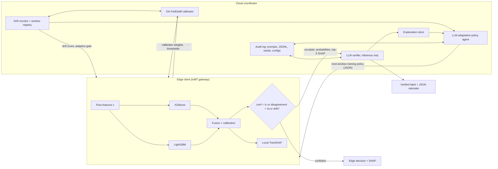

# LLM-Assisted Drift-Adaptive Incremental Federated Intrusion Detection in IoT: Edge Ensemble Learning with Cloud Verification and Explainability

[](LICENSE)

[](https://www.kaggle.com/datasets/indrajit147/ciciomt2024-processed-for-federated-ids)

This repository contains the implementation, experiment pipeline, results and reproduction package for a federated intrusion detection system (IDS) for Internet of Medical Things (IoMT) networks under concept drift. The system combines:

- a gateway-side **edge ensemble** (XGBoost + LightGBM, fused and temperature-calibrated);
- **DA-FedDistill**, a drift-adaptive federated distillation scheme in which clients share soft labels on a small public set instead of model weights;
- **ADWIN-triggered incremental updates** with mutual-information feature focus and a drift-adaptive uncertainty gate;
- **TreeSHAP** explanations for every escalated flow;
- two **LLM roles**: an inference-time verifier for uncertain flows and a training-time adaptation-policy agent.

Every component is evaluated against centralized, local, weight-averaging, distillation and federated-boosting baselines under a controlled class-incremental drift protocol on [CICIoMT2024](https://www.unb.ca/cic/datasets/iomt-dataset-2024.html), with 15 non-IID clients, six time windows, three seeds, paired client-bootstrap tests and Holm correction.

## Key findings

- **Federated distillation is the strongest collaborative method** (E3, window-average macro-F1 0.9256), ahead of centralized retraining (0.8897), FedAvg/FedProx on an MLP (0.8415/0.8414), FedMD (0.8873) and federated GBDT (0.8814). E7, the federated GBDT baseline, sends 760 to 3,200 times more uplink data than E3.
- **Its gain over purely local incremental learning is not significant.** E3 minus naïve incremental is +0.0044 (95% interval −0.0024 to +0.0096).
- **ADWIN-triggered updates do not shorten recovery or reduce variance** across windows (H2 not supported).
- **The gated LLM verifier does not reduce false positives.** Gemma 2 2B never changes a benign decision, and macro-F1 at drift boundaries is 0.6726 against 0.6737 for the edge alone, at about 85 LLM calls per 1,000 flows.
- **The LLM policy agent hurts.** Gemma 2 2B delays every update and loses about 0.10 macro-F1 (0.8252 against 0.9241), while a fixed heuristic on the same evidence ties the default (0.9234).
- **Collaboration needs label overlap.** Under strong label skew (Dirichlet α = 0.1, seed 42), E3 drops to 0.709, while local learning reaches 0.957. With a benign-only public set, E3 falls to 0.567.
- **Fresh Kaggle environments reproduce the results.** Rerunning from the public dataset matches the committed results within 0.0014 macro-F1 (training) and 0.0018 (explanation and LLM pipeline).

## Results

Six-class macro-F1 on held-out rows, averaged over windows t0–t5. Values are the mean ± std over seeds 42–44, with a 95% client-bootstrap interval (10,000 draws). Benign device-profiling captures are kept for training but excluded from scoring, because they are trivially separable from the CSV benign rows. Source: [`reports/m14/full/REPORT.md`](reports/m14/full/REPORT.md).

| Method | Collaboration | Window avg | 95% interval | Final window (t5) |
|---|---|---:|---:|---:|
| Static (trained on t0 only) | centralized | 0.3957 ± 0.0058 | 0.3611–0.4225 | 0.1740 ± 0.0087 |
| E1, retrained per window | centralized | 0.8897 ± 0.0001 | 0.8720–0.9020 | 0.8669 ± 0.0004 |
| Naïve incremental | none | 0.9212 ± 0.0001 | 0.9024–0.9337 | 0.8978 ± 0.0004 |
| Local + rehearsal | none | 0.9208 ± 0.0003 | 0.9018–0.9332 | 0.8967 ± 0.0006 |
| E2 FedAvg (MLP) | weight averaging | 0.8415 ± 0.0039 | 0.8194–0.8583 | 0.7811 ± 0.0014 |
| E2 FedProx (MLP) | weight averaging | 0.8414 ± 0.0025 | 0.8191–0.8585 | 0.7800 ± 0.0023 |
| FedMD | distillation | 0.8873 ± 0.0002 | 0.8630–0.9053 | 0.8603 ± 0.0003 |
| E7 federated GBDT | histogram aggregation | 0.8814 ± 0.0000 | 0.8630–0.8940 | 0.8514 ± 0.0009 |
| **E3 DA-FedDistill** | distillation | **0.9256 ± 0.0004** | 0.9108–0.9331 | 0.8947 ± 0.0010 |
| E3 + client guard † | distillation | 0.9285 ± 0.0005 | 0.9133–0.9362 | 0.9004 ± 0.0007 |
| **E4** (E3 + ADWIN trigger, MI top-K) † | distillation | **0.9241 ± 0.0004** | 0.9086–0.9319 | 0.8920 ± 0.0020 |
| E4, ADWIN replaces the schedule | distillation | 0.8538 ± 0.0219 | 0.8316–0.8648 | 0.8378 ± 0.0157 |

† Chosen after earlier results were seen. They are reported as named variants, never in place of the pre-specified method.

**Hypothesis tests.** A difference counts as a result only when its 95% interval excludes 0, its Holm-adjusted p (five tests) is below 0.05 and, for macro-F1, its size is at least 0.005.

| | Comparison | Difference [95% interval] | Holm p | Supported |
|---|---|---|---:|:---:|
| H1a | E3 − naïve incremental, window-avg macro-F1 | +0.0044 [−0.0024, +0.0096] | 0.65 | no |
| H1b | E3 − static, window-avg macro-F1 | +0.5299 [+0.5044, +0.5578] | < 0.0001 | yes |
| H2a | E4 − E3, variance of macro-F1 over t1–t5 | +0.00004 [+0.000004, +0.00012] | 0.12 | no |
| H2b | E4 − E3, time-to-recover (windows) | 0.0 [0.0, 0.4] | 1.00 | no |
| H3 | E5 gated LLM − E4 edge, benign false-positive rate at drift boundaries | 0.0 [0.0, 0.0] | 1.00 | no |

H4, on explanation quality, is exploratory:
- 0.36 of the verifier's reasons are grounded in the flow's SHAP evidence by a strict rule.
- 0.56 of its replies meet the JSON schema on the first attempt, and 0.9999 after retries.

Ablations, sensitivity runs (client count, label skew, window order, `IAT`, official split) and per-window results are in [`reports/m14/full/`](reports/m14/full/).

## System architecture



The system has three loops:
- **Inference loop.** The gateway escalates uncertain flows to the cloud verifier.
- **Adaptation loop.** Clients learn incrementally each window, and DA-FedDistill aggregates them.
- **Governance loop.** SHAP attributions, LLM outputs, seeds and configurations are logged append-only.

The LLM is never trained. Its label replaces the edge's only when it asks to override, the two boosters disagree and a drift flag is on.

## Experimental protocol

- **Data.** 8,775,013 Wi-Fi/MQTT flow records of CICIoMT2024 in six categories: Benign, DDoS, DoS, MQTT, Recon and Spoofing. Bluetooth (BLE) records and per-device benign profiling captures come from a published derivative ([Zenodo 19452870](https://zenodo.org/records/19452870)).
- **Features.** Models use 43 of the 45 flow features. The constant column `Drate` is dropped, and so is `IAT`, which behaves as a capture timestamp: alone it reaches 0.83 macro-F1, and with it every method scores about 0.99.
- **Drift timeline.** Six windows introduce attack categories in turn: DoS (t0), DDoS (t1), Recon (t2), MQTT (t3), Spoofing (t4) and the remaining Recon classes (t5). Five clients also receive held-back device populations at t5.
- **Clients.** There are 15 non-IID clients, with Dirichlet α = 0.5 label skew and device-based benign traffic; 20% of rows are held out for testing.
- **Public set D_pub.** 90,429 unlabelled rows, used only for distillation: 5,000 benign rows plus 1% of each attack category.
- **Metric.** Macro-F1 over the classes present, computed on each window's own test rows with the newest model and averaged over t0–t5. The final window, class forgetting, time-to-recover, benign false-positive rate, LLM calls per 1,000 flows and communication cost are reported alongside.
- **Statistics.** Paired client bootstrap (10,000 draws, the same client draw for every seed and method), with Holm correction over the five primary tests.
- **LLMs.** Gemma 2 2B Instruct (4-bit NF4 on one T4 GPU, greedy decoding, JSON schema with up to two retries) on all three seeds; Mistral 7B Instruct v0.2 on a subset of seed 42.

## Repository structure

```
IDS-code/
├── configs/
│   ├── default.yaml           # every setting: data, partition, models, FL, drift, gate, LLM, policy
│   └── env/                   # local and Kaggle profiles (paths and resources only)
├── src/ids/
│   ├── data/                  # schema, ingestion, sampling, external data, I/O
│   ├── partition/             # drift timeline, non-IID allocation, D_pub
│   ├── models/                # edge ensemble, incremental boosting
│   ├── drift/                 # ADWIN, PSI/KL/Wasserstein shift, uncertainty gate
│   ├── fl/                    # rehearsal, DA-FedDistill, FedAvg/FedProx, federated GBDT
│   ├── llm/                   # verifier and adaptation-policy agent
│   ├── eval/                  # metrics, harness, statistics, TreeSHAP, plots
│   └── utils/                 # config, seeding, run logging, JSONL
├── scripts/                   # command-line entry points, numbered by pipeline stage (m1 … m15)
├── notebooks/                 # Kaggle notebooks, incl. the two reproduction notebooks (m15_notebook_a/b)
├── tests/                     # unit tests (no data needed)
├── reports/                   # committed results: tables, figures, per-stage reports
└── release/                   # released configs, partitions, LLM logs, dataset card, checksums
```

## Installation

Requires Python 3.10 or later.

```bash
git clone https://github.com/Indrajit147/IDS-code.git
cd IDS-code
pip install -e ".[dev]"          # core: numpy, pandas, scikit-learn, xgboost, lightgbm, shap, ...
pip install -e ".[nn]"           # optional: PyTorch, for the FedAvg/FedProx MLP baselines
pip install -e ".[llm]"          # optional: transformers + bitsandbytes, for the LLM experiments (GPU)
python -m pytest -q              # unit tests
```

## Data

The processed input is public on Kaggle: [indrajit147/ciciomt2024-processed-for-federated-ids](https://www.kaggle.com/datasets/indrajit147/ciciomt2024-processed-for-federated-ids). Copy its five files into `data/processed/`:
- `data_manifest.json`
- `wifi_mqtt_full.parquet`
- `wifi_mqtt_dev.parquet`
- `wifi_profiling.parquet`
- `ble.parquet`

Their SHA-256 checksums are in [`release/dataset/SHA256SUMS`](release/dataset/SHA256SUMS), and the dataset card is [`release/dataset/README.md`](release/dataset/README.md).

To rebuild it from the original sources, `scripts/m1_prepare_data.py` reads a merge of CICIoMT2024's 72 Wi-Fi/MQTT CSV files together with the Zenodo derivative. The expected SHA-256 of the merged CSV is in the dataset card. The merge itself was done by hand and is not scripted.

## Reproducing the results

**Hardware.** Development runs (`--pool dev`, a stratified 568k-row sample) fit on a laptop CPU. Full-pool runs were made in Kaggle CPU sessions (about 29 GB of RAM), and the LLM experiments on a T4 GPU. Cells are bit-identical only at the same thread count: the headline runs use 4 (`--set resources.n_jobs=4`), and other counts move individual cells by up to 0.004 macro-F1.

### One-click reproduction on Kaggle

| Notebook | Runs | Hardware, time | Check |
|---|---|---|---|
| [`m15_notebook_a.ipynb`](notebooks/m15_notebook_a.ipynb) | partition, E1, static, naïve and local incremental, E3, E4 (with its K sweep), E7 | CPU, ~10 h | every headline cell within ±0.005 of the committed seed-42 results ([`CHECK_A.md`](reports/m15/full/CHECK_A.md): largest difference 0.0014) |
| [`m15_notebook_b.ipynb`](notebooks/m15_notebook_b.ipynb) | E4 refits, TreeSHAP, gated Gemma 2 2B verifier on a smaller sample | GPU T4, ~5 h | both refits within ±0.005 in every window ([`CHECK_B.md`](reports/m15/full/CHECK_B.md): largest difference 0.0018) |

Attach the Kaggle dataset above, plus **Gemma 2 › gemma-2-2b-it** for Notebook B, and run all cells. Each notebook verifies the data checksums, clones this repository and runs `scripts/m15_check.py` at the end.

### Stage by stage

Each script writes its report to `reports/<stage>/<pool>/` and its run record (resolved config, environment, metrics, logs) to `results/runs/<run_id>/`. From the edge-ensemble stage on, scripts take `--pool dev` or `--pool full`.

| Stage | Script(s) | Produces |
|---|---|---|
| Data | `m1_prepare_data.py`, `m1_eda.py` | processed Parquet, EDA |
| Partition | `m2_build_partitions.py` | drift timeline, 15 clients, D_pub |
| Edge ensemble | `m3_baselines.py`, `m3_shortcut_checks.py`, `m4_evaluate.py` | E1, static, shortcut-feature checks |
| Drift and gate | `m5_drift.py` | ADWIN, distribution shift, uncertainty gate |
| Incremental | `m6_incremental.py` | naïve incremental, local + rehearsal |
| DA-FedDistill | `m7_distill.py` | E3, client guard, FedMD |
| Neural FL | `m8_fedavg.py`, `m8_lr_sweep.py` | E2 FedAvg / FedProx |
| Drift-triggered | `m9_e4.py` | E4 and its variants |
| Explanations | `m10_shap.py` | TreeSHAP attributions and store |
| LLM verifier | `m11_verify.py`, `m11_subset.py` | E5 gated, E6 always-on; Mistral 7B subset |
| LLM policy | `m12_policy.py` | none / heuristic / LLM policy arms |
| Federated GBDT | `m13_fedgbdt.py` | E7 |
| Evaluation | `m14_report.py`, `m14_variant.py`, `m14_h4c.py` | headline, hypotheses, ablations, sensitivity, H4 |
| Release | `m15_release.py`, `m15_check.py` | `release/`, reproduction checks |

```bash
python scripts/m2_build_partitions.py                                       # both pools
python scripts/m7_distill.py --pool dev --set resources.n_jobs=4            # E3 + FedMD on the dev sample
python scripts/m7_distill.py --pool full --set resources.n_jobs=4 seed=43 --tag seed43   # another seed, own folder
python scripts/m14_report.py                                                # aggregates the seeds into reports/m14/full/
```

The `notebooks/m*_kaggle.ipynb` notebooks run each stage on Kaggle.

## Released artifacts

[`release/`](release/) holds the following, each listed with its SHA-256 in `MANIFEST.json`:
- the resolved experiment configuration;
- model hyperparameters;
- the client partition and window definitions;
- every LLM prompt and reply (gzipped JSONL, with schema validity and retry counts).

## Data sources and citation

If you use the data, cite the original dataset and, for the BLE and device-profiling files, the derivative:

- S. Dadkhah, E. C. P. Neto, R. Ferreira, R. C. Molokwu, S. Sadeghi, A. A. Ghorbani. "CICIoMT2024: A benchmark dataset for multi-protocol security assessment in IoMT." *Internet of Things*, 28, 101351, 2024. [doi:10.1016/j.iot.2024.101351](https://doi.org/10.1016/j.iot.2024.101351)
- V. J. L. Engel, D. Angela, A. Latif, S. A. Kristyan. "CICIoMT2024 Cleaned Dataset and EDA Outputs." Zenodo, 2026. [doi:10.5281/zenodo.19452870](https://doi.org/10.5281/zenodo.19452870)

## License

The code is released under the [MIT License](LICENSE). The data remain under their own terms:
- CICIoMT2024: the Canadian Institute for Cybersecurity's terms, which allow redistribution with citation.
- Zenodo-derived files: CC BY 4.0.
