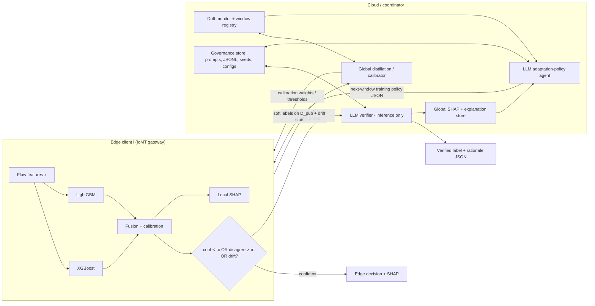

# LLM-Assisted Drift-Adaptive Incremental Federated IDS for IoT/IoMT

> Edge tree-ensemble detection (XGBoost + LightGBM), drift-adaptive federated distillation (DA-FedDistill),
> SHAP explainability, and inference-time cloud LLM verification, evaluated on CICIoMT2024.

Source documents in this folder:
- `LLM-Assisted Drift-Adaptive Incremental Federated Intrusion Detection in IoT_ Edge Ensemble Learning.docx`: full proposal (experiment matrix E1–E7, baselines, ablations, metrics).
- `Proposal explanation.docx`: plain-language walkthrough, plus the training-time role of the LLM as an "adaptation-policy" agent.

This README is the project's living plan. **It is updated after every milestone**: the status table, the milestone's checklist, its results, and the progress log. Each update is also pushed to [GitHub](https://github.com/Indrajit147/IDS-code).

## Quickstart

```bash
# local (Windows/Linux, CPU)
pip install -e . --no-deps        # deps already installed; see pyproject.toml for the list
python -m pytest -q               # unit tests
python scripts/m0_smoke_run.py    # writes results/runs/<timestamp>_m0_smoke/
python scripts/m0_smoke_run.py --set seed=7 gate.tau_conf=0.7   # dotted overrides
```

On Kaggle, open `notebooks/kaggle_bootstrap.ipynb`. It clones this repo, installs it with `--no-deps`, and auto-discovers the attached data under `/kaggle/input`. The environment is detected automatically and can be forced with `IDS_ENV=local|kaggle`.

## Compute plan: hybrid local + Kaggle

| Where | Used for | Config profile |
|---|---|---|
| **Local** (CPU, 7.7 GB RAM) | Writing and debugging code for M0–M10 on the stratified dev sample; unit tests | `configs/env/local.yaml` |
| **Kaggle** (~29 GB RAM, T4/P100 GPU) | Full-data runs, multi-seed experiment matrix (M14), LLM verifier/policy (M11–M12), Notebooks A/B (M15) | `configs/env/kaggle.yaml` |

Rules:
- Code lives in this repo only. Kaggle notebooks are thin wrappers that `git pull` and call `scripts/`.
- Data is never committed. On Kaggle it is a private Kaggle dataset; locally it lives in `data/`.
- Kaggle results are written to `/kaggle/working/results/runs/` and are downloaded or published as Kaggle dataset versions.

---

## Milestone status

| #   | Milestone                                          | Proposal mapping              | Status      | Completed |
|-----|----------------------------------------------------|-------------------------------|-------------|-----------|
| M0  | Project scaffolding & environment                  | Reproducibility design        | ✅ Done | 2026-11-04 |
| M1  | Data ingestion, cleaning & label harmonization     | Dataset preparation 1–4       | ⬜ Not started | — |
| M2  | Synthetic drift timeline, clients & D_pub          | Time windows, client sim, D_pub | ⬜ Not started | — |
| M3  | Edge ensemble + centralized/static baselines       | Edge model, E1, static baseline | ⬜ Not started | — |
| M4  | Evaluation harness & metrics                       | Evaluation metrics            | ⬜ Not started | — |
| M5  | Drift detection & uncertainty gate                 | ADWIN, PSI/KL/W, gate τc/τd   | ⬜ Not started | — |
| M6  | Incremental local learning + rehearsal buffer      | DA-FedDistill step 1          | ⬜ Not started | — |
| M7  | DA-FedDistill (federated distillation)             | E3, novelty claim B           | ⬜ Not started | — |
| M8  | Neural FL baselines (FedAvg / FedProx MLP)         | E2, baselines                 | ⬜ Not started | — |
| M9  | Drift-triggered updates + feature selection        | E4                            | ⬜ Not started | — |
| M10 | SHAP explainability (local + global store)         | Novelty claim C               | ⬜ Not started | — |
| M11 | Cloud LLM verifier (gated, JSON-constrained)       | E5, E6, novelty claim A       | ⬜ Not started | — |
| M12 | LLM adaptation-policy agent (training decisions)   | "What changes through LLM reasoning" | ⬜ Not started | — |
| M13 | Federated GBDT baseline (stretch)                  | E7                            | ⬜ Not started | — |
| M14 | Full experiment matrix, ablations & sensitivity    | E1–E7, ablations, H1–H4       | ⬜ Not started | — |
| M15 | Reproducibility package & paper artifacts          | Notebook A/B, IoT-J outline   | ⬜ Not started | — |

Legend: ⬜ Not started · 🟨 In progress · ✅ Done · ⏸ Blocked

---

## Architecture



Three loops: the **inference loop** (edge to cloud escalation), the **adaptation loop** (incremental local training plus DA-FedDistill per window), and the **governance loop** (SHAP, LLM JSON outputs, seeds and configs logged append-only).

---

## Dataset facts (measured from `data/raw/ciciomt2024_full_8p7m.csv`)

- **8,775,013 rows × 47 columns**: 45 numeric flow features plus `Sub_Attack` and `Major_Label`.
- **19 fine-grained classes** (Benign + 18 attacks) in **6 categories**:

| Category | Rows | Sub-attacks (rows) |
|---|---:|---|
| Benign | 230,339 | Benign |
| DDoS | 5,846,623 | ICMP 1,887,175 · UDP 1,998,026 · TCP 987,063 · SYN 974,359 |
| DoS | 2,222,205 | UDP 704,503 · SYN 540,498 · ICMP 514,724 · TCP 462,480 |
| MQTT | 326,653 | DDoS-Connect 214,952 · DoS-Publish 52,881 · DDoS-Publish 36,039 · DoS-Connect 15,904 · Malformed 6,877 |
| Recon | 131,402 | Port-Scan 106,603 · OS-Scan 20,666 · VulScan 3,207 · Ping-Sweep 926 |
| Spoofing | 17,791 | ARP-Spoofing |

**Facts that change the plan relative to the proposal:**
1. **There is no BLE data in this file.** It contains Wi-Fi/MQTT traffic only. BLE data has since been obtained from Zenodo; see *External data* below.
2. **There is no device-ID or profiling-state column.** "Device-based non-IID" and "client population drift" need a proxy, for example protocol-profile clusters (see M2). The Zenodo Wi-Fi parquet partly fixes this, because it carries `source_file`, including per-device benign profiling captures.
3. **The data is highly imbalanced.** Benign is 2.6% and DDoS is 67%. Recon-Ping-Sweep (926 rows) and MQTT-Malformed (6,877) are tiny. Use macro metrics and class weights.
4. **The file is sorted by label.** Any sample must be shuffled or stratified, never `head()`.
5. **Constant columns:** `Drate`, `Telnet`, `IRC` and `SMTP` were constant in a 300k-row sample. Confirm on the full data in M1. No NaN or inf values were seen in the sample.

## External data: Zenodo CICIoMT2024 derivative (incl. Bluetooth)

Downloaded 2026-11-04 to `data/external/zenodo_19452870/`. The zips were checked against Zenodo's MD5s, and the extracted files are in `extracted/`.
Source: [Zenodo record 19452870](https://zenodo.org/records/19452870), DOI 10.5281/zenodo.19452870, **CC BY 4.0**, curated by V. J. L. Engel et al. It is a *processed derivative*, not the raw CIC release, so it must be cited.

| File | Rows | Contents |
|---|---:|---|
| `bluetooth_clean.parquet` | 1,547,894 | **BLE packet-level** records: Benign 297,795 · DoS 1,250,099 · train 1,215,884 / test 317,038 / profiling 14,972 |
| `wifi_mqtt_clean.parquet` | 9,128,910 | Same 45 flow features (lower-case names) + `time_to_live`, plus `label`, `source_file` (114 files), `split` (train 7.16M / test 1.61M / profiling 361k) |
| `phase1–4` CSVs | — | Authors' EDA outputs: counts, correlations, entropy, imbalance |

BLE caveats:
- **The DoS rows are labelled `UNKNOWN`.** All of them come from the `Bluetooth_DoS_*.csv` source files, so they are relabelled to `DoS` (BLE) in M1.
- **The feature space is different and much smaller.** There are 8 packet fields (`packet_length`, `inter_packet_gap`, `hci_type`, `hci_event_code`, `l2cap_length`, `cumulative_packet_count`, `timestamp`, …). `ble_access_addr` and `ble_pdu_type` are entirely empty. BLE therefore can't share the Wi-Fi model's 45-feature input. It needs either a **separate BLE edge model** for t4, or a protocol-specific client group in the federation.
- Rows have real timestamps, which could support an actual chronological drift check for BLE.

Wi-Fi bonus: the Zenodo parquet has **361k benign profiling rows labelled by device and scenario** (e.g. `Owltron_Camera_LAN_MIC`, `Active`, `Idle`). That gives real device identities for benign traffic, which can strengthen the device-based non-IID partition in M2. It also includes the official train/test split.

The raw official release (pcaps plus Bluetooth CSVs) is at http://cicresearch.ca/IOTDataset/CICIoMT2024/. It sits behind a CIC registration form (name, email, organisation), which you have to fill in yourself if the raw data is needed.

## Compute environment (local)

- Windows 11, Python 3.14, **7.7 GB RAM**, 12 logical CPUs, **no CUDA GPU** (torch is the CPU build).
- Already installed: numpy, pandas, pyarrow, scikit-learn, xgboost 3.2, lightgbm 4.6, shap 0.51, torch (CPU), transformers, scipy, matplotlib.
- Missing: `river` (ADWIN; it can also be implemented in-house) and `bitsandbytes` (needs a GPU, so it doesn't apply locally).
- Consequences:
  - The full CSV (about 1.6 GB as float32) must be converted to Parquet in chunks.
  - Development runs use a stratified subsample. Final runs use the full data on Kaggle (see Compute plan).
  - LLM inference needs a backend decision; see M11.

---

## Default design decisions (open questions from the proposal)

The proposal ends with five open questions. Development proceeds with the defaults below. Change any of them here before M14.

| # | Question | Default chosen | Rationale |
|---|---|---|---|
| D1 | Headline target | **6-class category** (`y_category`); 19-class and binary reported as secondary | Stable with tiny sub-classes |
| D2 | D_pub composition | **Small stratified mix** (benign plus 1–2% per category), inputs only, labels hidden from distillation | More stable multiclass calibration; benign-only kept as an ablation |
| D3 | LLM override | **Conservative override**: allowed only when there is high disagreement *and* a drift flag; always logged | Matches the proposal's risk mitigation |
| D4 | Headline drift regime | **Attack-category introduction** (t0→t5); variant and population drift as secondary | Clear and class-incremental |
| D5 | Privacy section | **Short analysis** of what is shared (soft labels on D_pub, drift stats, escalated evidence) | Low cost, expected by TNSM reviewers |

---

## Planned repository layout

```
IDS-code/
├── README.md                     # this file (living plan)
├── pyproject.toml                # package `ids`; lower-bound deps + extras [nn], [llm], [dev]
├── configs/
│   ├── default.yaml              # paths, seeds, τc, τd, K, window/client settings
│   ├── env/{local,kaggle}.yaml   # environment profiles (paths/resources only)
│   └── experiments/E1..E7.yaml
├── data/
│   ├── raw/                      # ciciomt2024_full_8p7m.csv (original Wi-Fi/MQTT CSV)
│   ├── external/zenodo_19452870/ # Zenodo derivative: BLE + Wi-Fi parquet (see External data)
│   ├── processed/                # parquet, float32
│   └── splits/                   # window_definition.json, client_partitions.json, dpub.parquet
├── src/ids/
│   ├── data/          # ingest, clean, labels
│   ├── partition/     # timeline, clients, D_pub
│   ├── models/        # xgb, lgbm, fusion, calibration, mlp
│   ├── drift/         # adwin, psi/kl/wasserstein, gate
│   ├── fl/            # rehearsal, da_feddistill, fedavg, fedprox, fed_gbdt
│   ├── xai/           # shap local/global, store
│   ├── llm/           # backend, prompts, schema, verifier, policy agent
│   ├── eval/          # metrics, forgetting, time-to-recover, latency, comm cost
│   └── utils/         # seeding, logging (JSONL), config
├── scripts/                      # CLI entry points per milestone
├── notebooks/                    # kaggle_bootstrap.ipynb; later Notebook A (train/FL) and B (inference/LLM/XAI)
├── tests/
└── results/runs/<run_id>/        # config snapshot, metrics, logs, figures
```

---

## Milestones

Each milestone lists its **goal**, **tasks**, **deliverables**, and **acceptance criteria**. When a milestone is done, its checkboxes are ticked and a **Results** block is added.

### M0: Project scaffolding & environment
**Goal:** a reproducible skeleton that every later milestone plugs into.
- [x] Create the layout above, `pyproject.toml`, `configs/default.yaml` and env profiles `configs/env/{local,kaggle}.yaml`
- [x] `utils/seed.py` (global seed plus stable SHA-256-derived per-client/window seeds), `utils/jsonl.py` (append-only JSONL), `utils/config.py` (layered config, dotted CLI overrides, Kaggle auto-detection and input discovery)
- [x] `utils/run.py` run-directory convention: each run snapshots its config, git commit/dirty flag, Python/platform and package versions
- [x] `pytest` tests; `git init` and push to GitHub
- [x] Kaggle bootstrap notebook (`notebooks/kaggle_bootstrap.ipynb`)
- **Deliverables:** skeleton, config, logging and seed utilities.
- **Acceptance:** `pytest` passes, and a dummy run writes a run folder containing `experiment_config.json`.

**Results (2026-11-04)**
- `pytest`: **6 passed** (config layering/overrides, Kaggle profile, override parsing, seed determinism, JSONL append, run snapshots).
- `scripts/m0_smoke_run.py` (local) wrote `results/runs/<ts>_m0_smoke/` containing `experiment_config.json`, `environment.json`, `events.jsonl`, `run.log` and `data_check.json`. Both the raw CSV and the Zenodo folder were found.
- Decision: dependencies are declared as **lower bounds** in `pyproject.toml`, not pinned, and Kaggle installs with `--no-deps`. Forcing exact pins would reinstall Kaggle's preinstalled stack, which can break the image. Exact versions are recorded per run in `environment.json` instead.
- Not yet verified: the Kaggle side of the bootstrap. It runs on your first Kaggle session, after you upload the private dataset.

### M1: Data ingestion, cleaning & label harmonization
**Goal:** a fast, memory-safe, auditable processed dataset.
- [ ] Record the SHA-256 and the row/column counts of the raw CSV
- [ ] Chunked CSV → Parquet with float32 downcasting
- [ ] Labels: `y_binary` {benign, attack}, `y_category` (6), `y_attack19` (19)
- [ ] Drop constant columns (verified on the full data); check NaN/inf and duplicates (report, don't silently drop)
- [ ] Stratified dev subsample (e.g. 5–10%, with all rare classes kept in full) for fast iteration
- [ ] EDA report: class counts, feature stats, correlation, per-class feature shifts
- **Deliverables:** `data/processed/*.parquet`, `data_manifest.json`, EDA figures.
- **Acceptance:** loading the full Parquet fits in under 3 GB of RAM, and the label counts match the table above.

### M2: Synthetic drift timeline, non-IID clients & D_pub
**Goal:** the experimental world (windows × clients) written as JSON so it can be reproduced.
- [ ] Window definition (headline, D4):
  | Window | Train labels introduced | Notes |
  |---|---|---|
  | t0 | Benign + DoS | baseline deployment |
  | t1 | + DDoS | DoS/DDoS confusion expected |
  | t2 | + Recon (Port-Scan, Ping-Sweep first) | scan patterns |
  | t3 | + MQTT | protocol-semantic drift |
  | t4 | + Spoofing (ARP) + BLE DoS | BLE from Zenodo; separate BLE feature space and model (see External data) |
  | t5 | all + Recon OS-Scan/VulScan (variant drift) + client mix shift | compound drift |
- [ ] Device proxy: cluster flows into protocol/behaviour profiles (protocol indicators + `Protocol_Type`) to stand in for devices
- [ ] 15 clients (sensitivity: 10, 20): profile-based non-IID plus Dirichlet(α) label skew; population drift by reassigning profiles at t5
- [ ] D_pub: a fixed stratified subset (D2), disjoint from all client and test data
- [ ] Per-window held-out test sets (cumulative, to measure forgetting)
- [ ] Alternate timeline(s) for sensitivity analysis
- **Deliverables:** `window_definition.json`, `client_partitions.json`, `dpub.parquet`, partition statistics plots.
- **Acceptance:** fully deterministic from the seed; the statistics show measurable non-IID skew (e.g. Jensen–Shannon divergence between client label distributions).

### M3: Edge ensemble + centralized & static baselines
**Goal:** a strong edge detector and the upper and lower bounds.
- [ ] XGBoost and LightGBM with class weights; edge-friendly limits (depth, number of trees)
- [ ] Fusion: probability averaging and validation-weighted averaging; temperature or isotonic calibration
- [ ] **E1 centralized** (retrained per window on all data) = upper bound
- [ ] **Static** (trained on t0 only) = drift-degradation lower bound
- [ ] Edge latency (ms/sample, P50/P95) and model size
- **Acceptance:** E1 and static results for every window are logged; calibration error (ECE) is reported before and after calibration.

### M4: Evaluation harness & metrics
**Goal:** one evaluator that every experiment reuses.
- [ ] Detection: accuracy, macro-F1, per-class precision/recall, AUROC (binary), one-vs-rest AUC, confusion matrices per window and per client cluster
- [ ] Drift robustness: window-averaged macro-F1, forgetting (max−final per class/task), time-to-recover (within ε)
- [ ] System: edge latency, LLM latency (mean/P95), LLM calls per 1k samples, FL bytes/round, escalation payload bytes
- [ ] Standard results table plus plot writers
- **Acceptance:** M3 results are regenerated through the harness with identical numbers.

### M5: Drift detection & uncertainty gate
**Goal:** the signals that drive escalation and adaptation.
- [ ] ADWIN (in-house or `river`) on the error rate (when labels exist) and on label-free proxies (entropy, XGB–LGBM disagreement)
- [ ] PSI, KL and Wasserstein per feature and client against a running baseline
- [ ] Gate: escalate iff `conf < τc` OR `disagree > τd` OR drift flag; τ values tuned on validation data
- [ ] Drift registry: per-window/client drift events logged to JSONL
- **Acceptance:** ADWIN fires at the t1–t5 boundaries with low false alarms inside windows; the escalation-rate vs τ curve is plotted.

### M6: Incremental local learning + rehearsal buffer
**Goal:** client-side continual learning, before any federation.
- [ ] Incremental update: XGBoost continued boosting (`xgb_model=`) and LightGBM `init_model` (refit); compare with retraining from scratch
- [ ] Bounded rehearsal buffer (reservoir or class-balanced) with a configurable size
- [ ] Local-only baseline (no collaboration) under the timeline
- **Acceptance:** forgetting with rehearsal is below forgetting without it; the buffer stays within its memory budget.

### M7: DA-FedDistill (proposed federated distillation)
**Goal:** the core FL contribution (E3).
- [ ] Per window: local incremental update → soft predictions on D_pub → cloud aggregation (mean or reliability-weighted) → pseudo-labels
- [ ] Global calibrator `g_t(p_xgb, p_lgbm, drift_features) → p_global` (e.g. logistic regression or a small MLP)
- [ ] Send calibrator parameters and thresholds back; clients apply them at inference
- [ ] Communication accounting (bytes per round)
- [ ] Also run the plain FedMD-style distillation baseline
- **Acceptance:** E3 is better than local-only, and its window-averaged macro-F1 is compared with E1 and static (tests H1).

### M8: Neural FL baselines (FedAvg / FedProx MLP)
**Goal:** the classic FL references (E2).
- [ ] MLP in torch (CPU), same partitions and timeline
- [ ] FedAvg and FedProx (μ sweep), each with and without incremental training
- **Acceptance:** E2 results appear in the same table format as E3.

### M9: Drift-triggered updates + feature selection
**Goal:** E4, drift-aware scheduling and feature focus.
- [ ] Updates triggered by ADWIN instead of a fixed per-window schedule
- [ ] Top-K features by mutual information per window (K sweep)
- **Acceptance:** E4 vs E3 comparison of time-to-recover and performance variance (tests H2).

### M10: SHAP explainability
**Goal:** two-tier explanations that are cheap enough to run.
- [ ] Local TreeSHAP for the fused ensemble (top-k features per sample)
- [ ] Global SHAP per window/client from sampled, cached values; a SHAP drift signal (change in mean |SHAP| ranking)
- [ ] Explanation store (Parquet/JSONL) and figures
- **Acceptance:** SHAP cost per sample is measured, and the global rankings per window are stored.

### M11: Cloud LLM verifier (inference-time only)
**Goal:** E5/E6, gated verification with strict JSON output.
- [ ] **Backend: (a) Kaggle GPU is primary** (decided 2026-11-04); (b) is the local development fallback. The options are:
  (a) Kaggle GPU with Gemma-2-2B-it or Mistral-7B-Instruct and 4/8-bit bitsandbytes (as in the proposal),
  (b) local CPU via llama.cpp or Ollama with a quantized small model (slow but free),
  (c) a hosted API (fast, but it costs money and data leaves the machine)
- [ ] Evidence payload: probabilities, disagreement, top-k SHAP, class centroids/priors, drift state
- [ ] JSON schema: `final_label`, `override_edge`, `confidence_bucket`, `reasons[]`, `feature_recommendations[]`, `safety_notes`; validate → retry → fall back to "no override + SHAP-only"
- [ ] Override policy D3; every prompt, output, parse failure and retry logged to JSONL
- [ ] E5 (gated) and E6 (always-on vs gated) cost–accuracy frontier
- **Acceptance:** at least 99% of outputs pass schema validation after retries; FP rate change in drift windows (H3); LLM calls per 1k samples and latency reported.

### M12: LLM adaptation-policy agent (training-time decisions)
**Goal:** the "explanation" document's extension: the LLM decides *how* to learn next, never the model internals.
- [ ] Policy JSON: `update_urgency`, `training_style` (conservative/aggressive), `preserve_old_behavior`, `feature_focus_groups`, buffer selection policy, `update_scope` (partial/full)
- [ ] Map each field to concrete knobs: learning rate, number of new trees, rehearsal ratio, feature weights, update delay
- [ ] Inputs: drift registry, SHAP drift, per-class metrics; output logged as the next-window policy file
- [ ] Ablation: LLM policy vs a fixed heuristic policy vs no policy
- **Note:** the main proposal says the LLM is "not used for continuous learning", while the explanation document gives it control over training decisions. The paper must state clearly that the LLM controls the training *policy* only.
- **Acceptance:** the policy is applied deterministically, and the ablation results are recorded.

### M13: Federated GBDT baseline (stretch)
**Goal:** E7, a "true" federated boosting reference.
- [ ] Simplified horizontal federated GBDT (histogram aggregation, relaxed privacy) on reduced data
- **Acceptance:** the gap to E1 and E3 is reported, or the baseline is documented as infeasible with reasons.

### M14: Full experiment matrix, ablations & sensitivity
**Goal:** every number the paper needs.
- [ ] E1–E7 across ≥3 seeds (mean ± std)
- [ ] Ablations: no ADWIN, no feature selection, no rehearsal, no LLM verification, LLM always-on vs gated, SHAP-only vs SHAP+LLM explanations, D_pub benign-only
- [ ] Sensitivity: 10/15/20 clients, Dirichlet α, τc/τd, alternate timelines
- [ ] Hypotheses H1–H4 evaluated, with statistical tests
- **Acceptance:** all tables and figures are regenerated by one script from logged runs.

### M15: Reproducibility package & paper artifacts
**Goal:** a submission-ready artifact.
- [ ] Kaggle Notebook A (prep + FL simulation) and Notebook B (inference + LLM + XAI)
- [ ] Released configs: `experiment_config.json`, `client_partitions.json`, `window_definition.json`, `model_hparams.json`, LLM JSONL logs
- [ ] Figures/tables mapped to the IEEE IoT-J outline; privacy/threat-model section (D5)
- **Acceptance:** a fresh environment reproduces the headline table within ±0.5 macro-F1.

---

## Progress log

| Date | Milestone | Summary |
|---|---|---|
| 2026-11-04 | — | Plan created: dataset profiled (8.78M rows, 19 classes, no BLE/device columns), environment checked, milestones M0–M15 defined. |
| 2026-11-04 | — | BLE data found: downloaded the Zenodo CICIoMT2024 derivative (CC BY 4.0; Bluetooth 1.55M packet rows; Wi-Fi parquet with device `source_file` + official split). t4 can now include BLE DoS. |
| 2026-11-04 | M0 ✅ | Scaffolding done: package `ids`, layered configs (local/kaggle), seeding, JSONL logging, run snapshots, Kaggle bootstrap notebook; 6 tests pass. Compute plan set to hybrid local + Kaggle. Repo pushed to GitHub. |
