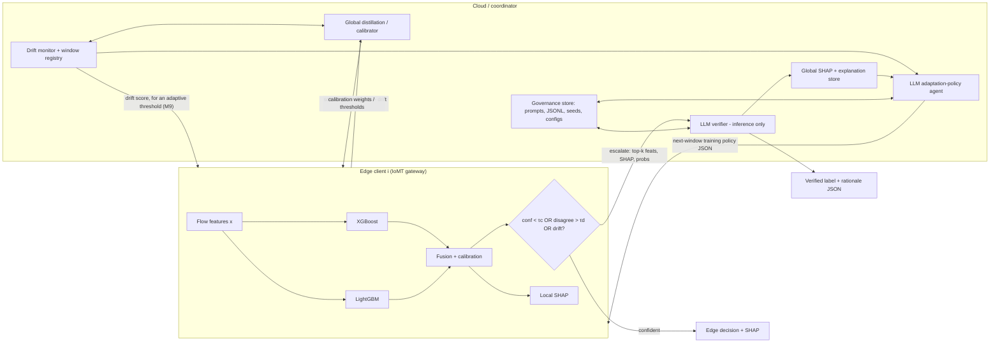

# LLM-Assisted Drift-Adaptive Incremental Federated IDS for IoT/IoMT

> Edge tree-ensemble detection (XGBoost + LightGBM), drift-adaptive federated distillation (DA-FedDistill),
> SHAP explainability, and inference-time cloud LLM verification, evaluated on CICIoMT2024.

Source documents (kept locally and not in this public repo, because the proposal is unpublished):
- `LLM-Assisted Drift-Adaptive Incremental Federated Intrusion Detection in IoT_ Edge Ensemble Learning.docx`: full proposal (experiment matrix E1–E7, baselines, ablations, metrics, hypotheses).
- `Proposal explanation.docx`: plain-language walkthrough, plus the training-time role of the LLM as an "adaptation-policy" agent.

The parts later milestones depend on are copied into this README; see *Hypotheses* and *Experiment matrix*.

This README is the project's living plan. **It is updated after every milestone**: the status table, the milestone's checklist, its results, and the progress log. Each update is also pushed to [GitHub](https://github.com/Indrajit147/IDS-code).

## Quickstart

```bash
# Install. Use `pip install -e ".[dev]"` on a fresh machine; --no-deps keeps an existing stack (Kaggle) intact.
pip install -e ".[dev]"
python -m pytest -q               # unit tests (no data needed)
python scripts/m0_smoke_run.py    # writes results/runs/<timestamp>_m0_smoke/ and reports which data it can find
python scripts/m0_smoke_run.py --set seed=7 gate.tau_conf=0.7   # dotted overrides

# Pipeline. Needs the raw data (see Dataset facts and External data); --pool dev runs on the stratified sample.
python scripts/m1_prepare_data.py        # raw CSV + Zenodo -> data/processed/
python scripts/m1_eda.py                 # reports/m1/
python scripts/m2_build_partitions.py    # data/splits/, reports/m2/
python scripts/m3_baselines.py --pool dev        # E1 + static + BLE; reports/m3/dev/
python scripts/m3_shortcut_checks.py --pool dev  # IAT, Number/Weight, profiling-row checks
python scripts/m4_evaluate.py --pool dev         # regression check + standard report; reports/m4/dev/
python scripts/m5_drift.py --pool dev             # ADWIN, shift, gate; reports/m5/dev/
python scripts/m6_incremental.py --pool dev --set resources.n_jobs=4   # reports/m6/dev/; --resume continues after a stop
python scripts/m7_distill.py --pool dev --set resources.n_jobs=4       # E3 + FedMD; reports/m7/dev/; --resume, --tag seed43; --only e3|fedmd, --report
python scripts/m7_seeds.py --pool dev                                  # reports/m7/dev/SEEDS.md
python scripts/m8_fedavg.py --pool dev --set resources.n_jobs=4        # E2, FedAvg + FedProx; reports/m8/dev/; --resume, --tag seed43; --only NAME, --report
python scripts/m7_seeds.py --pool dev --milestone m8                   # reports/m8/dev/SEEDS.md
python scripts/m8_lr_sweep.py --pool dev --lrs 0.03 0.1 --seeds 42 43   # choose lr on validation rows; reports/m8/<pool>/LR_SWEEP.csv
python scripts/m9_e4.py --pool dev --set resources.n_jobs=4 --only NAME --resume   # E4, one pass per process (see the file's docstring); then --report; reports/m9/<pool>/
python scripts/m10_shap.py --pool dev --set resources.n_jobs=4               # TreeSHAP of e4_added (D11); --only fit|shap; reports/m10/<pool>/
python scripts/m11_verify.py --pool dev --set resources.n_jobs=4             # LLM verifier (stub locally; llm.backend=hf on a GPU); --only fit|llm; reports/m11/<pool>/
```

On Kaggle, open `notebooks/kaggle_bootstrap.ipynb`. It clones this repo, installs it with `--no-deps`, and auto-discovers the attached data under `/kaggle/input`. The environment is detected automatically and can be forced with `IDS_ENV=local|kaggle`. The Kaggle dataset needs only the five files of `data/processed/`: `data_manifest.json`, `wifi_mqtt_full.parquet`, `wifi_mqtt_dev.parquet`, `wifi_profiling.parquet` and `ble.parquet`.

## Compute plan: hybrid local + Kaggle

| Where | Used for | Config profile |
|---|---|---|
| **Local** (CPU, 7.7 GB RAM) | Writing and debugging code for M0–M10 on the stratified dev sample; unit tests | `configs/env/local.yaml` |
| **Kaggle** (~29 GB RAM, T4/P100 GPU) | Full-data runs, multi-seed experiment matrix (M14), LLM verifier/policy (M11–M12), Notebooks A/B (M15) | `configs/env/kaggle.yaml` |

Rules:
- Code lives in this repo only. Kaggle notebooks are thin wrappers that `git pull` and call `scripts/`.
- Data is never committed. On Kaggle it is a private Kaggle dataset; locally it lives in `data/`.
- Kaggle results are written to `/kaggle/working/results/runs/` and are downloaded or published as Kaggle dataset versions.

---

## Milestone status

| #   | Milestone                                          | Proposal mapping              | Status      | Completed |
|-----|----------------------------------------------------|-------------------------------|-------------|-----------|
| M0  | Project scaffolding & environment                  | Reproducibility design        | ✅ Done | 2026-11-04 |
| M1  | Data ingestion, cleaning & label harmonization     | Dataset preparation 1–4       | ✅ Done | 2026-11-04 |
| M2  | Synthetic drift timeline, clients & D_pub          | Time windows, client sim, D_pub | ✅ Done | 2026-11-04 |
| M3  | Edge ensemble + centralized/static baselines       | Edge model, E1, static baseline | ✅ Done (dev + full) | 2026-11-04 |
| M4  | Evaluation harness & metrics                       | Evaluation metrics            | ✅ Done (dev + full) | 2026-11-04 |
| M5  | Drift detection & uncertainty gate                 | ADWIN, PSI/KL/W, gate τc/τd   | ✅ Done (dev + full), acceptance partly met | 2026-11-04 |
| M6  | Incremental local learning + rehearsal buffer      | DA-FedDistill step 1          | ✅ Done (dev + full) | 2026-11-06 |
| M7  | DA-FedDistill (federated distillation)             | E3, novelty claim B           | ✅ Done (dev + full); acceptance met on the full pool's window average only, two seeds | 2026-11-06 |
| M8  | Neural FL baselines (FedAvg / FedProx MLP)         | E2, baselines                 | ✅ Done: dev 3 seeds, full pool 2 seeds at lr 0.03, chosen on full-pool validation rows | 2026-11-07 |
| M9  | Drift-triggered updates, feature selection, adaptive threshold | E4, Methodology Step 5 | ✅ Done (dev + full, two seeds); `e4_added` carried forward (D11) | — |
| M10 | SHAP explainability (local + global store)         | Novelty claim C               | ✅ Done (dev one seed, full pool two seeds) | 2026-11-08 |
| M11 | Cloud LLM verifier (gated, JSON-constrained)       | E5, E6, novelty claim A       | 🟨 Built and checked on dev with a stub; full pool with Gemma 2 2B pending on Kaggle | — |
| M12 | LLM adaptation-policy agent (training decisions)   | "What changes through LLM reasoning" | ⬜ Not started | — |
| M13 | Federated GBDT baseline (stretch)                  | E7                            | ⬜ Not started | — |
| M14 | Full experiment matrix, ablations & sensitivity    | E1–E7, ablations, H1–H4       | ⬜ Not started | — |
| M15 | Reproducibility package & paper artifacts          | Notebook A/B, IoT-J outline   | ⬜ Not started | — |

Legend: ⬜ Not started · 🟨 In progress · ✅ Done · ⏸ Blocked

---

## Architecture



Three loops: the **inference loop** (edge to cloud escalation), the **adaptation loop** (incremental local training plus DA-FedDistill per window), and the **governance loop** (SHAP, LLM JSON outputs, seeds and configs logged append-only).

---

## Dataset facts (measured from `data/raw/ciciomt2024_full_8p7m.csv`)

Source file: `ciciomt2024_full_8p7m.csv`, SHA-256 `f7cb6fe30c4e4f0cb415a5e888f9bfcc7a652189a094447c72b8428b6b8f0eb6`. It was **merged by the project author from the CICIoMT2024 Wi-Fi/MQTT attack CSV files**, downloaded from the Canadian Institute for Cybersecurity ([dataset page](https://www.unb.ca/cic/datasets/iomt-dataset-2024.html); Dadkhah et al., *Internet of Things* 28, 2024, DOI [10.1016/j.iot.2024.101351](https://doi.org/10.1016/j.iot.2024.101351)).

Cross-check (2026-11-04), against the independent [Zenodo derivative](https://zenodo.org/records/19452870):
- **Row count:** 8,775,013, the exact number of flow records that record gives for the raw dataset.
- **Features:** every CSV row is in Zenodo's train + test tables and every such Zenodo row is in the CSV, compared on all 45 features by row hash at full float64 precision. Both hold the same 8,767,634 unique rows.
- **Labels:** the 19 CSV labels map one-to-one onto Zenodo's labels, with no disagreement on any row.
- **Coverage and order:** all 72 source files are represented. The CSV is one block for the official train split (19 classes; 7.16M rows) followed by one for the official test split (19 classes; 1.61M rows).

The merged file wasn't compared directly with the files as CIC distributes them. This check shows agreement with a second, independently published copy. The merge also dropped the official train/test split, though it can be recovered from the row order. M2 re-splits at random instead; M14 tests the official split as a sensitivity run.

- **8,775,013 rows × 47 columns**: 45 numeric flow features plus `Sub_Attack` and `Major_Label`.
- **19 fine-grained classes** (Benign + 18 attacks) in **6 categories**:

| Category | Rows | Sub-attacks (rows) |
|---|---:|---|
| Benign | 230,339 | Benign |
| DDoS | 5,846,623 | ICMP 1,887,175 · UDP 1,998,026 · TCP 987,063 · SYN 974,359 |
| DoS | 2,222,205 | UDP 704,503 · SYN 540,498 · ICMP 514,724 · TCP 462,480 |
| MQTT | 326,653 | DDoS-Connect 214,952 · DoS-Publish 52,881 · DDoS-Publish 36,039 · DoS-Connect 15,904 · Malformed 6,877 |
| Recon | 131,402 | Port-Scan 106,603 · OS-Scan 20,666 · VulScan 3,207 · Ping-Sweep 926 |
| Spoofing | 17,791 | ARP-Spoofing |

**Facts that change the plan relative to the proposal:**
1. **There is no BLE data in this file.** It contains Wi-Fi/MQTT traffic only. BLE data has since been obtained from Zenodo; see *External data* below.
2. **There is no device-ID or profiling-state column.** "Device-based non-IID" and "client population drift" need a proxy, for example protocol-profile clusters (see M2). The Zenodo Wi-Fi parquet partly fixes this, because it carries `source_file`, including per-device benign profiling captures.
3. **The data is highly imbalanced.** Benign is 2.6% and DDoS is 67%. Recon-Ping-Sweep (926 rows) and MQTT-Malformed (6,877) are tiny. Use macro metrics and class weights.
4. **The file is sorted by label.** Any sample must be shuffled or stratified, never `head()`.
5. **Constant columns:** on the full data only `Drate` is constant (verified in M1). `Telnet`, `IRC` and `SMTP` only looked constant in an early 300k-row sample. There are no NaN or inf values.
6. **Shortcut features (M1 EDA):** `IAT` alone gives 0.83 6-class macro-F1 and BLE `timestamp` alone gives 0.97. These look like capture artifacts rather than attack behaviour (decision D6).
7. **Duplicates:** 7,379 exact duplicate rows (0.08%), all within a single class (no conflicting labels), mostly Recon-Port-Scan. The Zenodo Wi-Fi table is effectively a de-duplicated copy of this CSV.
8. **`Number` and `Weight` look like aggregation artifacts (found in M3).** `Number` is exactly 9.5 for 99.9% of DoS and DDoS rows, exactly 5.5 or 13.5 for Benign, Recon and Spoofing, and 10.0 in the profiling rows, yet every class averages about 9.5. Alone it separates Benign from DoS at t0 (0.9995 macro-F1). `Weight` tracks it. Removing both barely changes E1 (t1 0.8256 → 0.8255, t5 0.8827 → 0.8838), so they are kept for now and tested again in M14.
9. **The two benign sources can be told apart perfectly (found in M3).** A classifier separates CSV benign rows from Zenodo profiling rows with hold-out AUC 1.0000 on the dev pool, even without `Number` and `Weight`. Profiling rows are always classified correctly, which flatters benign metrics. See decision D7.

## External data: Zenodo CICIoMT2024 derivative (incl. Bluetooth)

Downloaded 2026-11-04 to `data/external/zenodo_19452870/`. The zips were checked against Zenodo's MD5s, and the extracted files are in `extracted/`.
Source: [Zenodo record 19452870](https://zenodo.org/records/19452870), DOI 10.5281/zenodo.19452870, **CC BY 4.0**, curated by V. J. L. Engel et al. It is a *processed derivative*, not the raw CIC release, so it must be cited.

| File | Rows | Contents |
|---|---:|---|
| `bluetooth_clean.parquet` | 1,547,894 | **BLE packet-level** records: Benign 297,795 · DoS 1,250,099 · train 1,215,884 / test 317,038 / profiling 14,972 |
| `wifi_mqtt_clean.parquet` | 9,128,910 | Same 45 flow features (lower-case names) + `time_to_live`, plus `label`, `source_file` (114 files), `split` (train 7.16M / test 1.61M / profiling 361k) |
| `phase1–4` CSVs | — | Authors' EDA outputs: counts, correlations, entropy, imbalance |

BLE caveats:
- **The DoS rows are labelled `UNKNOWN`.** All of them come from the `Bluetooth_DoS_*.csv` source files, so they are relabelled to `DoS` (BLE) in M1.
- **The feature space is different and much smaller.** There are 9 packet fields, 7 of them usable (`packet_length`, `inter_packet_gap`, `hci_type`, `hci_event_code`, `l2cap_length`, `cumulative_packet_count`, `timestamp`). `ble_access_addr` and `ble_pdu_type` are entirely empty. BLE therefore can't share the Wi-Fi model's 45-feature input. It needs either a **separate BLE edge model** for t4, or a protocol-specific client group in the federation.
- Rows have real timestamps, which could support an actual chronological drift check for BLE.

Wi-Fi bonus: the Zenodo parquet has **361k benign profiling rows labelled by device and scenario** (e.g. `Owltron_Camera_LAN_MIC`, `Active`, `Idle`). That gives real device identities for benign traffic, which can strengthen the device-based non-IID partition in M2. It also includes the official train/test split.

The raw official release (pcaps plus Bluetooth CSVs) is at http://cicresearch.ca/IOTDataset/CICIoMT2024/. It sits behind a CIC registration form (name, email, organisation), which a person has to fill in if the raw data is needed.

## Compute environment (local)

- Windows 11, Python 3.14, **7.7 GB RAM**, 12 logical CPUs, **no CUDA GPU** (torch is the CPU build).
- Already installed: numpy, pandas, pyarrow, scikit-learn, xgboost 3.2, lightgbm 4.6, shap 0.51, torch (CPU), transformers, scipy, matplotlib.
- Missing: `river` (ADWIN; it can also be implemented in-house) and `bitsandbytes` (needs a GPU, so it doesn't apply locally).
- Consequences:
  - The full CSV (about 1.6 GB as float32) must be converted to Parquet in chunks.
  - Development runs use a stratified subsample. Final runs use the full data on Kaggle (see Compute plan).
  - LLM inference needs a backend decision; see M11.

---

## Default design decisions (open questions from the proposal)

The proposal ends with five open questions. Development proceeds with the defaults below. Change any of them here before M14. D6 to D10 were added during the work.

| # | Question | Default chosen | Rationale |
|---|---|---|---|
| D1 | Headline target | **6-class category** (`y_category`); 19-class and binary reported as secondary | Stable with tiny sub-classes |
| D2 | D_pub composition | **Stratified mix, as the proposal specifies:** a fixed 5,000 benign rows plus 1% of each attack category (`dpub.attack_frac`, the low end of the proposal's 1–2%), inputs only, labels hidden from distillation. Rare classes get at least 50 rows, and no class gives up more than 5% | More stable multiclass calibration; benign-only kept as an ablation. Full pool: 90,429 rows, of which DDoS is 65% because each category gives the same share, so M7 must not let DDoS dominate. Sharing soft labels on all of it costs about 2.2 MB per client per round before compression |
| D3 | LLM override | **Conservative override**: allowed only when there is high disagreement *and* a drift flag; always logged | Matches the proposal's risk mitigation |
| D4 | Headline drift regime | **Attack-category introduction** (t0→t5); variant and population drift as secondary | Clear and class-incremental |
| D5 | Privacy section | **Short analysis** of what is shared (soft labels on D_pub, drift stats, escalated evidence) | Low cost, expected by TNSM reviewers |
| D6 | Shortcut features (added in M1) | **Exclude `IAT` (Wi-Fi) and `cumulative_packet_count` (BLE) from modelling**; BLE `timestamp` is never a feature. A with-IAT run is reported as sensitivity in M14 | `IAT` alone reaches 0.83 macro-F1, and its values (mean 8.5×10⁷, max 1.7×10⁸) look like timestamps rather than inter-arrival times. **M3 A/B (t1, dev):** adding IAT lifts macro-F1 from 0.826 to 0.9998 and DoS F1 from 0.627 to 1.000, so DoS vs DDoS becomes trivially separable. That is the signature of a capture-session shortcut. It may also explain near-perfect scores in published work on this dataset, which still has to be checked against those papers before the paper claims it. Evidence: [`reports/m3/dev/shortcut_checks.md`](reports/m3/dev/shortcut_checks.md). Toggle: `features.exclude_wifi` |
| D7 | Benign profiling rows (added in M3/M4) | **Decided 2026-11-04: `csv_only` is the headline**, and `all` is reported as secondary. The rows stay in train and test because they supply the real device identities. This slice removes them from scoring only, so the models still train on them | Profiling rows are perfectly separable from CSV benign rows and always classified correctly (fact 9). On the dev pool at t5, removing them from train and test drops benign F1 from 0.982 to 0.815 and macro-F1 from 0.883 to 0.853. Training on them also lowers recall on CSV benign rows from 0.948 to 0.899, which bears directly on the false-positive claim in H3. The dev pool over-represents them (about 3.7 profiling rows per CSV benign row, against about 1.6 on the full pool). **Full pool, same models scored both ways:** window-average macro-F1 0.8915 → 0.8897, t5 macro-F1 0.8718 → 0.8668, t5 benign F1 0.984 → 0.954, t5 benign recall 0.984 → 0.954. The effect on macro-F1 is small, but it is three points on benign metrics |
| D8 | Drift flag at t1 (added in M5) | **Decided 2026-11-06 (the user asked for the recommended option):** the headline gate keeps the proposal's rule: confidence, disagreement and ADWIN on a model-output signal. A PSI-based drift flag is tested as a sensitivity run in M9 and is not part of any headline | **Why:** the proposal's rule escalates on confidence, disagreement or the drift detector, and says PSI is "reported, not necessarily used for hard triggers", so this is the proposal's own design. PSI would also be a one-window fix, as the evidence below shows. **What it costs:** the headline gate stays blind when an old model first meets t1 traffic, so no later result, E5 and E6 included, may claim to catch that shift, and the paper reports the blind spot. It concerns the old model only: once retrained on t1, the gate works normally. **Evidence:** At t1 the old model is confidently wrong. On the full pool its error rate goes from 0.000 to 0.715, yet it escalates 0.03 flows per 1k, and ADWIN on entropy and disagreement stays silent. PSI does see the shift: 12 of 15 clients have at least 10% of features over the alert, against 0 of 15 in the control. After t1 that flag barely fires (2, 1, 1 and 2 clients at t2–t5, against 2, 0, 1 and 0 in the controls), so it would cost little, but it also misses t3, where errors do rise. It amounts to a detector for t1 only. The proposal says PSI is "reported, not necessarily used for hard triggers", so either choice is allowed. The dev pool looked different at t5 (7 of 15 clients), so that estimate of the cost was too high |
| D9 | What E4 to E6 build on (added in M7) | **Decided by the user (2026-11-06):** `e3` stays the proposal's E3 and is reported as is; `e3_guard` is carried forward as a named addition | On dev, `e3` doesn't beat local-only and is worse at t5 in all three seeds. `e3_guard` beats it in all three, by small margins. On the full pool (seeds 42 and 43), `e3` beats local-only by 0.0047 and 0.0042 on window average and `e3_guard` by 0.0078 and 0.0074, and only the guard is ahead at t5. The guard is not in the proposal, and it was added after seeing the seed 42 per-client table, so the proposal's rule alone doesn't settle this |
| D10 | Escalation budget (added in M8, from M5) | **Decided 2026-11-06 (the user asked for the recommended option):** 10% stays the headline operating point, reported as an assumption, alongside the 5%, 20% and 30% points. It is a target when tuning τc and τd on held-out rows, not a cap at test time | **Why:** the proposal sets no number. It asks for "a tunable accuracy–cost frontier", so the frontier is the result and 10% is one point on it. 10% is a middle choice: on the full pool, validation rows catch 10%, 24%, 46% and 61% of edge errors at the four budgets, so higher budgets keep catching more, and no point stands out as a natural limit. **Not a cap:** test rates can pass the target, as M7 shows on next-window traffic, where the rows being scored have drifted from those used for tuning: E3 reached 10.6% (seed 43, model through t2 on t3 traffic) and local-only 13.5%. On the current window, E3's highest is 7.3%. A hard cost limit would need a rate limiter at run time, which the proposal doesn't ask for, so M11 reports the calls per 1k flows it actually makes and the rate limiter is left out. M14 sweeps τc and τd, which covers the frontier |
| D11 | What E5 and E6 build on (added in M9) | **Decided by the user (2026-11-08):** `e4_added`, the ADWIN trigger added to E3's fixed schedule with MI top-30, is carried forward as E4. `e4`, where the trigger replaces the schedule (the experiment matrix's reading), stays in the M9 report with its result | Chosen after the full-pool results were seen, so it is a post-hoc choice and is reported as one. `e4` fails H2 on the full pool (0.8360 against E3's 0.9256, about nine times the variance). `e4_added` scores 0.9240, serves better during a window (0.853 against 0.686 over rounds), and reaches E3's earlier score sooner at one boundary of five, at 38 more local updates. It doesn't lower variance, so H2 is at best partly supported |

---

## Hypotheses (from the proposal)

| # | Hypothesis | Tested in | How |
|---|---|---|---|
| H1 | DA-FedDistill improves average macro-F1 across drift windows versus static and naïve incremental baselines, by reducing client overfitting and enabling cross-client knowledge transfer without weight sharing | M7, M14 | Window-averaged macro-F1 of E3 vs static (M3) and naïve incremental (M6). **Dev, 3 seeds: supported against static, not against naïve. Full, 1 seed: supported against both on window average (+0.523, +0.005), but not at t5 against naïve (-0.003)** (see M7) |
| H2 | Drift-triggered adaptation (ADWIN) reduces time-to-recover after major shifts and stabilizes performance variance across windows | M9, M14 | E4 vs E3: time-to-recover and variance across windows |
| H3 | Gated LLM verification reduces false positives during high-drift windows, especially protocol-related ones, with overhead controlled through the LLM-call rate | M11, M14 | E5 vs E3/E4: benign false-positive rate per window on `csv_only` rows; LLM calls per 1k samples |
| H4 | SHAP + LLM explanations give more actionable operator-facing narratives than SHAP alone, when constrained to SHAP-grounded evidence and stored for audit | M11, M14 | The proposal gives no measure, so this plan adds one: see M14 |

## Experiment matrix (from the proposal)

| Group | FL collaboration | Drift adaptation | Feature selection | LLM verification | XAI | Question |
|---|---|---|---|---|---|---|
| E1 | None (centralized) | None | None | None | None | Upper bound without constraints |
| E2 | FedAvg (MLP) | None vs incremental | None | None | SHAP optional | Comparison with classic FL weight averaging |
| E3 | DA-FedDistill | Incremental + rehearsal | None | None | SHAP | Does distillation FL improve drift robustness? |
| E4 | DA-FedDistill | Drift-triggered schedule (ADWIN) | MI-driven top-K | None | SHAP | Does drift-aware feature focus stabilize models? |
| E5 | DA-FedDistill | As E4 | As E4 | Gated (uncertain only) | SHAP + LLM | Can LLM verification improve precision and reduce FPs under drift? |
| E6 | DA-FedDistill | As E4 | As E4 | Always-on vs gated | SHAP + LLM | Cost–accuracy frontier |
| E7 | Federated GBDT (if feasible) | Incremental | None | None | SHAP | How close can "true" federated boosting get? |

Other baselines: static (t0 only), FedProx + MLP, and FedMD-style distillation. The ablations are listed under M14.

---

## Repository layout

Directories marked *(planned)* are still empty.

```
IDS-code/
├── README.md                     # this file (living plan)
├── pyproject.toml                # package `ids`; lower-bound deps + extras [nn], [llm], [dev]
├── configs/
│   ├── default.yaml              # paths, seeds, τc, τd, K, window/client settings
│   ├── env/{local,kaggle}.yaml   # environment profiles (paths/resources only)
│   └── experiments/              # (planned) E1..E7.yaml
├── data/                         # untracked
│   ├── raw/                      # ciciomt2024_full_8p7m.csv (original Wi-Fi/MQTT CSV)
│   ├── external/zenodo_19452870/ # Zenodo derivative: BLE + Wi-Fi parquet (see External data)
│   ├── processed/                # data_manifest.json + 4 parquet files; all Kaggle needs
│   └── splits/<pool>/<timeline>/ # assignments, dpub, ble_assignments, window_definition, client_partitions, counts
├── src/ids/
│   ├── data/          # schema (labels), ingest, sample, external, io
│   ├── partition/     # timeline, allocate, build (clients, D_pub, BLE), io
│   ├── models/        # edge (XGB + LGBM, fusion, calibration, save/load, latency), incremental; later mlp
│   ├── eval/          # metrics, drift_metrics, system, harness, plots
│   ├── drift/         # adwin, shift (psi/kl/wasserstein), gate
│   ├── fl/            # rehearsal, distill (DA-FedDistill cloud side); (planned) fedavg, fedprox, fed_gbdt
│   ├── xai/           # (planned) shap local/global, store
│   ├── llm/           # (planned) backend, prompts, schema, verifier, policy agent
│   └── utils/         # seed, jsonl, config, run
├── scripts/                      # CLI entry points per milestone
├── notebooks/                    # kaggle_bootstrap, m3_kaggle (M3 to M5), m6_kaggle, m7_kaggle, m8_kaggle, m8_dirty_check, m9_kaggle, m10_kaggle, m11_kaggle; later Notebook A (train/FL) and B (inference/LLM/XAI)
├── tests/
├── reports/m<k>/                 # tracked milestone reports (EDA, figures, manifests)
└── results/runs/<run_id>/        # untracked: config snapshot, metrics, logs, models
```

---

## Milestones

Each milestone lists its **goal**, **tasks**, **deliverables**, and **acceptance criteria**. When a milestone is done, its checkboxes are ticked and a **Results** block is added.

### M0: Project scaffolding & environment
**Goal:** a reproducible skeleton that every later milestone plugs into.
- [x] Create the layout above, `pyproject.toml`, `configs/default.yaml` and env profiles `configs/env/{local,kaggle}.yaml`
- [x] `utils/seed.py` (global seed plus stable SHA-256-derived per-client/window seeds), `utils/jsonl.py` (append-only JSONL), `utils/config.py` (layered config, dotted CLI overrides, Kaggle auto-detection and input discovery)
- [x] `utils/run.py` run-directory convention: each run snapshots its config, git commit/dirty flag, Python/platform and package versions
- [x] `pytest` tests; `git init` and push to GitHub
- [x] Kaggle bootstrap notebook (`notebooks/kaggle_bootstrap.ipynb`)
- **Deliverables:** skeleton, config, logging and seed utilities.
- **Acceptance:** `pytest` passes, and a dummy run writes a run folder containing `experiment_config.json`.

**Results (2026-11-04)**
- `pytest`: **6 passed** (config layering/overrides, Kaggle profile, override parsing, seed determinism, JSONL append, run snapshots).
- `scripts/m0_smoke_run.py` (local) wrote `results/runs/<ts>_m0_smoke/` containing `experiment_config.json`, `environment.json`, `events.jsonl`, `run.log` and `data_check.json`. Both the raw CSV and the Zenodo folder were found.
- Decision: dependencies are declared as **lower bounds** in `pyproject.toml`, not pinned, and Kaggle installs with `--no-deps`. Forcing exact pins would reinstall Kaggle's preinstalled stack, which can break the image. Exact versions are recorded per run in `environment.json` instead.
- Kaggle: the first real session (M3, commit `a27f725`, Python 3.13, 4 vCPU) completed on 2026-11-04. A simulated session for the current notebook also passed (fresh GitHub clone, `--env kaggle`, only the five processed files under a nested input folder).

### M1: Data ingestion, cleaning & label harmonization
**Goal:** a fast, memory-safe, auditable processed dataset.
- [x] Record the SHA-256 and the row/column counts of the raw CSV
- [x] Chunked CSV → Parquet with float32 downcasting. A column stays float64 when the float32 cast would merge more than 0.1% of its distinct values
- [x] Labels: `y_binary` {benign, attack}, `y_category` (6), `y_attack19` (19), using fixed integer codes from `src/ids/data/schema.py`; Sub_Attack/Major_Label consistency asserted on every chunk
- [x] Constant columns found on the full data (excluded by the loader, not deleted); NaN/inf checked; exact duplicates and label conflicts reported, not dropped
- [x] Stratified dev subsample: 5% per class, ≥20k rows per class, rare classes whole, with per-class prior weights
- [x] BLE: Zenodo `UNKNOWN` relabelled to `BLE-DoS`, with an asserted invariant that every such row comes from a DoS capture file; all-NaN columns dropped
- [x] Wi-Fi device profiling: 361k benign rows from 42 device/scenario captures saved for M2
- [x] EDA report: class counts, feature stats, correlation, per-class profiles, single-feature shortcut check, Zenodo-vs-CSV audit
- **Deliverables:** `data/processed/*.parquet`, `data_manifest.json`, EDA figures.
- **Acceptance:** loading the full Parquet fits in under 3 GB of RAM, and the label counts match the table above.

**Results (2026-11-04)**
- Run: `python scripts/m1_prepare_data.py` (~100 s) then `python scripts/m1_eda.py`. Report: [`reports/m1/EDA.md`](reports/m1/EDA.md); manifest: [`reports/m1/data_manifest.json`](reports/m1/data_manifest.json).
- Raw CSV SHA-256 `f7cb6fe3…f0eb6`, 8,775,013 × 47. Label counts match the table above exactly.
- Processed: `wifi_mqtt_full.parquet` **249 MB** (from 2.4 GB CSV), `wifi_mqtt_dev.parquet` 29 MB (568,146 rows), `ble.parquet` 10 MB, `wifi_profiling.parquet` 11 MB.
- float64 kept for `Rate, Srate, AVG, Std, IAT, Magnitue, Radius, Covariance`; float32 for the other 37.
- Constant: only `Drate`. NaN/inf: 0. Duplicates: 7,379 rows (0.08%), 0 conflicting-label groups.
- Memory to load the full data (all 44 non-excluded columns): 1.8 GB dataframe, 1.8 GB peak resident, 3.2 GB peak committed (down from 4.6 GB after switching to pyarrow `split_blocks`/`self_destruct`). Loads in about 9 s. **Pass.**
- Redundant pairs (|ρ| ≥ 0.98): Rate~Srate, IPv~LLC~(−ARP), AVG~Magnitue~Tot_size, Number~Weight, Radius~Covariance~Std. They are kept for now, because trees tolerate redundant features; M9 feature selection decides.
- Shortcut check → **D6**: `IAT` excluded from modelling by default. BLE `hci_event_code` (0.95) and `packet_length` (0.93) are strong but plausibly real DoS behaviour, so they are kept.
- Tests: 13 passing (`tests/test_data.py` covers label encoding, round-trip, dtype rule, duplicates, sampling, row extraction, BLE relabel invariant, feature exclusion).

### M2: Synthetic drift timeline, non-IID clients & D_pub
**Goal:** the experimental world (windows × clients) written as JSON so it can be reproduced.
- [x] Window definition (headline, D4). Each class is introduced at its window, then recurs with fresh, disjoint rows in every later window (cumulative stream):
  | Window | Train labels introduced | Notes |
  |---|---|---|
  | t0 | Benign + DoS | baseline deployment |
  | t1 | + DDoS | DoS/DDoS confusion expected |
  | t2 | + Recon (Port-Scan, Ping-Sweep first) | scan patterns |
  | t3 | + MQTT | protocol-semantic drift |
  | t4 | + Spoofing (ARP) + BLE DoS | BLE from Zenodo; separate BLE feature space and model (see External data) |
  | t5 | all + Recon OS-Scan/VulScan (variant drift) + client mix shift | compound drift |
- [x] Device identity: instead of a clustering proxy, the **real Zenodo device captures** are used. Each of 21 device/network groups (e.g. `Owltron_Camera|WAN`) belongs to exactly one client; the network-wide captures (Active/ActiveBroker/Idle) are spread over all clients
- [x] 15 clients (n_clients is configurable for the 10/20 sensitivity runs): Dirichlet(α=0.5) label skew per class, quantity skew emerges naturally; **population drift at t5**: 5 clients get re-drawn attack mixes and 5 held-back device groups are onboarded
- [x] D_pub: fixed stratified subset (D2) of 90,429 rows, removed from all client/test data, tagged with `intro_window` so that M7 sees only classes introduced so far (`window_mode: cumulative`)
- [x] Per-window, client-local held-out test sets (20% per window×class). Exact duplicates are dropped first, so train and test never share a row
- [x] Alternate timeline `alt_order` (different family order, t5 = population drift only)
- [x] BLE sub-federation: 3 clients joining at t4, official BLE train/test split, Dirichlet label skew
- [x] Loader `ids.partition.io.load_rows(cfg, pool, timeline, windows, split, clients)` plus `load_dpub`, `load_ble_rows`
- **Deliverables:** `window_definition.json`, `client_partitions.json`, `dpub.parquet`, partition statistics plots.
- **Acceptance:** fully deterministic from the seed; the statistics show measurable non-IID skew (e.g. Jensen–Shannon divergence between client label distributions).

**Results (2026-11-04; rebuilt the same day when D_pub changed to match the proposal)**
- Run: `python scripts/m2_build_partitions.py` (~45 s for dev + full × 2 timelines). Reports: [`reports/m2/full/PARTITION.md`](reports/m2/full/PARTITION.md) (headline) and [`reports/m2/dev/PARTITION.md`](reports/m2/dev/PARTITION.md).
- Full pool, headline: **9,038,114 assigned rows**, which reconciles exactly (8,775,013 CSV − 7,379 dups − 90,429 D_pub + 361,081 profiling − 172 profiling dups). Per window: t0 370k train / 92k test, t1–t5 1.30–1.44M train / 324–359k test.
- Dev pool: 631,431 rows, D_pub 6,523, BLE 78,380, for fast local work.
- Non-IID: mean client JSD vs window 0.17 (t0) → 0.20 (t5), range 0.07–0.33. Client size at t5 ranges 33k–224k.
- **Deterministic:** rebuilding gives a byte-identical `assignments.parquet`, `dpub.parquet` and `ble_assignments.parquet`, including from a fresh clone under the Kaggle profile. Loader cross-check: loaded features match the processed Parquet exactly.
- Observation: because DDoS dominates the volume, newly introduced families are a **small slice** of their window (ARP-Spoofing 0.5% of t4 train, Recon-OS-Scan 1.1% and Recon-VulScan 0.2% of t5). This is realistic, and macro-F1 exposes it, but the later drift steps are subtle in accuracy terms. A per-window volume cap is an easy knob if the drift signal proves too weak.
- Tests: 20 passing (`tests/test_partition.py`: timeline validation, allocation primitives, D_pub caps, row-disjointness, no class before its intro window, device single-ownership, onboarding window, determinism, BLE split).

### M3: Edge ensemble + centralized & static baselines
**Goal:** a strong edge detector and the upper and lower bounds.
- [x] XGBoost and LightGBM with balanced class weights (capped at 50); edge-friendly limits (depth 8 / 63 leaves, ≤300 trees, early stopping 20)
- [x] Fixed global label space: models train on the locally present classes, and their outputs are scattered into all 6 columns (absent classes get exactly 0), so windows and clients with missing classes stay compatible
- [x] Fusion: weighted averaging with the weight chosen by validation log-loss (w ∈ {0, 0.1, …, 1}); temperature calibration on validation NLL
- [x] **E1 centralized** (retrained per window on all clients' data for windows 0..t) = upper bound
- [x] **Static** (trained on t0 only) = drift-degradation lower bound. It is row t0 of the train × eval matrix
- [x] Edge latency (single-flow P50/P95, batched µs/flow) and model size
- [x] BLE edge model (binary, separate 5-feature space) for the BLE sub-federation
- [x] Kaggle notebook for the full pool: `notebooks/m3_kaggle.ipynb`
- **Acceptance:** E1 and static results for every window are logged; calibration error (ECE) is reported before and after calibration.

**Results, dev pool (2026-11-04)**: [`reports/m3/dev/RESULTS.md`](reports/m3/dev/RESULTS.md)
- Run: `python scripts/m3_baselines.py --pool dev` (~3 min locally). Detection metrics reproduce byte for byte at the same thread count. A different thread count changes individual cells by at most 0.004 macro-F1 (window average unchanged at 0.891). Latency varies between runs.

  | window | t0 | t1 | t2 | t3 | t4 | t5 | window avg | avg excl. t0 |
  |---|---:|---:|---:|---:|---:|---:|---:|---:|
  | E1 centralized macro-F1 | 1.000 | 0.826 | 0.858 | 0.890 | 0.889 | 0.883 | **0.891** | 0.869 |
  | Static (t0 only) macro-F1 | 1.000 | 0.463 | 0.319 | 0.226 | 0.159 | 0.154 | **0.387** | 0.264 |

- **Drift effect confirmed.** Without updates the model falls from 1.000 to 0.154 by t5, which is 0.73 below E1 at that window, so the timeline gives a strong signal for M6–M9.
- **The perfect t0 score inflates both averages,** hence the extra column. Benign vs DoS is easy: `Number` alone gets 0.9995, but so do real packet-size features (`AVG` 0.985, `Tot_size` 0.984), and E1 still scores 0.9993 without `Number` and `Weight`. So this is mostly an easy first window, not only an artifact.
- **The main error is DoS↔DDoS confusion** (20–26% each way; DoS F1 ≈ 0.63, DDoS ≈ 0.85), which the proposal anticipated. All other categories reach F1 ≥ 0.88 (benign 0.98, recon 0.96, MQTT 0.99, spoofing 0.88–0.93). See the IAT A/B under D6.
- Components (diagonal mean): XGB 0.8903, LGBM 0.8900, fused 0.8910, calibrated 0.8910 macro-F1. **Calibration lowers ECE from 0.0168 to 0.0123.** The fusion weight varies by window (w_xgb 0.0–1.0).
- Edge cost on 12 threads: t0 model 0.9 MB with batched inference at about 3 µs/flow. The t5 model is **27 MB** (XGB 20 MB + LGBM 7 MB) at about 25 µs/flow batched, with about 9–10 ms single-flow latency. M4 measures the same model on one thread at about 3 ms single-flow, so most of that latency is thread overhead. The size is high for a constrained gateway, so tree-count and depth limits get revisited in M9 (feature selection) and M14.
- BLE: macro-F1 0.992–0.995, AUROC ≥ 0.999. BLE DoS is nearly trivially separable from packet-level fields.
- Shortcut and data checks are tracked in [`reports/m3/dev/shortcut_checks.md`](reports/m3/dev/shortcut_checks.md) (`scripts/m3_shortcut_checks.py`): D6, dataset facts 8–9, D7.

**Results, full pool (2026-11-04)**: [`reports/m3/full/RESULTS.md`](reports/m3/full/RESULTS.md)
- Kaggle run `20261104-154549_m3_baselines_full` at commit `72001d4` on 4 vCPU: M3 took 51 min, M4 6 min and M5 7 min. Its test and D_pub row counts match the tracked M2 report. The runs are flagged `git_dirty`. A later check at `cb9b1dc` reproduced the flag from three redrawn M2 figures (see M8); this run's own files weren't recorded.

  | window | t0 | t1 | t2 | t3 | t4 | t5 | window avg | avg excl. t0 |
  |---|---:|---:|---:|---:|---:|---:|---:|---:|
  | E1 centralized macro-F1 | 1.000 | 0.831 | 0.868 | 0.895 | 0.883 | 0.872 | **0.892** | 0.870 |
  | Static (t0 only) macro-F1 | 1.000 | 0.463 | 0.337 | 0.263 | 0.213 | 0.209 | **0.414** | 0.297 |

- All rows, as in the dev table above; the CSV-only headline (D7) is in M4 below.
- The dev pool predicted E1 well: window average 0.891 there against 0.892 here. Static is 0.387 against 0.414.
- Where the full pool differs: accuracy is lower (t5 0.818 vs 0.884), because DDoS and DoS dominate its test rows and they are the confused pair. Spoofing F1 is weaker (t5 0.801 vs 0.881).
- Calibration lowers ECE from 0.0239 to 0.0172. The t5 model is 36.5 MB with 1,800 XGB + 1,326 LGBM trees, at 74 µs/flow batched on 4 vCPU. BLE: macro-F1 0.992–0.994, AUROC 0.9998.
- Tests: 25 passing at the time (`tests/test_edge.py`: global label space with absent classes, binary mode, persistence, temperature/ECE, balanced weights, present-class macro metrics).

### M4: Evaluation harness & metrics
**Goal:** one evaluator that every experiment reuses.
- [x] Detection: accuracy, macro-F1, per-class precision/recall, AUROC (binary), one-vs-rest AUC, confusion matrices per window and per client cluster (`eval/metrics.py`, `eval/harness.py`). Clusters: Ward linkage on client training label mix, since the proposal doesn't define them
- [x] Drift robustness: window-averaged macro-F1 (with and without t0), forgetting (F_max − F_final per class and per window), time-to-recover within ε = 0.02 (`eval/drift_metrics.py`)
- [x] System: edge latency for XGBoost, LightGBM and the fused ensemble on one thread, model size, tree counts and an upper bound on comparisons per flow (the proposal's stand-in for FLOPs), training time. Helpers ready and unit-tested for M7/M11: LLM latency (mean/P95), LLM calls per 1k samples, FL bytes/round, escalation payload bytes (`eval/system.py`)
- [x] Standard results table plus plot writers (`eval/plots.py`, `scripts/m4_evaluate.py`)
- [x] One predictor interface for shared and per-client models (`predict_global`, `predict_by_client`), so M6–M13 go through the same code; `EdgeEnsemble.load` for saved models
- [x] Every metric on two slices: `all` and `csv_only` (D7)
- **Acceptance:** M3 results are regenerated through the harness with identical numbers.

**Results, dev pool (2026-11-04)**: [`reports/m4/dev/EVALUATION.md`](reports/m4/dev/EVALUATION.md)
- Run: `python scripts/m4_evaluate.py --pool dev` (~1 min). It reloads every saved M3 model and stops with an error if any number disagrees with what M3 logged.
- **Acceptance passed, twice.** M3 moved onto the harness reproduces its `results.csv` **byte for byte** (160 rows). Reloaded models match the logged numbers to within 5×10⁻¹¹, which is the rounding of the 10-decimal JSON log.

  | method | slice | window avg | avg excl. t0 | final (t5) | class forgetting |
  |---|---|---:|---:|---:|---:|
  | E1 | all rows | 0.8910 | 0.8692 | 0.8827 | 0.0290 |
  | E1 | CSV rows only | 0.8844 | 0.8612 | 0.8632 | 0.0370 |
  | Static | all rows | 0.3867 | 0.2641 | 0.1537 | n/a |
  | Static | CSV rows only | 0.3460 | 0.2152 | 0.0779 | n/a |

- **Time to recover:** E1 recovers within one update at t2–t5. It never gets back to its t1 reference, because that reference is the perfect t0 score, so comparisons in M7/M9 should focus on t2–t5. Static never recovers. These are the reference points for H2.
- **Client clusters:** at t5, cluster macro-F1 ranges from 0.857 to 0.906.
- **Edge cost, one thread:** t5 ensemble about 3 ms single-flow and about 100 µs/flow batched. Up to 1,800 XGBoost + 1,038 LightGBM trees, at most 24,780 comparisons per flow, 27 MB.
- **Full pool:** [`reports/m4/full/EVALUATION.md`](reports/m4/full/EVALUATION.md). The regression check passed on all 160 rows within 5×10⁻¹¹. CSV-only rows are the headline (D7).

  | method | slice | window avg | avg excl. t0 | final (t5) | class forgetting |
  |---|---|---:|---:|---:|---:|
  | **E1** | **CSV rows only** | **0.8897** | **0.8677** | **0.8668** | **0.0277** |
  | E1 | all rows | 0.8915 | 0.8698 | 0.8718 | 0.0254 |
  | **Static** | **CSV rows only** | **0.4024** | **0.2829** | **0.1840** | n/a |
  | Static | all rows | 0.4140 | 0.2968 | 0.2089 | n/a |

- One thread, on Kaggle: the t5 ensemble takes 1.02 ms per single flow (P50) and 142 µs/flow batched.

### M5: Drift detection & uncertainty gate
**Goal:** the signals that drive escalation and adaptation.
- [x] ADWIN (in-house, `src/ids/drift/adwin.py`) on the error rate (when labels exist) and on label-free proxies (entropy, XGB–LGBM disagreement)
- [x] PSI, KL and Wasserstein per feature and client against a running baseline
- [x] Gate: escalate iff `conf < τc` OR `disagree > τd` OR drift flag; τ values tuned on validation data
- [x] Drift registry: per-window/client drift events logged to JSONL (`drift_registry.jsonl` in the run folder)
- [x] Kaggle notebook extended: `notebooks/m3_kaggle.ipynb` now also runs M5
- **Acceptance:** ADWIN fires at the t1–t5 boundaries with low false alarms inside windows; the escalation-rate vs τ curve is plotted.
- **Acceptance outcome:** partly met on both pools. On the full pool, ADWIN on the error rate catches all 33 affected clients with no false alarms, but the pooled stream fires at t1–t3 only: the error rate barely moves at t4 (0.181 → 0.185) and t5 (0.185 → 0.185). The label-free signals catch 16 of 33 (disagreement) and 11 of 33 (entropy). On the dev pool: The curve is plotted and there were no false alarms. ADWIN on the error rate fires at t1–t4 on the pooled stream, but not at t5, where the error rate doesn't rise (0.137 → 0.134). The label-free signals fire at fewer boundaries: disagreement at t2–t4, entropy at t3 only.

**Results, dev pool (2026-11-04)**: [`reports/m5/dev/DRIFT.md`](reports/m5/dev/DRIFT.md)
- ADWIN was checked against `river` 0.26.1: identical detection lists on 40 synthetic streams.
- At each boundary, the model trained through the earlier window scores test rows from that window, then from the new one. Rows are shuffled inside each window, because the stored order is grouped by class and would look like drift. The data has no timestamps, so real bursts are absent and the false-alarm result applies only to shuffled traffic.

  | signal | needs labels | boundaries caught, pooled | affected clients caught | false alarms (pre-boundary rows: 93,448) |
  |---|---|---:|---:|---:|
  | error rate | yes | 4/5 | 38/49 | 0 |
  | disagreement | no | 3/5 | 14/49 | 0 |
  | entropy | no | 1/5 | 11/49 | 0 |

- **Main finding: the gate can't see t1 (D8).** The t0 model knows only Benign and DoS, and it is confidently wrong on new classes. Its error rate goes from 0.000 to 0.648, but it escalates 0 flows per 1k and accuracy on what it keeps is 0.271. Later boundaries behave better: at t3 the old model escalates 208 flows per 1k and catches 46% of its errors. The drift flag raises that to 280 per 1k and 52%.
- **PSI sees what the model's own signals miss.** Mean PSI by window is 0.236, 0.028, 0.176, 0.064 and 0.118, against controls of 0.010, 0.015, 0.009, 0.053 and 0.031. It is noisier at t4, where the new window barely separates from its control.
- **Gate thresholds are a cost decision.** The proposal sets no budget, so the 10% used below is an assumption. Settled models then catch 29–31% of edge errors on test, against 29.5% on validation:

  | escalation budget | τc | τd | escalation rate | errors captured (validation) |
  |---:|---:|---:|---:|---:|
  | 5% | 0.52 | 0.15 | 0.039 | 0.107 |
  | 10% | 0.58 | 0.40 | 0.100 | 0.295 |
  | 20% | 0.66 | 0.30 | 0.200 | 0.526 |
  | 30% | 0.74 | 0.15 | 0.294 | 0.702 |

- **Disagreement adds almost nothing as a per-flow test:** the cost-benefit curves with it off and at τd = 0.2 nearly coincide, and τd = 0.05 is worse. It stays in the gate because the proposal specifies it, and it is still useful to ADWIN as a stream.

**Results, full pool (2026-11-04)**: [`reports/m5/full/DRIFT.md`](reports/m5/full/DRIFT.md)

  | signal | needs labels | boundaries caught, pooled | affected clients caught | false alarms (pre-boundary rows: 1,448,425) |
  |---|---|---:|---:|---:|
  | error rate | yes | 3/5 | 33/33 | 0 |
  | disagreement | no | 2/5 | 16/33 | 0 |
  | entropy | no | 1/5 | 11/33 | 0 |

- **The t1 blind spot is confirmed (D8).** The pooled error rate jumps from 0.000 to 0.715, while the old model escalates 0.03 flows per 1k and accuracy on what it keeps is 0.259. Later boundaries are milder than on the dev pool: at t3 the old model escalates 118 flows per 1k and catches 31% of its errors, and the drift flag adds little (124 per 1k, 31%).
- **PSI is much weaker here after t1.** Mean PSI by window is 0.243, 0.047, 0.053, 0.026 and 0.065, against controls of 0.001, 0.047, 0.020, 0.025 and 0.016, so t2 and t4 can't be told from their controls. On the dev pool t3 looked strong (0.176) and here it is 0.053.
- **The gate catches fewer errors at each budget than on the dev pool:**

  | escalation budget | τc | τd | escalation rate | errors captured (validation) |
  |---:|---:|---:|---:|---:|
  | 5% | 0.52 | 0.15 | 0.043 | 0.100 |
  | 10% | 0.56 | 0.20 | 0.095 | 0.241 |
  | 20% | 0.64 | off | 0.200 | 0.456 |
  | 30% | 0.70 | 0.10 | 0.294 | 0.609 |

- At the 10% budget, settled models send 88–104 flows per 1k to the cloud and catch 24–26% of edge errors on test, in line with validation.

### M6: Incremental local learning + rehearsal buffer
**Goal:** client-side continual learning, before any federation.
- [x] Incremental update: XGBoost continued boosting (`xgb_model=`) and LightGBM `init_model`; compared with retraining from scratch (`models/incremental.py`)
- [x] Bounded rehearsal buffer, class-balanced, with a configurable size (`fl/rehearsal.py`)
- [x] Local-only baseline (no collaboration) under the timeline
- [x] Naïve incremental baseline (no collaboration, no rehearsal), which H1 compares against
- [x] Full-pool run through `notebooks/m6_kaggle.ipynb` (one seed)
- **Acceptance:** forgetting with rehearsal is below forgetting without it; the buffer stays within its memory budget.

**Results, dev pool (2026-11-04)**: [`reports/m6/dev/INCREMENTAL.md`](reports/m6/dev/INCREMENTAL.md), [`reports/m6/dev/SEEDS.md`](reports/m6/dev/SEEDS.md)
- Run: `python scripts/m6_incremental.py --pool dev --set resources.n_jobs=4` (15 min, 1.0 GB peak), repeated with seeds 43 and 44. The partition is the same in all three. Mean ± standard deviation, CSV rows only:

  | method | window avg | avg excl. t0 | final (t5) | class forgetting | fit time, seed 42 | model size at t5, seed 42 |
  |---|---:|---:|---:|---:|---:|---:|
  | Naïve incremental | 0.9123 ± 0.0004 | 0.8951 | 0.8818 | 0.0353 ± 0.0021 | 86 s | 9.0 MB |
  | Local + rehearsal (500) | 0.9121 ± 0.0005 | 0.8949 | 0.8815 | 0.0323 ± 0.0009 | 103 s | 9.9 MB |
  | **Local + rehearsal (2,000)** | 0.9119 ± 0.0006 | 0.8946 | 0.8820 | **0.0275 ± 0.0005** | 127 s | 10.5 MB |
  | Local + rehearsal (8,000) | 0.9121 ± 0.0007 | 0.8949 | 0.8799 | 0.0219 ± 0.0011 | 152 s | 11.4 MB |
  | Retrain per client | 0.9127 ± 0.0005 | 0.8958 | 0.8802 | 0.0224 ± 0.0004 | 225 s | 4.0 MB |
  | E1 centralized (M3, one seed) | 0.8844 | 0.8612 | 0.8632 | 0.0370 | | |
  | Static centralized (M3, one seed) | 0.3460 | 0.2152 | 0.0779 | n/a | | |

- **Acceptance met on the dev pool.** At 2,000 and 8,000 rows, forgetting is below naïve in all three seeds. At 500 rows it is not reliable: the seed 42 difference is +0.0001. The buffer never exceeded its limit (2,000 rows, 360 kB on the largest client).
- **Rehearsal lowers forgetting but does not raise macro-F1.** All five methods sit within 0.001 of each other on window average, which is about the seed noise. Old classes recur with fresh rows in every later window of this timeline, so a client without a buffer keeps seeing them. Expect the M14 "remove rehearsal" ablation to show little on this timeline.
- **Incremental matches retraining on macro-F1 at 38% of the fit time** (naïve vs retrain), but models keep growing and are 2.2× larger by t5.
- **Local models beat centralized E1 by 0.028, and this is not like for like.** Nearly all of the gain is DDoS and DoS: at t5, DDoS F1 is 0.89 vs 0.85 and DoS 0.73 vs 0.63 (seed 42, retrain vs E1). These two are hard to separate from features, so a client model can lean on its own label mix. That explanation is likely but untested. It matters for M7: E3 must beat local-only, which starts from this advantage.

**Results, full pool (2026-11-05, Kaggle)**: [`reports/m6/full/INCREMENTAL.md`](reports/m6/full/INCREMENTAL.md)
- Run `20261105-160217_m6_incremental_full` at `67a2c81`, 4 threads, 2 h 38 min against the 4 h estimate (92 min fitting, the rest mostly evaluation). One seed, so differences below the dev seed noise (about 0.002 on forgetting) are not evidence. The run is marked `git_dirty`, as all the earlier Kaggle full runs are. That fits the notebook rebuilding M2 and rewriting tracked reports, but the run stores no diff, so this is not proven. The saved experiment settings match `configs/default.yaml`. CSV rows only:

  | method | window avg | avg excl. t0 | final (t5) | class forgetting | fit time | model size at t5 |
  |---|---:|---:|---:|---:|---:|---:|
  | Naïve incremental | 0.9211 | 0.9054 | 0.8979 | 0.0240 | 769 s | 16.4 MB |
  | Local + rehearsal (500) | 0.9208 | 0.9051 | 0.8963 | 0.0233 | 770 s | 16.9 MB |
  | **Local + rehearsal (2,000)** | 0.9208 | 0.9051 | 0.8965 | **0.0217** | 786 s | 17.3 MB |
  | Local + rehearsal (8,000) | 0.9208 | 0.9050 | 0.8967 | 0.0189 | 835 s | 17.9 MB |
  | Retrain per client | 0.9205 | 0.9046 | 0.8930 | 0.0168 | 2,360 s | 6.5 MB |
  | E1 centralized (M3) | 0.8897 | 0.8677 | 0.8668 | 0.0277 | | |
  | Static centralized (M3) | 0.4024 | 0.2829 | 0.1840 | n/a | | |

- **Acceptance met on this seed, narrowly at the default size.** Forgetting falls from 0.0240 to 0.0217 at 2,000 rows and 0.0189 at 8,000; the buffer stays at 2,000 rows and 360 kB. At 500 rows the gain (0.0007) is within noise.
- **At 2,000 rows nearly all of the gain is one class.** Spoofing goes from 0.020 to 0.009, and the other five classes move by at most 0.001. Spoofing's t5 F1 is lower with the buffer (0.802 vs 0.812), so the buffer protects the intro-window test set without helping the current one. The largest forgetting, DoS at 0.078, barely moves at any buffer size.
- **The dev findings hold.** Rehearsal doesn't move macro-F1 (all five within 0.0006 on window average). Incremental matches retraining at 33% of the fit time, with models 2.5× larger by t5.
- **Local-only is the bar for E3, and it is high:** it beats E1 by 0.031. The gain is again mostly DDoS and DoS: at t5, DDoS F1 is 0.906 vs 0.852 and DoS 0.755 vs 0.634 (local + rehearsal vs E1). The label-mix explanation remains untested.

**Choices the proposal leaves open (additions):**
- LightGBM continues boosting through `init_model` instead of the `refit` this plan first named, since `refit` can't add a class.
- Stock LightGBM can't learn a class absent from its first fit, and the ensemble hides the failure. LightGBM therefore trains with softmax gradients and a floored Hessian, and `max_delta_step` = 10 bounds leaf outputs. A regression test checks each booster alone.
- At most 50 rounds for a first fit and 50 per update, and a 2,000-row buffer per client. These budgets are assumptions. Retraining keeps M3's limit of 300 rounds.

### M7: DA-FedDistill (proposed federated distillation)
**Goal:** the core FL contribution (E3).
- [x] Per window: local incremental update → soft predictions on D_pub → cloud aggregation (mean or reliability-weighted) → pseudo-labels (`scripts/m7_distill.py`, `fl/distill.py`)
- [x] Global calibrator `g_t(p_xgb, p_lgbm, drift_features) → p_global`: softmax regression on log probabilities
- [x] Send calibrator parameters and thresholds back; clients apply them at inference. Every g_t is logged in `calibrators.json`
- [x] Keep DDoS from dominating the aggregation and calibrator, since it is 65% of D_pub (D2): class-balanced weights on D_pub rows, compared with unweighted
- [x] Communication accounting (bytes per round, rounds), including compressing soft labels
- [x] Also run the plain FedMD-style distillation baseline
- [x] Full-pool run: `notebooks/m7_kaggle.ipynb`, each pass in its own process. The first attempt died after FedMD's t2 (see the progress log)
- **Acceptance:** E3 is better than local-only, and its window-averaged macro-F1 is compared with E1, static and naïve incremental (tests H1). **Not met on the dev pool; met on the full pool's window average for one seed, but not at t4 or t5.**

**Results, dev pool (2026-11-06)**: [`reports/m7/dev/DISTILL.md`](reports/m7/dev/DISTILL.md), [`reports/m7/dev/SEEDS.md`](reports/m7/dev/SEEDS.md)
- Run: `python scripts/m7_distill.py --pool dev --set resources.n_jobs=4` (about 11 min, 1.2 GB peak), repeated with seeds 43 and 44. All E3 variants share one set of local models, and those match M6's `local_rehearsal` exactly in all three seeds, so differences between them come from g_t alone. The headline `e3` was fixed before any result: mean aggregation, class-balanced, drift features. Mean ± standard deviation, CSV rows only:

  | method | window avg | final (t5) | class forgetting | mean ECE | window avg minus local, per seed | t5 minus local, per seed |
  |---|---:|---:|---:|---:|---:|---:|
  | Local + rehearsal (M6) | 0.9119 ± 0.0006 | 0.8820 ± 0.0021 | 0.0275 ± 0.0005 | 0.0098 | | |
  | **E3 DA-FedDistill** | **0.9125 ± 0.0006** | **0.8782 ± 0.0017** | 0.0321 ± 0.0002 | 0.0141 | +0.0016, +0.0009, -0.0008 | -0.0028, -0.0037, -0.0049 |
  | E3, reliability-weighted | 0.9124 ± 0.0010 | 0.8788 ± 0.0012 | 0.0329 ± 0.0006 | 0.0141 | +0.0018, +0.0011, -0.0012 | -0.0016, -0.0036, -0.0043 |
  | E3, no drift features | 0.9125 ± 0.0004 | 0.8785 ± 0.0013 | 0.0327 ± 0.0007 | 0.0135 | +0.0013, +0.0011, -0.0005 | -0.0022, -0.0038, -0.0045 |
  | E3, no class balance | 0.9023 ± 0.0036 | 0.8631 ± 0.0016 | 0.0456 ± 0.0060 | 0.0124 | -0.0065, -0.0135, -0.0087 | -0.0156, -0.0197, -0.0212 |
  | E3, 8-bit uplink | 0.9062 ± 0.0018 | 0.8770 ± 0.0018 | 0.0312 ± 0.0010 | 0.0164 | -0.0064, -0.0063, -0.0043 | -0.0016, -0.0056, -0.0075 |
  | E3 + client guard (addition) | 0.9157 ± 0.0001 | 0.8842 ± 0.0019 | 0.0293 ± 0.0006 | 0.0064 | +0.0045, +0.0039, +0.0031 | +0.0026, +0.0023, +0.0018 |
  | FedMD-style digest | 0.8734 ± 0.0005 | 0.8450 ± 0.0026 | 0.0460 ± 0.0030 | 0.0384 | -0.0381, -0.0388, -0.0386 | -0.0318, -0.0395, -0.0396 |
  | Naïve incremental (M6) | 0.9123 ± 0.0004 | 0.8818 ± 0.0017 | 0.0353 ± 0.0021 | | +0.0009, +0.0011, -0.0006 | +0.0015, +0.0001, -0.0020 |
  | E1 centralized (M3, one seed) | 0.8844 | 0.8632 | 0.0370 | | | |
  | Static centralized (M3, one seed) | 0.3460 | 0.0779 | n/a | | | |

- **Acceptance is not met.** On window average, E3 is within noise of local-only (the sign changes across seeds). At t5 it is worse in all three seeds, and its forgetting is higher (0.0321 vs 0.0275).
- **H1 on dev: supported against static (+0.57), not against naïve incremental.** E3 minus naïve is +0.0007, -0.0002 and -0.0002 per seed. E3 is 0.028 above E1, but that isn't like for like, as M6 explains.
- **g_t helps early and hurts later.** Against local-only in seeds 42/43/44: t1 +0.018, +0.016, +0.008 and t2 +0.009, +0.008, +0.006, but t3 to t5 and t0 are all slightly negative (up to -0.007). The t5 gains on DoS (0.763 vs 0.741) and DDoS (0.924 vs 0.902) are outweighed by benign (0.790 vs 0.830).
- **The benign loss is missed attacks, not false alarms.** Benign recall stays level (0.872 vs 0.860 at t5), while precision falls (seed 42: 0.720 vs 0.798). So more attacks are labelled benign. This doesn't count against H3's false-positive claim, but it is the wrong kind of error for an IDS.
- **Why E3 stalls, as far as the data shows.** The consensus does hold knowledge that clients lack: on D_pub (seed 42) pseudo-labels score 0.82–0.87 from t1 on, against 0.72–0.76 for a mean client. But g_t sees only a client's own two probability vectors, and closes 0.016–0.040 of that gap of 0.09–0.14. It improves all windows on D_pub's global mix, and on clients' own rows it helps some and hurts others (at t5, 6, 7 and 3 of 15 clients improve). That fits M6's label-mix explanation, and so does FedMD: pulling the trees toward a global consensus costs 0.038, with DoS falling to 0.632. This is consistent with that explanation, not a test of it.
- **The guard is the one variant better than local-only in every seed**, on window average and at t5, and also on ECE. Clients accept g_t in only 0–7 of 15 cases per window. Its gains are small, its forgetting (0.0293) is still above local-only, and two caveats apply: the choice uses validation rows that also set early stopping, and the variant was designed after seeing the seed 42 per-client table. See D9.
- **Class balance matters, as D2 warned.** Removing it costs 0.010 on window average and 0.015 at t5. Reliability weighting and drift features change nothing measurable; both stay in because the proposal names them, and the M14 ablations can confirm it.
- **Calibration bug found and fixed.** The first run's g_t had a mean ECE of 0.194 against 0.0097 local, since its target is a mean over clients and so is soft. Each client now fits a temperature on its own rows. Temperatures of 0.14–0.29 confirm the underconfidence, ECE falls to 0.014, and macro-F1 is unchanged as expected.
- **Communication (15 clients, 6 rounds).** E3 at t5 costs 0.313 MB per client per round up as float32 and 392 bytes down, 22.6 MB up in total. 8-bit + zlib cuts the upload to 1.6 MB, but **that compression is not free**: it costs 0.006 on window average. On the full pool, float32 works out at 4.3 MB per client per round (computed, not yet measured). g_t adds about 0.4 µs per flow at inference.
- **Gate (seed 42).** The cloud's thresholds kept test escalation under the 10% budget in all cases (highest 9.8%). The t1 blind spot remains: the t0 model facing t1 traffic has a 0.730 error rate, escalates 1.6% of flows and catches 1.9% of its errors, see D8.

**Results, full pool (2026-11-06)**: [`reports/m7/full/DISTILL.md`](reports/m7/full/DISTILL.md)
- Run: Kaggle at `d5c2b77`, one seed, 4 threads, settings the same as the repo config. E3 took 62 min and FedMD 61 min, with a peak of 4.2 GB out of 31.3 GB. `git_dirty` is true, as on the earlier Kaggle full runs.

  | method | window avg | final (t5) | class forgetting | mean ECE |
  |---|---:|---:|---:|---:|
  | Local + rehearsal (M6) | 0.9210 | 0.8972 | 0.0218 | 0.0081 |
  | **E3 (headline)** | **0.9257** | **0.8947** | **0.0245** | **0.0054** |
  | E3, reliability-weighted | 0.9248 | 0.8939 | 0.0236 | 0.0054 |
  | E3, no class balance | 0.9208 | 0.9004 | -0.0003 | 0.0079 |
  | E3, no drift features | 0.9237 | 0.8968 | 0.0172 | 0.0057 |
  | E3, 8-bit uplink | 0.9255 | 0.8956 | 0.0220 | 0.0062 |
  | E3 + client guard (addition) | 0.9288 | 0.8986 | 0.0249 | 0.0044 |
  | FedMD-style digest | 0.8872 | 0.8598 | 0.0324 | 0.0568 |
  | Naïve incremental (M6) | 0.9211 | 0.8979 | 0.0240 | |
  | E1 centralized (M3) | 0.8897 | 0.8668 | 0.0277 | |
  | Static centralized (M3) | 0.4024 | 0.1840 | n/a | |

- **Acceptance is met on window average for this seed, and the gain does not last.** E3 beats local-only by 0.0047, but by window the difference is t0 -0.0002, t1 +0.021, t2 +0.014, t3 +0.005, t4 -0.008, t5 -0.003. Forgetting is higher (0.0245 vs 0.0218), and 3 of 5 drops recover against 4 of 5 for local-only. The shape matches dev, where g_t also helps early and hurts later, but the full pool's early gain is larger. Dev and full disagree on the window average, and this is one seed, so this is not a settled win.
- **H1 on the full pool:** supported on window average against static (+0.523) and naïve (+0.0046), but E3 is below naïve at t5 (-0.0033). E3 is 0.036 above E1, which isn't like for like, as M6 explains.
- **Most clients lose from t3 on.** Clients improved by g_t: 9 of 15 at t1, 8 at t2, 6 at t3, 1 at t4, 6 at t5. The mean change per client is negative at t3, t4 and t5 (-0.014, -0.022, -0.008). At t3, the pooled score rises while the mean client falls, so pooled macro-F1 hides this.
- **Per class at t5:** E3 gains on DDoS (0.925 vs 0.906) and DoS (0.776 vs 0.755), and loses on Spoofing (0.769 vs 0.806) and benign (0.940 vs 0.952). Benign precision falls more than recall (0.940 vs 0.959, and 0.940 vs 0.945).
- **The guard is ahead of local-only in four of six windows**, level at t0 and -0.002 at t4: 0.9288 on window average, 0.8986 at t5. Clients accept g_t in 1, 9, 11, 8, 3 and 6 of 15 cases. The two dev caveats still apply: it was designed after seeing results, and its validation rows also set early stopping. See D9.
- **g_t recovers little of what the consensus knows.** On D_pub from t1 on, pseudo-labels score 0.82–0.89 against 0.72–0.81 for a mean client, and g_t closes 0.007–0.023 of that gap of 0.08–0.10.
- **Several dev findings changed size on the full pool.** The 8-bit uplink cost 0.006 on dev, and costs 0.0002 here. Drift features had no measurable effect on dev, and add 0.002 here on window average, though they are behind at t5. Class balance adds 0.005 on window average but is behind at t5, and at t4 its absence costs 0.031. Reliability weighting is again no better than the mean.
- **FedMD is worse than doing nothing:** 0.034 below local-only, and slightly below E1, with an ECE of 0.057.
- **Communication (15 clients, 6 rounds).** E3 at t5 costs 4.34 MB per client per round up as float32, matching the 4.3 MB computed earlier, and 392 bytes down. The whole run is 338.6 MB up as float32 and 16.6 MB as 8-bit + zlib, and 35.3 kB down. g_t adds about 0.7 µs per flow at inference.
- **Gate.** Test escalation stayed under the 10% budget in all cases (highest 9.7%). E3 has fewer errors than local-only under the same thresholds (t5: 0.103 vs 0.123), and catches a slightly smaller share of them (0.278 vs 0.293). The t1 blind spot remains: the t0 model facing t1 traffic has a 0.741 error rate, escalates 0.2% of flows and catches 0.2% of its errors, see D8.
- **The local models don't match M6 exactly here.** They are the same through t2, and from t3 on single cells differ by up to 0.0015, which moves the window average by 0.00013. Code, library versions and thread count are the same, and the cause isn't known. All E3 comparisons with local-only are paired within this run, so this doesn't touch them. The naïve row comes from M6's run.

**Second full-pool seed (2026-11-06, Kaggle, seed 43)**: [`reports/m7/full/SEEDS.md`](reports/m7/full/SEEDS.md), [`reports/m7/full/seed43/DISTILL.md`](reports/m7/full/seed43/DISTILL.md)

- Run at `c72e9c5`, about 2 h 5 min in three separate processes, with no crash. The config differs from seed 42 only in the seed. Only the report, per-client table and summary are kept in the repo, as for the dev seeds.

  | method | window avg | final (t5) | class forgetting | window avg minus local, per seed | final minus local, per seed |
  |---|---:|---:|---:|---:|---:|
  | Local + rehearsal (M6) | 0.9209 ± 0.0000 | 0.8968 ± 0.0005 | 0.0215 ± 0.0005 | | |
  | **E3 (headline)** | **0.9254 ± 0.0004** | **0.8948 ± 0.0001** | **0.0268 ± 0.0032** | +0.0047, +0.0042 | -0.0025, -0.0016 |
  | E3, no class balance | 0.9215 ± 0.0011 | 0.9002 ± 0.0003 | 0.0050 ± 0.0075 | -0.0002, +0.0014 | +0.0032, +0.0035 |
  | E3 + client guard (addition) | 0.9286 ± 0.0003 | 0.8983 ± 0.0003 | 0.0241 ± 0.0011 | +0.0078, +0.0074 | +0.0014, +0.0016 |
  | FedMD-style digest | 0.8872 ± 0.0000 | 0.8598 ± 0.0000 | 0.0327 ± 0.0005 | -0.0338, -0.0337 | -0.0374, -0.0367 |

- **The seed 42 result repeats, so the dev and full gap isn't seed noise.** E3 beats local-only on window average by about ten times the spread between these two seeds, and is behind at t5 in both. By window, seed 43 gives t0 -0.0004, t1 +0.018, t2 +0.013, t3 +0.002, t4 -0.006, t5 -0.002, the same shape as seed 42. The seed leaves the partition fixed, and two seeds give only a rough spread.
- **The guard is ahead of local-only at t1, t2, t3 and t5 in both seeds.** It is level at t0, and at t4 the sign changes (-0.002, +0.002). The caveats in D9 still apply.
- **Without class balance, E3 is ahead at t5 in both seeds** (+0.0032, +0.0035), with lower forgetting, though it dips at t4 in both (0.873, 0.882). This is the reverse of dev, where removing class balance cost 0.015 at t5. It was not the rule fixed before the results, so it stays a variant.
- **Per client, the pattern also repeats.** Clients improved by g_t: 8 of 15 at t1, 7 at t2, 5 at t3, 3 at t4, 6 at t5. The mean change per client is negative at t3, t4 and t5 (-0.023, -0.019, -0.002).
- **The gate's budget was exceeded once on the test rows.** E3 with the model through t2, facing t3 traffic, escalates 10.6% of flows. With the model of the current window, its highest is 7.3%. Seed 42's highest was 9.7%. The t1 blind spot remains (0.741 error rate, 0.2% escalated), see D8.
- **No naïve row here.** M6 was not run on the full pool at seed 43, so naïve incremental stays a one-seed comparison. The user decided on 2026-11-06 that this comparison isn't needed, so no M6 run will be added for it.

**Choices the proposal leaves open (additions):**
- g_t is a softmax regression on log probabilities with L2 toward the plain mean of the two boosters, fitted on at most 200,000 sampled (client, public row) pairs. Drift features: booster disagreement, entropy, the client's share of features over the PSI alert.
- Reliability is each client's per-class F1 on its own validation rows. FedMD adds 10 rounds per client per window. These budgets are assumptions.
- Client temperature after g_t, and `e3_guard`, are both additions, explained above. The cloud's thresholds use the same 10% budget as M5, which is still an assumption.
- Class balance uses pseudo-labels, as D2 hides D_pub's true labels. These are read only for the pseudo-label table. D_pub's cumulative window filter uses `intro_window`, which is a simulation device derived from the true classes.

### M8: Neural FL baselines (FedAvg / FedProx MLP)
**Goal:** the classic FL references (E2).
- [x] MLP in torch (CPU), same partitions and timeline (`src/ids/fl/fedavg.py`, `scripts/m8_fedavg.py`)
- [x] FedAvg and FedProx (μ sweep), each with and without incremental training
- [x] Full-pool run: `notebooks/m8_kaggle.ipynb`, each pass in its own process. A first run at lr 0.1 was unstable (below), so the notebook chooses the rate on the full pool first
- **Acceptance:** E2 results appear in the same table format as E3.

**Results, dev pool (2026-11-06)**: [`reports/m8/dev/FEDAVG.md`](reports/m8/dev/FEDAVG.md), [`reports/m8/dev/SEEDS.md`](reports/m8/dev/SEEDS.md)

- Run: `python scripts/m8_fedavg.py --pool dev --set resources.n_jobs=4` (about 4 min, 1.2 GB), repeated with seeds 43 and 44. Same partitions, test rows, rehearsal buffers and validation rows as E3. Scores use CSV-only rows (D7). A dev run split as the notebook splits it (`--only`, then `--report`) reproduces `results.csv` exactly.

  | method | window avg | final (t5) | class forgetting | window avg minus E3, per seed | final minus E3, per seed |
  |---|---:|---:|---:|---:|---:|
  | **E2 FedAvg, incremental (headline)** | **0.8156 ± 0.0096** | **0.7618 ± 0.0074** | **0.1048 ± 0.0076** | -0.0889, -0.1075, -0.0943 | -0.1098, -0.1151, -0.1242 |
  | E2 FedAvg, none (t0 only) | 0.3384 ± 0.0019 | 0.0747 ± 0.0003 | n/a | -0.5758, -0.5752, -0.5712 | -0.8024, -0.8054, -0.8026 |
  | FedAvg, no rehearsal (addition) | 0.8149 ± 0.0088 | 0.7668 ± 0.0088 | 0.1015 ± 0.0124 | -0.0901, -0.1071, -0.0956 | -0.1024, -0.1229, -0.1088 |
  | FedProx, incremental (μ 0.1) | 0.8236 ± 0.0017 | 0.7703 ± 0.0053 | 0.1090 ± 0.0078 | -0.0886, -0.0909, -0.0870 | -0.1081, -0.1140, -0.1014 |
  | FedProx, none (t0 only) | 0.3384 ± 0.0019 | 0.0747 ± 0.0002 | n/a | -0.5758, -0.5752, -0.5712 | -0.8023, -0.8055, -0.8026 |
  | E3 DA-FedDistill (M7) | 0.9125 ± 0.0006 | 0.8782 ± 0.0017 | 0.0321 ± 0.0002 | | |
  | Local + rehearsal (M6) | 0.9119 ± 0.0006 | 0.8820 ± 0.0021 | 0.0275 ± 0.0005 | | |
  | FedMD-style digest (M7) | 0.8734 ± 0.0005 | 0.8450 ± 0.0026 | 0.0460 ± 0.0030 | | |
  | E1 centralized (M3, one seed) | 0.8844 | 0.8632 | 0.0370 | | |

- **Acceptance is met:** E2 is reported in E3's table format. Updating matters far more than the choice of method: from about 0.34 without updates to about 0.82 with them.
- **E3 is well ahead of classic FL on this pool.** FedAvg is 0.089 to 0.108 below E3 on window average in every seed, and 0.110 to 0.124 below at t5. Its class forgetting is three times E3's (0.105 vs 0.032), and its mean ECE is 0.061 to 0.076 against 0.013 to 0.016.
- **This doesn't show that distillation is what helps.** Local + rehearsal, with no collaboration, is just as far ahead of FedAvg (M7 found E3 level with it on dev). The result fits tree models beating this small MLP on these features, one global model against a model per client, or both, and this design can't separate them. FedAvg is also below E1, the other single global model, by 0.060 to 0.079, so trees are at least part of it.
- **The gap is largest in DoS** at t5 for seed 42 (F1 0.448 vs 0.761), then Spoofing (0.709 vs 0.860).
- **FedProx is no worse, and its edge over FedAvg isn't clear.** μ 0.1 had the best validation score in all three seeds. FedProx is ahead of FedAvg by +0.0003, +0.0165 and +0.0073 on window average, and much of that comes from FedAvg's larger spread between seeds (0.0096 vs 0.0017). μ 1 is too strong, at 0.7906.
- **Rehearsal adds nothing measurable here.** Window average differs by -0.0011, +0.0004 and -0.0013 without it, and forgetting is the same within the spread. The cause isn't known. M6 found a similarly small effect for trees on macro-F1, though there it did lower forgetting.
- **Communication depends on the pool.** FedAvg sends 57 kB each way per client per round, and 173 to 204 MB up and down over the whole dev run, with 101 to 119 rounds. E3 sends 22.6 MB up on dev, so it's cheaper here. Its cost grows with D_pub (338.6 MB on the full pool as float32), and FedAvg's grows with rounds, so the full pool may reverse this before compression. To be measured.

**Choices the proposal leaves open (additions):**
- The proposal names FedAvg and FedProx with an MLP and sets none of the settings. Hidden layers [128, 64], 1 local epoch, SGD with momentum 0.9, batch 512, patience 5, a class-balanced loss per client and a temperature fitted on validation rows are assumptions. So is signed-log scaling, with statistics from t0 only, built from per-client totals.
- `lr 0.1` and up to 50 rounds were chosen on validation rows only, FedAvg, seed 42, before the other passes were run. The sweep's highest rate didn't win, so it wasn't cut off by the range. Test scores for three of these runs were printed before the choice, though the rule looks only at validation. These were not tuned: the architecture, epochs and batch size, so a better MLP could close part of the gap. Fair use in the paper is "this MLP", not "any neural FL".

  | lr | rounds at most | mean best validation macro-F1 | excl. t0 |
  |---:|---:|---:|---:|
  | 0.01 | 20 | 0.7874 | 0.7487 |
  | 0.03 | 20 | 0.8245 | 0.7921 |
  | 0.03 | 50 | 0.8276 | 0.7945 |
  | 0.1 | 20 | 0.8382 | 0.8062 |
  | **0.1** | **50** | **0.8388** | **0.8068** |
  | 0.2 | 20 | 0.8350 | 0.8020 |
  | 0.2 | 50 | 0.8350 | 0.8020 |
  | 0.3 | 20 | 0.8305 | 0.7966 |

- "None" in the proposal's E2 row is the t0 model, never updated. "Incremental" doesn't say whether to rehearse, so the headline matches E3 (new rows + buffer), and `fedavg_no_rehearsal` is an addition.
- Lr and rounds above were chosen on the dev pool, for the dev pool. The full pool gets its own rate, as below.

**Results, full pool (2026-11-07, Kaggle, seeds 42 and 43, lr 0.03)**: [`reports/m8/full/FEDAVG.md`](reports/m8/full/FEDAVG.md), [`reports/m8/full/SEEDS.md`](reports/m8/full/SEEDS.md), [`reports/m8/full/LR_SWEEP.csv`](reports/m8/full/LR_SWEEP.csv)

- Run at `cb9b1dc`, 4 threads, 3 h 40 min in one notebook: 85 min for the sweep, then both seeds. Peak 4.5 GB of 31.3 GB, all 22 runs ended without error, and the configs differ only in seed and rate.
- **`git_dirty` is true on all 22 runs, and the check below reproduces it from three redrawn figures.** `notebooks/m8_dirty_check.ipynb` repeated the setup on Kaggle at `cb9b1dc` ([`reports/m8/full/dirty_check.json`](reports/m8/full/dirty_check.json)). `git status` is clean after the clone and after the install. After the M2 step only `client_class_share.png`, `client_jsd.png` and `window_class_counts.png` in `reports/m2/full` differ, with no text change. Nothing in `src`, `scripts`, `configs` or `tests` reads them, so they can't reach a result. This was a separate session: the 22 runs don't list their own changed files, so it's a reproduction of the same steps, not a record from those runs. Why the bytes differ wasn't tested (matplotlib is 3.10.0 on Kaggle and 3.11.2 locally). The notebooks now restore these three files after M2, and `git_changed` in `environment.json` records anything else.
- **Checked from the raw outputs (2026-11-07):** macro-F1 recomputed from the confusion counts matches `results.csv` for all 528 cells and `summary.json` for every method and seed. The window averages of the E3, guard, local and FedMD rows match the tracked M7 reports (other columns not compared). The partition rebuilt at `cb9b1dc` on this PC matches `data/splits/full` row for row. **The partition rebuilt on Kaggle is the same, row for row, as the local one in all 6 files**, despite different numpy and pandas versions (`dirty_check.json`). The M2 code and its settings haven't changed since `72001d4`, the first full Kaggle run, so the earlier full runs should have the same partition if the same input dataset was attached; those runs weren't fingerprinted. The claim that M8 shares E3's validation rows and buffers rests on the shared seed keys in the code (`scripts/m8_fedavg.py:62,76`), not on a comparison of the rows.
- **Rate, from validation rows only:**

  | lr | mean best validation, seed 42 | seed 43 | mean |
  |---:|---:|---:|---:|
  | 0.003 | 0.8331 | 0.8322 | 0.8327 |
  | 0.01 | 0.8334 | 0.8385 | 0.8359 |
  | **0.03** | **0.8536** | **0.8498** | **0.8517** |
  | 0.1 | 0.8397 | 0.7020 | 0.7709 |

  Lr 0.1 repeated the first run's validation scores and round counts, including 0.466 at seed 43's t2, so that collapse is reproducible and not a one-off. At 0.03 none of the 12 passes collapses. This is a coarse grid and two seeds, so 0.03 is the best tested rate, not a proven optimum, and how close it sits to the unstable region is not known. The rate was tuned on FedAvg only and FedProx reuses it.
- **E2 is well below E3 on the full pool too:**

  | method | window avg | final (t5) | class forgetting |
  |---|---:|---:|---:|
  | FedAvg, incremental | 0.8434 ± 0.0029 | 0.7816 ± 0.0014 | 0.0695 ± 0.0025 |
  | FedAvg, no rehearsal (addition) | 0.8456 ± 0.0042 | 0.7926 ± 0.0060 | 0.0676 ± 0.0098 |
  | FedProx, μ picked on validation | 0.8425 ± 0.0021 | 0.7813 ± 0.0007 | 0.0755 ± 0.0119 |
  | FedAvg, t0 model never updated | 0.3704 ± 0.0023 | 0.1327 ± 0.0024 | n/a |
  | E3 DA-FedDistill (M7) | 0.9254 ± 0.0004 | 0.8948 ± 0.0001 | 0.0268 ± 0.0032 |
  | Local + rehearsal (M6) | 0.9209 ± 0.0000 | 0.8968 ± 0.0005 | 0.0215 ± 0.0005 |

- FedAvg trails E3 by 0.0802 and 0.0838 on window average and by 0.1120 and 0.1143 at t5. At t5 on seed 42 the gap is widest on DoS (0.570 against 0.776) and spoofing (0.523 against 0.769).
- **This doesn't show that distillation beats FedAvg.** Local boosters with no federation are just as far ahead (0.0755 and 0.0795), as on dev. The comparison mixes the model family with the federation method, and only the rate of this MLP was tuned on the full pool, so the claim stays "this MLP".
- **FedAvg and FedProx can't be separated.** FedAvg minus FedProx is +0.0045 at seed 42 and -0.0027 at seed 43, and the picked μ differs (0.01, then 0.001). Stronger μ is clearly worse: 0.8261 at 0.1 and 0.8108 at 1. FedProx's lead on dev (0.8236 against 0.8156) doesn't hold here.
- **Rehearsal doesn't help FedAvg.** No rehearsal is ahead on both seeds, by 0.0031 and 0.0012 on window average and 0.0142 and 0.0078 at t5. On dev the window average shows no difference (0.8149 against 0.8156), and neither does M6's naive incremental row (0.9211 against 0.9210, seed 42). The cause isn't tested. The two passes also stop early on different validation rows, because the no-rehearsal pass has no buffer rows to draw from (`scripts/m8_fedavg.py:71-77`). The test rows are the same.
- **Communication:** FedAvg sends 227.9 and 186.8 MB up and down over the run, as float32 (133 and 109 rounds), and the difference is only early stopping. E3 at seed 42 sends 338.6 MB up as float32, or 16.6 MB as 8-bit + zlib, and 35.3 kB down. FedAvg's weights weren't compressed, so 16.6 MB against about 200 MB isn't like for like, and uncompressed E3 uploads more than FedAvg.
- Training is steady across seeds but early stopping isn't: rounds per window range from 6 to 42, and at seed 42's t4 the first round of the window is the best one. Scores don't show a collapse from this.
- **Acceptance met:** E2 is in the same table format as E3, on the same partitions, test rows and buffers.

**First full-pool run, not the result (2026-11-07, Kaggle, seeds 42 and 43, lr 0.1)**: [`reports/m8/full/lr0.1/SEEDS.md`](reports/m8/full/lr0.1/SEEDS.md), [`reports/m8/full/lr0.1/FEDAVG.md`](reports/m8/full/lr0.1/FEDAVG.md)

- Run at `285be6e`, 54 and 61 min, with no crash and no config difference other than the seed. **Training is unstable at this rate, so these scores don't measure FedAvg fairly.** FedAvg gets 0.8267 and 0.6063 on window average. At seed 43's t2 it falls to 0.292, with its best round at 0, and doesn't recover. Without rehearsal it reaches 0.4408 and 0.3854, with F1 0.000 on benign at seed 42's t5. FedProx at μ 0.001 falls to 0.597 at seed 42's t4.
- **The validation rows show the same collapse** (0.466 at seed 43's t2, against about 0.82 in the stable passes), so this is a training failure and not a problem in the test rows or the report.
- **The likely cause, supported but not isolated by the sweep above (a lower rate removes the collapse; step count itself wasn't varied):** the full pool has 11 to 18 times the rows per window, so a round has that many more SGD steps than on dev, where lr 0.1 was chosen. The early stopping also can't go back to the model a window started from, so a collapse in the first rounds is kept and carries into the next window.
- **FedAvg vs FedProx can't be read from this run.** FedProx at μ 0.01 gets 0.8340 ± 0.0025 and looks far ahead of FedAvg's 0.7165 ± 0.1558, but μ 0.001 and FedAvg fail at random, and μ 0.01 is too weak a pull for this to be clearly the proximal term at work. Even so, every stable pass is about 0.09 or more below E3 (0.9254).
- **The fix:** `scripts/m8_lr_sweep.py` runs FedAvg at lr 0.003, 0.01, 0.03 and 0.1 on seeds 42 and 43, and takes the highest mean validation score over windows and seeds. The rule was fixed after seeing this run, but before any result at the other rates, and it reads no test rows. `notebooks/m8_kaggle.ipynb` then runs all passes at that rate.

### M9: Drift-triggered updates, feature selection, adaptive threshold
**Goal:** E4, drift-aware scheduling and feature focus, plus the gate's adaptive threshold.
- [x] Updates triggered by ADWIN instead of a fixed per-window schedule (`scripts/m9_e4.py`)
- [x] Top-K features by mutual information per window (K sweep)
- [x] Sensitivity run (D8): a PSI-based drift flag in the gate against the proposal's rule, reported and not a headline
- [x] Drift score from cloud to edge (`Proposal explanation.docx`, Methodology Step 5: "The drift score is sent back to the edge so that an adaptive threshold can be used in the subsequent inference"): the cloud's ADWIN monitor turns each client's label-free ADWIN signals into a score, sent down with g_t and τ, and its bytes count in communication
- [x] Adaptive threshold: each client's τc and τd for the next window depend on its drift score, and a score of 0 gives exactly the fixed gate
- [x] Fixed against adaptive gate, on current-window and next-window rows: escalation rate, errors caught, accuracy on the rest, and whether it helps the t1 blind spot (D8), reported against the 10% target (D10)
- [x] Full-pool run: `notebooks/m9_kaggle.ipynb`, each pass in its own process, seeds 42 and 43
- **Acceptance:** E4 vs E3 comparison of time-to-recover and performance variance (tests H2), and the fixed vs adaptive gate comparison above.

**Why the adaptive threshold is here (checked 2026-11-07).** Nothing built so far does this:
- **M5:** ADWIN fires a hard flag that escalates the next 200 flows of a client. τc and τd don't change, and this exists only in M5's offline evaluation.
- **M7:** the cloud re-picks τc and τd each window, on D_pub, for the escalation budget. They are one global pair and no drift score goes into the choice. M7's gate doesn't use a drift flag either.
- **M7's drift features:** each client's PSI share is an input to g_t, so drift can move the probabilities and, through them, confidence. It doesn't move a threshold, and it is PSI, not the ADWIN score.

**Design, fixed on 2026-11-07 before any E4 result (the user asked to start M9; the choices below are mine, and all but those marked as the proposal's are additions).**

*What the proposal fixes:* E4 is DA-FedDistill with a "drift-triggered update schedule (ADWIN)" and "MI-driven top-K". ADWIN runs on the "rolling error rate for a client (when labels available in evaluation)" or on entropy or disagreement as a label-free proxy. Time-to-recover is "number of rounds/windows to return to within ε of pre-drift performance". H2 says ADWIN reduces time-to-recover and stabilizes variance across windows.

*Schedule: updates inside a window.* E3 updates at every window, so a trigger at window level could only match it or lag behind it, and H2 could never hold, whatever the data showed. So a window's rows reach each client in 10 rounds, in random order, as the dataset has no timestamps. E3's schedule updates once, at the end of the window, and the old model serves until then. In E4:
- each round is scored by the current model, and its signal feeds that client's ADWIN, which restarts after each update from the new model's own level on held-out new rows;
- a rise triggers an update at once, on the rows held so far plus the buffer, and one more at the end of that window on the rest, so a triggered client has trained on the whole window by its end;
- a client whose ADWIN stays quiet doesn't update and keeps its rows for its next update, which is where the saving comes from;
- between its update and the next g_t, the client uses its own calibrated output, because the old g_t predates the new classes. The cloud refits g_t only at the end of a window, so mid-window cloud cost is not added.

*Trigger signal: the error rate*, the first signal the proposal names. Clients train on these rows, so they have the labels, and on the full pool (M5) it catches all 33 affected clients with no false alarms, while disagreement catches 16. `e4_label_free` runs the same schedule on disagreement as a sensitivity run. M5 says it should stay silent at t1.

*Top-K:* each client ranks features by mutual information on its own training rows, at each update (500 rows per class at most), and sends nothing. K is one of 10, 20 or 30 out of 43, picked on the fixed schedule by the best mean validation macro-F1 and repeated per seed. **It limits new trees only:** older trees keep their splits, so inference still needs all 43 features, and this is not a saving at inference. Continued boosting rules out dropping columns from the rows, as the old trees would then compute wrong margins. The script stops with an error if a new tree splits on a feature outside the set.

*Passes, so each factor can be read alone:* `fixed` (no factor; must reproduce E3), `fixed_k*` (top-K only), `e4_schedule` (trigger only), `e4` (both; the headline, as E4 is defined with top-K even if all features score higher), `e4_label_free`. Each is also reported with `e3_guard`'s rule (D9), and without g_t.

*Changed after the first dev run, before any full-pool result:*
- **`e4_added` is a new pass.** H2 says "adding" drift-triggered adaptation, and the matrix says a drift-triggered schedule, so the proposal reads both ways. On dev, clients whose ADWIN stays quiet keep a stale model, which costs accuracy at the end of a window. In `e4_added` every client still updates at the end of each window and a trigger only adds an early update, at the cost of more updates. `e4` stays the headline, as the matrix's reading; which to carry forward is for the user to decide on the full-pool results.
- **Recovery is also measured against E3's earlier score.** A method measured against its own earlier score looks recovered sooner if it has already fallen.
- **`fixed gate at the same cost` is a new measure.** The strength rule keeps choosing λ = 0, as the fixed gate is already near 10% on next-window rows. The rule isn't changed. The new column shows whether the drift score catches more errors than a fixed gate loosened to the same escalation rate.
- **Limiting XGBoost's new trees:** `feature_weights` is not absolute, as the script's check found in a real run, and `interaction_constraints` doesn't restrict features outside its sets (tested). An update that leaks a feature now trains again with another seed, so the limit is a hard one.
- **A bug fixed in the PSI flag:** it compared CSV rows with a baseline that holds profiling rows, so it fired even with no shift (69% escalated at t0 on t0 rows).

*H2's measures, fixed now:* per boundary, the share of the window's rounds until macro-F1 on that window's test rows is back within ε = 0.02 of the score before the boundary; macro-F1 averaged over the rounds; and the SD of window scores over t1 to t5. E3's curve comes from its M7 scores: the old model until the end of the window, then the new one. Window average, t5 and forgetting are also reported, as the trigger may cost accuracy, along with updates and communication. A client that didn't update resends predictions only for public rows new in that window.

*Drift score (explanation document, Step 5):* for each client's inference stream, the largest rise ADWIN has reported so far on disagreement or entropy, in [0, 1], and 0 until then. It starts each new window at the value the last boundary ended on. It is ADWIN's estimate at the moment it fires, with old rows still in its window, so it understates the true rise. It adds 4 bytes per client per window to the downlink. No network delay is modelled.

*Adaptive threshold:* with a = min(1, λ·score), τc' = τc + a(1 − τc) and τd' = τd(1 − a), so a score of 0 gives exactly the fixed gate, and a higher score only adds escalations (both are tested). τc and τd are still the cloud's values from M7.

*Strength λ:* one of 0, 1, 2, 4, 8 or 16 for the whole run, with the most errors caught on held-out rows of the next window, with mean escalation at or under the 10% target (D10), ties to the weaker. If nothing fits, λ = 0. These rows are later training rows, which the model scoring them hasn't seen, and no test row is read. The test table shows every strength.

*Gate modes on test rows:* `thresholds_only` (M7's gate), `fixed` (adds the proposal's ADWIN flag on disagreement, 200 rows, the headline under D8), `adaptive`, and `psi_flag` (D8's sensitivity run: a client's rows are all escalated when at least 10% of its features pass the PSI alert, as in M5). It may not help at t1, as the old model there is confidently wrong and M5 found ADWIN silent on these signals. The comparison reports what it does either way.

**Results, dev pool (2026-11-07, seed 42 only)**: [`reports/m9/dev/E4.md`](reports/m9/dev/E4.md)

- One seed on a 5% sample, so these are for checking the method, and the differences have no noise estimate. `fixed` reproduces M7's E3, guard and local rows with a difference of 0.0 in every window, and the reported scores match a recomputation from the confusion counts.
- **Replacing the fixed schedule costs accuracy on dev:**

  | method | window avg | final (t5) | SD, t1 to t5 | macro-F1 over rounds, mean of t1 to t5 | local updates | uplink, float32 (MB) |
  |---|---:|---:|---:|---:|---:|---:|
  | E3 | 0.9130 | 0.8768 | 0.0127 | 0.6267 | 90 | 22.6 |
  | E4: trigger + top-30 | 0.8085 | 0.8081 | 0.1313 | 0.7855 | 97 | 13.3 |
  | Trigger added to the fixed schedule, top-30 | 0.9079 | 0.8731 | 0.0135 | 0.8196 | 127 | 22.6 |
  | Trigger on disagreement, all features | 0.6818 | 0.6517 | 0.1693 | 0.6108 | 58 | 10.4 |

- **H2 is mixed so far.** Service during a window is clearly better with a trigger, as the old model isn't kept until the window ends. But apart from one case, no method gets back to E3's earlier score before the end of a window, so time-to-recover by that measure doesn't improve. The case is `e4` at t3, after one round, with rows it held back from t2 to train on. Variance across windows is about ten times worse with `e4`, and about the same with the trigger added.
- **Why `e4` loses at window ends:** only 3 of 15 clients update at t2, 4 at t4 and 5 at t5, and the others keep older models. The likely reason, not tested: a new class that is a small share of a client's rows moves its error rate too little for ADWIN, while macro-F1 weighs that class fully. The full pool shows the same pattern (below).
- **Label-free trigger:** 0 of 15 clients fire at t1, the same blind spot as D8, so the model stays at the old one's 0.451 for that whole window.
- **Top-K costs a little and saves nothing measured here:** validation rises with K (0.9033, 0.9119, 0.9178), so 30, the top of the grid, is picked, and all 43 features score about the same (window average 0.9130 against 0.9127). Inference still needs all features.
- **The drift score adds nothing clear:** the rule picks λ = 0 for `e4`, so the adaptive gate is the fixed gate there. On next-window test rows, at λ = 16 it catches 0.430 of errors at 26.4% escalated, and a fixed gate loosened to the same rate catches 0.420. On validation rows the order reverses (0.326 against 0.356). The score is silent at t1, so the blind spot stays: 0.019 of errors caught at 1.6% escalated.
- **PSI flag (D8's sensitivity run):** it does see t1, catching 0.979 of errors, but by escalating 93.8% of rows, and at the later boundaries it escalates 9%, 49%, 34% and 63%, catching 21%, 66%, 52% and 80% of errors.

**Results, full pool (2026-11-08, seeds 42 and 43 on Kaggle)**: [`reports/m9/full/E4.md`](reports/m9/full/E4.md), [`seed43/E4.md`](reports/m9/full/seed43/E4.md), [`SEEDS.md`](reports/m9/full/SEEDS.md)

- **Runs:** 18 runs at `d6ef3ce` (8 passes and a report per seed), 4 threads, about 7.5 h per seed. All have `git_dirty` false and no changed files, and the library versions match M7's runs. I recomputed every method's window average and t5 from the confusion counts, and all match the reports. The feature limit needed no XGBoost retry in any pass.
- **`fixed` against M7's E3:** identical through t2. From t3 on, single windows differ by up to 0.00085 (seed 42) and 0.0010 (seed 43), and window averages by 0.00009 and 0.00021 (guard rows up to 0.0030). That is the same pattern M7's local models showed against M6, at the same versions and thread count, and the cause is still unknown. Every M9 comparison is between passes of the same run.
- Two seeds, mean ± SD (the last three columns per seed where they differ), CSV rows only:

  | method | window avg | final (t5) | SD, t1 to t5 | macro-F1 over rounds, mean of t1 to t5 | local updates | uplink, float32 (MB) |
  |---|---:|---:|---:|---:|---:|---:|
  | E3 (`fixed`) | 0.9256 ± 0.0003 | 0.8951 ± 0.0011 | 0.0137 | 0.686 | 90 | 338.6 |
  | E4: trigger + top-30 | 0.8360 ± 0.0064 | 0.8156 ± 0.0355 | 0.1240 | 0.815 | 95, 97 | 189.9, 194.1 |
  | Trigger added to the fixed schedule, top-30 | 0.9240 ± 0.0006 | 0.8909 ± 0.0023 | 0.0155 | 0.853 | 128 | 338.6 |
  | Trigger, all features | 0.8495 ± 0.0266 | 0.7637 ± 0.0197 | 0.0954 | 0.821 | 95 | 189.7 |
  | Trigger on disagreement, all features | 0.7638 ± 0.0002 | 0.7529 ± 0.0009 | 0.1687 | 0.728 | 75, 77 | 190.3, 194.7 |
  | Local + rehearsal | 0.9208 ± 0.0001 | 0.8964 ± 0.0001 | 0.0152 | — | 90 | — |

- **H2 is not supported for E4 as the matrix defines it.** Service during a window is better (0.815 against 0.686 over rounds), but variance across windows is about nine times E3's and the window average is 0.090 lower. Time to E3's earlier score, the same in both seeds: E3 reaches it at the end of the window at t2, t3 and t5. E4 reaches it only at t3, and only because it fell at t2. With the trigger added to the schedule, it is reached after 0.2 of the window at t3 and at the window end at t2 and t5. Nothing reaches it at t1 or t4. The added trigger is earlier at one boundary of five, its variance isn't lower (0.0155 against 0.0137), and it costs 38 more local updates for a window average 0.0013 to 0.0016 lower.
- **Where `e4` loses (checked per class, both seeds):** at window ends its F1 on the new class is 0.00 and 0.02 for recon at t2 (fixed schedule about 0.98), and 0.00 for ARP spoofing at t4 (about 0.81). Clients updated by window: 15 15 3 14 2 6 (seed 42) and 15 15 4 14 2 6 (seed 43). In the training partition, the new class is under 10% of every client's rows at t2 (8.1% at most), t4 (3.3%) and t5 (4.0%), and at least 10% for all 15 clients at t1 and 5 at t3. That fits a trigger on the error rate that moves too little when the new class is small, but I haven't tested that directly. Within E4, the clients' own models score above g_t (0.8940 against 0.8360), and the guard lifts it to 0.9031 ± 0.0088, still below E3's 0.9256.
- **Label-free trigger:** 0 of 15 clients fire at t1 in both seeds, as D8 predicts.
- **Top-K:** K = 30 is picked in both seeds, again the top of the grid (validation 0.8996, 0.9070, 0.9115 and 0.8978, 0.9072, 0.9097). Top-30 scores the same as all 43 features (0.9257 against 0.9256), and top-10 is 0.0097 lower. Inference still needs all features.
- **The drift score adds nothing at the same cost.** The rule picks λ = 8 for E3's schedule and for E4 in both seeds, and 4 for the label-free trigger. On next-window rows, averaged over the five boundaries, the adaptive gate on E4 escalates 8.3% and 8.2% and catches 0.266 and 0.269 of errors, and a fixed gate loosened to the same rate catches 0.263 and 0.267. On E3's schedule: 0.292 and 0.300 against 0.288 and 0.304. It catches more than the plain fixed gate (0.205 and 0.215 at 6.0% and 6.3%) only by escalating more. Mean escalation stays under the 10% target.
- **t1 blind spot (D8) stays:** at every strength, 0.2% of rows are escalated and 0.2% of errors caught. The PSI flag catches 91.2% at t1 by escalating 87.1%. Averaged over all five boundaries, it escalates 32% to catch 46% to 50%.
- **Decided (D11, 2026-11-08, by the user after these results):** `e4_added` goes forward as E4. `e4` stays reported above as the matrix's reading, and it fails H2.

### M10: SHAP explainability
**Goal:** two-tier explanations that are cheap enough to run.
- [x] Local TreeSHAP for the fused ensemble (top-k features per sample) (`src/ids/eval/explain.py`, `scripts/m10_shap.py`)
- [x] Global SHAP per window/client from sampled, cached values; a SHAP drift signal (change in mean |SHAP| ranking)
- [x] Explanation store (Parquet/JSONL) and figures
- [x] Full-pool run: `notebooks/m10_kaggle.ipynb`, seeds 42 and 43
- **Acceptance:** SHAP cost per sample is measured, and the global rankings per window are stored.

**Design, fixed on 2026-11-08 before any M10 result (the user asked to start M10; the choices below are mine unless marked as the proposal's).**

*What the proposal fixes:* two tiers. A "local SHAP summary" is made on the edge with each decision, and escalated samples carry "top-k features + SHAP summary + probabilities" to the cloud. A "global SHAP and explanation store" in the cloud holds a "consolidated attribution summary", and "SHAP drift patterns" are part of the cloud's drift monitoring (Step 5) and feed the feature-guidance agent (M12). Its cost mitigation: "sample-based SHAP, per-window SHAP caching, and top-feature only explanation storage". E4 to E7 all list SHAP as their XAI output.

*Model explained:* the E4 carried forward (D11, `e4_added`), each client's edge ensemble after window t's update, on window t's test rows. M9 doesn't keep its models, so `scripts/m10_shap.py` reruns the `e4_added` pass with M9's code and K, saves the models per window, and checks that its scores match M9's report. g_t, the cloud's calibration on top, isn't explained: the proposal places local SHAP on the edge, after fusion.

*What is attributed:* exact TreeSHAP, computed by XGBoost and LightGBM themselves (`pred_contribs`, `pred_contrib`), not the `shap` package. The edge averages the two models' *probabilities*, and SHAP is additive only in each model's margin (logit). So the attribution is w·φ_XGB + (1 − w)·φ_LGBM for the class the edge predicts, with the edge's fusion weight w. It sums exactly to the weighted margin of that class (checked in code on every call). The report states how often the class with the highest weighted margin is the class the edge predicts, so the size of this approximation is known.

*Rows:* a uniform random sample of up to 1,000 CSV test rows per client and window (D7). It is drawn without labels, as the cloud would draw it, and labels are used only to report on it.

*Local store:* for every sampled row, the top 5 features by |attribution| with their signed values, the bias, the predicted and true class, in `local.parquet`. The payload of an escalated sample (top 5 + the six probabilities + disagreement) is measured in bytes with M3's `payload_bytes`.

*Global store:* per client and window, the mean |attribution| of each feature over the sample, and the cloud's summary as the mean over clients, each with its ranking.

*SHAP drift signal:* label-free, at each boundary t−1 → t, before any update. For each client, the model through t−1 is explained on a sample of window t's rows and on a sample of window t−1's rows. The signal is 1 − Spearman ρ between the two mean-|attribution| vectors, with the top-5 overlap also shown. The noise floor is the same comparison between two disjoint samples of window t−1. It is reported per boundary, including t1, where M5 found ADWIN on disagreement silent (D8).

*Cost:* TreeSHAP time per row on 1 thread and on 4, per window, against plain inference on the same rows and threads.


**Results, dev pool (2026-11-08, seed 42 only)**: [`reports/m10/dev/SHAP.md`](reports/m10/dev/SHAP.md)

- One seed on a 5% sample. The refit `e4_added` matches M9's report exactly (difference 0.000000 in every window), so the explained models are M9's. I recomputed the report's figures from the stores (margin agreement, payload size, cloud summary as the mean of the clients, top-10 rankings), and they match. 49,989 rows were explained: dev clients have fewer rows, from 39 to 1,000 per client and window.
- **The approximation is small:** the class with the highest weighted margin is the edge's predicted class for 0.9992 of the rows. The attributions add up exactly to that margin, checked on every call.
- **Local TreeSHAP on every prediction is expensive at the edge.** At t5 it takes about 22 ms per row on one thread against 0.16 ms for inference, about 140 times as long, and the cost grows with the trees (1 ms at t0). On 4 threads it is 8 ms. These are single timings on this laptop. The proposal's own mitigation ("sample-based SHAP") fits: explaining only the escalated rows (about 7% to 10%, M9) or a sample would be needed in practice. That is not decided here.
- **Escalation payload:** 178 bytes on average for the top 5 features with values, six probabilities and disagreement, as compact JSON.
- **SHAP drift signal: small, but above its noise floor at every boundary, including t1.** The ranking change (1 − Spearman ρ, mean over clients) is 0.008, 0.005, 0.038, 0.009 and 0.024 at t1 to t5, against 0.003 for the control at each. The share of clients above their own control is 0.80, 0.80, 1.00, 0.73 and 1.00. At t1, where ADWIN on disagreement is silent (D8), 12 of 15 clients are above it. On dev the comparison is, if anything, conservative: the control compares two samples of the older window, which are smaller than the new window's sample. No threshold is set, so whether it works as a flag isn't tested. Its use is for M12's feature guidance, and the proposal's Step 5.
- **Global ranking shifts with the attacks:** `Number`, `Variance` and `AVG` lead at t0 (DoS only), and `rst_count` and `Header_Length` lead from t3 on, once MQTT and later classes are in.

**Results, full pool (2026-11-08, Kaggle, seeds 42 and 43)**: [`reports/m10/full/SHAP.md`](reports/m10/full/SHAP.md), [`seed43/SHAP.md`](reports/m10/full/seed43/SHAP.md)

- **Runs:** 4 runs at `bee20e1` (a fit and an explain run per seed), 4 threads. All have `git_dirty` false and no changed files, and the library versions and Python match M9's full runs. I recomputed each seed's figures from its stores (row count, margin agreement, payload, drift means and share above control, cost ratios, top-10 rankings), and they match the reports. 89,743 rows were explained per seed, 772 to 1,000 per client and window.
- **The refit doesn't match M9 exactly from t2 on.** It is identical at t0 and t1 in both seeds. At t2 to t5 single windows differ by −0.00044, +0.00021, −0.00154 and +0.00017 (seed 42) and +0.00056, −0.00032, −0.00063 and −0.00039 (seed 43). That is the same unexplained rerun drift seen in M7 against M6 and M9 against M7, at the same versions and thread count, starting one window earlier here. So from t2 the explained models are reruns of M9's `e4_added` that score within 0.0016 of it, not M9's exact models.
- **The approximation is small:** the class with the highest weighted margin is the edge's predicted class for 0.9997 and 0.9998 of the rows.
- **Local TreeSHAP costs about 100 times inference.** On one thread, 4.1 and 5.0 ms per row at t0, and 36.5 and 40.2 ms at t5, against 0.35 and 0.37 ms for inference at t5: 103 and 107 times as long (96 to 118 times across windows and seeds). On 4 threads, 14.7 and 17.3 ms at t5. The dev run's 140 times was on the laptop with smaller models, so it is not comparable. Explaining every prediction at the edge isn't practical. Explaining only the escalated rows or a sample is needed, as the proposal's mitigation says; that choice is left to M11.
- **Escalation payload:** 175 and 176 bytes on average.
- **SHAP drift signal: above its noise floor at three of five boundaries in both seeds, at the floor at t4.** Ranking change (1 − Spearman ρ, mean over clients), new window against control:

  | boundary | seed 42 | seed 43 | clients above their control (42 / 43, of 15) |
  |---|---|---|---|
  | t0 → t1 | 0.015 vs 0.004 | 0.011 vs 0.003 | 14 / 13 |
  | t1 → t2 | 0.004 vs 0.001 | 0.002 vs 0.001 | 8 / 10 |
  | t2 → t3 | 0.010 vs 0.001 | 0.011 vs 0.002 | 13 / 14 |
  | t3 → t4 | 0.002 vs 0.002 | 0.002 vs 0.002 | 8 / 6 |
  | t4 → t5 | 0.012 vs 0.002 | 0.013 vs 0.002 | 9 / 12 |

  At t1, where ADWIN on disagreement is silent (D8), 14 and 13 of 15 clients are above their control in the two seeds. At t5 the mean is carried by a few clients: the median is 0.0026 and 0.0027, near the floor. The values are small in absolute terms, no threshold is set, and whether it works as a flag isn't tested. It feeds M12.
- **Global ranking:** `Number` ranks first at every window in both seeds. At t0 the top 5 are the same in both (`Number`, `AVG`, `Tot_size`, `Variance`, `Srate`). From t1 on, `Header_Length` and `Rate` join the top 4, and `rst_count` from t2 or t3 on, once MQTT and later classes are in.

### M11: Cloud LLM verifier (inference-time only)
**Goal:** E5/E6, gated verification with strict JSON output.
- [ ] **Backend: (a) Kaggle GPU is primary** (decided 2026-11-04); (b) is the local development fallback. The options are:
  (a) Kaggle GPU with Gemma-2-2B-it or Mistral-7B-Instruct and 4/8-bit bitsandbytes (as in the proposal),
  (b) local CPU via llama.cpp or Ollama with a quantized small model (slow but free),
  (c) a hosted API (fast, but it costs money and data leaves the machine)
- [x] Evidence payload: probabilities, disagreement, top-k SHAP, class centroids/priors, drift state (`scripts/m11_verify.py`)
- [x] JSON schema: `final_label`, `override_edge`, `confidence_bucket`, `reasons[]`, `feature_recommendations[]`, `safety_notes`; validate → retry → fall back to "no override + SHAP-only" (`src/ids/llm/verifier.py`)
- [x] Override policy D3; every prompt, output, parse failure and retry logged to JSONL
- [ ] E5 (gated) and E6 (always-on vs gated) cost–accuracy frontier: full pool on Kaggle (`notebooks/m11_kaggle.ipynb`, seeds 42 and 43)
- **Acceptance:** at least 99% of outputs pass schema validation after retries; FP rate change in drift windows (H3); LLM calls per 1k samples and latency reported.

**Design, fixed on 2026-11-08 before any M11 result (the user asked to start M11; the choices below are mine unless marked as the proposal's).**

*What the proposal fixes:* the LLM is "not trained and not used for continuous learning". It verifies escalated samples, checking the edge's class against "top SHAP features and their signed contributions", "neighbor summaries (e.g., nearest centroid statistics per class)", and "drift state flags and class priors in the current window". It must answer in JSON (`final_label`, `override_edge`, `confidence_bucket`, `reasons`, `feature_recommendations`, `safety_notes`). On a parse failure it retries "with a stricter prompt", otherwise it falls back to "no override + SHAP-only explanation". Overrides "must be conservative (only in high-disagreement + drift-flag situations) and always logged" (D3). Every prompt and output, parse failure and retry count goes to append-only JSONL. Models: Gemma 2 2B instruct by default on GPU with 8-bit or 4-bit bitsandbytes, and Mistral 7B Instruct v0.2 "for a smaller subset". E5 is gated and E6 compares always-on with gated. Metrics: LLM latency (mean and P95), LLM calls per 1k samples, and payload per escalation. H3: fewer false positives in high-drift windows.

*Edge and gate:* E4 as carried forward (D11, `e4_added`), with its cloud calibration g_t and thresholds. M9 keeps neither, so `scripts/m11_verify.py` reruns the `e4_added` pass with M9's code and K (as M10 does), checks its scores against M9's report, and captures the gate's inputs as the pass runs. A hook in M9's gate code reads them, so no result changes. The gate is E4's: the cloud's τc and τd, the ADWIN drift flag, and the adaptive threshold at the strength M9 picked for `e4_added` (8 on the full pool, 0 on dev). It runs on every CSV test row of the stream, as in M9, in two settings: the model on its own window's rows, and the model through t−1 on window t's rows (the boundary, where the drift is).

*Rows sent to the LLM:* a 2B model can't verify every escalated row of the full test set within Kaggle's GPU time. So the evaluation uses a uniform random sample of up to 500 CSV test rows per client and evaluation window, drawn without labels after the gate has run on the full stream. E5 sends every escalated row of the sample to the LLM. E6 sends the first 50 sampled rows per client and window, escalated or not, and is compared with E5 on those same rows. The gate's escalation rate and calls per 1k are also measured on the full stream.

*Evidence payload (cloud side):* the edge's class and its six g_t probabilities, each booster's class, XGBoost–LightGBM disagreement, the top 5 features by exact TreeSHAP (M10's attribution, for the class the edge predicts) with their signed values and the row's feature values, and these:
- **Class centroids:** for those 5 features, the median of each known class on D_pub, by pseudo-label. The pseudo-label is the mean of the clients' calibrated outputs, as in the proposal's distillation step 3, so the labels of D_pub stay unused.
- **Class priors:** the share of each class the edge predicted on the client's earlier rows in that window's stream, using only rows before this one.
- **Drift state:** the ADWIN drift flag, and the drift score.

SHAP is computed only for rows sent to the LLM.

*Output contract:* JSON only. `final_label` must be one of the six classes, and `override_edge` must equal "final_label differs from the edge's class". `confidence_bucket` is low, medium or high. `reasons` holds 1 to 3 strings and `feature_recommendations` 0 to 5 names of model features. `safety_notes` is a string. A reply that fails any check is retried up to 2 times, with the error stated and a stricter instruction. After that the fallback applies. Decoding is greedy (no sampling), so a rerun gives the same output on the same hardware.

*Override policy (D3):* the LLM's class replaces the edge's only if `override_edge` is true, the two boosters predict different classes ("high disagreement"), and a drift flag is on: ADWIN fired within the last 200 flows, or the drift score is above 0. Using the boosters' classes, not τd, is my reading of "high disagreement", because τd is 1.01 (the test switched off) in several full-pool windows. As an ablation, `llm_free` takes the LLM's class whenever its reply is valid, which shows what D3 holds back.

*Metrics, on the sampled rows, paired with the edge on the same rows:* macro-F1 over the classes present; the false-positive rate (benign rows called an attack) and the miss rate (attack rows called benign); overrides that fix an edge error and overrides that break a correct label; valid replies on the first try and after retries; payload bytes; LLM latency per batch (mean and P95, which is what a request waits) and rows per second; and calls per 1k rows, on the full stream for E5 and 1,000 for E6. "High-drift windows" for H3 are the boundary rows, the model through t−1 on window t. H4 has no measure in the proposal and isn't tested here.

*Backends:* `stub` is a rule-based stand-in (nearest centroid on the top features) for tests and the local dev run. It is not an LLM and its numbers are not results. `hf` is transformers on Kaggle's GPU: Gemma 2 2B instruct with 4-bit NF4 and float16 compute (the T4 has no bfloat16), batch 16, at most 256 new tokens. Mistral 7B is a later run on a subset, as the proposal says.

**Pipeline check, dev pool (2026-11-08, seed 42, stub verifier): not a result.** [`reports/m11/dev/VERIFY.md`](reports/m11/dev/VERIFY.md)

- At 4 threads the refit matches M9's `e4_added` exactly in every window, so the gate hook changes nothing. At the laptop's default 10 threads it differs by up to 0.0025, the thread-count effect M4 measured.
- I checked the outputs with a separate script:
  - The rows sent to the verifier are exactly the escalated and always-on rows, and SHAP was computed only for them.
  - Every D3 override has a valid reply that differs from the edge, boosters that disagree, and a drift flag.
  - E5 and E6 rebuild from the per-row records.
  - Macro-F1 recomputes to within rounding.
- 77,842 rows were sampled and 14,127 sent to the verifier. The full stream escalates 8.6%. The payload is about 1,000 bytes, against M10's 175: class medians and recent class shares are what make it larger. The prompt log is 72 MB for the dev pool, so it isn't tracked in git.
- The stub's numbers are not reported as results. It replaces the edge's label wrongly far more often than rightly, which only shows that the pipeline lets a bad verifier through when the policy is off (`llm_free`).

### M12: LLM adaptation-policy agent (training-time decisions)
**Goal:** the "explanation" document's extension: the LLM decides *how* to learn next, never the model internals.
- [ ] Policy JSON: `update_urgency`, `training_style` (conservative/aggressive), `preserve_old_behavior`, `feature_focus_groups`, buffer selection policy, `update_scope` (partial/full)
- [ ] Map each field to concrete knobs: learning rate, number of new trees, rehearsal ratio, feature weights, update delay
- [ ] Inputs: drift registry, SHAP drift, per-class metrics; output logged as the next-window policy file
- [ ] Ablation: LLM policy vs a fixed heuristic policy vs no policy
- **Note:** the main proposal says the LLM is "not used for continuous learning", while the explanation document gives it control over training decisions. The paper must state clearly that the LLM controls the training *policy* only.
- **Acceptance:** the policy is applied deterministically, and the ablation results are recorded.

### M13: Federated GBDT baseline (stretch)
**Goal:** E7, a "true" federated boosting reference.
- [ ] Simplified horizontal federated GBDT (histogram aggregation, relaxed privacy) on reduced data
- **Acceptance:** the gap to E1 and E3 is reported, or the baseline is documented as infeasible with reasons.

### M14: Full experiment matrix, ablations & sensitivity
**Goal:** every number the paper needs.
- [ ] E1–E7 across ≥3 seeds (mean ± std)
- [ ] Ablations: no ADWIN, no feature selection, no rehearsal, no LLM verification, LLM always-on vs gated, SHAP-only vs SHAP+LLM explanations, D_pub benign-only
- [ ] Sensitivity: 10/15/20 clients, Dirichlet α, τc/τd (the accuracy–cost frontier at 5/10/20/30%, D10), alternate timelines
- [ ] Sensitivity to suspect features and rows: with IAT (D6), without `Number`/`Weight` (fact 8), without profiling rows (D7)
- [ ] Sensitivity to the split: train on the official train block and test on the official test block, instead of M2's random split, to see whether mixing the official split inflates scores
- [ ] Hypotheses H1–H4 evaluated, with statistical tests
- [ ] H4 measure, proposed here because the proposal gives none: (a) groundedness, the share of LLM reasons citing a feature that really is in that sample's top-k SHAP with the right sign; (b) schema-valid rate; (c) a fixed rubric scoring SHAP-only and SHAP+LLM explanations on a blinded sample for whether they name a concrete operator action. Rubric and scorers need settling before M11 outputs are read
- **Acceptance:** all tables and figures are regenerated by one script from logged runs.

### M15: Reproducibility package & paper artifacts
**Goal:** a submission-ready artifact.
- [ ] Kaggle Notebook A (prep + FL simulation) and Notebook B (inference + LLM + XAI)
- [ ] Released configs: `experiment_config.json`, `client_partitions.json`, `window_definition.json`, `model_hparams.json`, LLM JSONL logs
- [ ] Figures/tables mapped to the IEEE IoT-J outline; privacy/threat-model section (D5)
- **Acceptance:** a fresh environment reproduces the headline table within ±0.005 macro-F1. A different thread count alone already moves individual cells by up to 0.004 (measured in M4), so the check must not demand exact equality.

---

## Progress log

| Date | Milestone | Summary |
|---|---|---|
| 2026-11-04 | — | Plan created: dataset profiled (8.78M rows, 19 classes, no BLE/device columns), environment checked, milestones M0–M15 defined. |
| 2026-11-04 | — | BLE data found: downloaded the Zenodo CICIoMT2024 derivative (CC BY 4.0; Bluetooth 1.55M packet rows; Wi-Fi parquet with device `source_file` + official split). t4 can now include BLE DoS. |
| 2026-11-04 | M0 ✅ | Scaffolding done: package `ids`, layered configs (local/kaggle), seeding, JSONL logging, run snapshots, Kaggle bootstrap notebook; 6 tests pass. Compute plan set to hybrid local + Kaggle. Repo pushed to GitHub. |
| 2026-11-04 | M1 ✅ | Data prep done: 8.78M rows → 249 MB Parquet (lossless, fixed label codes), dev sample 568k, BLE relabelled, 42 device-profiling captures extracted. EDA found the IAT/timestamp shortcut features → new decision D6 (exclude IAT by default). Only `Drate` is constant; 7,379 duplicates with no label conflicts. 13 tests pass. |
| 2026-11-04 | M2 ✅ | Partitions built (dev + full, headline + alt timeline): 15 Dirichlet non-IID clients with real device ownership, population drift at t5, D_pub 17.9k, BLE 3-client sub-federation from t4. Duplicates dropped before splitting. Deterministic (byte-identical rebuild). 20 tests pass. |
| 2026-11-04 | M3 ✅ (dev) | Edge ensemble (XGB+LGBM, fixed 6-class space, val-tuned fusion + temperature). Dev pool: E1 window-avg macro-F1 0.891 vs static 0.390 (static falls to 0.16 by t5). Main error: DoS↔DDoS. IAT A/B shows IAT makes DoS/DDoS trivially separable (0.82→0.9997), which supports D6. BLE 0.99. Kaggle notebook for the full pool added. 25 tests pass. |
| 2026-11-04 | D2 change | README audit against the repo and the proposal. D_pub now follows the proposal (5,000 benign + 1% of each attack category: 90,429 rows, was 17,913), so M2 was rebuilt and M3 rerun on dev: E1 0.891 and static 0.387 window-average. Corrected figures, added hypotheses, experiment matrix, data source, full Quickstart. Reproduction tolerance fixed from ±0.5 to ±0.005 macro-F1. |
| 2026-11-04 | M4 ✅ (dev) | Shared evaluation harness: detection metrics including one-vs-rest AUC, confusion per window and client cluster, forgetting, time-to-recover, per-component latency, model cost. M3 reproduced byte for byte through it, and reloaded models match the logged numbers. New findings: `Number`/`Weight` look like aggregation artifacts but barely matter; benign profiling rows are perfectly separable and inflate benign F1, so all metrics are now also reported without them (D7, open). 39 tests pass. |
| 2026-11-04 | Data check, full pool | CSV provenance settled: merged by the author from the CICIoMT2024 CSVs, and it matches the Zenodo copy row for row on all features and labels. First Kaggle run came back (M3, 75 min) but predates the D_pub change, so its results are stored as provisional: E1 0.891 and static 0.414 window-average. Scored through M4: regression check passed; removing profiling rows costs 0.002 window-average macro-F1 and 0.03 t5 benign F1 on the full pool. Final Kaggle rerun pending. |
| 2026-11-04 | M5 ✅ (dev) | ADWIN (matches `river` on 40 synthetic streams), PSI/KL/Wasserstein per client, gate tuned on validation rows, drift registry. No false alarms in 93k shuffled rows; error rate caught at t1–t4. Main finding: the old model at t1 is confidently wrong and escalates nothing, while PSI sees the shift (new open decision D8). D7 decided: `csv_only` is the headline. Acceptance partly met; the Kaggle notebook now runs M3 to M5 in one go. |
| 2026-11-04 | M3–M5 full pool | Final Kaggle run at `72001d4` (M3 51 min, M4 6 min, M5 7 min) replaces the provisional results. Headline, CSV rows only: E1 0.890 window-average and 0.867 at t5; static 0.402 and 0.184. M5: error-rate ADWIN catches all 33 affected clients with no false alarms in 1.45M rows; the gate is still blind at t1 (D8); PSI is weak after t1; the 10% budget catches 24% of errors. |
| 2026-11-04 | M6 ✅ (dev) | Per-client continued boosting with a class-balanced buffer, over 3 seeds. Forgetting 0.035 naïve, 0.028 with 2,000 rows, 0.022 with 8,000; the buffer stays within budget, so acceptance is met on dev. Macro-F1 does not move (all 0.912–0.913), because old classes recur in this timeline. Local models beat E1 (0.884), mostly on DDoS/DoS, which is likely a client label-mix effect. Full-pool notebook ready, not yet run. 56 tests pass. |
| 2026-11-06 | M6 full pool | Kaggle run at `67a2c81` (2 h 38 min, one seed). Forgetting 0.024 naïve, 0.022 with 2,000 rows, 0.019 with 8,000; the buffer stays within budget, so acceptance is met on this seed, though at 2,000 rows nearly all of the gain is Spoofing. Macro-F1 does not move (0.921). Local models beat E1 (0.890) by 0.031, mostly on DDoS/DoS. |
| 2026-11-06 | M7 🟨 (dev) | DA-FedDistill as the proposal specifies, plus FedMD, over 3 seeds. **Acceptance not met:** E3 0.9125 vs local-only 0.9119 on window average (within noise), and worse at t5 in all seeds (0.878 vs 0.882). H1 holds against static, not against naïve. FedMD is 0.038 below local-only. A client guard, added after seeing results, beats local-only in all seeds (0.9157, new open decision D9). Fixed an underconfident g_t (ECE 0.194 → 0.014). Full-pool notebook ready, not yet run. 75 tests pass. |
| 2026-11-06 | M7 Kaggle crash | The first full-pool attempt finished all six E3 windows, then died after FedMD's t2, with no error in the log. **Cause not known yet.** A local replay of FedMD's training through t3 on the full pool, without evaluation or the E3 pass, did not crash and stayed near 2.3 GB, so the digest step on this data is not enough to explain it, on Windows with xgboost 3.2.0 (Kaggle has 3.4.1). The script gains `--only` and `--report` and logs memory; a dev run split this way reproduces `results.csv` and the other result tables exactly. |
| 2026-11-06 | M7 ✅ full pool | Kaggle run at `d5c2b77` (about 2 h 3 min, one seed). E3 0.9257 vs local-only 0.9210 on window average, so acceptance is met there, but E3 is behind at t4 and t5 (t5 0.8947 vs 0.8972) and most clients lose from t3 on. `e3_guard` 0.9288, FedMD 0.8872. **Crash:** the same FedMD t3 step passed this time with a 4.2 GB peak of 31.3 GB, so this run gives no sign of a memory problem. The first attempt's cause is still unknown. |
| 2026-11-06 | D9 decided | `e3` stays the proposal's E3, and `e3_guard` is carried as a named addition. A second full-pool seed (43) is being run, because dev and full disagree on E3 vs local-only; `notebooks/m7_kaggle.ipynb` now takes `SEED`. |
| 2026-11-06 | M7 full pool, seed 43 | Kaggle run at `c72e9c5`. E3 0.9251 vs local-only 0.9209 on window average, t5 0.8949 vs 0.8965, the same pattern as seed 42. `e3_guard` 0.9283 and ahead at t5 in both seeds. E3's test escalation reached 10.6% once, over the 10% budget, on next-window traffic. `m7_seeds.py` now compares only the methods every run has. No crash in this run, so the first attempt's cause stays unknown. |
| 2026-11-06 | D8, D10 decided | The user asked for the recommended options. D8: the headline gate keeps the proposal's rule, and a PSI flag becomes a sensitivity run in M9. D10: 10% stays the headline operating point, as a tuning target and not a cap, with the frontier reported. The M6 comparison at full-pool seed 43 isn't needed. |
| 2026-11-06 | M8 🟨 (dev) | FedAvg and FedProx on an MLP, 3 seeds. FedAvg 0.8156 and FedProx 0.8236 on window average, against E3 0.9125; 0.34 without updates. Acceptance met. Local-only is just as far ahead, so this doesn't isolate distillation as the cause. Lr 0.1 chosen on validation rows. Full-pool notebook ready, not yet run. 89 tests pass. |
| 2026-11-07 | M8 full pool, first run | Kaggle at `285be6e`. Lr 0.1 from the dev sweep is unstable on the full pool: FedAvg 0.8267 and 0.6063 on window average across two seeds, collapsing on validation rows too. Kept in `reports/m8/full/lr0.1/`, not used as the result. Added a validation-only lr sweep on the full pool ahead of the final passes. |
| 2026-11-07 | M8 ✅ | Kaggle at `cb9b1dc`, seeds 42 and 43. Lr 0.03 chosen on full-pool validation rows; lr 0.1's collapse reproduced. FedAvg 0.8434 ± 0.0029, FedProx 0.8425 ± 0.0021, no real difference between them; E3 0.9254, local 0.9209. Rehearsal doesn't help FedAvg. The gap mixes model family with federation, so the claim is about this MLP. |
| 2026-11-07 | M8 check | Recomputed the M8 numbers from raw outputs: they match, apart from one rounding corrected in this README (0.0143 to 0.0142). The `git_dirty` flag on all Kaggle runs is not traced: added `notebooks/m8_dirty_check.ipynb` and a `git_changed` field to every run's `environment.json`. |
| 2026-11-08 | M11 🟨 (built) | Design fixed in the README before any result. Verifier module (payload, JSON contract, retry with the error, fallback, D3, JSONL log), a read-only hook in M9's gate, `scripts/m11_verify.py` and `notebooks/m11_kaggle.ipynb` (Gemma 2 2B, 4-bit, T4). Dev pipeline check with a stub: refit matches M9 exactly at 4 threads, outputs checked separately. Full pool on Kaggle next. |
| 2026-11-08 | M10 ✅ | Full pool, seeds 42 and 43, at `bee20e1`, all runs clean, figures recomputed from the stores. Local TreeSHAP costs about 100 times inference on one thread (36.5 and 40.2 ms per row at t5), so explaining every prediction isn't practical. The SHAP drift signal is above its noise floor at t1, t3 and t5 in both seeds and at the floor at t4. The refit differs from M9's scores by up to 0.0016 from t2 on, the known unexplained rerun drift. The first Kaggle attempt failed on a stale clone; the notebook now stops early on one. |
| 2026-11-08 | M10 🟨 (dev) | TreeSHAP of `e4_added` (D11) built with XGBoost's and LightGBM's own exact TreeSHAP: local top-5 store, global rankings, SHAP drift signal, cost. The refit matches M9 exactly. Local SHAP costs about 140 times inference at t5 on one thread. The drift signal is small but above its noise floor at every boundary, t1 included. Full pool next. |
| 2026-11-08 | D11 decided | The user chose `e4_added` (the trigger added to the fixed schedule) as the E4 that E5 and E6 build on. It was chosen after seeing the full-pool results, and is reported that way. `e4` stays in the M9 report. |
| 2026-11-08 | M9 ✅ | Full pool, seeds 42 and 43, at `d6ef3ce`, all runs clean and recomputed from confusion counts. E4 scores 0.8360 against E3's 0.9256 with nine times the variance, so H2 isn't supported for E4 as defined. Its window-end loss is on each window's new class at t2, t4 and t5, where few clients trigger. Adding the trigger to the schedule scores 0.9240 and is faster at one boundary of five. The drift score adds nothing over a fixed gate at the same cost, and t1 stays blind. Which E4 to carry forward is the user's call. |
| 2026-11-07 | M9 🟨 (dev) | E4 built: ADWIN trigger inside windows, top-K limiting new trees, drift score and adaptive gate, one seed on dev. `fixed` reproduces E3 exactly. Replacing the schedule scores 0.8085 against E3's 0.9130, adding the trigger to it 0.9079, and both serve much better during a window. The drift score adds nothing clear. Full pool next. |
| 2026-11-07 | `git_dirty` traced | Kaggle check at `cb9b1dc`: the M2 step changes only three figure PNGs, which nothing reads, and the partition matches the local build row for row in all 6 files. Kaggle notebooks now restore those PNGs after M2. |
| 2026-11-07 | M9 plan extended | Checked whether the drift-score adaptive threshold (explanation document, Methodology Step 5) exists. It doesn't: M5 has a hard flag, and M7 re-picks one global τ pair without a drift score. Added to M9, with a fixed vs adaptive gate comparison in its acceptance. |
