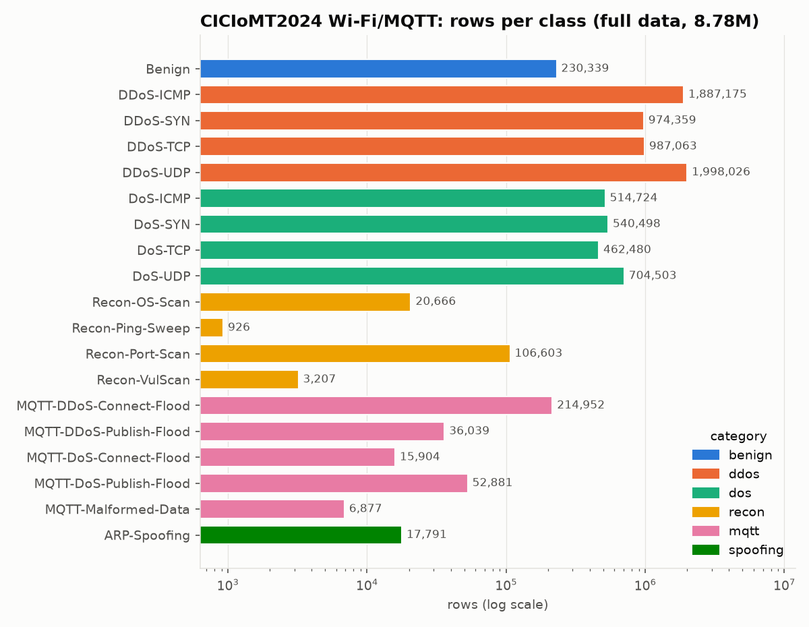
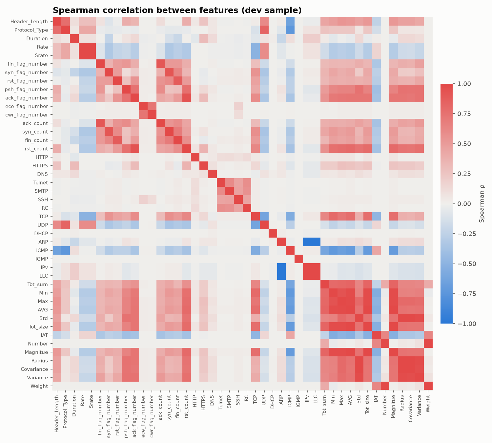
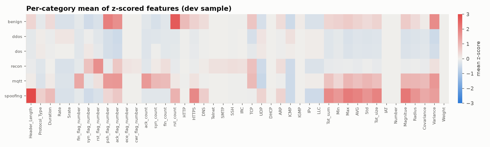
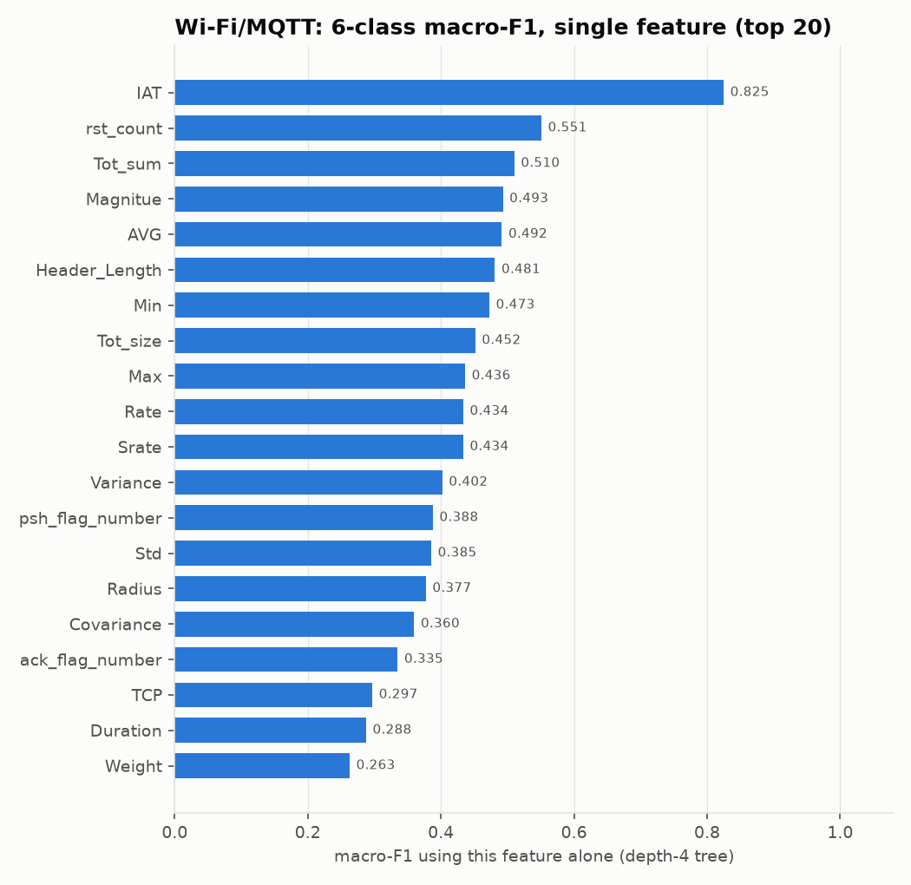
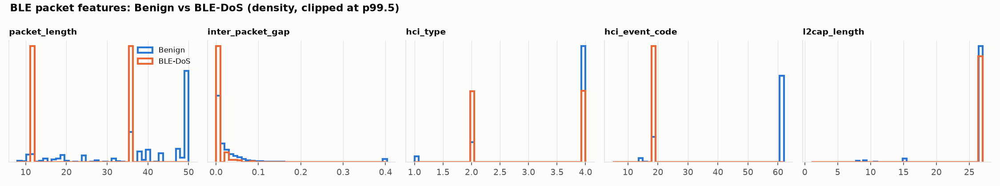
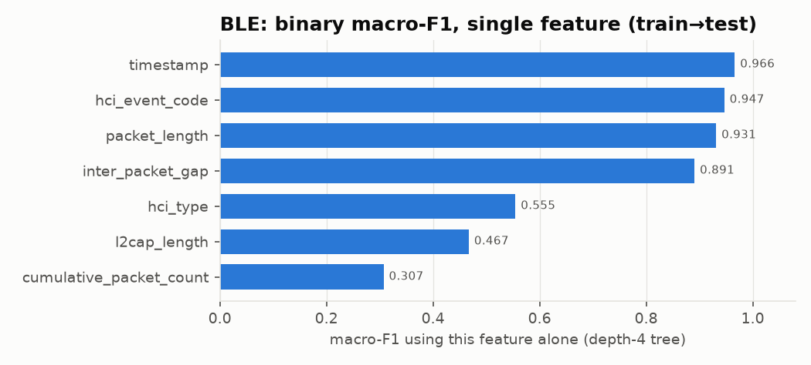

# M1 EDA report

Generated by `scripts/m1_eda.py` from `data/processed/` (see `data_manifest.json`).

## Raw data
- File: `ciciomt2024_full_8p7m.csv`, 2,404,149,218 bytes, SHA-256 `f7cb6fe30c4e4f0cb415a5e888f9bfcc7a652189a094447c72b8428b6b8f0eb6`
- 8,775,013 rows × 47 columns. NaN: 0, inf: 0
- Constant columns (excluded by the loader): Drate
- Kept as float64 to avoid precision loss: Rate, Srate, AVG, Std, IAT, Magnitue, Radius, Covariance; all others float32
- Processed full parquet: 249 MB

## Duplicates (exact match on all 45 features)
- Duplicate rows: **7,379** (0.1% of rows) in 4,441 groups; unique feature rows: 8,767,634
- Duplicate groups with **conflicting labels**: 0 (0 rows)
- Duplicate rows by class: DDoS-ICMP: 657, DDoS-SYN: 16, DDoS-TCP: 1, Recon-OS-Scan: 1,008, Recon-Port-Scan: 5,630, Recon-VulScan: 67

Duplicates are kept in the processed file. Removing them, and making sure train/test splits are duplicate-disjoint, is decided in M2.

## Dev sample
5% per class, but classes with ≤20,000 rows are kept whole and every other class gets at least 20,000 rows → **568,146 rows**. `weight` = n_full/n_sample restores the full-data class priors.

| class | n_full | n_sample | weight |
|---|---|---|---|
| Benign | 230,339 | 20,000 | 11.52 |
| DDoS-ICMP | 1,887,175 | 94,359 | 20.00 |
| DDoS-SYN | 974,359 | 48,718 | 20.00 |
| DDoS-TCP | 987,063 | 49,353 | 20.00 |
| DDoS-UDP | 1,998,026 | 99,901 | 20.00 |
| DoS-ICMP | 514,724 | 25,736 | 20.00 |
| DoS-SYN | 540,498 | 27,025 | 20.00 |
| DoS-TCP | 462,480 | 23,124 | 20.00 |
| DoS-UDP | 704,503 | 35,225 | 20.00 |
| Recon-OS-Scan | 20,666 | 20,000 | 1.03 |
| Recon-Ping-Sweep | 926 | 926 | 1.00 |
| Recon-Port-Scan | 106,603 | 20,000 | 5.33 |
| Recon-VulScan | 3,207 | 3,207 | 1.00 |
| MQTT-DDoS-Connect-Flood | 214,952 | 20,000 | 10.75 |
| MQTT-DDoS-Publish-Flood | 36,039 | 20,000 | 1.80 |
| MQTT-DoS-Connect-Flood | 15,904 | 15,904 | 1.00 |
| MQTT-DoS-Publish-Flood | 52,881 | 20,000 | 2.64 |
| MQTT-Malformed-Data | 6,877 | 6,877 | 1.00 |
| ARP-Spoofing | 17,791 | 17,791 | 1.00 |

## Feature statistics (full data; nunique on dev sample)

| feature | min | max | mean | std | dtype | dev_nunique |
|---|---|---|---|---|---|---|
| Header_Length | 0 | 9.897e+06 | 2.996e+04 | 2.824e+05 | float32 | 1.96e+05 |
| Protocol_Type | 0 | 17 | 8.047 | 6.305 | float32 | 600 |
| Duration | 0 | 255 | 64.64 | 7.853 | float32 | 2556 |
| Rate | 0 | 2.097e+06 | 1.574e+04 | 4.001e+04 | float64 | 4.315e+05 |
| Srate | 0 | 2.097e+06 | 1.574e+04 | 4.001e+04 | float64 | 4.315e+05 |
| Drate | 0 | 0 | 0 | 0 | float32 | nan |
| fin_flag_number | 0 | 1 | 0.005123 | 0.03416 | float32 | 131 |
| syn_flag_number | 0 | 1 | 0.1572 | 0.3369 | float32 | 176 |
| rst_flag_number | 0 | 1 | 0.03952 | 0.1393 | float32 | 200 |
| psh_flag_number | 0 | 1 | 0.02218 | 0.09654 | float32 | 250 |
| ack_flag_number | 0 | 1 | 0.09566 | 0.2521 | float32 | 204 |
| ece_flag_number | 0 | 0.2 | 2.909e-06 | 0.0005036 | float32 | 4 |
| cwr_flag_number | 0 | 0.2 | 1.921e-06 | 0.0003797 | float32 | 4 |
| ack_count | 0 | 11.2 | 0.02798 | 0.1783 | float32 | 386 |
| syn_count | 0 | 10.7 | 0.2939 | 0.6036 | float32 | 577 |
| fin_count | 0 | 151.7 | 0.08558 | 0.5612 | float32 | 2231 |
| rst_count | 0 | 9576 | 65.87 | 498.3 | float32 | 4.204e+04 |
| HTTP | 0 | 1 | 0.0008677 | 0.02842 | float32 | 21 |
| HTTPS | 0 | 1 | 0.00559 | 0.06034 | float32 | 110 |
| DNS | 0 | 1 | 0.0001516 | 0.005248 | float32 | 22 |
| Telnet | 0 | 0.1 | 1.254e-05 | 0.0008917 | float32 | 3 |
| SMTP | 0 | 0.1 | 1.254e-05 | 0.0008917 | float32 | 3 |
| SSH | 0 | 1 | 2.611e-05 | 0.002719 | float32 | 12 |
| IRC | 0 | 0.1111 | 1.253e-05 | 0.0008923 | float32 | 3 |
| TCP | 0 | 1 | 0.4149 | 0.4899 | float32 | 112 |
| UDP | 0 | 1 | 0.3108 | 0.4596 | float32 | 109 |
| DHCP | 0 | 0.6 | 3.259e-06 | 0.0009866 | float32 | 8 |
| ARP | 0 | 1 | 0.0007607 | 0.01928 | float32 | 46 |
| ICMP | 0 | 1 | 0.2735 | 0.444 | float32 | 105 |
| IGMP | 0 | 0.7 | 4.474e-06 | 0.001206 | float32 | 9 |
| IPv | 0 | 1 | 0.9992 | 0.01928 | float32 | 46 |
| LLC | 0 | 1 | 0.9992 | 0.01928 | float32 | 46 |
| Tot_sum | 42 | 2.347e+04 | 636 | 991.6 | float32 | 7.204e+04 |
| Min | 42 | 1514 | 55.12 | 69.1 | float32 | 1.786e+04 |
| Max | 42 | 1514 | 72.33 | 133.6 | float32 | 3.586e+04 |
| AVG | 42 | 1514 | 60.59 | 88.07 | float64 | 1.502e+05 |
| Std | 0 | 721.2 | 6.061 | 38.06 | float64 | 1.458e+05 |
| Tot_size | 42 | 1514 | 60.59 | 87.88 | float32 | 2.952e+04 |
| IAT | -1.282 | 1.695e+08 | 8.468e+07 | 1.782e+07 | float64 | 5.49e+05 |
| Number | 1 | 15 | 9.499 | 0.8416 | float32 | 95 |
| Magnitue | 9.165 | 55.03 | 10.44 | 3.158 | float64 | 1.499e+05 |
| Radius | 0 | 1020 | 8.56 | 53.8 | float64 | 1.438e+05 |
| Covariance | 0 | 5.204e+05 | 2371 | 1.976e+04 | float64 | 1.44e+05 |
| Variance | 0 | 1 | 0.09074 | 0.233 | float32 | 257 |
| Weight | 1 | 244.6 | 141.5 | 21.66 | float32 | 101 |

## Correlation
Feature pairs with |Spearman ρ| ≥ 0.98 (11): Rate~Srate (+1.000), ARP~IPv (-1.000), ARP~LLC (-1.000), IPv~LLC (+1.000), AVG~Magnitue (+0.999), Number~Weight (+0.999), Radius~Covariance (+0.999), AVG~Tot_size (+0.997), Tot_size~Magnitue (+0.996), Std~Radius (+0.996), Std~Covariance (+0.995)

## Single-feature shortcut check
Each feature alone is given to a depth-4 decision tree (balanced class weights) and scored by 6-class macro-F1 on a stratified 70/30 split of the dev sample. Features scoring ≥0.80 are listed as possible capture artifacts and are excluded from modelling by default (`features.exclude_wifi`, decision D6):
`IAT` (0.825)

## Zenodo Wi-Fi (train+test) vs our CSV

| class | csv | zenodo_train_test | diff | csv_exact_duplicates |
|---|---|---|---|---|
| Benign | 230,339 | 230,339 | 0 | 0 |
| DDoS-ICMP | 1,887,175 | 1,886,518 | -657 | 657 |
| DDoS-SYN | 974,359 | 974,343 | -16 | 16 |
| DDoS-TCP | 987,063 | 987,062 | -1 | 1 |
| DDoS-UDP | 1,998,026 | 1,998,026 | 0 | 0 |
| DoS-ICMP | 514,724 | 514,724 | 0 | 0 |
| DoS-SYN | 540,498 | 540,498 | 0 | 0 |
| DoS-TCP | 462,480 | 462,480 | 0 | 0 |
| DoS-UDP | 704,503 | 704,503 | 0 | 0 |
| Recon-OS-Scan | 20,666 | 19,658 | -1,008 | 1,008 |
| Recon-Ping-Sweep | 926 | 926 | 0 | 0 |
| Recon-Port-Scan | 106,603 | 101,168 | -5,435 | 5,630 |
| Recon-VulScan | 3,207 | 3,140 | -67 | 67 |
| MQTT-DDoS-Connect-Flood | 214,952 | 214,952 | 0 | 0 |
| MQTT-DDoS-Publish-Flood | 36,039 | 36,039 | 0 | 0 |
| MQTT-DoS-Connect-Flood | 15,904 | 15,904 | 0 | 0 |
| MQTT-DoS-Publish-Flood | 52,881 | 52,881 | 0 | 0 |
| MQTT-Malformed-Data | 6,877 | 6,877 | 0 | 0 |
| ARP-Spoofing | 17,791 | 17,791 | 0 | 0 |

Totals: CSV 8,775,013 vs Zenodo 8,767,829. For every class except Recon-Port-Scan, `diff` equals minus the CSV's exact-duplicate count, so the Zenodo Wi-Fi table is effectively a **de-duplicated** CSV. Port-Scan keeps 195 rows that the CSV marks as duplicates, probably because of float rounding in Zenodo's own export.

## Wi-Fi device profiling (Zenodo, benign only)
361,081 rows from 42 device/scenario captures. Largest: ActiveBroker (169,733), Active (102,880), Idle (32,688), Owltron_Camera_WAN_RECORDING (4,014), Owltron_Camera_LAN_MIC (3,893), Ecobee_Camera_LAN_MIC (3,874).

## BLE (Zenodo, packet-level)
Dropped all-NaN columns: ble_access_addr, ble_pdu_type. `UNKNOWN` was relabelled to `BLE-DoS` (all of those rows come from DoS capture files).

| label | profiling | test | train |
|---|---|---|---|
| BLE-DoS | 0 | 251,708 | 998,391 |
| Benign | 14,972 | 65,330 | 217,493 |

Single-feature binary macro-F1, official train→test split:
`timestamp` (0.966), `hci_event_code` (0.947), `packet_length` (0.931), `inter_packet_gap` (0.891), `hci_type` (0.555), `l2cap_length` (0.467), `cumulative_packet_count` (0.307)

