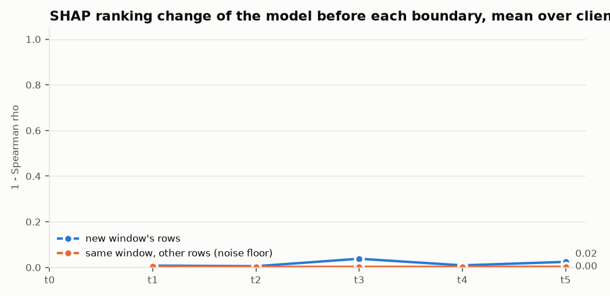

# M10: TreeSHAP explanations of E4 (`e4_added`, D11), `dev` pool

Seed 42. Generated by `scripts/m10_shap.py`. Attributions are exact TreeSHAP of w·margin_XGB + (1 − w)·margin_LGBM for the class the edge predicts, on up to the configured number of uniformly sampled CSV test rows per client and window (README, M10).

**Models against M9:** the rerun `e4_added` (K = 30) differs from M9's report by at most 0.000000 macro-F1 in any window.

**Rows explained:** 49,989. **The class with the highest weighted margin is the edge's predicted class** for 0.9992 of them.
**Escalation payload** (top 5 features with values, six probabilities, disagreement, as compact JSON): 178 bytes on average.

## Cost per row (µs), mean over clients

| window | TreeSHAP, 1 thread | inference, 1 thread | TreeSHAP, 4 threads | inference, 4 threads | XGBoost trees | LightGBM trees |
|---|---:|---:|---:|---:|---:|---:|
| t0 | 1049 | 26.4 | 576 | 17.6 | 296 | 280 |
| t1 | 3775 | 40.6 | 1495 | 17.9 | 707 | 488 |
| t2 | 9669 | 78.4 | 3642 | 33.0 | 1020 | 662 |
| t3 | 20409 | 143.9 | 5816 | 59.7 | 1485 | 880 |
| t4 | 19621 | 152.8 | 6728 | 49.2 | 1769 | 1034 |
| t5 | 21974 | 158.7 | 8134 | 47.2 | 1986 | 1128 |

TreeSHAP time includes the margins used to check that the attributions add up.

## SHAP drift signal

The model through t−1, before any update, explained on window t's rows and compared with its explanation on window t−1's rows (1 − Spearman ρ of mean |SHAP|, and the share of the top features kept). The control compares two disjoint samples of window t−1, so it is the noise floor. Mean over clients.

| boundary | change, new window | change, control | top-5 kept, new window | top-5 kept, control | share of clients above their control |
|---|---:|---:|---:|---:|---:|
| t0 → t1 | 0.008 | 0.003 | 0.97 | 0.99 | 0.80 |
| t1 → t2 | 0.005 | 0.003 | 0.89 | 0.96 | 0.80 |
| t2 → t3 | 0.038 | 0.003 | 0.72 | 0.97 | 1.00 |
| t3 → t4 | 0.009 | 0.003 | 0.93 | 0.96 | 0.73 |
| t4 → t5 | 0.024 | 0.003 | 0.84 | 0.97 | 1.00 |

## Global ranking (cloud: mean over clients of mean |SHAP|), top 10

| rank | t0 | t1 | t2 | t3 | t4 | t5 |
|---|---|---|---|---|---|---|
| 1 | `Number` | `Variance` | `Variance` | `rst_count` | `rst_count` | `rst_count` |
| 2 | `Variance` | `Number` | `Number` | `Rate` | `Header_Length` | `Header_Length` |
| 3 | `AVG` | `Rate` | `Rate` | `Magnitue` | `Rate` | `Magnitue` |
| 4 | `Tot_size` | `Header_Length` | `Header_Length` | `Number` | `Magnitue` | `Number` |
| 5 | `Min` | `Srate` | `Srate` | `Variance` | `Number` | `Rate` |
| 6 | `Srate` | `Min` | `rst_count` | `Header_Length` | `Variance` | `fin_count` |
| 7 | `ack_flag_number` | `Protocol_Type` | `Min` | `Srate` | `Srate` | `Variance` |
| 8 | `Max` | `AVG` | `fin_count` | `Min` | `fin_count` | `Srate` |
| 9 | `Std` | `Tot_size` | `AVG` | `fin_count` | `Min` | `Min` |
| 10 | `psh_flag_number` | `ICMP` | `Tot_size` | `Tot_size` | `Tot_size` | `Tot_size` |

Stores: `local.parquet` (top features per row), `global_by_client.csv`, `global.csv`, `shap_drift.csv`, `cost.csv`.
