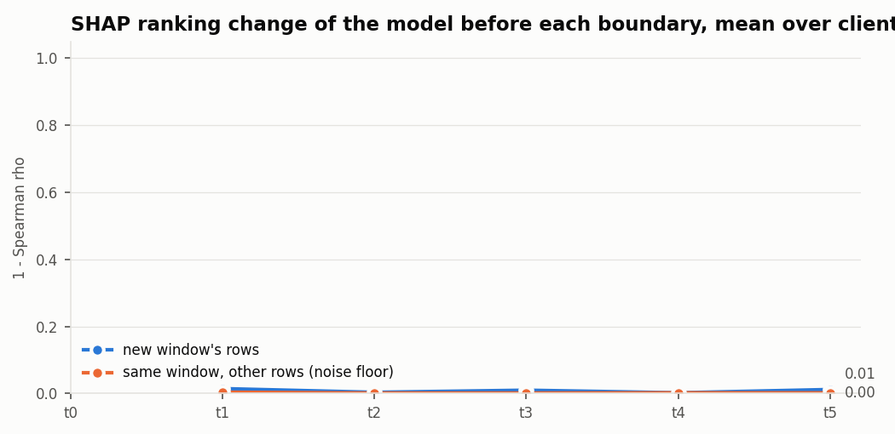

# M10: TreeSHAP explanations of E4 (`e4_added`, D11), `full` pool

Seed 42. Generated by `scripts/m10_shap.py`. Attributions are exact TreeSHAP of w·margin_XGB + (1 − w)·margin_LGBM for the class the edge predicts, on up to the configured number of uniformly sampled CSV test rows per client and window (README, M10).

**Models against M9:** the rerun `e4_added` (K = 30) differs from M9's report by at most 0.001545 macro-F1 in any window.

**Rows explained:** 89,743. **The class with the highest weighted margin is the edge's predicted class** for 0.9997 of them.
**Escalation payload** (top 5 features with values, six probabilities, disagreement, as compact JSON): 175 bytes on average.

## Cost per row (µs), mean over clients

| window | TreeSHAP, 1 thread | inference, 1 thread | TreeSHAP, 4 threads | inference, 4 threads | XGBoost trees | LightGBM trees |
|---|---:|---:|---:|---:|---:|---:|
| t0 | 4073 | 42.3 | 1683 | 22.4 | 300 | 300 |
| t1 | 12908 | 121.8 | 5258 | 45.5 | 881 | 723 |
| t2 | 18930 | 180.9 | 7716 | 62.3 | 1224 | 972 |
| t3 | 27530 | 259.2 | 11140 | 83.2 | 1755 | 1315 |
| t4 | 32244 | 311.6 | 13030 | 96.1 | 2058 | 1476 |
| t5 | 36506 | 353.6 | 14721 | 105.9 | 2333 | 1620 |

TreeSHAP time includes the margins used to check that the attributions add up.

## SHAP drift signal

The model through t−1, before any update, explained on window t's rows and compared with its explanation on window t−1's rows (1 − Spearman ρ of mean |SHAP|, and the share of the top features kept). The control compares two disjoint samples of window t−1, so it is the noise floor. Mean over clients.

| boundary | change, new window | change, control | top-5 kept, new window | top-5 kept, control | share of clients above their control |
|---|---:|---:|---:|---:|---:|
| t0 → t1 | 0.015 | 0.004 | 0.96 | 0.99 | 0.93 |
| t1 → t2 | 0.004 | 0.001 | 0.97 | 1.00 | 0.53 |
| t2 → t3 | 0.010 | 0.001 | 0.93 | 0.96 | 0.87 |
| t3 → t4 | 0.002 | 0.002 | 0.95 | 0.95 | 0.53 |
| t4 → t5 | 0.012 | 0.002 | 0.87 | 0.96 | 0.60 |

## Global ranking (cloud: mean over clients of mean |SHAP|), top 10

| rank | t0 | t1 | t2 | t3 | t4 | t5 |
|---|---|---|---|---|---|---|
| 1 | `Number` | `Number` | `Number` | `Number` | `Number` | `Number` |
| 2 | `AVG` | `Header_Length` | `Header_Length` | `rst_count` | `rst_count` | `Header_Length` |
| 3 | `Tot_size` | `Rate` | `Rate` | `Header_Length` | `Header_Length` | `rst_count` |
| 4 | `Variance` | `Srate` | `Srate` | `Rate` | `Rate` | `Rate` |
| 5 | `Srate` | `AVG` | `rst_count` | `Variance` | `Srate` | `Srate` |
| 6 | `syn_flag_number` | `Variance` | `syn_count` | `Srate` | `Variance` | `Variance` |
| 7 | `Min` | `Protocol_Type` | `AVG` | `AVG` | `Tot_size` | `fin_count` |
| 8 | `Covariance` | `syn_count` | `Protocol_Type` | `Tot_size` | `AVG` | `Tot_size` |
| 9 | `ack_flag_number` | `Tot_size` | `Variance` | `syn_count` | `Magnitue` | `AVG` |
| 10 | `ICMP` | `UDP` | `Tot_size` | `Magnitue` | `syn_count` | `syn_count` |

Stores: `local.parquet` (top features per row), `global_by_client.csv`, `global.csv`, `shap_drift.csv`, `cost.csv`.
