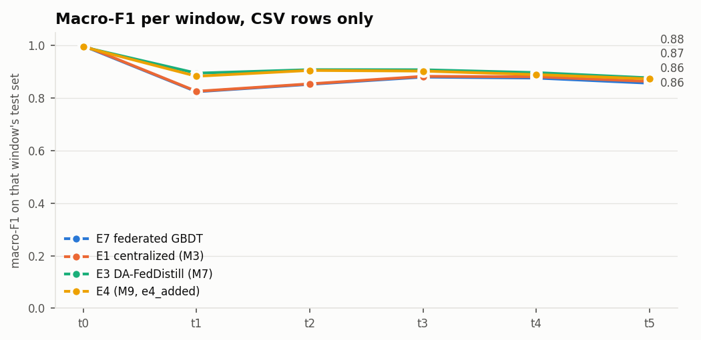

# M13: E7, horizontal federated GBDT (`dev` pool)

Run `20261110-164019_m13_fedgbdt_dev`, seed 42. Generated by `scripts/m13_fedgbdt.py`. Scores use CSV-only rows (D7); E7 is one global model.
References are read from the earlier milestones' reports for the same pool (seed 42).

| method | window avg | avg excl. t0 | final | class forgetting |
|---|---:|---:|---:|---:|
| **E7 federated GBDT** | 0.8811 | 0.8577 | 0.8565 | 0.0509 |
| E1 centralized (M3) | 0.8844 | 0.8612 | 0.8632 | 0.0370 |
| Naive incremental, local (M6) | 0.9122 | 0.8950 | 0.8812 | 0.0332 |
| E3 DA-FedDistill (M7) | 0.9130 | 0.8968 | 0.8768 | 0.0323 |
| E4 (M9, e4_added) | 0.9079 | 0.8906 | 0.8731 | 0.0323 |

| method | t0 | t1 | t2 | t3 | t4 | t5 |
|---|---:|---:|---:|---:|---:|---:|
| **E7** | 0.998 | 0.824 | 0.852 | 0.880 | 0.876 | 0.857 |
| E1 centralized (M3) | 1.000 | 0.826 | 0.854 | 0.883 | 0.881 | 0.863 |
| Naive incremental, local (M6) | 0.999 | 0.876 | 0.900 | 0.914 | 0.904 | 0.881 |
| E3 DA-FedDistill (M7) | 0.994 | 0.895 | 0.908 | 0.908 | 0.897 | 0.877 |
| E4 (M9, e4_added) | 0.994 | 0.883 | 0.905 | 0.903 | 0.889 | 0.873 |

## Cost

Uplink: an upper bound per client, one gradient and one Hessian histogram (8-byte values, all bins) per new tree node, without XGBoost's subtraction trick, which halves it; the quantile sketch isn't counted. E3's is its raw float32 soft labels on D_pub (M7).

| window | clients | rounds added | fit seconds | model MB | E7 uplink per client (MB) | E3 uplink per client (MB) |
|---|---:|---:|---:|---:|---:|---:|
| t0 | 15 | 50 | 66 | 0.29 | 476.3 | 0.10 |
| t1 | 15 | 50 | 84 | 1.45 | 5010.5 | 0.24 |
| t2 | 15 | 50 | 95 | 2.45 | 4160.1 | 0.25 |
| t3 | 15 | 50 | 115 | 4.17 | 7842.6 | 0.29 |
| t4 | 15 | 50 | 129 | 6.33 | 10184.8 | 0.30 |
| t5 | 15 | 49 | 142 | 8.85 | 12067.2 | 0.31 |

Stores: `summary.json`, `results.csv`, `per_class.csv`, `confusions.csv`, `cost.csv`.
