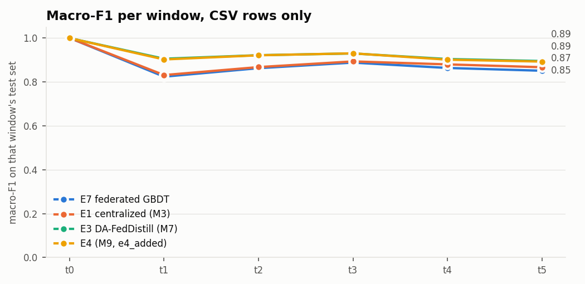

# M13: E7, horizontal federated GBDT (`full` pool)

Run `20261115-150344_m13_fedgbdt_full`, seed 44. Generated by `scripts/m13_fedgbdt.py`. Scores use CSV-only rows (D7); E7 is one global model.
References are read from the earlier milestones' reports for the same pool (seed 42).

| method | window avg | avg excl. t0 | final | class forgetting |
|---|---:|---:|---:|---:|
| **E7 federated GBDT** | 0.8814 | 0.8577 | 0.8508 | 0.0320 |
| E1 centralized (M3) | 0.8897 | 0.8677 | 0.8668 | 0.0277 |
| Naive incremental, local (M6) | 0.9211 | 0.9054 | 0.8978 | 0.0242 |
| E3 DA-FedDistill (M7) | 0.9258 | 0.9111 | 0.8950 | 0.0247 |
| E4 (M9, e4_added) | 0.9244 | 0.9094 | 0.8925 | 0.0288 |

| method | t0 | t1 | t2 | t3 | t4 | t5 |
|---|---:|---:|---:|---:|---:|---:|
| **E7** | 1.000 | 0.824 | 0.863 | 0.888 | 0.863 | 0.851 |
| E1 centralized (M3) | 1.000 | 0.831 | 0.867 | 0.893 | 0.880 | 0.867 |
| Naive incremental, local (M6) | 1.000 | 0.885 | 0.909 | 0.925 | 0.910 | 0.898 |
| E3 DA-FedDistill (M7) | 0.999 | 0.905 | 0.922 | 0.930 | 0.904 | 0.895 |
| E4 (M9, e4_added) | 0.999 | 0.902 | 0.921 | 0.930 | 0.901 | 0.893 |

## Cost

Uplink: an upper bound per client, one gradient and one Hessian histogram (8-byte values, all bins) per new tree node, without XGBoost's subtraction trick, which halves it; the quantile sketch isn't counted. E3's is its raw float32 soft labels on D_pub (M7).

| window | clients | rounds added | fit seconds | model MB | E7 uplink per client (MB) | E3 uplink per client (MB) |
|---|---:|---:|---:|---:|---:|---:|
| t0 | 15 | 50 | 76 | 0.40 | 1061.7 | 1.31 |
| t1 | 15 | 50 | 117 | 2.10 | 7757.4 | 4.11 |
| t2 | 15 | 50 | 133 | 3.71 | 7322.0 | 4.16 |
| t3 | 15 | 50 | 172 | 6.08 | 11260.6 | 4.32 |
| t4 | 15 | 50 | 199 | 8.84 | 13255.0 | 4.33 |
| t5 | 15 | 50 | 225 | 11.71 | 13878.5 | 4.34 |

Stores: `summary.json`, `results.csv`, `per_class.csv`, `confusions.csv`, `cost.csv`.
