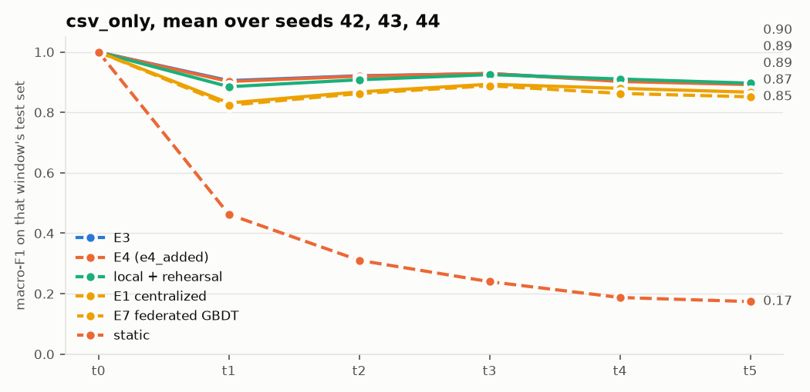

# M14 tier 1: headline, ablations and hypotheses (`full` pool)

Generated by `scripts/m14_report.py` from stored per-client counts only (`csv_only` rows, D7). Seeds 42, 43, 44. Intervals: client bootstrap, 10,000 draws, the same 15-client draw for every seed and both methods, seeds averaged inside each draw. A difference counts as a result when its 95% interval excludes 0, its Holm-adjusted p (hypotheses) or raw p (ablations) is under 0.05, and, for macro-F1, its size is at least 0.005. Every source reproduces its own stored window average exactly; sources and commits: `sources.csv`.

## Headline

| method | window avg (mean ± std over seeds) | 95% interval, seed mean | t5 (mean ± std) |
|---|---:|---:|---:|
| E1 centralized | 0.8897 ± 0.0001 | 0.8720 to 0.9020 | 0.8669 ± 0.0004 |
| static | 0.3957 ± 0.0058 | 0.3611 to 0.4225 | 0.1740 ± 0.0087 |
| naive incremental | 0.9212 ± 0.0001 | 0.9024 to 0.9337 | 0.8978 ± 0.0004 |
| local + rehearsal | 0.9208 ± 0.0003 | 0.9018 to 0.9332 | 0.8967 ± 0.0006 |
| E2 FedAvg | 0.8415 ± 0.0039 | 0.8194 to 0.8583 | 0.7811 ± 0.0014 |
| E2 FedProx | 0.8414 ± 0.0025 | 0.8191 to 0.8585 | 0.7800 ± 0.0023 |
| E3 | 0.9256 ± 0.0004 | 0.9108 to 0.9331 | 0.8947 ± 0.0010 |
| FedMD | 0.8873 ± 0.0002 | 0.8630 to 0.9053 | 0.8603 ± 0.0003 |
| e3_guard (addition) | 0.9285 ± 0.0005 | 0.9133 to 0.9362 | 0.9004 ± 0.0007 |
| E4 (e4_added) | 0.9241 ± 0.0004 | 0.9086 to 0.9319 | 0.8920 ± 0.0020 |
| e4 (ADWIN replaces schedule) | 0.8538 ± 0.0219 | 0.8316 to 0.8648 | 0.8378 ± 0.0157 |
| E7 federated GBDT | 0.8814 ± 0.0000 | 0.8630 to 0.8940 | 0.8514 ± 0.0009 |

E5 and E6 are scored on M11's sampled rows (500 per client and window; always-on: the first 50 of them), so they are compared with the E4 edge on the same rows, not with the table above.

| rows | setting | method | macro-F1 (mean ± std) | benign false-positive rate (mean ± std) |
|---|---|---|---:|---:|
| sample | boundary | E4 edge | 0.6737 ± 0.0074 | 0.0211 ± 0.0098 |
| always_on | boundary | E4 edge | 0.6731 ± 0.0115 | 0.0164 ± 0.0074 |
| sample | own window | E4 edge | 0.9295 ± 0.0030 | 0.0257 ± 0.0061 |
| always_on | own window | E4 edge | 0.9251 ± 0.0091 | 0.0260 ± 0.0164 |
| sample | boundary | E5 gated | 0.6726 ± 0.0076 | 0.0211 ± 0.0098 |
| always_on | boundary | E5 gated | 0.6722 ± 0.0109 | 0.0164 ± 0.0074 |
| sample | own window | E5 gated | 0.9288 ± 0.0031 | 0.0257 ± 0.0061 |
| always_on | own window | E5 gated | 0.9242 ± 0.0095 | 0.0260 ± 0.0164 |
| always_on | boundary | E6 always-on | 0.6711 ± 0.0108 | 0.0164 ± 0.0074 |
| always_on | own window | E6 always-on | 0.9236 ± 0.0095 | 0.0260 ± 0.0164 |

LLM calls per 1k flows, E5 (full stream, boundary): 84.1, 84.3, 87.4; E6: 1000.

## Ablations (paired, window-avg macro-F1 unless stated; difference = ablation minus base)

| ablation | base | difference | 95% interval | p | result |
|---|---|---:|---:|---:|---|
| no ADWIN (fixed_k30) | E4 | +0.0015 | +0.0002 to +0.0027 | 0.0226 | no |
| no feature selection | E4 | +0.0007 | +0.0001 to +0.0014 | 0.0246 | no |
| no rehearsal | E4 | +0.0000 | -0.0008 to +0.0014 | 0.9234 | no |
| E3, D_pub benign-only | E3 | -0.3585 | -0.4019 to -0.3231 | 0.0000 | yes |
| E4, D_pub benign-only | E4 | -0.4447 | -0.4869 to -0.4018 | 0.0000 | yes |
| no LLM verification: E5 gated minus E4 edge (boundary, sample rows) | E4 edge | -0.0011 | -0.0022 to -0.0002 | 0.0122 | no |
| no LLM verification: E5 gated minus E4 edge (own window, sample rows) | E4 edge | -0.0007 | -0.0014 to -0.0001 | 0.0268 | no |
| always-on vs gated: E6 minus E5 (boundary, always_on rows) | E5 gated | -0.0011 | -0.0021 to -0.0003 | 0.0012 | no |
| always-on vs gated: E6 minus E5 (own window, always_on rows) | E5 gated | -0.0006 | -0.0014 to +0.0000 | 0.0556 | no |

D_pub benign-only moves attack rows from D_pub back to the clients, so its rows are not identical to the headline's; the client draw is paired, the rows within a client are not.

## Hypotheses (Holm over the five tests below)

| id | test | difference | 95% interval | p | Holm p | result |
|---|---|---:|---:|---:|---:|---|
| H1a | E3 minus naive incremental, window-avg macro-F1 | +0.00443 | -0.00236 to +0.00963 | 0.2174 | 0.6522 | no |
| H1b | E3 minus static, window-avg macro-F1 | +0.52990 | +0.50437 to +0.55779 | 0.0000 | 0.0000 | yes |
| H2a | E4 minus E3, variance of macro-F1 over t1-t5 (lower is better) | +0.00004 | +0.00000 to +0.00012 | 0.0294 | 0.1176 | no |
| H2b | E4 minus E3, mean time-to-recover in windows, eps 0.02 (lower is better) | +0.00000 | +0.00000 to +0.40000 | 1.0000 | 1.0000 | no |
| H3 | E5 gated minus E4 edge, benign false-positive rate, boundary windows t1-t5, sampled rows (lower is better) | +0.00000 | +0.00000 to +0.00000 | 1.0000 | 1.0000 | no |

Observed, seed-averaged: variance over t1-t5 E3 0.00018, E4 0.00022; mean time-to-recover E3 2.40, E4 2.40 windows (a drop that never recovers counts as one window past t5).

## Sensitivity (tier 2, seed 42; one run per variant, so the intervals are client intervals only)

| variant | clients | E1 | local + rehearsal | E3 | E4 | E3 − local (95% interval) | E4 − E3 (95% interval) |
|---|---:|---:|---:|---:|---:|---:|---:|
| headline (seed 42) | 15 | 0.8897 | 0.9209 | 0.9258 | 0.9243 | | |
| (no variant back yet) | | | | | | | |

Tier 3 (τc/τd frontier, H4): `TIER3.md`, written by the same command.

