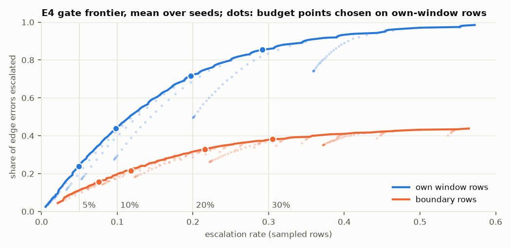

# M14 tier 3: τc/τd frontier and H4 (`full` pool)

Generated by `scripts/m14_tier3.py` (called by `scripts/m14_report.py`) from M11's and M12's stored rows and logs; nothing is retrained and no LLM is called. Seeds 42, 43, 44 (M12: 42, 43, 44).

## τc/τd frontier (D10)

E4's gate as run in M11 (adaptive thresholds from the drift score, plus the drift hold), swept over base τc 0.40 to 0.98 (step 0.02) and τd in `gate.tune_tau_d`, on M11's sampled rows (500 per client and window, so each client and window counts equally; full-stream rates differ). For each budget the point with the most edge errors escalated at that rate or under is chosen on **own-window** rows and read out on **boundary** rows, the drifted setting it wasn't chosen on. The LLM columns score E5 at that point on the always-on rows (50 per client and window), where Gemma's reply exists whatever the gate said, with D3 as in M11. Mean ± std over seeds.

| budget | setting | τc, τd (per seed) | escalation rate | edge errors escalated | edge macro-F1 | E5 macro-F1 | edge FP rate | E5 FP rate |
|---:|---|---|---:|---:|---:|---:|---:|---:|
| 5% | own window | 0.58, 0.5; 0.56, 0.3; 0.56, 0.4 | 0.0492 ± 0.0011 | 0.2396 ± 0.0146 | 0.9251 ± 0.0091 | 0.9247 ± 0.0099 | 0.0260 ± 0.0164 | 0.0260 ± 0.0164 |
| 5% | boundary | 0.58, 0.5; 0.56, 0.3; 0.56, 0.4 | 0.0757 ± 0.0040 | 0.1567 ± 0.0053 | 0.6731 ± 0.0115 | 0.6725 ± 0.0108 | 0.0164 ± 0.0074 | 0.0164 ± 0.0074 |
| 10% | own window | 0.68, 1.01; 0.66, 0.3; 0.66, 0.4 | 0.0982 ± 0.0008 | 0.4388 ± 0.0066 | 0.9251 ± 0.0091 | 0.9239 ± 0.0098 | 0.0260 ± 0.0164 | 0.0260 ± 0.0164 |
| 10% | boundary | 0.68, 1.01; 0.66, 0.3; 0.66, 0.4 | 0.1183 ± 0.0058 | 0.2143 ± 0.0192 | 0.6731 ± 0.0115 | 0.6720 ± 0.0110 | 0.0164 ± 0.0074 | 0.0164 ± 0.0074 |
| 20% | own window | 0.80, 0.2; 0.80, 0.2; 0.80, 0.2 | 0.1972 ± 0.0024 | 0.7172 ± 0.0029 | 0.9251 ± 0.0091 | 0.9237 ± 0.0095 | 0.0260 ± 0.0164 | 0.0260 ± 0.0164 |
| 20% | boundary | 0.80, 0.2; 0.80, 0.2; 0.80, 0.2 | 0.2158 ± 0.0029 | 0.3295 ± 0.0050 | 0.6731 ± 0.0115 | 0.6714 ± 0.0107 | 0.0164 ± 0.0074 | 0.0164 ± 0.0074 |
| 30% | own window | 0.88, 0.1; 0.88, 0.1; 0.88, 0.1 | 0.2917 ± 0.0040 | 0.8541 ± 0.0025 | 0.9251 ± 0.0091 | 0.9236 ± 0.0095 | 0.0260 ± 0.0164 | 0.0260 ± 0.0164 |
| 30% | boundary | 0.88, 0.1; 0.88, 0.1; 0.88, 0.1 | 0.3051 ± 0.0032 | 0.3818 ± 0.0039 | 0.6731 ± 0.0115 | 0.6711 ± 0.0108 | 0.0164 ± 0.0074 | 0.0164 ± 0.0074 |

## H4 (a) groundedness and (b) schema-valid rate

**Verifier (M11).** A reason counts as grounded when it names a feature in that row's top-5 SHAP (stored with signs in `evidence.parquet`) and, if it states a direction (high, low, increased, decreased and similar words), that direction matches the sign of every named feature's SHAP value towards the edge's label; a reason stating both directions fails, a reason naming no top-5 feature fails. The direction words are matched anywhere in the reason, so a word about a probability ("the probability is higher") is read as a feature direction: the rule is strict and crude, and its effect shows in the gap between the first two columns. `M11 weak` is M11's check (every reason names a feature or class from the evidence), per reply.

| seed | replies | reasons | names a top-5 feature | grounded (strict) | replies with every reason grounded | M11 weak, per reply | valid, first try | valid after retries |
|---:|---:|---:|---:|---:|---:|---:|---:|---:|
| 42 | 14,066 | 42,198 | 0.420 | 0.362 | 0.007 | 0.967 | 0.554 | 0.9999 |
| 43 | 14,290 | 42,870 | 0.422 | 0.366 | 0.006 | 0.973 | 0.560 | 0.9999 |
| 44 | 14,687 | 44,061 | 0.413 | 0.358 | 0.004 | 0.967 | 0.560 | 0.9999 |

**Policy agent (M12).** Its reasons are window-level and its evidence has no SHAP signs, so only the weaker check is possible: does a reason explicitly contradict one of two yes/no facts it was given (new classes present, ADWIN fired). Keyword matching catches only explicit contradictions, so the share is a lower bound. `urgency low with a new class` is the share of valid decisions that delay the update although a new class is in the window.

| seed | decisions | reasons | reasons contradicting the evidence | urgency low with a new class (decisions) | valid, first try | valid after retries |
|---:|---:|---:|---:|---:|---:|---:|
| 42 | 75 | 212 | 0.000 | 1.000 (73) | 0.800 | 1.000 |
| 43 | 75 | 210 | 0.005 | 1.000 (74) | 0.800 | 1.000 |
| 44 | 75 | 213 | 0.014 | 1.000 (74) | 0.800 | 1.000 |
