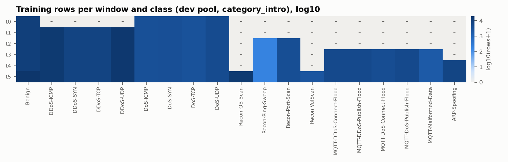
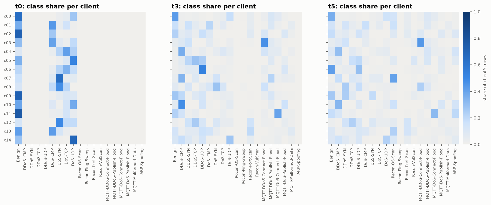
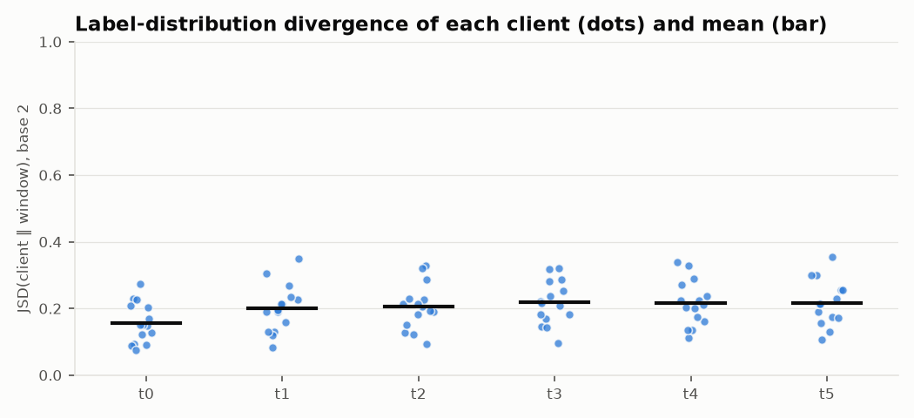

# M2 partition report — `dev` pool, `category_intro` timeline

Generated by `scripts/m2_build_partitions.py` (seed 42). Files: `data/splits/dev/category_intro/`.

## Setup
- 15 Wi-Fi/MQTT clients, Dirichlet α = 0.5 label skew per class; test share 20% per (window, class), client-local.
- Exact duplicates dropped before splitting: 1,347 CSV rows, 47 profiling rows. Train and test are therefore duplicate-disjoint.
- Each class enters at its introduction window and then recurs with **fresh, disjoint rows** in every later window.
- Population drift at t5: clients c04, c05, c07, c08, c09 (⟲) get re-drawn attack mixes, and 5 held-back device groups are onboarded.
- D_pub: 6,523 rows, removed from all client data. Window mode `cumulative`: at window t only classes introduced by t are used.

## Windows

| window | new classes | train rows | test rows | JSD mean | JSD min | JSD max |
|---|---|---:|---:|---:|---:|---:|
| t0 | Benign, DoS-ICMP, DoS-SYN, DoS-TCP, DoS-UDP | 25,142 | 6,281 | 0.157 | 0.076 | 0.274 |
| t1 | DDoS-ICMP, DDoS-SYN, DDoS-TCP, DDoS-UDP | 71,447 | 17,856 | 0.200 | 0.082 | 0.350 |
| t2 | Recon-Ping-Sweep, Recon-Port-Scan | 75,518 | 18,874 | 0.205 | 0.093 | 0.330 |
| t3 | MQTT-DDoS-Connect-Flood, MQTT-DDoS-Publish-Flood, MQTT-DoS-Connect-Flood, MQTT-DoS-Publish-Flood, MQTT-Malformed-Data | 97,367 | 24,338 | 0.217 | 0.096 | 0.322 |
| t4 | ARP-Spoofing | 104,407 | 26,099 | 0.216 | 0.110 | 0.339 |
| t5 | Recon-OS-Scan, Recon-VulScan | 131,283 | 32,819 | 0.217 | 0.106 | 0.355 |

JSD is the Jensen–Shannon divergence between a client's 19-class training distribution and the whole window's, where 0 = identical and 1 = disjoint. It measures how non-IID the clients are.

## Training rows per client and window

| client | t0 | t1 | t2 | t3 | t4 | t5 |
|---|---:|---:|---:|---:|---:|---:|
| c00 | 2,685 | 2,947 | 3,152 | 4,067 | 4,126 | 4,776 |
| c01 | 1,817 | 2,842 | 3,051 | 3,772 | 3,831 | 4,586 |
| c02 | 1,483 | 3,164 | 3,542 | 4,668 | 5,221 | 5,788 |
| c03 | 541 | 1,427 | 1,502 | 3,610 | 3,633 | 3,844 |
| c04 ⟲ | 1,659 | 5,203 | 5,208 | 7,283 | 7,620 | 9,610 |
| c05 ⟲ | 463 | 8,224 | 8,247 | 9,639 | 10,183 | 5,556 |
| c06 | 1,007 | 10,183 | 10,381 | 12,798 | 12,854 | 22,605 |
| c07 ⟲ | 878 | 2,628 | 2,642 | 3,992 | 4,753 | 14,679 |
| c08 ⟲ | 2,140 | 2,850 | 2,897 | 3,572 | 3,580 | 6,479 |
| c09 ⟲ | 2,711 | 5,723 | 5,778 | 7,189 | 7,259 | 4,991 |
| c10 | 1,806 | 8,714 | 8,743 | 11,282 | 13,408 | 16,036 |
| c11 | 1,800 | 3,023 | 3,112 | 5,983 | 7,484 | 7,495 |
| c12 | 1,263 | 4,349 | 5,223 | 5,879 | 5,995 | 6,360 |
| c13 | 2,531 | 5,111 | 6,653 | 7,716 | 8,080 | 11,363 |
| c14 | 2,358 | 5,059 | 5,387 | 5,917 | 6,380 | 7,115 |

## Benign device ownership (real devices from Zenodo profiling)
Network-wide captures (Active, ActiveBroker, Idle) are spread over all clients. Each device/network group belongs to exactly one client:

- c00: Owltron_Camera|WAN
- c01: M1T_Camera|LAN
- c02: Ecobee_Camera|WAN
- c03: SenseU|LAN
- c04: Owltron_Camera|Power
- c05: Multifunctional_Pager|Power, SenseUBaby|Power (onboarded at drift)
- c06: Owltron_Camera|LAN (onboarded at drift), Singcall|WAN
- c07: M1T_Camera|Power
- c08: Multifunctional_Pager|WAN (onboarded at drift), Singcall|LAN
- c09: M1T_Camera|WAN, Singcall|Power (onboarded at drift)
- c10: Blink_Camera|WAN
- c11: Ecobee_Camera|LAN
- c12: Multifunctional_Pager|LAN, SenseU|WAN
- c13: Blink_Camera|LAN, Blink_Mini_Camera|Power (onboarded at drift)
- c14: Ecobee_Camera|Power

## D_pub by class
Benign: 1,000, DDoS-ICMP: 944, DDoS-SYN: 487, DDoS-TCP: 494, DDoS-UDP: 999, DoS-ICMP: 257, DoS-SYN: 270, DoS-TCP: 231, DoS-UDP: 352, Recon-OS-Scan: 190, Recon-Ping-Sweep: 46, Recon-Port-Scan: 197, Recon-VulScan: 50, MQTT-DDoS-Connect-Flood: 200, MQTT-DDoS-Publish-Flood: 200, MQTT-DoS-Connect-Flood: 159, MQTT-DoS-Publish-Flood: 200, MQTT-Malformed-Data: 69, ARP-Spoofing: 178

## BLE sub-federation (3 clients, official train/test split)

| window | split | benign | BLE-DoS |
|---|---|---:|---:|
| t4 | train | 5,438 | 24,960 |
| t4 | test | 2,500 | 6,293 |
| t5 | train | 5,437 | 24,960 |
| t5 | test | 2,500 | 6,292 |
