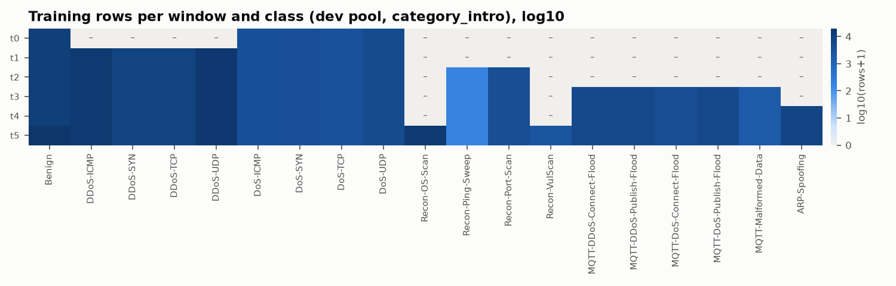
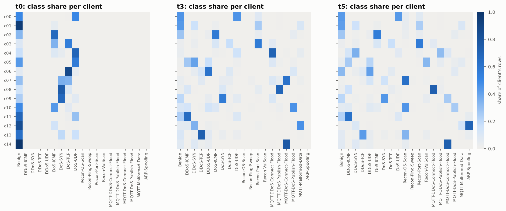
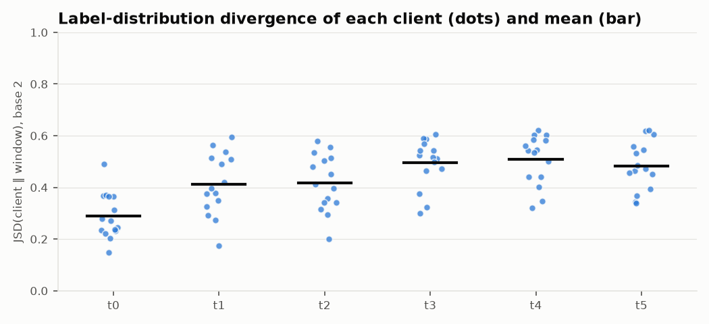

# M2 partition report — `dev` pool, `category_intro` timeline

Generated by `scripts/m2_build_partitions.py` (seed 42). Files: `data/splits/dev/category_intro/`.

## Setup
- 15 Wi-Fi/MQTT clients, Dirichlet α = 0.1 label skew per class; test share 20% per (window, class), client-local.
- Exact duplicates dropped before splitting: 1,347 CSV rows, 47 profiling rows. Train and test are therefore duplicate-disjoint.
- Each class enters at its introduction window and then recurs with **fresh, disjoint rows** in every later window.
- Population drift at t5: clients c04, c05, c07, c08, c09 (⟲) get re-drawn attack mixes, and 5 held-back device groups are onboarded.
- D_pub: 6,523 rows, removed from all client data. Window mode `cumulative`: at window t only classes introduced by t are used.

## Windows

| window | new classes | train rows | test rows | JSD mean | JSD min | JSD max |
|---|---|---:|---:|---:|---:|---:|
| t0 | Benign, DoS-ICMP, DoS-SYN, DoS-TCP, DoS-UDP | 25,142 | 6,281 | 0.289 | 0.148 | 0.491 |
| t1 | DDoS-ICMP, DDoS-SYN, DDoS-TCP, DDoS-UDP | 71,447 | 17,856 | 0.413 | 0.175 | 0.595 |
| t2 | Recon-Ping-Sweep, Recon-Port-Scan | 75,518 | 18,874 | 0.419 | 0.200 | 0.580 |
| t3 | MQTT-DDoS-Connect-Flood, MQTT-DDoS-Publish-Flood, MQTT-DoS-Connect-Flood, MQTT-DoS-Publish-Flood, MQTT-Malformed-Data | 97,367 | 24,338 | 0.495 | 0.300 | 0.605 |
| t4 | ARP-Spoofing | 104,407 | 26,099 | 0.509 | 0.320 | 0.622 |
| t5 | Recon-OS-Scan, Recon-VulScan | 131,283 | 32,819 | 0.484 | 0.338 | 0.621 |

JSD is the Jensen–Shannon divergence between a client's 19-class training distribution and the whole window's, where 0 = identical and 1 = disjoint. It measures how non-IID the clients are.

## Training rows per client and window

| client | t0 | t1 | t2 | t3 | t4 | t5 |
|---|---:|---:|---:|---:|---:|---:|
| c00 | 3,451 | 3,451 | 3,758 | 3,783 | 3,783 | 3,953 |
| c01 | 681 | 929 | 1,310 | 1,482 | 1,482 | 1,548 |
| c02 | 3,223 | 3,386 | 3,551 | 3,772 | 3,798 | 3,923 |
| c03 | 1,480 | 1,659 | 4,306 | 4,627 | 4,626 | 4,675 |
| c04 ⟲ | 889 | 938 | 939 | 4,066 | 4,069 | 14,328 |
| c05 ⟲ | 359 | 10,767 | 10,766 | 12,297 | 12,322 | 4,652 |
| c06 | 1,999 | 17,434 | 17,462 | 19,578 | 19,577 | 28,999 |
| c07 ⟲ | 479 | 791 | 868 | 3,993 | 4,069 | 9,162 |
| c08 ⟲ | 931 | 1,712 | 2,065 | 6,751 | 6,751 | 6,665 |
| c09 ⟲ | 3,598 | 3,767 | 3,797 | 4,263 | 4,263 | 4,403 |
| c10 | 1,321 | 3,029 | 3,077 | 6,063 | 6,063 | 10,935 |
| c11 | 5,233 | 15,128 | 15,126 | 15,249 | 15,985 | 15,984 |
| c12 | 174 | 1,225 | 1,255 | 2,404 | 8,167 | 8,169 |
| c13 | 1,156 | 6,740 | 6,748 | 6,827 | 7,240 | 11,568 |
| c14 | 168 | 491 | 490 | 2,212 | 2,212 | 2,319 |

## Benign device ownership (real devices from Zenodo profiling)
Network-wide captures (Active, ActiveBroker, Idle) are spread over all clients. Each device/network group belongs to exactly one client:

- c00: Owltron_Camera|WAN
- c01: M1T_Camera|LAN
- c02: Ecobee_Camera|WAN
- c03: SenseU|LAN
- c04: Owltron_Camera|Power
- c05: Multifunctional_Pager|Power, SenseUBaby|Power (onboarded at drift)
- c06: Owltron_Camera|LAN (onboarded at drift), Singcall|WAN
- c07: M1T_Camera|Power
- c08: Multifunctional_Pager|WAN (onboarded at drift), Singcall|LAN
- c09: M1T_Camera|WAN, Singcall|Power (onboarded at drift)
- c10: Blink_Camera|WAN
- c11: Ecobee_Camera|LAN
- c12: Multifunctional_Pager|LAN, SenseU|WAN
- c13: Blink_Camera|LAN, Blink_Mini_Camera|Power (onboarded at drift)
- c14: Ecobee_Camera|Power

## D_pub by class
Benign: 1,000, DDoS-ICMP: 944, DDoS-SYN: 487, DDoS-TCP: 494, DDoS-UDP: 999, DoS-ICMP: 257, DoS-SYN: 270, DoS-TCP: 231, DoS-UDP: 352, Recon-OS-Scan: 190, Recon-Ping-Sweep: 46, Recon-Port-Scan: 197, Recon-VulScan: 50, MQTT-DDoS-Connect-Flood: 200, MQTT-DDoS-Publish-Flood: 200, MQTT-DoS-Connect-Flood: 159, MQTT-DoS-Publish-Flood: 200, MQTT-Malformed-Data: 69, ARP-Spoofing: 178

## BLE sub-federation (3 clients, official train/test split)

| window | split | benign | BLE-DoS |
|---|---|---:|---:|
| t4 | train | 5,438 | 24,960 |
| t4 | test | 2,500 | 6,293 |
| t5 | train | 5,437 | 24,960 |
| t5 | test | 2,500 | 6,292 |
