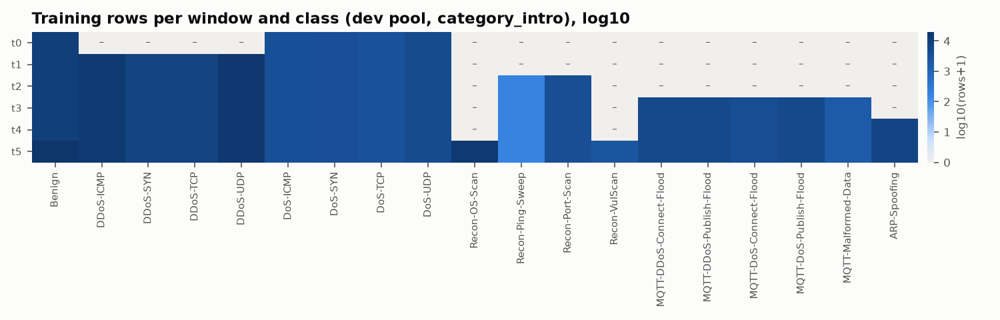
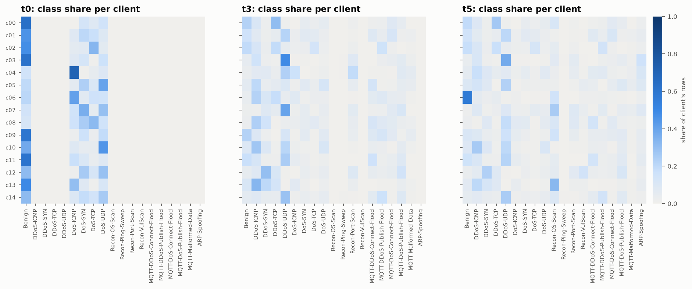
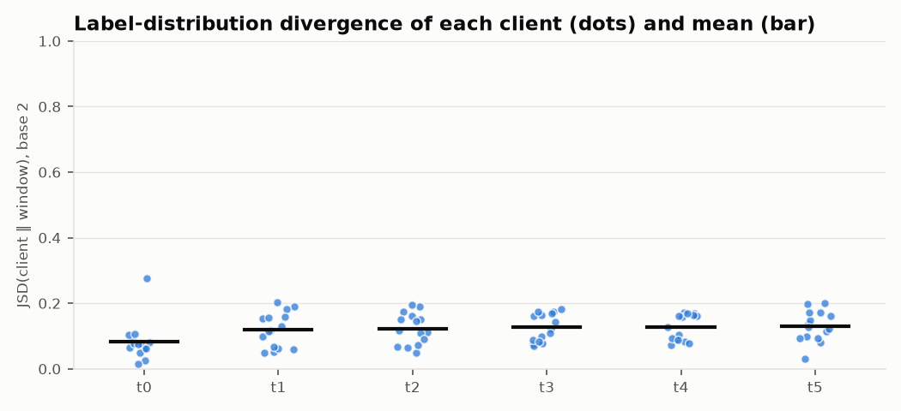

# M2 partition report — `dev` pool, `category_intro` timeline

Generated by `scripts/m2_build_partitions.py` (seed 42). Files: `data/splits/dev/category_intro/`.

## Setup
- 15 Wi-Fi/MQTT clients, Dirichlet α = 1.0 label skew per class; test share 20% per (window, class), client-local.
- Exact duplicates dropped before splitting: 1,347 CSV rows, 47 profiling rows. Train and test are therefore duplicate-disjoint.
- Each class enters at its introduction window and then recurs with **fresh, disjoint rows** in every later window.
- Population drift at t5: clients c04, c05, c07, c08, c09 (⟲) get re-drawn attack mixes, and 5 held-back device groups are onboarded.
- D_pub: 6,523 rows, removed from all client data. Window mode `cumulative`: at window t only classes introduced by t are used.

## Windows

| window | new classes | train rows | test rows | JSD mean | JSD min | JSD max |
|---|---|---:|---:|---:|---:|---:|
| t0 | Benign, DoS-ICMP, DoS-SYN, DoS-TCP, DoS-UDP | 25,142 | 6,281 | 0.083 | 0.014 | 0.275 |
| t1 | DDoS-ICMP, DDoS-SYN, DDoS-TCP, DDoS-UDP | 71,447 | 17,856 | 0.120 | 0.049 | 0.203 |
| t2 | Recon-Ping-Sweep, Recon-Port-Scan | 75,518 | 18,874 | 0.123 | 0.050 | 0.196 |
| t3 | MQTT-DDoS-Connect-Flood, MQTT-DDoS-Publish-Flood, MQTT-DoS-Connect-Flood, MQTT-DoS-Publish-Flood, MQTT-Malformed-Data | 97,367 | 24,338 | 0.126 | 0.070 | 0.181 |
| t4 | ARP-Spoofing | 104,407 | 26,099 | 0.126 | 0.073 | 0.173 |
| t5 | Recon-OS-Scan, Recon-VulScan | 131,283 | 32,819 | 0.129 | 0.030 | 0.200 |

JSD is the Jensen–Shannon divergence between a client's 19-class training distribution and the whole window's, where 0 = identical and 1 = disjoint. It measures how non-IID the clients are.

## Training rows per client and window

| client | t0 | t1 | t2 | t3 | t4 | t5 |
|---|---:|---:|---:|---:|---:|---:|
| c00 | 2,751 | 6,259 | 6,401 | 7,751 | 7,989 | 9,038 |
| c01 | 2,457 | 4,969 | 5,041 | 7,055 | 7,369 | 7,519 |
| c02 | 2,918 | 5,666 | 5,818 | 7,166 | 7,371 | 7,786 |
| c03 | 466 | 4,580 | 5,115 | 6,083 | 7,327 | 7,922 |
| c04 ⟲ | 1,254 | 3,448 | 4,502 | 5,380 | 6,294 | 10,078 |
| c05 ⟲ | 1,682 | 3,876 | 4,154 | 5,524 | 6,996 | 5,887 |
| c06 | 771 | 3,089 | 3,122 | 4,172 | 4,609 | 16,504 |
| c07 ⟲ | 1,023 | 4,954 | 5,420 | 7,015 | 7,053 | 8,938 |
| c08 ⟲ | 1,720 | 4,967 | 5,277 | 7,820 | 7,978 | 7,833 |
| c09 ⟲ | 2,510 | 4,107 | 4,369 | 6,619 | 7,004 | 8,446 |
| c10 | 2,398 | 8,079 | 8,177 | 9,500 | 9,907 | 10,056 |
| c11 | 1,936 | 4,720 | 4,723 | 6,770 | 7,190 | 7,603 |
| c12 | 520 | 2,308 | 2,629 | 3,572 | 3,704 | 4,622 |
| c13 | 1,859 | 7,462 | 7,747 | 8,343 | 8,928 | 13,747 |
| c14 | 877 | 2,963 | 3,023 | 4,597 | 4,688 | 5,304 |

## Benign device ownership (real devices from Zenodo profiling)
Network-wide captures (Active, ActiveBroker, Idle) are spread over all clients. Each device/network group belongs to exactly one client:

- c00: Owltron_Camera|WAN
- c01: M1T_Camera|LAN
- c02: Ecobee_Camera|WAN
- c03: SenseU|LAN
- c04: Owltron_Camera|Power
- c05: Multifunctional_Pager|Power, SenseUBaby|Power (onboarded at drift)
- c06: Owltron_Camera|LAN (onboarded at drift), Singcall|WAN
- c07: M1T_Camera|Power
- c08: Multifunctional_Pager|WAN (onboarded at drift), Singcall|LAN
- c09: M1T_Camera|WAN, Singcall|Power (onboarded at drift)
- c10: Blink_Camera|WAN
- c11: Ecobee_Camera|LAN
- c12: Multifunctional_Pager|LAN, SenseU|WAN
- c13: Blink_Camera|LAN, Blink_Mini_Camera|Power (onboarded at drift)
- c14: Ecobee_Camera|Power

## D_pub by class
Benign: 1,000, DDoS-ICMP: 944, DDoS-SYN: 487, DDoS-TCP: 494, DDoS-UDP: 999, DoS-ICMP: 257, DoS-SYN: 270, DoS-TCP: 231, DoS-UDP: 352, Recon-OS-Scan: 190, Recon-Ping-Sweep: 46, Recon-Port-Scan: 197, Recon-VulScan: 50, MQTT-DDoS-Connect-Flood: 200, MQTT-DDoS-Publish-Flood: 200, MQTT-DoS-Connect-Flood: 159, MQTT-DoS-Publish-Flood: 200, MQTT-Malformed-Data: 69, ARP-Spoofing: 178

## BLE sub-federation (3 clients, official train/test split)

| window | split | benign | BLE-DoS |
|---|---|---:|---:|
| t4 | train | 5,438 | 24,960 |
| t4 | test | 2,500 | 6,293 |
| t5 | train | 5,437 | 24,960 |
| t5 | test | 2,500 | 6,292 |
