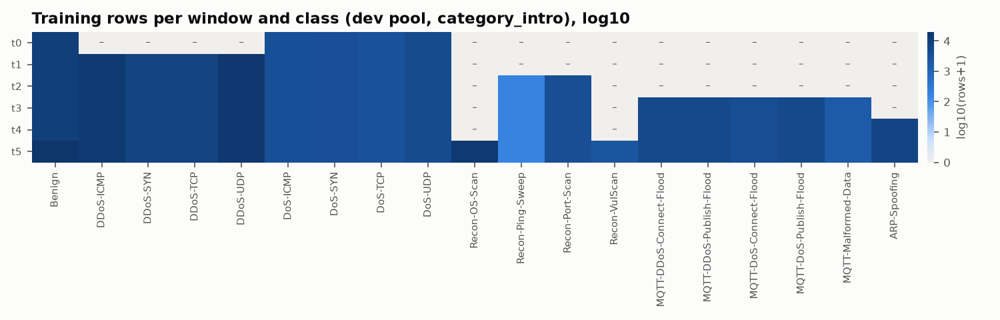
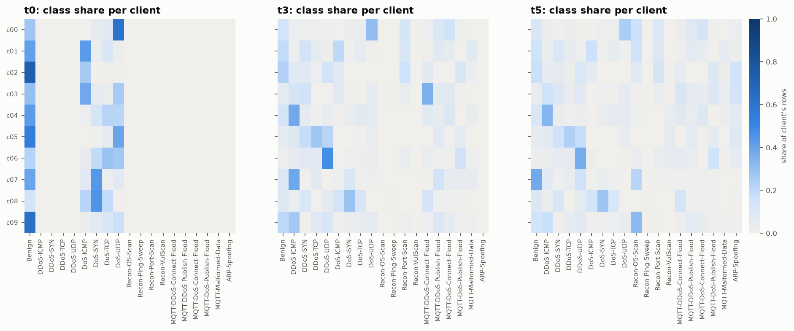
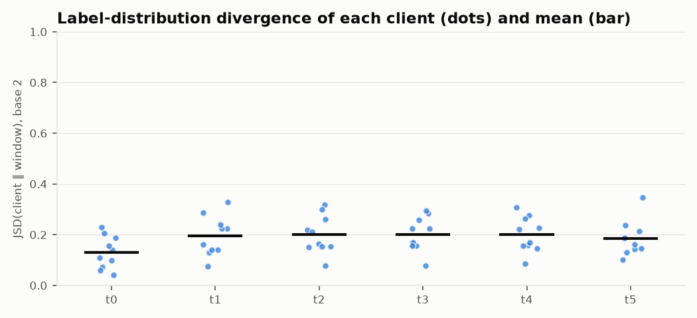

# M2 partition report — `dev` pool, `category_intro` timeline

Generated by `scripts/m2_build_partitions.py` (seed 42). Files: `data/splits/dev/category_intro/`.

## Setup
- 10 Wi-Fi/MQTT clients, Dirichlet α = 0.5 label skew per class; test share 20% per (window, class), client-local.
- Exact duplicates dropped before splitting: 1,347 CSV rows, 47 profiling rows. Train and test are therefore duplicate-disjoint.
- Each class enters at its introduction window and then recurs with **fresh, disjoint rows** in every later window.
- Population drift at t5: clients c03, c06, c07 (⟲) get re-drawn attack mixes, and 5 held-back device groups are onboarded.
- D_pub: 6,523 rows, removed from all client data. Window mode `cumulative`: at window t only classes introduced by t are used.

## Windows

| window | new classes | train rows | test rows | JSD mean | JSD min | JSD max |
|---|---|---:|---:|---:|---:|---:|
| t0 | Benign, DoS-ICMP, DoS-SYN, DoS-TCP, DoS-UDP | 25,142 | 6,281 | 0.130 | 0.042 | 0.229 |
| t1 | DDoS-ICMP, DDoS-SYN, DDoS-TCP, DDoS-UDP | 71,447 | 17,856 | 0.195 | 0.076 | 0.328 |
| t2 | Recon-Ping-Sweep, Recon-Port-Scan | 75,518 | 18,874 | 0.201 | 0.078 | 0.318 |
| t3 | MQTT-DDoS-Connect-Flood, MQTT-DDoS-Publish-Flood, MQTT-DoS-Connect-Flood, MQTT-DoS-Publish-Flood, MQTT-Malformed-Data | 97,367 | 24,338 | 0.201 | 0.078 | 0.295 |
| t4 | ARP-Spoofing | 104,407 | 26,099 | 0.201 | 0.087 | 0.308 |
| t5 | Recon-OS-Scan, Recon-VulScan | 131,283 | 32,819 | 0.185 | 0.101 | 0.348 |

JSD is the Jensen–Shannon divergence between a client's 19-class training distribution and the whole window's, where 0 = identical and 1 = disjoint. It measures how non-IID the clients are.

## Training rows per client and window

| client | t0 | t1 | t2 | t3 | t4 | t5 |
|---|---:|---:|---:|---:|---:|---:|
| c00 | 2,740 | 3,159 | 3,866 | 5,515 | 5,682 | 6,857 |
| c01 | 3,083 | 4,577 | 5,316 | 6,547 | 6,712 | 8,023 |
| c02 | 2,571 | 5,085 | 6,418 | 8,142 | 9,717 | 10,673 |
| c03 ⟲ | 948 | 2,376 | 2,598 | 5,223 | 5,288 | 13,391 |
| c04 | 4,222 | 10,805 | 10,813 | 14,268 | 15,229 | 16,043 |
| c05 | 1,412 | 12,792 | 12,854 | 14,943 | 16,489 | 17,525 |
| c06 ⟲ | 1,641 | 14,675 | 15,391 | 19,484 | 19,647 | 10,822 |
| c07 ⟲ | 1,812 | 5,127 | 5,146 | 7,192 | 9,363 | 26,324 |
| c08 | 3,164 | 4,192 | 4,262 | 5,058 | 5,085 | 5,118 |
| c09 | 3,549 | 8,659 | 8,854 | 10,995 | 11,195 | 16,507 |

## Benign device ownership (real devices from Zenodo profiling)
Network-wide captures (Active, ActiveBroker, Idle) are spread over all clients. Each device/network group belongs to exactly one client:

- c00: Blink_Camera|WAN, Blink_Mini_Camera|Power (onboarded at drift)
- c01: Ecobee_Camera|LAN, Singcall|WAN
- c02: Ecobee_Camera|WAN, M1T_Camera|WAN
- c03: Multifunctional_Pager|WAN (onboarded at drift), Owltron_Camera|Power
- c04: Owltron_Camera|WAN, Singcall|LAN
- c05: Blink_Camera|LAN, SenseU|LAN
- c06: Ecobee_Camera|Power, Singcall|Power (onboarded at drift)
- c07: M1T_Camera|LAN, Owltron_Camera|LAN (onboarded at drift)
- c08: M1T_Camera|Power, Multifunctional_Pager|LAN, SenseUBaby|Power (onboarded at drift)
- c09: Multifunctional_Pager|Power, SenseU|WAN

## D_pub by class
Benign: 1,000, DDoS-ICMP: 944, DDoS-SYN: 487, DDoS-TCP: 494, DDoS-UDP: 999, DoS-ICMP: 257, DoS-SYN: 270, DoS-TCP: 231, DoS-UDP: 352, Recon-OS-Scan: 190, Recon-Ping-Sweep: 46, Recon-Port-Scan: 197, Recon-VulScan: 50, MQTT-DDoS-Connect-Flood: 200, MQTT-DDoS-Publish-Flood: 200, MQTT-DoS-Connect-Flood: 159, MQTT-DoS-Publish-Flood: 200, MQTT-Malformed-Data: 69, ARP-Spoofing: 178

## BLE sub-federation (3 clients, official train/test split)

| window | split | benign | BLE-DoS |
|---|---|---:|---:|
| t4 | train | 5,438 | 24,960 |
| t4 | test | 2,500 | 6,293 |
| t5 | train | 5,437 | 24,960 |
| t5 | test | 2,500 | 6,292 |
