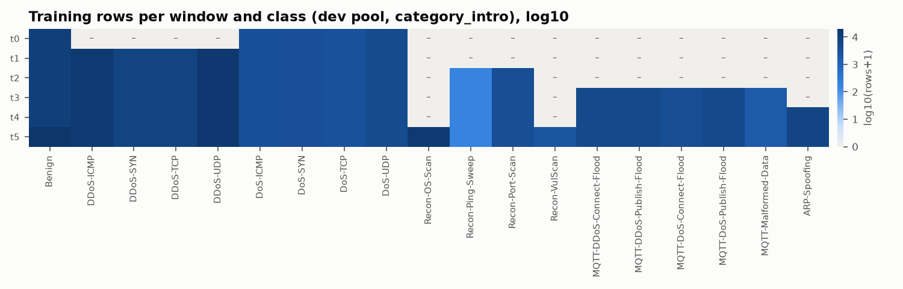
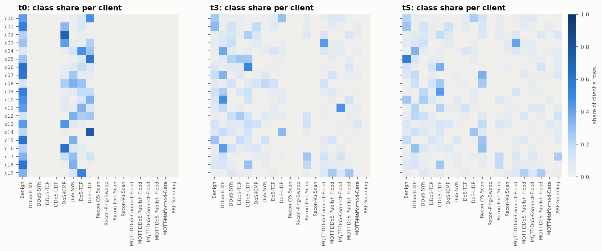
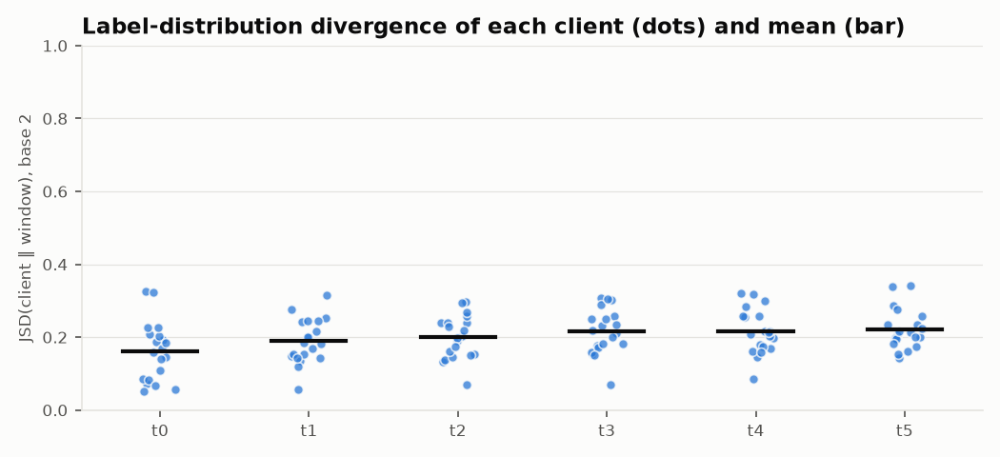

# M2 partition report — `dev` pool, `category_intro` timeline

Generated by `scripts/m2_build_partitions.py` (seed 42). Files: `data/splits/dev/category_intro/`.

## Setup
- 20 Wi-Fi/MQTT clients, Dirichlet α = 0.5 label skew per class; test share 20% per (window, class), client-local.
- Exact duplicates dropped before splitting: 1,347 CSV rows, 47 profiling rows. Train and test are therefore duplicate-disjoint.
- Each class enters at its introduction window and then recurs with **fresh, disjoint rows** in every later window.
- Population drift at t5: clients c05, c06, c08, c09, c10, c11, c12 (⟲) get re-drawn attack mixes, and 5 held-back device groups are onboarded.
- D_pub: 6,523 rows, removed from all client data. Window mode `cumulative`: at window t only classes introduced by t are used.

## Windows

| window | new classes | train rows | test rows | JSD mean | JSD min | JSD max |
|---|---|---:|---:|---:|---:|---:|
| t0 | Benign, DoS-ICMP, DoS-SYN, DoS-TCP, DoS-UDP | 25,142 | 6,281 | 0.161 | 0.052 | 0.326 |
| t1 | DDoS-ICMP, DDoS-SYN, DDoS-TCP, DDoS-UDP | 71,447 | 17,856 | 0.189 | 0.057 | 0.316 |
| t2 | Recon-Ping-Sweep, Recon-Port-Scan | 75,518 | 18,874 | 0.200 | 0.069 | 0.298 |
| t3 | MQTT-DDoS-Connect-Flood, MQTT-DDoS-Publish-Flood, MQTT-DoS-Connect-Flood, MQTT-DoS-Publish-Flood, MQTT-Malformed-Data | 97,367 | 24,338 | 0.215 | 0.071 | 0.306 |
| t4 | ARP-Spoofing | 104,407 | 26,099 | 0.216 | 0.086 | 0.321 |
| t5 | Recon-OS-Scan, Recon-VulScan | 131,283 | 32,819 | 0.222 | 0.142 | 0.341 |

JSD is the Jensen–Shannon divergence between a client's 19-class training distribution and the whole window's, where 0 = identical and 1 = disjoint. It measures how non-IID the clients are.

## Training rows per client and window

| client | t0 | t1 | t2 | t3 | t4 | t5 |
|---|---:|---:|---:|---:|---:|---:|
| c00 | 1,492 | 1,704 | 1,838 | 2,391 | 2,434 | 2,837 |
| c01 | 2,090 | 2,930 | 3,064 | 3,535 | 3,578 | 4,047 |
| c02 | 461 | 1,861 | 2,105 | 2,891 | 3,294 | 3,710 |
| c03 | 435 | 1,174 | 1,226 | 2,595 | 2,612 | 2,808 |
| c04 | 1,339 | 4,277 | 4,281 | 5,674 | 5,920 | 6,360 |
| c05 ⟲ | 393 | 6,666 | 6,682 | 7,487 | 7,884 | 17,660 |
| c06 ⟲ | 1,705 | 9,383 | 9,509 | 11,166 | 11,208 | 7,476 |
| c07 | 1,039 | 2,461 | 2,472 | 3,270 | 3,826 | 5,938 |
| c08 ⟲ | 1,433 | 2,028 | 2,065 | 2,508 | 2,514 | 10,864 |
| c09 ⟲ | 1,388 | 3,857 | 3,893 | 4,733 | 4,784 | 6,393 |
| c10 ⟲ | 1,895 | 7,657 | 7,677 | 9,313 | 10,866 | 4,035 |
| c11 ⟲ | 620 | 1,613 | 1,674 | 3,776 | 4,873 | 6,536 |
| c12 ⟲ | 874 | 3,334 | 3,892 | 4,349 | 4,434 | 7,729 |
| c13 | 2,011 | 4,135 | 5,122 | 5,990 | 6,255 | 8,394 |
| c14 | 2,030 | 4,269 | 4,480 | 4,864 | 5,203 | 5,658 |
| c15 | 3,928 | 6,657 | 6,684 | 8,667 | 9,518 | 13,253 |
| c16 | 707 | 3,476 | 3,493 | 3,933 | 3,933 | 5,654 |
| c17 | 500 | 997 | 1,692 | 2,504 | 3,408 | 3,608 |
| c18 | 468 | 1,845 | 2,452 | 3,031 | 3,068 | 3,203 |
| c19 | 334 | 1,123 | 1,217 | 4,690 | 4,795 | 5,120 |

## Benign device ownership (real devices from Zenodo profiling)
Network-wide captures (Active, ActiveBroker, Idle) are spread over all clients. Each device/network group belongs to exactly one client:

- c00: Blink_Camera|WAN
- c01: Ecobee_Camera|LAN
- c02: Blink_Mini_Camera|Power (onboarded at drift)
- c03: Multifunctional_Pager|WAN (onboarded at drift)
- c04: Singcall|LAN
- c05: Owltron_Camera|LAN (onboarded at drift)
- c06: Ecobee_Camera|WAN
- c07: M1T_Camera|LAN
- c08: SenseU|WAN
- c09: Singcall|Power (onboarded at drift)
- c10: M1T_Camera|WAN
- c11: Owltron_Camera|Power
- c12: Multifunctional_Pager|LAN, SenseUBaby|Power (onboarded at drift)
- c13: Blink_Camera|LAN
- c14: M1T_Camera|Power
- c15: Owltron_Camera|WAN
- c16: Ecobee_Camera|Power
- c17: Singcall|WAN
- c18: SenseU|LAN
- c19: Multifunctional_Pager|Power

## D_pub by class
Benign: 1,000, DDoS-ICMP: 944, DDoS-SYN: 487, DDoS-TCP: 494, DDoS-UDP: 999, DoS-ICMP: 257, DoS-SYN: 270, DoS-TCP: 231, DoS-UDP: 352, Recon-OS-Scan: 190, Recon-Ping-Sweep: 46, Recon-Port-Scan: 197, Recon-VulScan: 50, MQTT-DDoS-Connect-Flood: 200, MQTT-DDoS-Publish-Flood: 200, MQTT-DoS-Connect-Flood: 159, MQTT-DoS-Publish-Flood: 200, MQTT-Malformed-Data: 69, ARP-Spoofing: 178

## BLE sub-federation (3 clients, official train/test split)

| window | split | benign | BLE-DoS |
|---|---|---:|---:|
| t4 | train | 5,438 | 24,960 |
| t4 | test | 2,500 | 6,293 |
| t5 | train | 5,437 | 24,960 |
| t5 | test | 2,500 | 6,292 |
