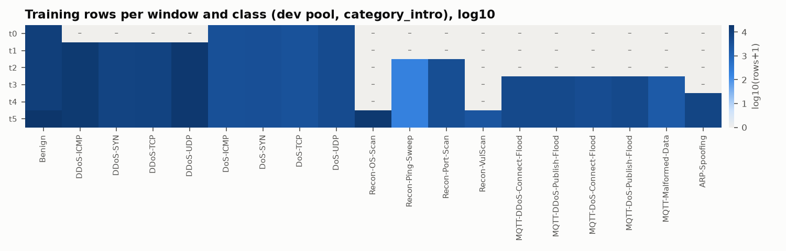
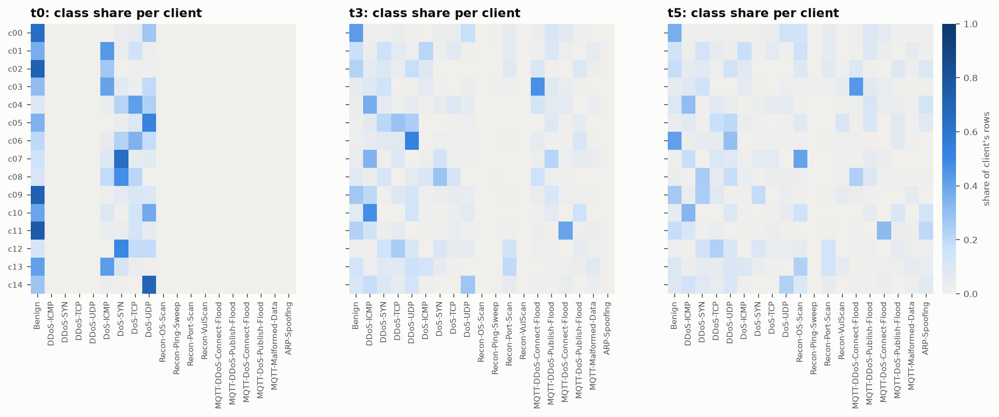
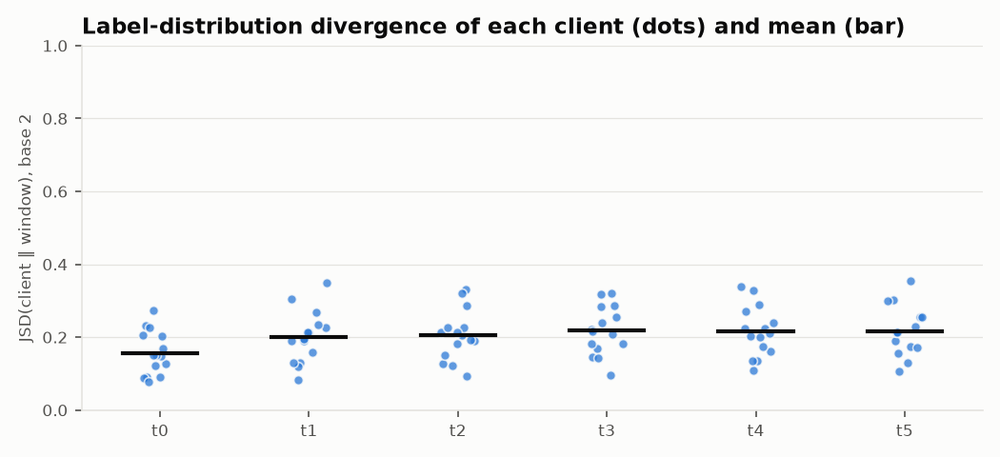

# M2 partition report — `dev` pool, `category_intro` timeline

Generated by `scripts/m2_build_partitions.py` (seed 42). Files: `data/splits/dev/category_intro/`.

## Setup
- 15 Wi-Fi/MQTT clients, Dirichlet α = 0.5 label skew per class; test share 20% per (window, class), client-local.
- Exact duplicates dropped before splitting: 1,347 CSV rows, 47 profiling rows. Train and test are therefore duplicate-disjoint.
- Each class enters at its introduction window and then recurs with **fresh, disjoint rows** in every later window.
- Population drift at t5: clients c04, c05, c07, c08, c09 (⟲) get re-drawn attack mixes, and 5 held-back device groups are onboarded.
- D_pub: 1,000 rows, removed from all client data. Window mode `cumulative`: at window t only classes introduced by t are used.

## Windows

| window | new classes | train rows | test rows | JSD mean | JSD min | JSD max |
|---|---|---:|---:|---:|---:|---:|
| t0 | Benign, DoS-ICMP, DoS-SYN, DoS-TCP, DoS-UDP | 25,289 | 6,318 | 0.157 | 0.077 | 0.274 |
| t1 | DDoS-ICMP, DDoS-SYN, DDoS-TCP, DDoS-UDP | 72,062 | 18,011 | 0.200 | 0.082 | 0.350 |
| t2 | Recon-Ping-Sweep, Recon-Port-Scan | 76,182 | 19,041 | 0.205 | 0.093 | 0.330 |
| t3 | MQTT-DDoS-Connect-Flood, MQTT-DDoS-Publish-Flood, MQTT-DoS-Connect-Flood, MQTT-DoS-Publish-Flood, MQTT-Malformed-Data | 98,256 | 24,559 | 0.218 | 0.095 | 0.322 |
| t4 | ARP-Spoofing | 105,365 | 26,337 | 0.216 | 0.110 | 0.338 |
| t5 | Recon-OS-Scan, Recon-VulScan | 132,429 | 33,105 | 0.217 | 0.106 | 0.354 |

JSD is the Jensen–Shannon divergence between a client's 19-class training distribution and the whole window's, where 0 = identical and 1 = disjoint. It measures how non-IID the clients are.

## Training rows per client and window

| client | t0 | t1 | t2 | t3 | t4 | t5 |
|---|---:|---:|---:|---:|---:|---:|
| c00 | 2,695 | 2,961 | 3,168 | 4,092 | 4,150 | 4,808 |
| c01 | 1,828 | 2,865 | 3,076 | 3,803 | 3,861 | 4,624 |
| c02 | 1,487 | 3,184 | 3,566 | 4,704 | 5,262 | 5,836 |
| c03 | 544 | 1,439 | 1,516 | 3,647 | 3,669 | 3,884 |
| c04 ⟲ | 1,673 | 5,252 | 5,258 | 7,353 | 7,694 | 9,699 |
| c05 ⟲ | 465 | 8,304 | 8,329 | 9,736 | 10,285 | 5,616 |
| c06 | 1,015 | 10,283 | 10,483 | 12,926 | 12,983 | 22,742 |
| c07 ⟲ | 886 | 2,655 | 2,669 | 4,030 | 4,800 | 14,828 |
| c08 ⟲ | 2,159 | 2,876 | 2,925 | 3,608 | 3,617 | 6,543 |
| c09 ⟲ | 2,718 | 5,761 | 5,817 | 7,244 | 7,315 | 5,028 |
| c10 | 1,816 | 8,794 | 8,824 | 11,389 | 13,537 | 16,191 |
| c11 | 1,805 | 3,039 | 3,130 | 6,029 | 7,546 | 7,557 |
| c12 | 1,275 | 4,392 | 5,275 | 5,938 | 6,055 | 6,423 |
| c13 | 2,547 | 5,153 | 6,711 | 7,787 | 8,154 | 11,471 |
| c14 | 2,376 | 5,104 | 5,435 | 5,970 | 6,437 | 7,179 |

## Benign device ownership (real devices from Zenodo profiling)
Network-wide captures (Active, ActiveBroker, Idle) are spread over all clients. Each device/network group belongs to exactly one client:

- c00: Owltron_Camera|WAN
- c01: M1T_Camera|LAN
- c02: Ecobee_Camera|WAN
- c03: SenseU|LAN
- c04: Owltron_Camera|Power
- c05: Multifunctional_Pager|Power, SenseUBaby|Power (onboarded at drift)
- c06: Owltron_Camera|LAN (onboarded at drift), Singcall|WAN
- c07: M1T_Camera|Power
- c08: Multifunctional_Pager|WAN (onboarded at drift), Singcall|LAN
- c09: M1T_Camera|WAN, Singcall|Power (onboarded at drift)
- c10: Blink_Camera|WAN
- c11: Ecobee_Camera|LAN
- c12: Multifunctional_Pager|LAN, SenseU|WAN
- c13: Blink_Camera|LAN, Blink_Mini_Camera|Power (onboarded at drift)
- c14: Ecobee_Camera|Power

## D_pub by class
Benign: 1,000

## BLE sub-federation (3 clients, official train/test split)

| window | split | benign | BLE-DoS |
|---|---|---:|---:|
| t4 | train | 5,438 | 24,960 |
| t4 | test | 2,500 | 6,293 |
| t5 | train | 5,437 | 24,960 |
| t5 | test | 2,500 | 6,292 |
