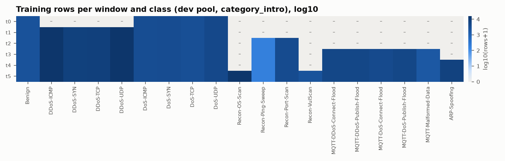
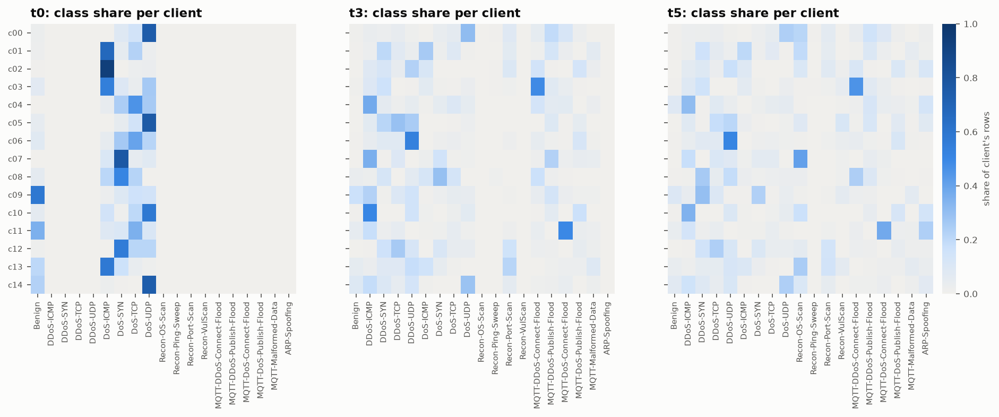
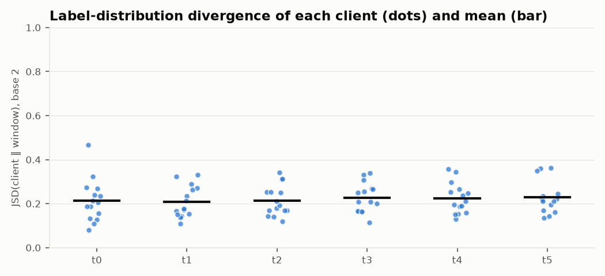

# M2 partition report — `dev` pool, `category_intro` timeline

Generated by `scripts/m2_build_partitions.py` (seed 42). Files: `data/splits/dev/category_intro/`.

## Setup
- 15 Wi-Fi/MQTT clients, Dirichlet α = 0.5 label skew per class; test share 20% per (window, class), client-local.
- Exact duplicates dropped before splitting: 1,347 CSV rows, 47 profiling rows. Train and test are therefore duplicate-disjoint.
- Each class enters at its introduction window and then recurs with **fresh, disjoint rows** in every later window.
- Population drift at t5: clients c04, c05, c07, c08, c09 (⟲) get re-drawn attack mixes, and 0 held-back device groups are onboarded.
- D_pub: 6,523 rows, removed from all client data. Window mode `cumulative`: at window t only classes introduced by t are used.

## Windows

| window | new classes | train rows | test rows | JSD mean | JSD min | JSD max |
|---|---|---:|---:|---:|---:|---:|
| t0 | Benign, DoS-ICMP, DoS-SYN, DoS-TCP, DoS-UDP | 17,203 | 4,300 | 0.214 | 0.081 | 0.468 |
| t1 | DDoS-ICMP, DDoS-SYN, DDoS-TCP, DDoS-UDP | 63,509 | 15,875 | 0.209 | 0.109 | 0.330 |
| t2 | Recon-Ping-Sweep, Recon-Port-Scan | 67,583 | 16,894 | 0.214 | 0.119 | 0.341 |
| t3 | MQTT-DDoS-Connect-Flood, MQTT-DDoS-Publish-Flood, MQTT-DoS-Connect-Flood, MQTT-DoS-Publish-Flood, MQTT-Malformed-Data | 89,435 | 22,358 | 0.228 | 0.115 | 0.340 |
| t4 | ARP-Spoofing | 96,478 | 24,119 | 0.225 | 0.130 | 0.358 |
| t5 | Recon-OS-Scan, Recon-VulScan | 114,018 | 28,504 | 0.229 | 0.135 | 0.362 |

JSD is the Jensen–Shannon divergence between a client's 19-class training distribution and the whole window's, where 0 = identical and 1 = disjoint. It measures how non-IID the clients are.

## Training rows per client and window

| client | t0 | t1 | t2 | t3 | t4 | t5 |
|---|---:|---:|---:|---:|---:|---:|
| c00 | 971 | 1,233 | 1,438 | 2,353 | 2,412 | 3,063 |
| c01 | 1,173 | 2,198 | 2,407 | 3,128 | 3,187 | 3,943 |
| c02 | 423 | 2,104 | 2,482 | 3,609 | 4,162 | 4,729 |
| c03 | 400 | 1,286 | 1,361 | 3,469 | 3,493 | 3,704 |
| c04 ⟲ | 1,504 | 5,049 | 5,054 | 7,129 | 7,466 | 9,456 |
| c05 ⟲ | 315 | 8,076 | 8,099 | 9,491 | 10,035 | 5,382 |
| c06 | 864 | 10,040 | 10,238 | 12,655 | 12,712 | 13,261 |
| c07 ⟲ | 734 | 2,484 | 2,498 | 3,848 | 4,609 | 14,536 |
| c08 ⟲ | 1,996 | 2,706 | 2,753 | 3,428 | 3,436 | 6,310 |
| c09 ⟲ | 1,836 | 4,848 | 4,903 | 6,314 | 6,384 | 4,075 |
| c10 | 1,162 | 8,070 | 8,099 | 10,639 | 12,765 | 15,393 |
| c11 | 659 | 1,882 | 1,973 | 4,844 | 6,345 | 6,356 |
| c12 | 1,117 | 4,203 | 5,077 | 5,733 | 5,850 | 6,216 |
| c13 | 1,858 | 4,438 | 5,980 | 7,044 | 7,408 | 10,645 |
| c14 | 2,191 | 4,892 | 5,221 | 5,751 | 6,214 | 6,949 |

## Benign device ownership (real devices from Zenodo profiling)
Network-wide captures () are spread over all clients. Each device/network group belongs to exactly one client:

## D_pub by class
Benign: 1,000, DDoS-ICMP: 944, DDoS-SYN: 487, DDoS-TCP: 494, DDoS-UDP: 999, DoS-ICMP: 257, DoS-SYN: 270, DoS-TCP: 231, DoS-UDP: 352, Recon-OS-Scan: 190, Recon-Ping-Sweep: 46, Recon-Port-Scan: 197, Recon-VulScan: 50, MQTT-DDoS-Connect-Flood: 200, MQTT-DDoS-Publish-Flood: 200, MQTT-DoS-Connect-Flood: 159, MQTT-DoS-Publish-Flood: 200, MQTT-Malformed-Data: 69, ARP-Spoofing: 178

## BLE sub-federation (3 clients, official train/test split)

| window | split | benign | BLE-DoS |
|---|---|---:|---:|
| t4 | train | 5,438 | 24,960 |
| t4 | test | 2,500 | 6,293 |
| t5 | train | 5,437 | 24,960 |
| t5 | test | 2,500 | 6,292 |
