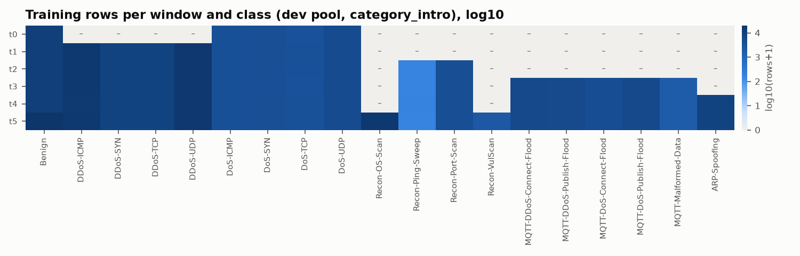
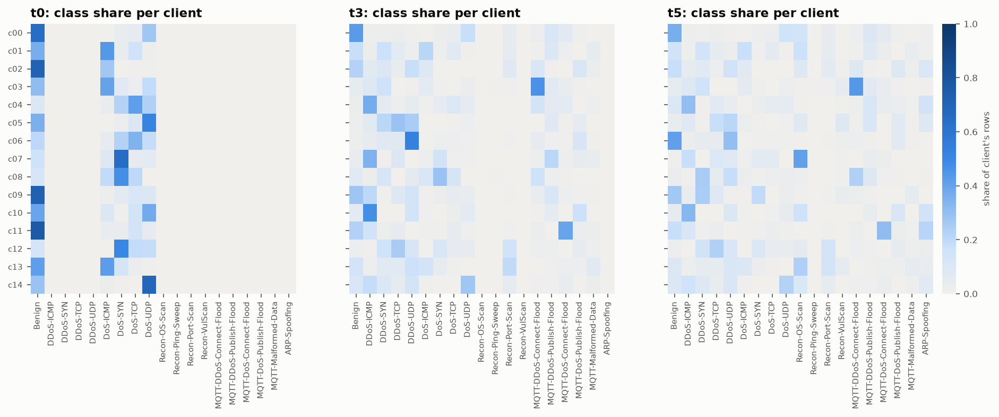
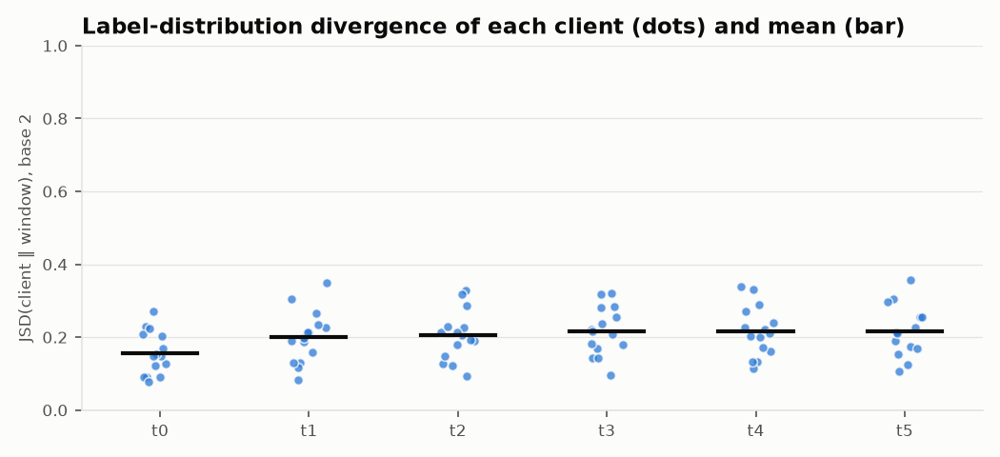

# M2 partition report — `dev` pool, `category_intro` timeline

Generated by `scripts/m2_build_partitions.py` (seed 42). Files: `data/splits/dev/category_intro/`.

## Setup
- 15 Wi-Fi/MQTT clients, Dirichlet α = 0.5 label skew per class; test share 20% per (window, class), client-local.
- Exact duplicates dropped before splitting: 1,347 CSV rows, 47 profiling rows. Train and test are therefore duplicate-disjoint.
- Each class enters at its introduction window and then recurs with **fresh, disjoint rows** in every later window.
- Population drift at t5: clients c04, c05, c07, c08, c09 (⟲) get re-drawn attack mixes, and 5 held-back device groups are onboarded.
- D_pub: 6,523 rows, removed from all client data. Window mode `cumulative`: at window t only classes introduced by t are used.

## Windows

| window | new classes | train rows | test rows | JSD mean | JSD min | JSD max |
|---|---|---:|---:|---:|---:|---:|
| t0 | Benign, DoS-ICMP, DoS-SYN, DoS-TCP, DoS-UDP | 25,395 | 6,028 | 0.157 | 0.077 | 0.272 |
| t1 | DDoS-ICMP, DDoS-SYN, DDoS-TCP, DDoS-UDP | 72,873 | 16,430 | 0.200 | 0.083 | 0.350 |
| t2 | Recon-Ping-Sweep, Recon-Port-Scan | 76,824 | 17,568 | 0.205 | 0.093 | 0.329 |
| t3 | MQTT-DDoS-Connect-Flood, MQTT-DDoS-Publish-Flood, MQTT-DoS-Connect-Flood, MQTT-DoS-Publish-Flood, MQTT-Malformed-Data | 98,520 | 23,185 | 0.217 | 0.096 | 0.321 |
| t4 | ARP-Spoofing | 106,453 | 24,053 | 0.216 | 0.113 | 0.340 |
| t5 | Recon-OS-Scan, Recon-VulScan | 133,686 | 30,416 | 0.217 | 0.106 | 0.356 |

JSD is the Jensen–Shannon divergence between a client's 19-class training distribution and the whole window's, where 0 = identical and 1 = disjoint. It measures how non-IID the clients are.

## Training rows per client and window

| client | t0 | t1 | t2 | t3 | t4 | t5 |
|---|---:|---:|---:|---:|---:|---:|
| c00 | 2,690 | 2,968 | 3,169 | 4,061 | 4,134 | 4,808 |
| c01 | 1,832 | 2,887 | 3,096 | 3,765 | 3,839 | 4,634 |
| c02 | 1,489 | 3,210 | 3,580 | 4,722 | 5,344 | 5,923 |
| c03 | 545 | 1,457 | 1,529 | 3,623 | 3,668 | 3,856 |
| c04 ⟲ | 1,674 | 5,316 | 5,315 | 7,344 | 7,728 | 9,863 |
| c05 ⟲ | 464 | 8,402 | 8,414 | 9,803 | 10,402 | 5,588 |
| c06 | 1,020 | 10,434 | 10,599 | 13,083 | 13,131 | 22,868 |
| c07 ⟲ | 891 | 2,688 | 2,692 | 3,996 | 4,850 | 14,972 |
| c08 ⟲ | 2,176 | 2,923 | 2,963 | 3,615 | 3,641 | 6,568 |
| c09 ⟲ | 2,760 | 5,834 | 5,901 | 7,274 | 7,360 | 5,037 |
| c10 | 1,813 | 8,885 | 8,905 | 11,506 | 13,860 | 16,596 |
| c11 | 1,814 | 3,063 | 3,154 | 6,022 | 7,735 | 7,737 |
| c12 | 1,280 | 4,445 | 5,299 | 5,964 | 6,080 | 6,488 |
| c13 | 2,565 | 5,207 | 6,729 | 7,756 | 8,158 | 11,460 |
| c14 | 2,382 | 5,154 | 5,479 | 5,986 | 6,523 | 7,288 |

## Benign device ownership (real devices from Zenodo profiling)
Network-wide captures (Active, ActiveBroker, Idle) are spread over all clients. Each device/network group belongs to exactly one client:

- c00: Owltron_Camera|WAN
- c01: M1T_Camera|LAN
- c02: Ecobee_Camera|WAN
- c03: SenseU|LAN
- c04: Owltron_Camera|Power
- c05: Multifunctional_Pager|Power, SenseUBaby|Power (onboarded at drift)
- c06: Owltron_Camera|LAN (onboarded at drift), Singcall|WAN
- c07: M1T_Camera|Power
- c08: Multifunctional_Pager|WAN (onboarded at drift), Singcall|LAN
- c09: M1T_Camera|WAN, Singcall|Power (onboarded at drift)
- c10: Blink_Camera|WAN
- c11: Ecobee_Camera|LAN
- c12: Multifunctional_Pager|LAN, SenseU|WAN
- c13: Blink_Camera|LAN, Blink_Mini_Camera|Power (onboarded at drift)
- c14: Ecobee_Camera|Power

## D_pub by class
Benign: 1,000, DDoS-ICMP: 944, DDoS-SYN: 487, DDoS-TCP: 494, DDoS-UDP: 999, DoS-ICMP: 257, DoS-SYN: 270, DoS-TCP: 231, DoS-UDP: 352, Recon-OS-Scan: 190, Recon-Ping-Sweep: 46, Recon-Port-Scan: 197, Recon-VulScan: 50, MQTT-DDoS-Connect-Flood: 200, MQTT-DDoS-Publish-Flood: 200, MQTT-DoS-Connect-Flood: 159, MQTT-DoS-Publish-Flood: 200, MQTT-Malformed-Data: 69, ARP-Spoofing: 178

## BLE sub-federation (3 clients, official train/test split)

| window | split | benign | BLE-DoS |
|---|---|---:|---:|
| t4 | train | 5,438 | 24,960 |
| t4 | test | 2,500 | 6,293 |
| t5 | train | 5,437 | 24,960 |
| t5 | test | 2,500 | 6,292 |
