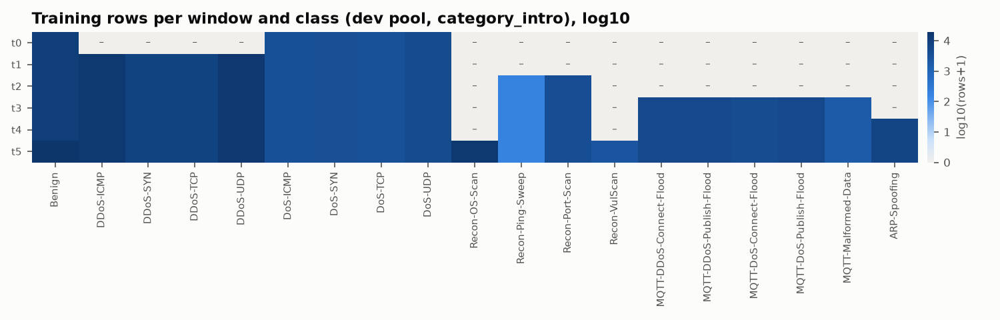
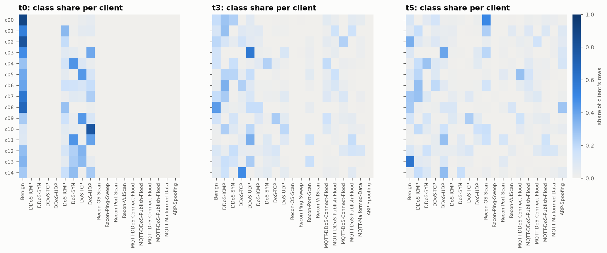
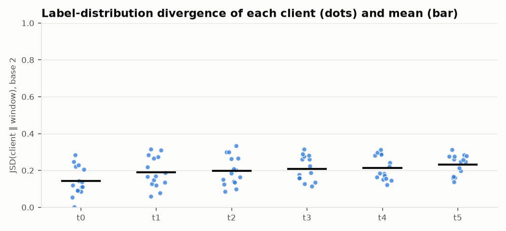

# M2 partition report — `dev` pool, `category_intro` timeline

Generated by `scripts/m2_build_partitions.py` (seed 7). Files: `data/splits/dev/category_intro/`.

## Setup
- 15 Wi-Fi/MQTT clients, Dirichlet α = 0.5 label skew per class; test share 20% per (window, class), client-local.
- Exact duplicates dropped before splitting: 1,347 CSV rows, 43 profiling rows. Train and test are therefore duplicate-disjoint.
- Each class enters at its introduction window and then recurs with **fresh, disjoint rows** in every later window.
- Population drift at t5: clients c00, c04, c05, c07, c14 (⟲) get re-drawn attack mixes, and 5 held-back device groups are onboarded.
- D_pub: 6,523 rows, removed from all client data. Window mode `cumulative`: at window t only classes introduced by t are used.

## Windows

| window | new classes | train rows | test rows | JSD mean | JSD min | JSD max |
|---|---|---:|---:|---:|---:|---:|
| t0 | Benign, DoS-ICMP, DoS-SYN, DoS-TCP, DoS-UDP | 25,234 | 6,308 | 0.142 | 0.001 | 0.283 |
| t1 | DDoS-ICMP, DDoS-SYN, DDoS-TCP, DDoS-UDP | 71,539 | 17,882 | 0.191 | 0.060 | 0.315 |
| t2 | Recon-Ping-Sweep, Recon-Port-Scan | 75,611 | 18,900 | 0.197 | 0.085 | 0.334 |
| t3 | MQTT-DDoS-Connect-Flood, MQTT-DDoS-Publish-Flood, MQTT-DoS-Connect-Flood, MQTT-DoS-Publish-Flood, MQTT-Malformed-Data | 97,459 | 24,364 | 0.209 | 0.115 | 0.316 |
| t4 | ARP-Spoofing | 104,499 | 26,125 | 0.214 | 0.122 | 0.312 |
| t5 | Recon-OS-Scan, Recon-VulScan | 130,777 | 32,694 | 0.232 | 0.137 | 0.313 |

JSD is the Jensen–Shannon divergence between a client's 19-class training distribution and the whole window's, where 0 = identical and 1 = disjoint. It measures how non-IID the clients are.

## Training rows per client and window

| client | t0 | t1 | t2 | t3 | t4 | t5 |
|---|---:|---:|---:|---:|---:|---:|
| c00 ⟲ | 1,009 | 3,923 | 3,963 | 4,967 | 5,985 | 8,567 |
| c01 | 1,474 | 4,413 | 4,448 | 6,715 | 7,654 | 11,040 |
| c02 | 2,192 | 5,479 | 5,656 | 8,658 | 9,573 | 13,228 |
| c03 | 1,780 | 5,279 | 5,477 | 6,009 | 6,969 | 8,870 |
| c04 ⟲ | 2,656 | 3,799 | 3,943 | 5,248 | 5,908 | 8,660 |
| c05 ⟲ | 385 | 7,089 | 7,766 | 10,056 | 10,067 | 7,678 |
| c06 | 801 | 6,557 | 6,738 | 8,584 | 8,666 | 10,110 |
| c07 ⟲ | 2,005 | 4,741 | 4,754 | 6,424 | 6,424 | 4,618 |
| c08 | 2,466 | 3,630 | 3,788 | 3,952 | 5,780 | 6,628 |
| c09 | 2,983 | 3,808 | 3,808 | 5,273 | 5,340 | 5,375 |
| c10 | 2,002 | 6,250 | 6,277 | 7,691 | 8,085 | 9,772 |
| c11 | 2,146 | 6,846 | 8,524 | 10,988 | 11,005 | 13,284 |
| c12 | 1,727 | 3,253 | 3,264 | 5,048 | 5,177 | 5,528 |
| c13 | 825 | 3,203 | 3,922 | 4,096 | 4,113 | 9,683 |
| c14 ⟲ | 783 | 3,269 | 3,283 | 3,750 | 3,753 | 7,736 |

## Benign device ownership (real devices from Zenodo profiling)
Network-wide captures (Active, ActiveBroker, Idle) are spread over all clients. Each device/network group belongs to exactly one client:

- c00: M1T_Camera|WAN, Multifunctional_Pager|LAN
- c01: Blink_Camera|LAN
- c02: M1T_Camera|LAN (onboarded at drift), Owltron_Camera|WAN
- c03: Blink_Camera|WAN
- c04: Singcall|WAN
- c05: Blink_Mini_Camera|Power
- c06: M1T_Camera|Power, SenseUBaby|Power (onboarded at drift)
- c07: Ecobee_Camera|LAN, Multifunctional_Pager|Power (onboarded at drift)
- c08: Owltron_Camera|LAN
- c09: SenseU|LAN
- c10: Multifunctional_Pager|WAN
- c11: SenseU|WAN
- c12: Ecobee_Camera|Power, Owltron_Camera|Power (onboarded at drift)
- c13: Ecobee_Camera|WAN (onboarded at drift), Singcall|LAN
- c14: Singcall|Power

## D_pub by class
Benign: 1,000, DDoS-ICMP: 944, DDoS-SYN: 487, DDoS-TCP: 494, DDoS-UDP: 999, DoS-ICMP: 257, DoS-SYN: 270, DoS-TCP: 231, DoS-UDP: 352, Recon-OS-Scan: 190, Recon-Ping-Sweep: 46, Recon-Port-Scan: 197, Recon-VulScan: 50, MQTT-DDoS-Connect-Flood: 200, MQTT-DDoS-Publish-Flood: 200, MQTT-DoS-Connect-Flood: 159, MQTT-DoS-Publish-Flood: 200, MQTT-Malformed-Data: 69, ARP-Spoofing: 178

## BLE sub-federation (3 clients, official train/test split)

| window | split | benign | BLE-DoS |
|---|---|---:|---:|
| t4 | train | 5,438 | 24,960 |
| t4 | test | 2,500 | 6,293 |
| t5 | train | 5,437 | 24,960 |
| t5 | test | 2,500 | 6,292 |
