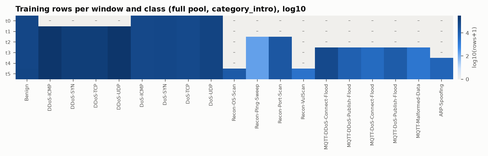
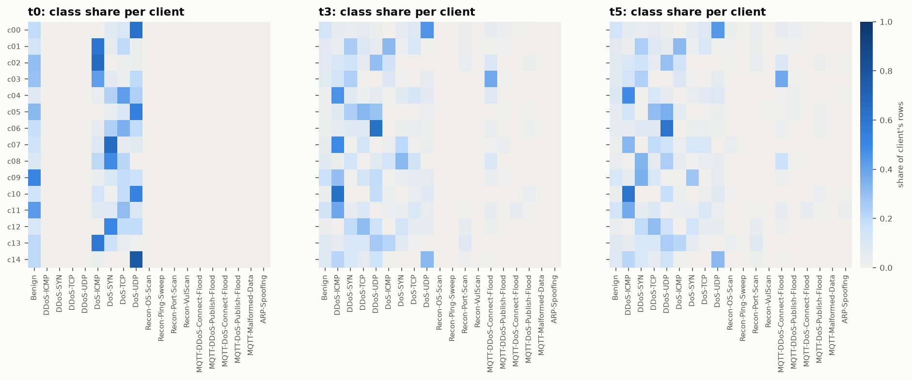
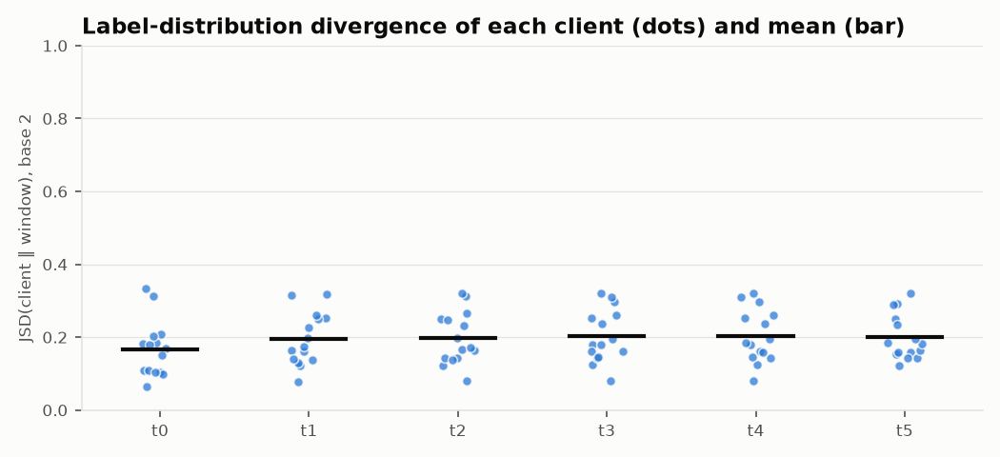

# M2 partition report — `full` pool, `category_intro` timeline

Generated by `scripts/m2_build_partitions.py` (seed 42). Files: `data/splits/full/category_intro/`.

## Setup
- 15 Wi-Fi/MQTT clients, Dirichlet α = 0.5 label skew per class; test share 20% per (window, class), client-local.
- Exact duplicates dropped before splitting: 7,379 CSV rows, 172 profiling rows. Train and test are therefore duplicate-disjoint.
- Each class enters at its introduction window and then recurs with **fresh, disjoint rows** in every later window.
- Population drift at t5: clients c04, c05, c07, c08, c09 (⟲) get re-drawn attack mixes, and 5 held-back device groups are onboarded.
- D_pub: 17,913 rows, removed from all client data. Window mode `cumulative`: at window t only classes introduced by t are used.

## Windows

| window | new classes | train rows | test rows | JSD mean | JSD min | JSD max |
|---|---|---:|---:|---:|---:|---:|
| t0 | Benign, DoS-ICMP, DoS-SYN, DoS-TCP, DoS-UDP | 372,514 | 93,124 | 0.167 | 0.066 | 0.332 |
| t1 | DDoS-ICMP, DDoS-SYN, DDoS-TCP, DDoS-UDP | 1,307,386 | 326,842 | 0.195 | 0.078 | 0.318 |
| t2 | Recon-Ping-Sweep, Recon-Port-Scan | 1,327,266 | 331,812 | 0.197 | 0.081 | 0.321 |
| t3 | MQTT-DDoS-Connect-Flood, MQTT-DDoS-Publish-Flood, MQTT-DoS-Connect-Flood, MQTT-DoS-Publish-Flood, MQTT-Malformed-Data | 1,413,570 | 353,390 | 0.203 | 0.080 | 0.320 |
| t4 | ARP-Spoofing | 1,420,325 | 355,080 | 0.203 | 0.081 | 0.321 |
| t5 | Recon-OS-Scan, Recon-VulScan | 1,447,459 | 361,862 | 0.200 | 0.123 | 0.321 |

JSD is the Jensen–Shannon divergence between a client's 19-class training distribution and the whole window's, where 0 = identical and 1 = disjoint. It measures how non-IID the clients are.

## Training rows per client and window

| client | t0 | t1 | t2 | t3 | t4 | t5 |
|---|---:|---:|---:|---:|---:|---:|
| c00 | 23,694 | 29,011 | 29,984 | 32,563 | 32,618 | 33,280 |
| c01 | 26,718 | 47,436 | 48,462 | 49,870 | 49,926 | 50,696 |
| c02 | 12,150 | 46,057 | 47,902 | 54,844 | 55,374 | 55,951 |
| c03 | 10,550 | 28,444 | 28,735 | 47,529 | 47,550 | 47,760 |
| c04 ⟲ | 33,032 | 104,591 | 104,599 | 116,318 | 116,642 | 122,398 |
| c05 ⟲ | 8,954 | 165,637 | 165,716 | 168,820 | 169,341 | 63,935 |
| c06 | 19,601 | 204,851 | 205,849 | 216,326 | 216,380 | 226,131 |
| c07 ⟲ | 17,525 | 52,887 | 52,901 | 55,940 | 56,671 | 158,711 |
| c08 ⟲ | 42,038 | 56,374 | 56,437 | 62,882 | 62,891 | 96,444 |
| c09 ⟲ | 31,582 | 92,401 | 92,671 | 97,373 | 97,441 | 69,530 |
| c10 | 26,088 | 165,534 | 165,662 | 172,269 | 174,309 | 176,985 |
| c11 | 15,080 | 39,736 | 40,140 | 45,005 | 46,448 | 46,458 |
| c12 | 25,152 | 87,462 | 91,879 | 94,560 | 94,670 | 95,041 |
| c13 | 37,554 | 89,636 | 97,364 | 98,808 | 99,156 | 102,483 |
| c14 | 42,796 | 97,329 | 98,965 | 100,463 | 100,908 | 101,656 |

## Benign device ownership (real devices from Zenodo profiling)
Network-wide captures (Active, ActiveBroker, Idle) are spread over all clients. Each device/network group belongs to exactly one client:

- c00: Owltron_Camera|WAN
- c01: M1T_Camera|LAN
- c02: Ecobee_Camera|WAN
- c03: SenseU|LAN
- c04: Owltron_Camera|Power
- c05: Multifunctional_Pager|Power, SenseUBaby|Power (onboarded at drift)
- c06: Owltron_Camera|LAN (onboarded at drift), Singcall|WAN
- c07: M1T_Camera|Power
- c08: Multifunctional_Pager|WAN (onboarded at drift), Singcall|LAN
- c09: M1T_Camera|WAN, Singcall|Power (onboarded at drift)
- c10: Blink_Camera|WAN
- c11: Ecobee_Camera|LAN
- c12: Multifunctional_Pager|LAN, SenseU|WAN
- c13: Blink_Camera|LAN, Blink_Mini_Camera|Power (onboarded at drift)
- c14: Ecobee_Camera|Power

## D_pub by class
Benign: 5,000, DDoS-ICMP: 968, DDoS-SYN: 500, DDoS-TCP: 507, DDoS-UDP: 1,025, DoS-ICMP: 695, DoS-SYN: 730, DoS-TCP: 624, DoS-UDP: 951, Recon-OS-Scan: 473, Recon-Ping-Sweep: 46, Recon-Port-Scan: 2,429, Recon-VulScan: 76, MQTT-DDoS-Connect-Flood: 1,974, MQTT-DDoS-Publish-Flood: 331, MQTT-DoS-Connect-Flood: 146, MQTT-DoS-Publish-Flood: 486, MQTT-Malformed-Data: 63, ARP-Spoofing: 889

## BLE sub-federation (3 clients, official train/test split)

| window | split | benign | BLE-DoS |
|---|---|---:|---:|
| t4 | train | 108,747 | 499,196 |
| t4 | test | 32,665 | 125,854 |
| t5 | train | 108,746 | 499,195 |
| t5 | test | 32,665 | 125,854 |
