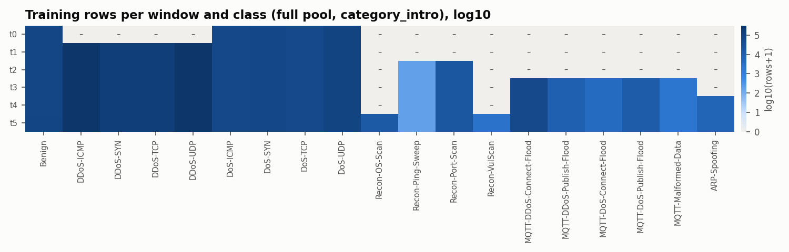
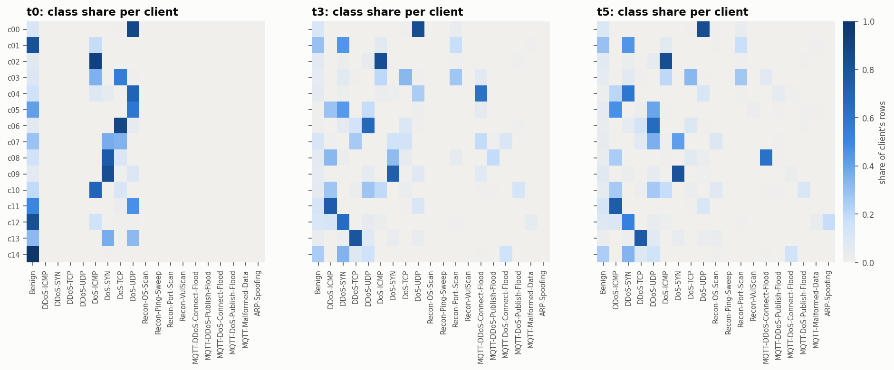
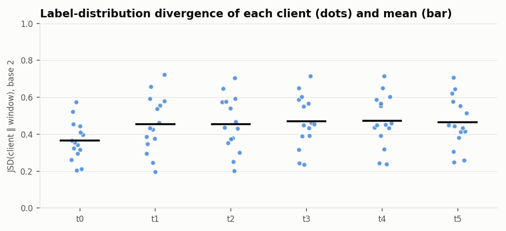

# M2 partition report — `full` pool, `category_intro` timeline

Generated by `scripts/m2_build_partitions.py` (seed 42). Files: `data/splits/full/category_intro/`.

## Setup
- 15 Wi-Fi/MQTT clients, Dirichlet α = 0.1 label skew per class; test share 20% per (window, class), client-local.
- Exact duplicates dropped before splitting: 7,379 CSV rows, 172 profiling rows. Train and test are therefore duplicate-disjoint.
- Each class enters at its introduction window and then recurs with **fresh, disjoint rows** in every later window.
- Population drift at t5: clients c04, c05, c07, c08, c09 (⟲) get re-drawn attack mixes, and 5 held-back device groups are onboarded.
- D_pub: 90,429 rows, removed from all client data. Window mode `cumulative`: at window t only classes introduced by t are used.

## Windows

| window | new classes | train rows | test rows | JSD mean | JSD min | JSD max |
|---|---|---:|---:|---:|---:|---:|
| t0 | Benign, DoS-ICMP, DoS-SYN, DoS-TCP, DoS-UDP | 369,950 | 92,485 | 0.365 | 0.204 | 0.575 |
| t1 | DDoS-ICMP, DDoS-SYN, DDoS-TCP, DDoS-UDP | 1,295,948 | 323,984 | 0.454 | 0.196 | 0.722 |
| t2 | Recon-Ping-Sweep, Recon-Port-Scan | 1,316,112 | 329,025 | 0.455 | 0.202 | 0.705 |
| t3 | MQTT-DDoS-Connect-Flood, MQTT-DDoS-Publish-Flood, MQTT-DoS-Connect-Flood, MQTT-DoS-Publish-Flood, MQTT-Malformed-Data | 1,402,345 | 350,585 | 0.470 | 0.236 | 0.714 |
| t4 | ARP-Spoofing | 1,409,385 | 352,346 | 0.473 | 0.238 | 0.715 |
| t5 | Recon-OS-Scan, Recon-VulScan | 1,436,758 | 359,191 | 0.465 | 0.248 | 0.707 |

JSD is the Jensen–Shannon divergence between a client's 19-class training distribution and the whole window's, where 0 = identical and 1 = disjoint. It measures how non-IID the clients are.

## Training rows per client and window

| client | t0 | t1 | t2 | t3 | t4 | t5 |
|---|---:|---:|---:|---:|---:|---:|
| c00 | 39,047 | 39,047 | 40,587 | 40,636 | 40,636 | 40,812 |
| c01 | 3,949 | 8,909 | 10,860 | 11,041 | 11,041 | 11,109 |
| c02 | 46,891 | 50,157 | 50,967 | 51,487 | 51,513 | 51,641 |
| c03 | 29,476 | 33,062 | 46,564 | 50,006 | 50,005 | 50,054 |
| c04 ⟲ | 17,404 | 18,388 | 18,391 | 49,607 | 49,610 | 170,920 |
| c05 ⟲ | 6,883 | 214,998 | 214,998 | 228,440 | 228,464 | 50,736 |
| c06 | 39,830 | 348,534 | 348,665 | 354,161 | 354,160 | 363,579 |
| c07 ⟲ | 9,414 | 15,656 | 15,732 | 22,938 | 23,014 | 65,652 |
| c08 ⟲ | 18,453 | 34,051 | 35,864 | 44,306 | 44,306 | 83,990 |
| c09 ⟲ | 57,882 | 61,285 | 61,413 | 66,216 | 66,216 | 48,242 |
| c10 | 16,743 | 50,906 | 50,954 | 58,996 | 58,996 | 64,027 |
| c11 | 65,482 | 263,319 | 263,318 | 263,496 | 264,233 | 264,233 |
| c12 | 3,282 | 24,297 | 24,452 | 25,700 | 31,463 | 31,465 |
| c13 | 12,450 | 124,112 | 124,121 | 124,239 | 124,652 | 129,110 |
| c14 | 2,764 | 9,227 | 9,226 | 11,076 | 11,076 | 11,188 |

## Benign device ownership (real devices from Zenodo profiling)
Network-wide captures (Active, ActiveBroker, Idle) are spread over all clients. Each device/network group belongs to exactly one client:

- c00: Owltron_Camera|WAN
- c01: M1T_Camera|LAN
- c02: Ecobee_Camera|WAN
- c03: SenseU|LAN
- c04: Owltron_Camera|Power
- c05: Multifunctional_Pager|Power, SenseUBaby|Power (onboarded at drift)
- c06: Owltron_Camera|LAN (onboarded at drift), Singcall|WAN
- c07: M1T_Camera|Power
- c08: Multifunctional_Pager|WAN (onboarded at drift), Singcall|LAN
- c09: M1T_Camera|WAN, Singcall|Power (onboarded at drift)
- c10: Blink_Camera|WAN
- c11: Ecobee_Camera|LAN
- c12: Multifunctional_Pager|LAN, SenseU|WAN
- c13: Blink_Camera|LAN, Blink_Mini_Camera|Power (onboarded at drift)
- c14: Ecobee_Camera|Power

## D_pub by class
Benign: 5,000, DDoS-ICMP: 18,865, DDoS-SYN: 9,743, DDoS-TCP: 9,871, DDoS-UDP: 19,980, DoS-ICMP: 5,147, DoS-SYN: 5,405, DoS-TCP: 4,625, DoS-UDP: 7,045, Recon-OS-Scan: 197, Recon-Ping-Sweep: 46, Recon-Port-Scan: 1,010, Recon-VulScan: 50, MQTT-DDoS-Connect-Flood: 2,150, MQTT-DDoS-Publish-Flood: 360, MQTT-DoS-Connect-Flood: 159, MQTT-DoS-Publish-Flood: 529, MQTT-Malformed-Data: 69, ARP-Spoofing: 178

## BLE sub-federation (3 clients, official train/test split)

| window | split | benign | BLE-DoS |
|---|---|---:|---:|
| t4 | train | 108,747 | 499,196 |
| t4 | test | 32,665 | 125,854 |
| t5 | train | 108,746 | 499,195 |
| t5 | test | 32,665 | 125,854 |
