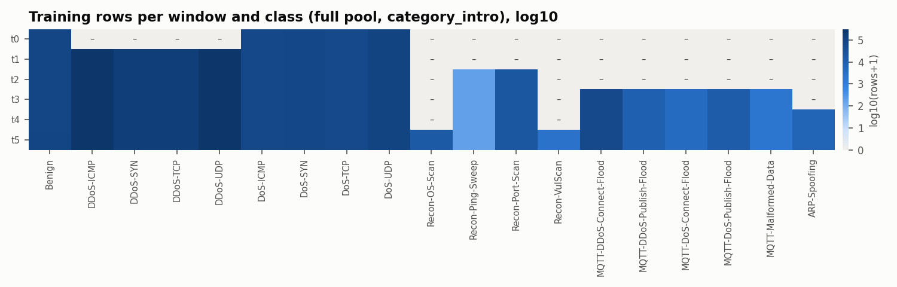
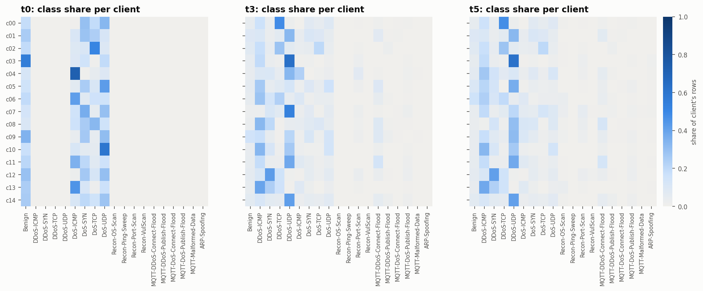
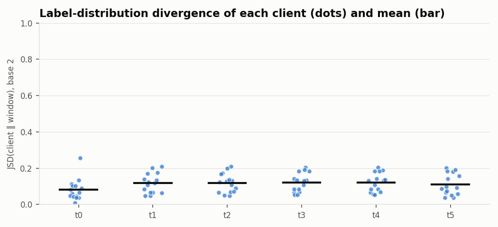

# M2 partition report — `full` pool, `category_intro` timeline

Generated by `scripts/m2_build_partitions.py` (seed 42). Files: `data/splits/full/category_intro/`.

## Setup
- 15 Wi-Fi/MQTT clients, Dirichlet α = 1.0 label skew per class; test share 20% per (window, class), client-local.
- Exact duplicates dropped before splitting: 7,379 CSV rows, 172 profiling rows. Train and test are therefore duplicate-disjoint.
- Each class enters at its introduction window and then recurs with **fresh, disjoint rows** in every later window.
- Population drift at t5: clients c04, c05, c07, c08, c09 (⟲) get re-drawn attack mixes, and 5 held-back device groups are onboarded.
- D_pub: 90,429 rows, removed from all client data. Window mode `cumulative`: at window t only classes introduced by t are used.

## Windows

| window | new classes | train rows | test rows | JSD mean | JSD min | JSD max |
|---|---|---:|---:|---:|---:|---:|
| t0 | Benign, DoS-ICMP, DoS-SYN, DoS-TCP, DoS-UDP | 369,950 | 92,485 | 0.082 | 0.009 | 0.256 |
| t1 | DDoS-ICMP, DDoS-SYN, DDoS-TCP, DDoS-UDP | 1,295,948 | 323,984 | 0.117 | 0.047 | 0.210 |
| t2 | Recon-Ping-Sweep, Recon-Port-Scan | 1,316,112 | 329,025 | 0.118 | 0.048 | 0.209 |
| t3 | MQTT-DDoS-Connect-Flood, MQTT-DDoS-Publish-Flood, MQTT-DoS-Connect-Flood, MQTT-DoS-Publish-Flood, MQTT-Malformed-Data | 1,402,345 | 350,585 | 0.121 | 0.052 | 0.205 |
| t4 | ARP-Spoofing | 1,409,385 | 352,346 | 0.122 | 0.053 | 0.204 |
| t5 | Recon-OS-Scan, Recon-VulScan | 1,436,758 | 359,191 | 0.111 | 0.037 | 0.203 |

JSD is the Jensen–Shannon divergence between a client's 19-class training distribution and the whole window's, where 0 = identical and 1 = disjoint. It measures how non-IID the clients are.

## Training rows per client and window

| client | t0 | t1 | t2 | t3 | t4 | t5 |
|---|---:|---:|---:|---:|---:|---:|
| c00 | 24,811 | 94,973 | 95,676 | 99,115 | 99,353 | 100,435 |
| c01 | 35,628 | 85,853 | 86,170 | 94,306 | 94,620 | 94,773 |
| c02 | 38,163 | 93,129 | 93,894 | 96,257 | 96,462 | 96,889 |
| c03 | 8,037 | 90,299 | 92,860 | 94,808 | 96,052 | 96,665 |
| c04 ⟲ | 24,460 | 68,348 | 73,647 | 75,839 | 76,754 | 130,451 |
| c05 ⟲ | 31,929 | 75,808 | 77,218 | 86,128 | 87,600 | 73,007 |
| c06 | 15,126 | 61,489 | 61,614 | 65,925 | 66,362 | 78,337 |
| c07 ⟲ | 20,304 | 98,920 | 101,298 | 105,437 | 105,475 | 78,251 |
| c08 ⟲ | 33,659 | 98,592 | 100,179 | 112,626 | 112,784 | 95,983 |
| c09 ⟲ | 31,142 | 63,077 | 64,377 | 72,996 | 73,381 | 84,321 |
| c10 | 36,172 | 149,775 | 150,235 | 155,968 | 156,375 | 156,524 |
| c11 | 19,386 | 75,058 | 75,082 | 88,588 | 89,007 | 89,433 |
| c12 | 10,075 | 45,822 | 47,438 | 50,817 | 50,949 | 51,876 |
| c13 | 25,007 | 137,039 | 138,503 | 139,796 | 140,381 | 145,349 |
| c14 | 16,051 | 57,766 | 57,921 | 63,739 | 63,830 | 64,464 |

## Benign device ownership (real devices from Zenodo profiling)
Network-wide captures (Active, ActiveBroker, Idle) are spread over all clients. Each device/network group belongs to exactly one client:

- c00: Owltron_Camera|WAN
- c01: M1T_Camera|LAN
- c02: Ecobee_Camera|WAN
- c03: SenseU|LAN
- c04: Owltron_Camera|Power
- c05: Multifunctional_Pager|Power, SenseUBaby|Power (onboarded at drift)
- c06: Owltron_Camera|LAN (onboarded at drift), Singcall|WAN
- c07: M1T_Camera|Power
- c08: Multifunctional_Pager|WAN (onboarded at drift), Singcall|LAN
- c09: M1T_Camera|WAN, Singcall|Power (onboarded at drift)
- c10: Blink_Camera|WAN
- c11: Ecobee_Camera|LAN
- c12: Multifunctional_Pager|LAN, SenseU|WAN
- c13: Blink_Camera|LAN, Blink_Mini_Camera|Power (onboarded at drift)
- c14: Ecobee_Camera|Power

## D_pub by class
Benign: 5,000, DDoS-ICMP: 18,865, DDoS-SYN: 9,743, DDoS-TCP: 9,871, DDoS-UDP: 19,980, DoS-ICMP: 5,147, DoS-SYN: 5,405, DoS-TCP: 4,625, DoS-UDP: 7,045, Recon-OS-Scan: 197, Recon-Ping-Sweep: 46, Recon-Port-Scan: 1,010, Recon-VulScan: 50, MQTT-DDoS-Connect-Flood: 2,150, MQTT-DDoS-Publish-Flood: 360, MQTT-DoS-Connect-Flood: 159, MQTT-DoS-Publish-Flood: 529, MQTT-Malformed-Data: 69, ARP-Spoofing: 178

## BLE sub-federation (3 clients, official train/test split)

| window | split | benign | BLE-DoS |
|---|---|---:|---:|
| t4 | train | 108,747 | 499,196 |
| t4 | test | 32,665 | 125,854 |
| t5 | train | 108,746 | 499,195 |
| t5 | test | 32,665 | 125,854 |
