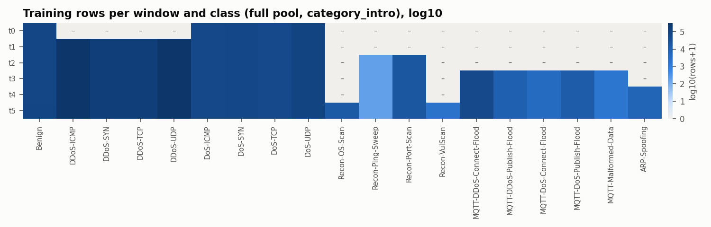
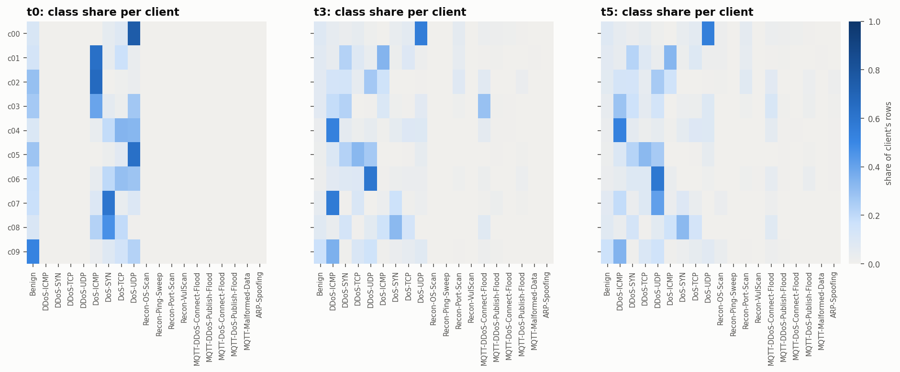
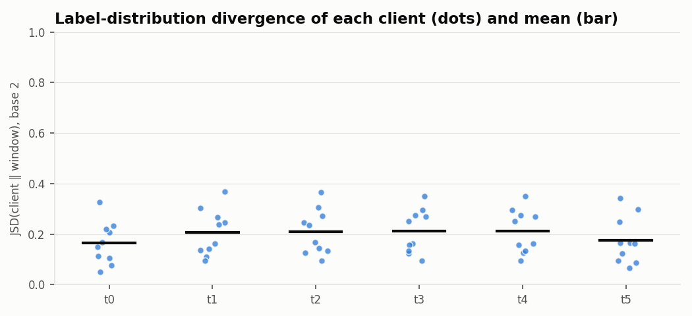

# M2 partition report — `full` pool, `category_intro` timeline

Generated by `scripts/m2_build_partitions.py` (seed 42). Files: `data/splits/full/category_intro/`.

## Setup
- 10 Wi-Fi/MQTT clients, Dirichlet α = 0.5 label skew per class; test share 20% per (window, class), client-local.
- Exact duplicates dropped before splitting: 7,379 CSV rows, 172 profiling rows. Train and test are therefore duplicate-disjoint.
- Each class enters at its introduction window and then recurs with **fresh, disjoint rows** in every later window.
- Population drift at t5: clients c03, c06, c07 (⟲) get re-drawn attack mixes, and 5 held-back device groups are onboarded.
- D_pub: 90,429 rows, removed from all client data. Window mode `cumulative`: at window t only classes introduced by t are used.

## Windows

| window | new classes | train rows | test rows | JSD mean | JSD min | JSD max |
|---|---|---:|---:|---:|---:|---:|
| t0 | Benign, DoS-ICMP, DoS-SYN, DoS-TCP, DoS-UDP | 369,950 | 92,485 | 0.164 | 0.049 | 0.327 |
| t1 | DDoS-ICMP, DDoS-SYN, DDoS-TCP, DDoS-UDP | 1,295,948 | 323,984 | 0.207 | 0.094 | 0.368 |
| t2 | Recon-Ping-Sweep, Recon-Port-Scan | 1,316,112 | 329,025 | 0.209 | 0.095 | 0.365 |
| t3 | MQTT-DDoS-Connect-Flood, MQTT-DDoS-Publish-Flood, MQTT-DoS-Connect-Flood, MQTT-DoS-Publish-Flood, MQTT-Malformed-Data | 1,402,345 | 350,585 | 0.211 | 0.095 | 0.350 |
| t4 | ARP-Spoofing | 1,409,385 | 352,346 | 0.212 | 0.096 | 0.349 |
| t5 | Recon-OS-Scan, Recon-VulScan | 1,436,758 | 359,191 | 0.175 | 0.066 | 0.343 |

JSD is the Jensen–Shannon divergence between a client's 19-class training distribution and the whole window's, where 0 = identical and 1 = disjoint. It measures how non-IID the clients are.

## Training rows per client and window

| client | t0 | t1 | t2 | t3 | t4 | t5 |
|---|---:|---:|---:|---:|---:|---:|
| c00 | 44,752 | 53,145 | 56,687 | 60,280 | 60,447 | 61,659 |
| c01 | 42,081 | 71,957 | 75,711 | 77,737 | 77,902 | 79,256 |
| c02 | 19,787 | 70,025 | 76,777 | 85,495 | 87,070 | 88,051 |
| c03 ⟲ | 18,121 | 46,667 | 47,686 | 68,693 | 68,759 | 153,692 |
| c04 | 54,314 | 185,954 | 185,971 | 200,092 | 201,053 | 201,879 |
| c05 | 17,674 | 245,249 | 245,515 | 250,191 | 251,737 | 252,776 |
| c06 ⟲ | 31,174 | 291,858 | 295,534 | 310,351 | 310,514 | 136,305 |
| c07 ⟲ | 26,576 | 92,855 | 92,875 | 97,057 | 99,228 | 204,945 |
| c08 | 61,215 | 81,792 | 81,920 | 89,072 | 89,099 | 89,132 |
| c09 | 54,256 | 156,446 | 157,436 | 163,377 | 163,576 | 169,063 |

## Benign device ownership (real devices from Zenodo profiling)
Network-wide captures (Active, ActiveBroker, Idle) are spread over all clients. Each device/network group belongs to exactly one client:

- c00: Blink_Camera|WAN, Blink_Mini_Camera|Power (onboarded at drift)
- c01: Ecobee_Camera|LAN, Singcall|WAN
- c02: Ecobee_Camera|WAN, M1T_Camera|WAN
- c03: Multifunctional_Pager|WAN (onboarded at drift), Owltron_Camera|Power
- c04: Owltron_Camera|WAN, Singcall|LAN
- c05: Blink_Camera|LAN, SenseU|LAN
- c06: Ecobee_Camera|Power, Singcall|Power (onboarded at drift)
- c07: M1T_Camera|LAN, Owltron_Camera|LAN (onboarded at drift)
- c08: M1T_Camera|Power, Multifunctional_Pager|LAN, SenseUBaby|Power (onboarded at drift)
- c09: Multifunctional_Pager|Power, SenseU|WAN

## D_pub by class
Benign: 5,000, DDoS-ICMP: 18,865, DDoS-SYN: 9,743, DDoS-TCP: 9,871, DDoS-UDP: 19,980, DoS-ICMP: 5,147, DoS-SYN: 5,405, DoS-TCP: 4,625, DoS-UDP: 7,045, Recon-OS-Scan: 197, Recon-Ping-Sweep: 46, Recon-Port-Scan: 1,010, Recon-VulScan: 50, MQTT-DDoS-Connect-Flood: 2,150, MQTT-DDoS-Publish-Flood: 360, MQTT-DoS-Connect-Flood: 159, MQTT-DoS-Publish-Flood: 529, MQTT-Malformed-Data: 69, ARP-Spoofing: 178

## BLE sub-federation (3 clients, official train/test split)

| window | split | benign | BLE-DoS |
|---|---|---:|---:|
| t4 | train | 108,747 | 499,196 |
| t4 | test | 32,665 | 125,854 |
| t5 | train | 108,746 | 499,195 |
| t5 | test | 32,665 | 125,854 |
