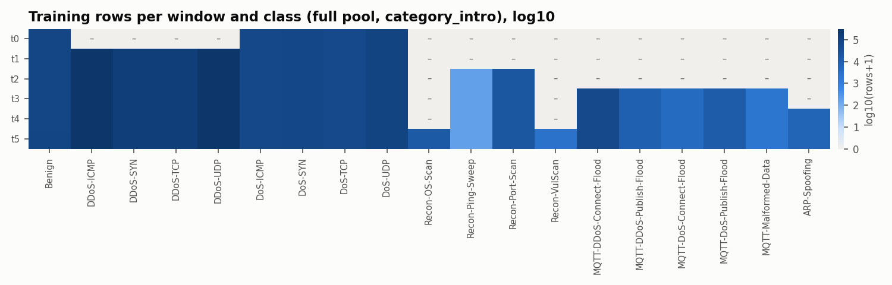
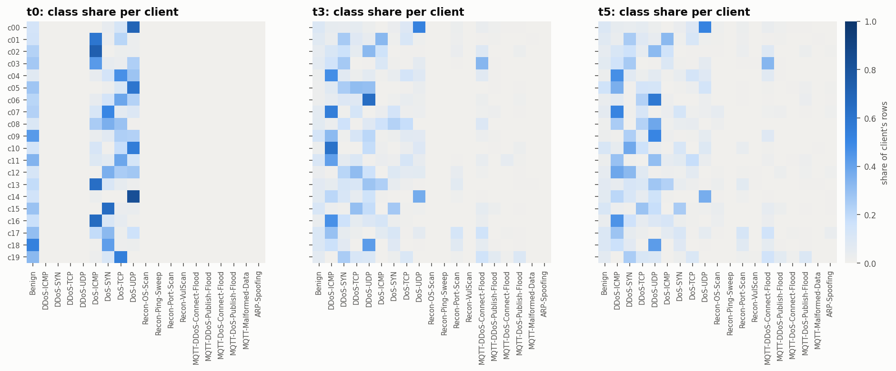
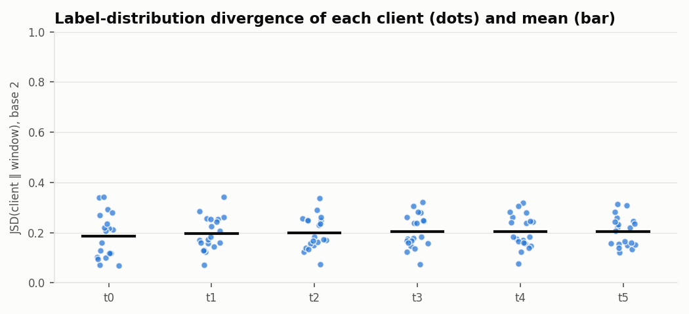

# M2 partition report — `full` pool, `category_intro` timeline

Generated by `scripts/m2_build_partitions.py` (seed 42). Files: `data/splits/full/category_intro/`.

## Setup
- 20 Wi-Fi/MQTT clients, Dirichlet α = 0.5 label skew per class; test share 20% per (window, class), client-local.
- Exact duplicates dropped before splitting: 7,379 CSV rows, 172 profiling rows. Train and test are therefore duplicate-disjoint.
- Each class enters at its introduction window and then recurs with **fresh, disjoint rows** in every later window.
- Population drift at t5: clients c05, c06, c08, c09, c10, c11, c12 (⟲) get re-drawn attack mixes, and 5 held-back device groups are onboarded.
- D_pub: 90,429 rows, removed from all client data. Window mode `cumulative`: at window t only classes introduced by t are used.

## Windows

| window | new classes | train rows | test rows | JSD mean | JSD min | JSD max |
|---|---|---:|---:|---:|---:|---:|
| t0 | Benign, DoS-ICMP, DoS-SYN, DoS-TCP, DoS-UDP | 369,950 | 92,485 | 0.185 | 0.070 | 0.341 |
| t1 | DDoS-ICMP, DDoS-SYN, DDoS-TCP, DDoS-UDP | 1,295,948 | 323,984 | 0.197 | 0.071 | 0.343 |
| t2 | Recon-Ping-Sweep, Recon-Port-Scan | 1,316,112 | 329,025 | 0.200 | 0.074 | 0.337 |
| t3 | MQTT-DDoS-Connect-Flood, MQTT-DDoS-Publish-Flood, MQTT-DoS-Connect-Flood, MQTT-DoS-Publish-Flood, MQTT-Malformed-Data | 1,402,345 | 350,585 | 0.204 | 0.075 | 0.320 |
| t4 | ARP-Spoofing | 1,409,385 | 352,346 | 0.205 | 0.076 | 0.320 |
| t5 | Recon-OS-Scan, Recon-VulScan | 1,436,758 | 359,191 | 0.205 | 0.122 | 0.314 |

JSD is the Jensen–Shannon divergence between a client's 19-class training distribution and the whole window's, where 0 = identical and 1 = disjoint. It measures how non-IID the clients are.

## Training rows per client and window

| client | t0 | t1 | t2 | t3 | t4 | t5 |
|---|---:|---:|---:|---:|---:|---:|
| c00 | 20,070 | 24,308 | 24,941 | 26,543 | 26,586 | 27,003 |
| c01 | 22,537 | 39,323 | 39,987 | 40,865 | 40,908 | 41,393 |
| c02 | 9,155 | 37,170 | 38,368 | 43,039 | 43,442 | 43,867 |
| c03 | 8,514 | 23,301 | 23,493 | 35,924 | 35,941 | 36,139 |
| c04 | 26,606 | 85,358 | 85,364 | 93,116 | 93,362 | 93,805 |
| c05 ⟲ | 7,744 | 133,182 | 133,234 | 135,090 | 135,487 | 115,670 |
| c06 ⟲ | 16,214 | 169,750 | 170,397 | 177,453 | 177,495 | 93,033 |
| c07 | 11,124 | 39,593 | 39,605 | 41,418 | 41,974 | 44,155 |
| c08 ⟲ | 28,029 | 39,933 | 39,981 | 44,254 | 44,260 | 147,107 |
| c09 ⟲ | 22,480 | 71,844 | 72,020 | 74,944 | 74,995 | 110,039 |
| c10 ⟲ | 23,516 | 138,709 | 138,793 | 143,123 | 144,675 | 51,528 |
| c11 ⟲ | 10,913 | 30,802 | 31,067 | 34,500 | 35,597 | 97,658 |
| c12 ⟲ | 17,240 | 66,420 | 69,281 | 71,083 | 71,168 | 82,898 |
| c13 | 28,107 | 70,590 | 75,598 | 76,711 | 76,976 | 79,170 |
| c14 | 38,026 | 82,776 | 83,838 | 84,854 | 85,193 | 85,663 |
| c15 | 42,647 | 97,197 | 97,295 | 105,478 | 106,330 | 110,188 |
| c16 | 13,337 | 68,714 | 68,747 | 71,224 | 71,224 | 72,999 |
| c17 | 9,384 | 19,328 | 22,876 | 27,585 | 28,489 | 28,695 |
| c18 | 7,837 | 35,392 | 38,490 | 41,312 | 41,349 | 41,488 |
| c19 | 6,470 | 22,258 | 22,737 | 33,829 | 33,934 | 34,260 |

## Benign device ownership (real devices from Zenodo profiling)
Network-wide captures (Active, ActiveBroker, Idle) are spread over all clients. Each device/network group belongs to exactly one client:

- c00: Blink_Camera|WAN
- c01: Ecobee_Camera|LAN
- c02: Blink_Mini_Camera|Power (onboarded at drift)
- c03: Multifunctional_Pager|WAN (onboarded at drift)
- c04: Singcall|LAN
- c05: Owltron_Camera|LAN (onboarded at drift)
- c06: Ecobee_Camera|WAN
- c07: M1T_Camera|LAN
- c08: SenseU|WAN
- c09: Singcall|Power (onboarded at drift)
- c10: M1T_Camera|WAN
- c11: Owltron_Camera|Power
- c12: Multifunctional_Pager|LAN, SenseUBaby|Power (onboarded at drift)
- c13: Blink_Camera|LAN
- c14: M1T_Camera|Power
- c15: Owltron_Camera|WAN
- c16: Ecobee_Camera|Power
- c17: Singcall|WAN
- c18: SenseU|LAN
- c19: Multifunctional_Pager|Power

## D_pub by class
Benign: 5,000, DDoS-ICMP: 18,865, DDoS-SYN: 9,743, DDoS-TCP: 9,871, DDoS-UDP: 19,980, DoS-ICMP: 5,147, DoS-SYN: 5,405, DoS-TCP: 4,625, DoS-UDP: 7,045, Recon-OS-Scan: 197, Recon-Ping-Sweep: 46, Recon-Port-Scan: 1,010, Recon-VulScan: 50, MQTT-DDoS-Connect-Flood: 2,150, MQTT-DDoS-Publish-Flood: 360, MQTT-DoS-Connect-Flood: 159, MQTT-DoS-Publish-Flood: 529, MQTT-Malformed-Data: 69, ARP-Spoofing: 178

## BLE sub-federation (3 clients, official train/test split)

| window | split | benign | BLE-DoS |
|---|---|---:|---:|
| t4 | train | 108,747 | 499,196 |
| t4 | test | 32,665 | 125,854 |
| t5 | train | 108,746 | 499,195 |
| t5 | test | 32,665 | 125,854 |
