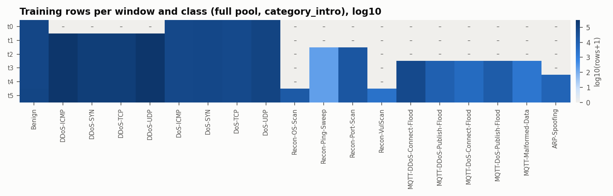
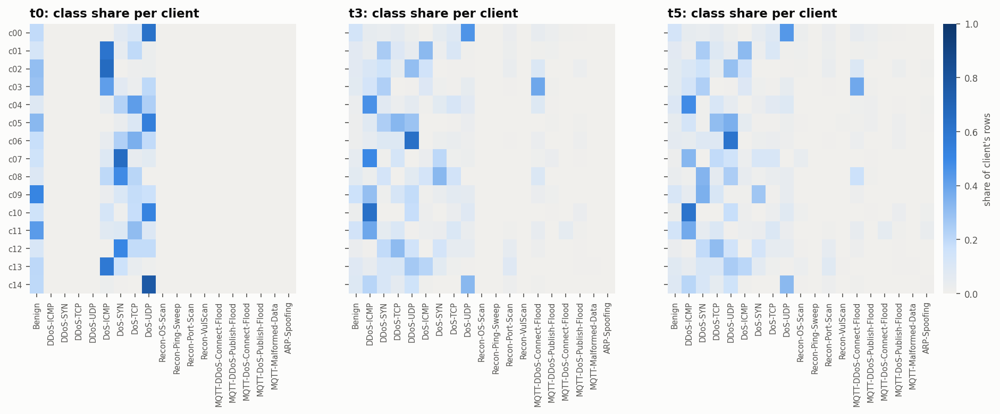
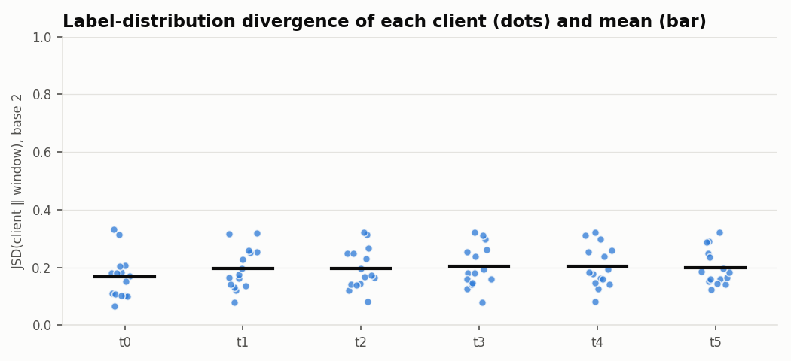

# M2 partition report — `full` pool, `category_intro` timeline

Generated by `scripts/m2_build_partitions.py` (seed 42). Files: `data/splits/full/category_intro/`.

## Setup
- 15 Wi-Fi/MQTT clients, Dirichlet α = 0.5 label skew per class; test share 20% per (window, class), client-local.
- Exact duplicates dropped before splitting: 7,379 CSV rows, 172 profiling rows. Train and test are therefore duplicate-disjoint.
- Each class enters at its introduction window and then recurs with **fresh, disjoint rows** in every later window.
- Population drift at t5: clients c04, c05, c07, c08, c09 (⟲) get re-drawn attack mixes, and 5 held-back device groups are onboarded.
- D_pub: 5,000 rows, removed from all client data. Window mode `cumulative`: at window t only classes introduced by t are used.

## Windows

| window | new classes | train rows | test rows | JSD mean | JSD min | JSD max |
|---|---|---:|---:|---:|---:|---:|
| t0 | Benign, DoS-ICMP, DoS-SYN, DoS-TCP, DoS-UDP | 372,912 | 93,226 | 0.168 | 0.066 | 0.333 |
| t1 | DDoS-ICMP, DDoS-SYN, DDoS-TCP, DDoS-UDP | 1,308,264 | 327,064 | 0.195 | 0.078 | 0.318 |
| t2 | Recon-Ping-Sweep, Recon-Port-Scan | 1,328,641 | 332,157 | 0.197 | 0.081 | 0.321 |
| t3 | MQTT-DDoS-Connect-Flood, MQTT-DDoS-Publish-Flood, MQTT-DoS-Connect-Flood, MQTT-DoS-Publish-Flood, MQTT-Malformed-Data | 1,415,746 | 353,933 | 0.203 | 0.080 | 0.320 |
| t4 | ARP-Spoofing | 1,422,856 | 355,711 | 0.204 | 0.081 | 0.321 |
| t5 | Recon-OS-Scan, Recon-VulScan | 1,450,427 | 362,606 | 0.200 | 0.123 | 0.322 |

JSD is the Jensen–Shannon divergence between a client's 19-class training distribution and the whole window's, where 0 = identical and 1 = disjoint. It measures how non-IID the clients are.

## Training rows per client and window

| client | t0 | t1 | t2 | t3 | t4 | t5 |
|---|---:|---:|---:|---:|---:|---:|
| c00 | 23,718 | 29,037 | 30,035 | 32,638 | 32,696 | 33,375 |
| c01 | 26,749 | 47,478 | 48,529 | 49,951 | 50,009 | 50,798 |
| c02 | 12,161 | 46,085 | 47,976 | 54,982 | 55,540 | 56,132 |
| c03 | 10,560 | 28,463 | 28,762 | 47,730 | 47,752 | 47,969 |
| c04 ⟲ | 33,073 | 104,670 | 104,679 | 116,507 | 116,848 | 122,586 |
| c05 ⟲ | 8,963 | 165,727 | 165,808 | 168,942 | 169,491 | 64,045 |
| c06 | 19,623 | 204,967 | 205,990 | 216,565 | 216,622 | 226,385 |
| c07 ⟲ | 17,546 | 52,927 | 52,941 | 56,009 | 56,779 | 158,997 |
| c08 ⟲ | 42,090 | 56,433 | 56,498 | 63,003 | 63,013 | 96,664 |
| c09 ⟲ | 31,602 | 92,451 | 92,728 | 97,473 | 97,544 | 69,604 |
| c10 | 26,117 | 165,636 | 165,767 | 172,436 | 174,583 | 177,324 |
| c11 | 15,091 | 39,759 | 40,174 | 45,083 | 46,601 | 46,613 |
| c12 | 25,181 | 87,523 | 92,050 | 94,756 | 94,874 | 95,255 |
| c13 | 37,594 | 89,703 | 97,622 | 99,079 | 99,446 | 102,854 |
| c14 | 42,844 | 97,405 | 99,082 | 100,592 | 101,058 | 101,826 |

## Benign device ownership (real devices from Zenodo profiling)
Network-wide captures (Active, ActiveBroker, Idle) are spread over all clients. Each device/network group belongs to exactly one client:

- c00: Owltron_Camera|WAN
- c01: M1T_Camera|LAN
- c02: Ecobee_Camera|WAN
- c03: SenseU|LAN
- c04: Owltron_Camera|Power
- c05: Multifunctional_Pager|Power, SenseUBaby|Power (onboarded at drift)
- c06: Owltron_Camera|LAN (onboarded at drift), Singcall|WAN
- c07: M1T_Camera|Power
- c08: Multifunctional_Pager|WAN (onboarded at drift), Singcall|LAN
- c09: M1T_Camera|WAN, Singcall|Power (onboarded at drift)
- c10: Blink_Camera|WAN
- c11: Ecobee_Camera|LAN
- c12: Multifunctional_Pager|LAN, SenseU|WAN
- c13: Blink_Camera|LAN, Blink_Mini_Camera|Power (onboarded at drift)
- c14: Ecobee_Camera|Power

## D_pub by class
Benign: 5,000

## BLE sub-federation (3 clients, official train/test split)

| window | split | benign | BLE-DoS |
|---|---|---:|---:|
| t4 | train | 108,747 | 499,196 |
| t4 | test | 32,665 | 125,854 |
| t5 | train | 108,746 | 499,195 |
| t5 | test | 32,665 | 125,854 |
