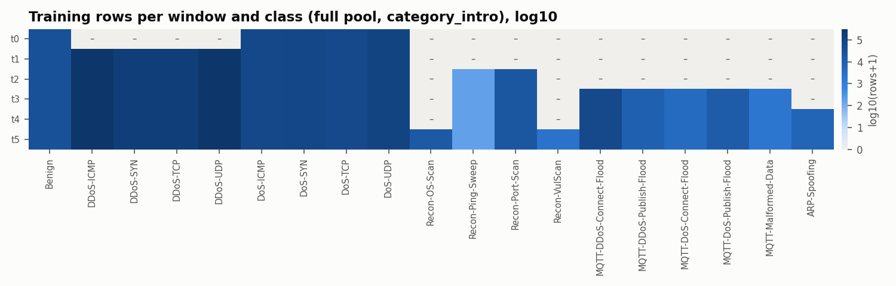
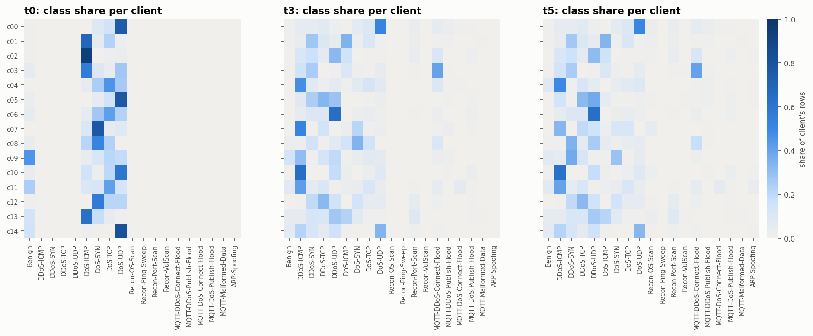
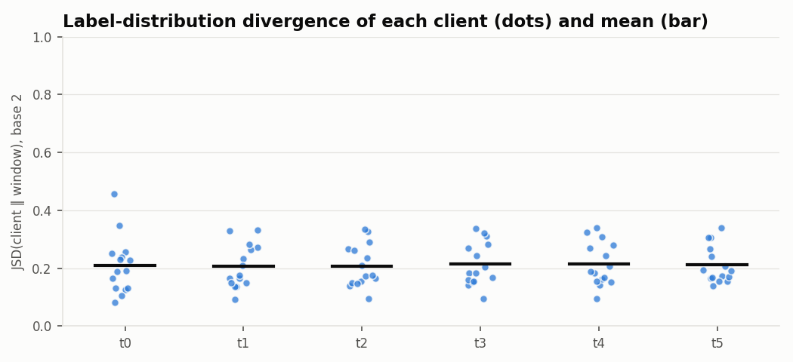

# M2 partition report — `full` pool, `category_intro` timeline

Generated by `scripts/m2_build_partitions.py` (seed 42). Files: `data/splits/full/category_intro/`.

## Setup
- 15 Wi-Fi/MQTT clients, Dirichlet α = 0.5 label skew per class; test share 20% per (window, class), client-local.
- Exact duplicates dropped before splitting: 7,379 CSV rows, 172 profiling rows. Train and test are therefore duplicate-disjoint.
- Each class enters at its introduction window and then recurs with **fresh, disjoint rows** in every later window.
- Population drift at t5: clients c04, c05, c07, c08, c09 (⟲) get re-drawn attack mixes, and 0 held-back device groups are onboarded.
- D_pub: 90,429 rows, removed from all client data. Window mode `cumulative`: at window t only classes introduced by t are used.

## Windows

| window | new classes | train rows | test rows | JSD mean | JSD min | JSD max |
|---|---|---:|---:|---:|---:|---:|
| t0 | Benign, DoS-ICMP, DoS-SYN, DoS-TCP, DoS-UDP | 323,378 | 80,845 | 0.208 | 0.081 | 0.457 |
| t1 | DDoS-ICMP, DDoS-SYN, DDoS-TCP, DDoS-UDP | 1,249,377 | 312,344 | 0.206 | 0.093 | 0.333 |
| t2 | Recon-Ping-Sweep, Recon-Port-Scan | 1,269,544 | 317,386 | 0.208 | 0.095 | 0.334 |
| t3 | MQTT-DDoS-Connect-Flood, MQTT-DDoS-Publish-Flood, MQTT-DoS-Connect-Flood, MQTT-DoS-Publish-Flood, MQTT-Malformed-Data | 1,355,779 | 338,946 | 0.214 | 0.094 | 0.338 |
| t4 | ARP-Spoofing | 1,362,822 | 340,707 | 0.214 | 0.095 | 0.339 |
| t5 | Recon-OS-Scan, Recon-VulScan | 1,380,860 | 345,217 | 0.211 | 0.139 | 0.340 |

JSD is the Jensen–Shannon divergence between a client's 19-class training distribution and the whole window's, where 0 = identical and 1 = disjoint. It measures how non-IID the clients are.

## Training rows per client and window

| client | t0 | t1 | t2 | t3 | t4 | t5 |
|---|---:|---:|---:|---:|---:|---:|
| c00 | 19,236 | 24,501 | 25,488 | 28,065 | 28,124 | 28,796 |
| c01 | 23,296 | 43,818 | 44,858 | 46,264 | 46,323 | 47,105 |
| c02 | 8,440 | 42,026 | 43,896 | 50,833 | 51,386 | 51,969 |
| c03 | 7,768 | 25,491 | 25,786 | 44,564 | 44,588 | 44,800 |
| c04 ⟲ | 30,039 | 100,920 | 100,928 | 112,637 | 112,974 | 118,751 |
| c05 ⟲ | 6,177 | 161,373 | 161,453 | 164,555 | 165,098 | 60,678 |
| c06 | 16,744 | 200,234 | 201,247 | 211,716 | 211,773 | 212,326 |
| c07 ⟲ | 14,680 | 49,707 | 49,722 | 52,759 | 53,520 | 154,714 |
| c08 ⟲ | 38,992 | 53,190 | 53,253 | 59,693 | 59,702 | 92,985 |
| c09 ⟲ | 27,998 | 88,239 | 88,513 | 93,212 | 93,282 | 65,498 |
| c10 | 22,677 | 160,801 | 160,931 | 167,534 | 169,660 | 172,375 |
| c11 | 11,289 | 35,712 | 36,122 | 40,983 | 42,485 | 42,496 |
| c12 | 22,237 | 83,956 | 88,438 | 91,116 | 91,233 | 91,611 |
| c13 | 34,047 | 85,637 | 93,476 | 94,919 | 95,283 | 98,606 |
| c14 | 39,758 | 93,772 | 95,433 | 96,929 | 97,391 | 98,150 |

## Benign device ownership (real devices from Zenodo profiling)
Network-wide captures () are spread over all clients. Each device/network group belongs to exactly one client:

## D_pub by class
Benign: 5,000, DDoS-ICMP: 18,865, DDoS-SYN: 9,743, DDoS-TCP: 9,871, DDoS-UDP: 19,980, DoS-ICMP: 5,147, DoS-SYN: 5,405, DoS-TCP: 4,625, DoS-UDP: 7,045, Recon-OS-Scan: 197, Recon-Ping-Sweep: 46, Recon-Port-Scan: 1,010, Recon-VulScan: 50, MQTT-DDoS-Connect-Flood: 2,150, MQTT-DDoS-Publish-Flood: 360, MQTT-DoS-Connect-Flood: 159, MQTT-DoS-Publish-Flood: 529, MQTT-Malformed-Data: 69, ARP-Spoofing: 178

## BLE sub-federation (3 clients, official train/test split)

| window | split | benign | BLE-DoS |
|---|---|---:|---:|
| t4 | train | 108,747 | 499,196 |
| t4 | test | 32,665 | 125,854 |
| t5 | train | 108,746 | 499,195 |
| t5 | test | 32,665 | 125,854 |
