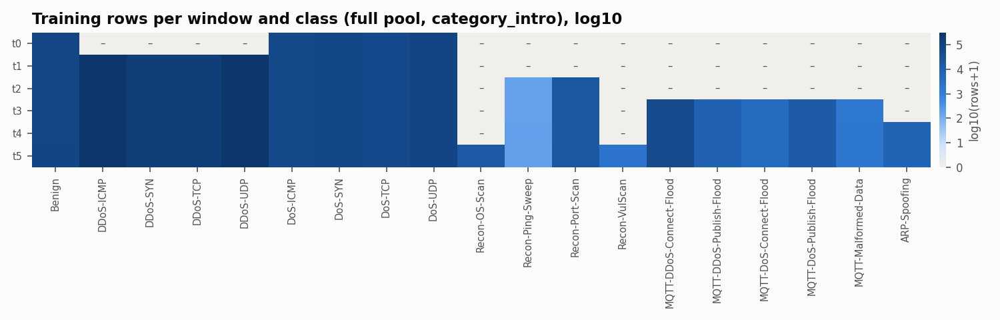
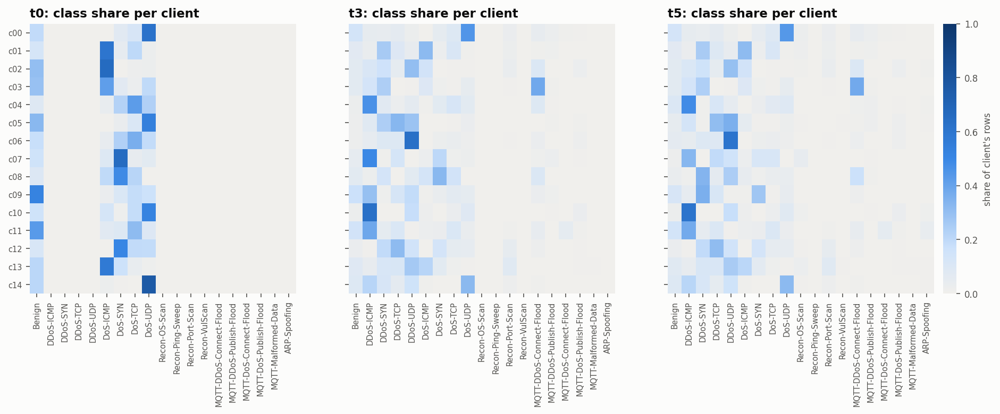
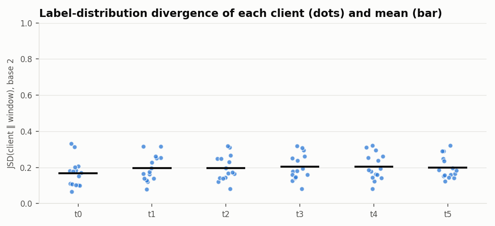

# M2 partition report — `full` pool, `category_intro` timeline

Generated by `scripts/m2_build_partitions.py` (seed 42). Files: `data/splits/full/category_intro/`.

## Setup
- 15 Wi-Fi/MQTT clients, Dirichlet α = 0.5 label skew per class; test share 20% per (window, class), client-local.
- Exact duplicates dropped before splitting: 7,379 CSV rows, 172 profiling rows. Train and test are therefore duplicate-disjoint.
- Each class enters at its introduction window and then recurs with **fresh, disjoint rows** in every later window.
- Population drift at t5: clients c04, c05, c07, c08, c09 (⟲) get re-drawn attack mixes, and 5 held-back device groups are onboarded.
- D_pub: 90,429 rows, removed from all client data. Window mode `cumulative`: at window t only classes introduced by t are used.

## Windows

| window | new classes | train rows | test rows | JSD mean | JSD min | JSD max |
|---|---|---:|---:|---:|---:|---:|
| t0 | Benign, DoS-ICMP, DoS-SYN, DoS-TCP, DoS-UDP | 375,829 | 86,606 | 0.167 | 0.066 | 0.332 |
| t1 | DDoS-ICMP, DDoS-SYN, DDoS-TCP, DDoS-UDP | 1,322,453 | 297,479 | 0.195 | 0.079 | 0.317 |
| t2 | Recon-Ping-Sweep, Recon-Port-Scan | 1,341,966 | 303,171 | 0.197 | 0.082 | 0.320 |
| t3 | MQTT-DDoS-Connect-Flood, MQTT-DDoS-Publish-Flood, MQTT-DoS-Connect-Flood, MQTT-DoS-Publish-Flood, MQTT-Malformed-Data | 1,429,205 | 323,725 | 0.203 | 0.081 | 0.320 |
| t4 | ARP-Spoofing | 1,437,032 | 324,699 | 0.203 | 0.083 | 0.321 |
| t5 | Recon-OS-Scan, Recon-VulScan | 1,464,149 | 331,800 | 0.199 | 0.122 | 0.322 |

JSD is the Jensen–Shannon divergence between a client's 19-class training distribution and the whole window's, where 0 = identical and 1 = disjoint. It measures how non-IID the clients are.

## Training rows per client and window

| client | t0 | t1 | t2 | t3 | t4 | t5 |
|---|---:|---:|---:|---:|---:|---:|
| c00 | 23,730 | 29,113 | 30,097 | 32,662 | 32,733 | 33,420 |
| c01 | 26,878 | 47,929 | 48,915 | 50,291 | 50,442 | 51,214 |
| c02 | 12,170 | 46,563 | 48,372 | 55,409 | 56,091 | 56,655 |
| c03 | 10,581 | 28,753 | 29,049 | 47,894 | 47,951 | 48,153 |
| c04 ⟲ | 33,377 | 105,664 | 105,749 | 117,489 | 117,730 | 123,846 |
| c05 ⟲ | 8,970 | 167,724 | 167,682 | 170,929 | 171,529 | 64,520 |
| c06 | 19,821 | 207,652 | 208,514 | 219,186 | 219,425 | 228,987 |
| c07 ⟲ | 17,670 | 53,382 | 53,385 | 56,451 | 57,188 | 160,461 |
| c08 ⟲ | 42,538 | 57,147 | 57,204 | 63,681 | 63,700 | 97,627 |
| c09 ⟲ | 32,325 | 93,798 | 94,041 | 98,697 | 98,734 | 70,514 |
| c10 | 26,185 | 167,019 | 167,191 | 174,071 | 176,211 | 179,011 |
| c11 | 15,319 | 40,213 | 40,626 | 45,523 | 47,195 | 47,192 |
| c12 | 25,388 | 88,542 | 92,922 | 95,739 | 95,846 | 96,183 |
| c13 | 37,905 | 90,751 | 98,376 | 99,868 | 100,415 | 103,714 |
| c14 | 42,972 | 98,203 | 99,843 | 101,315 | 101,842 | 102,652 |

## Benign device ownership (real devices from Zenodo profiling)
Network-wide captures (Active, ActiveBroker, Idle) are spread over all clients. Each device/network group belongs to exactly one client:

- c00: Owltron_Camera|WAN
- c01: M1T_Camera|LAN
- c02: Ecobee_Camera|WAN
- c03: SenseU|LAN
- c04: Owltron_Camera|Power
- c05: Multifunctional_Pager|Power, SenseUBaby|Power (onboarded at drift)
- c06: Owltron_Camera|LAN (onboarded at drift), Singcall|WAN
- c07: M1T_Camera|Power
- c08: Multifunctional_Pager|WAN (onboarded at drift), Singcall|LAN
- c09: M1T_Camera|WAN, Singcall|Power (onboarded at drift)
- c10: Blink_Camera|WAN
- c11: Ecobee_Camera|LAN
- c12: Multifunctional_Pager|LAN, SenseU|WAN
- c13: Blink_Camera|LAN, Blink_Mini_Camera|Power (onboarded at drift)
- c14: Ecobee_Camera|Power

## D_pub by class
Benign: 5,000, DDoS-ICMP: 18,865, DDoS-SYN: 9,743, DDoS-TCP: 9,871, DDoS-UDP: 19,980, DoS-ICMP: 5,147, DoS-SYN: 5,405, DoS-TCP: 4,625, DoS-UDP: 7,045, Recon-OS-Scan: 197, Recon-Ping-Sweep: 46, Recon-Port-Scan: 1,010, Recon-VulScan: 50, MQTT-DDoS-Connect-Flood: 2,150, MQTT-DDoS-Publish-Flood: 360, MQTT-DoS-Connect-Flood: 159, MQTT-DoS-Publish-Flood: 529, MQTT-Malformed-Data: 69, ARP-Spoofing: 178

## BLE sub-federation (3 clients, official train/test split)

| window | split | benign | BLE-DoS |
|---|---|---:|---:|
| t4 | train | 108,747 | 499,196 |
| t4 | test | 32,665 | 125,854 |
| t5 | train | 108,746 | 499,195 |
| t5 | test | 32,665 | 125,854 |
