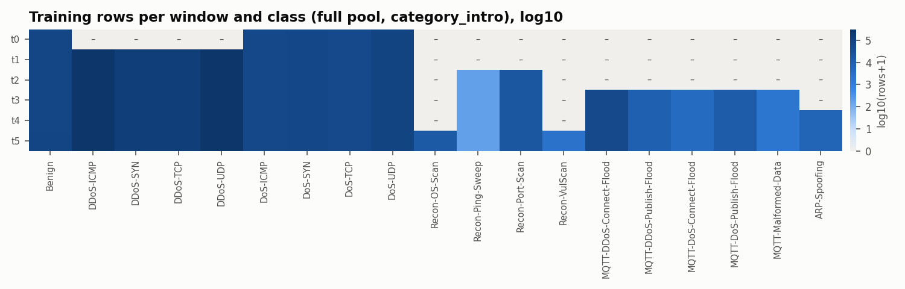
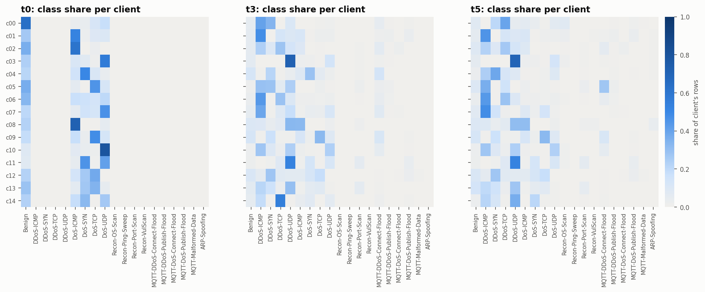
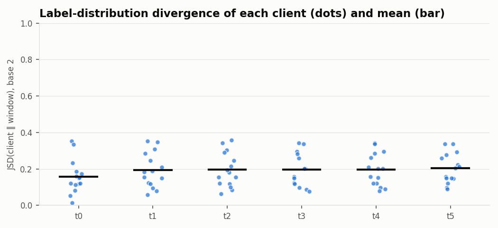

# M2 partition report — `full` pool, `category_intro` timeline

Generated by `scripts/m2_build_partitions.py` (seed 7). Files: `data/splits/full/category_intro/`.

## Setup
- 15 Wi-Fi/MQTT clients, Dirichlet α = 0.5 label skew per class; test share 20% per (window, class), client-local.
- Exact duplicates dropped before splitting: 7,379 CSV rows, 172 profiling rows. Train and test are therefore duplicate-disjoint.
- Each class enters at its introduction window and then recurs with **fresh, disjoint rows** in every later window.
- Population drift at t5: clients c00, c04, c05, c07, c14 (⟲) get re-drawn attack mixes, and 5 held-back device groups are onboarded.
- D_pub: 90,429 rows, removed from all client data. Window mode `cumulative`: at window t only classes introduced by t are used.

## Windows

| window | new classes | train rows | test rows | JSD mean | JSD min | JSD max |
|---|---|---:|---:|---:|---:|---:|
| t0 | Benign, DoS-ICMP, DoS-SYN, DoS-TCP, DoS-UDP | 370,049 | 92,512 | 0.158 | 0.015 | 0.352 |
| t1 | DDoS-ICMP, DDoS-SYN, DDoS-TCP, DDoS-UDP | 1,296,047 | 324,010 | 0.193 | 0.057 | 0.352 |
| t2 | Recon-Ping-Sweep, Recon-Port-Scan | 1,316,211 | 329,051 | 0.195 | 0.064 | 0.358 |
| t3 | MQTT-DDoS-Connect-Flood, MQTT-DDoS-Publish-Flood, MQTT-DoS-Connect-Flood, MQTT-DoS-Publish-Flood, MQTT-Malformed-Data | 1,402,443 | 350,611 | 0.196 | 0.077 | 0.344 |
| t4 | ARP-Spoofing | 1,409,483 | 352,372 | 0.196 | 0.078 | 0.341 |
| t5 | Recon-OS-Scan, Recon-VulScan | 1,436,258 | 359,067 | 0.204 | 0.091 | 0.338 |

JSD is the Jensen–Shannon divergence between a client's 19-class training distribution and the whole window's, where 0 = identical and 1 = disjoint. It measures how non-IID the clients are.

## Training rows per client and window

| client | t0 | t1 | t2 | t3 | t4 | t5 |
|---|---:|---:|---:|---:|---:|---:|
| c00 ⟲ | 5,785 | 64,068 | 64,147 | 68,843 | 69,861 | 57,512 |
| c01 | 18,157 | 76,911 | 77,002 | 83,109 | 84,048 | 87,521 |
| c02 | 13,469 | 79,201 | 80,083 | 88,118 | 89,033 | 92,704 |
| c03 | 24,213 | 94,204 | 95,086 | 96,895 | 97,855 | 99,819 |
| c04 ⟲ | 47,912 | 70,808 | 71,530 | 82,720 | 83,380 | 127,337 |
| c05 ⟲ | 7,499 | 141,551 | 144,890 | 152,821 | 152,832 | 89,357 |
| c06 | 14,453 | 129,534 | 130,352 | 138,116 | 138,198 | 139,689 |
| c07 ⟲ | 20,636 | 75,350 | 75,386 | 82,995 | 82,995 | 55,908 |
| c08 | 20,002 | 43,279 | 44,077 | 44,258 | 46,086 | 46,938 |
| c09 | 54,562 | 71,050 | 71,050 | 81,179 | 81,246 | 81,282 |
| c10 | 39,530 | 124,481 | 124,616 | 133,143 | 133,538 | 135,281 |
| c11 | 42,511 | 136,502 | 145,106 | 151,191 | 151,208 | 153,559 |
| c12 | 31,055 | 61,607 | 61,670 | 64,997 | 65,126 | 65,476 |
| c13 | 15,236 | 62,778 | 66,461 | 67,219 | 67,235 | 72,807 |
| c14 ⟲ | 15,029 | 64,723 | 64,755 | 66,839 | 66,842 | 131,068 |

## Benign device ownership (real devices from Zenodo profiling)
Network-wide captures (Active, ActiveBroker, Idle) are spread over all clients. Each device/network group belongs to exactly one client:

- c00: M1T_Camera|WAN, Multifunctional_Pager|LAN
- c01: Blink_Camera|LAN
- c02: M1T_Camera|LAN (onboarded at drift), Owltron_Camera|WAN
- c03: Blink_Camera|WAN
- c04: Singcall|WAN
- c05: Blink_Mini_Camera|Power
- c06: M1T_Camera|Power, SenseUBaby|Power (onboarded at drift)
- c07: Ecobee_Camera|LAN, Multifunctional_Pager|Power (onboarded at drift)
- c08: Owltron_Camera|LAN
- c09: SenseU|LAN
- c10: Multifunctional_Pager|WAN
- c11: SenseU|WAN
- c12: Ecobee_Camera|Power, Owltron_Camera|Power (onboarded at drift)
- c13: Ecobee_Camera|WAN (onboarded at drift), Singcall|LAN
- c14: Singcall|Power

## D_pub by class
Benign: 5,000, DDoS-ICMP: 18,865, DDoS-SYN: 9,743, DDoS-TCP: 9,871, DDoS-UDP: 19,980, DoS-ICMP: 5,147, DoS-SYN: 5,405, DoS-TCP: 4,625, DoS-UDP: 7,045, Recon-OS-Scan: 197, Recon-Ping-Sweep: 46, Recon-Port-Scan: 1,010, Recon-VulScan: 50, MQTT-DDoS-Connect-Flood: 2,150, MQTT-DDoS-Publish-Flood: 360, MQTT-DoS-Connect-Flood: 159, MQTT-DoS-Publish-Flood: 529, MQTT-Malformed-Data: 69, ARP-Spoofing: 178

## BLE sub-federation (3 clients, official train/test split)

| window | split | benign | BLE-DoS |
|---|---|---:|---:|
| t4 | train | 108,747 | 499,196 |
| t4 | test | 32,665 | 125,854 |
| t5 | train | 108,746 | 499,195 |
| t5 | test | 32,665 | 125,854 |
