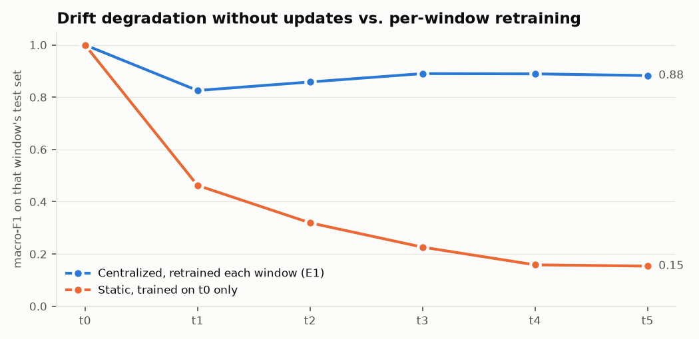
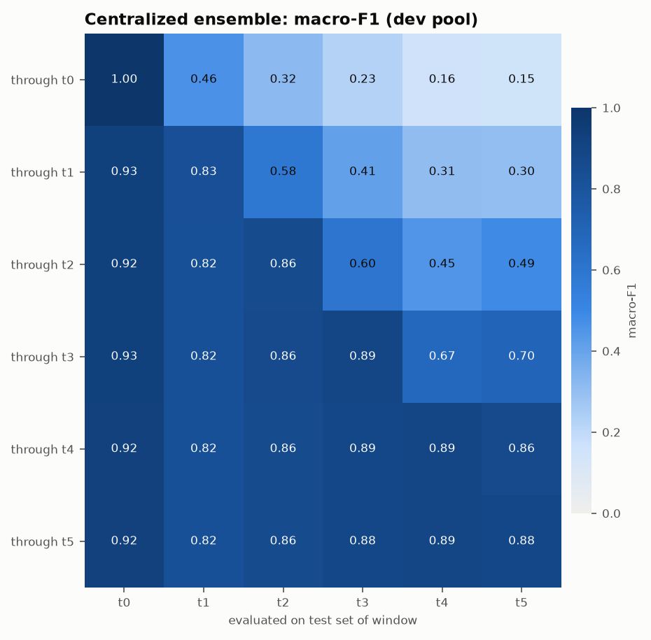
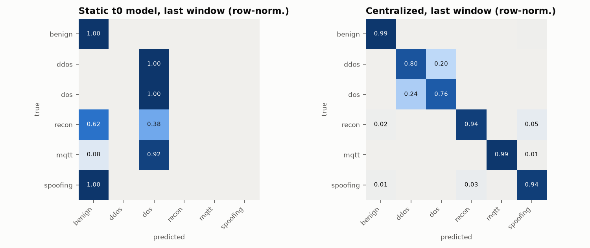

# M3 results — edge ensemble baselines (`dev` pool)

Run `20261104-142623_m3_baselines_dev`; target `y_category` (6 classes); timeline `category_intro`; 43 features (D6: IAT excluded).
Model: XGBoost + LightGBM with balanced class weights (capped at 50), early stopping on a 10% stratified validation split, fusion weight chosen by validation log-loss, temperature-calibrated.

## E1 centralized vs static, on each window's own test set

| window | new classes | E1 centralized macro-F1 | E1 accuracy | static macro-F1 | static accuracy | E1 n_train | w_xgb | T |
|---|---|---:|---:|---:|---:|---:|---:|---:|
| t0 | Benign, DoS-* | 1.0000 | 1.0000 | 1.0000 | 1.0000 | 22,628 | 0.0 | 0.14 |
| t1 | DDoS-* | 0.8256 | 0.8170 | 0.4626 | 0.3517 | 86,930 | 0.4 | 0.96 |
| t2 | Recon-Port-Scan, Recon-Ping-Sweep | 0.8582 | 0.8156 | 0.3193 | 0.3326 | 154,897 | 1.0 | 0.84 |
| t3 | MQTT-* | 0.8902 | 0.8640 | 0.2263 | 0.2580 | 242,526 | 0.6 | 0.85 |
| t4 | ARP-Spoofing | 0.8893 | 0.8633 | 0.1586 | 0.2406 | 336,493 | 0.4 | 0.87 |
| t5 | Recon-OS-Scan, Recon-VulScan | 0.8827 | 0.8841 | 0.1537 | 0.2625 | 454,648 | 0.4 | 0.87 |

- *E1 centralized* = retrained at every window on all clients' train data for windows 0..t (the upper bound).
- *Static* = trained on t0 only and never updated, which quantifies drift degradation.
- Window-averaged macro-F1: **E1 0.8910**, **static 0.3867**.
- E1 macro-F1 on the cumulative test set (windows 0..t, row-weighted) per t: t0 1.0000, t1 0.8516, t2 0.8527, t3 0.8674, t4 0.8711, t5 0.8735.

Each matrix row is one model (trained through window t) and each column is a window's test set. Cells right of the diagonal are future windows the model hasn't seen.

## Ensemble components (averaged over the diagonal)

| variant | mean macro-F1 | mean accuracy | mean ECE |
|---|---:|---:|---:|
| xgb | 0.8903 | 0.8736 | 0.0166 |
| lgb | 0.8900 | 0.8726 | 0.0174 |
| fused | 0.8910 | 0.8740 | 0.0168 |
| calibrated | 0.8910 | 0.8740 | 0.0123 |

## Per-class F1 of E1 on each window (— = class not yet present)

| window | benign | ddos | dos | recon | mqtt | spoofing |
|---|---:|---:|---:|---:|---:|---:|
| t0 | 1.000 | — | 1.000 | — | — | — |
| t1 | 1.000 | 0.850 | 0.627 | — | — | — |
| t2 | 0.994 | 0.840 | 0.612 | 0.986 | — | — |
| t3 | 0.987 | 0.851 | 0.630 | 0.988 | 0.996 | — |
| t4 | 0.984 | 0.847 | 0.627 | 0.955 | 0.991 | 0.932 |
| t5 | 0.982 | 0.852 | 0.633 | 0.958 | 0.990 | 0.881 |

## Edge cost

| model | single-flow P50 (ms) | P95 (ms) | batched (µs/flow) | XGB size (KB) | LGBM size (KB) |
|---|---:|---:|---:|---:|---:|
| trained through t0 | 7.52 | 8.97 | 3.24 | 147 | 766 |
| trained through t5 | 9.89 | 10.85 | 24.61 | 19,859 | 7,095 |

Measured on this machine's CPU (12 threads) with the full fused + calibrated ensemble. Single-flow latency includes Python call overhead.

## BLE edge model (binary, separate feature space: packet_length, inter_packet_gap, hci_type, hci_event_code, l2cap_length)

| trained through | eval window | macro-F1 | accuracy | AUROC | ECE |
|---|---|---:|---:|---:|---:|
| t4 | t4 | 0.9934 | 0.9947 | 0.9990 | 0.0055 |
| t4 | t5 | 0.9951 | 0.9960 | 0.9992 | 0.0063 |
| t5 | t4 | 0.9918 | 0.9933 | 0.9996 | 0.0047 |
| t5 | t5 | 0.9926 | 0.9940 | 0.9995 | 0.0047 |
