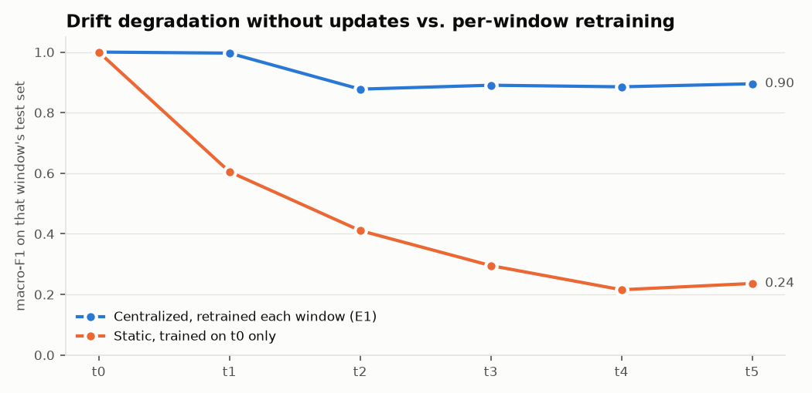
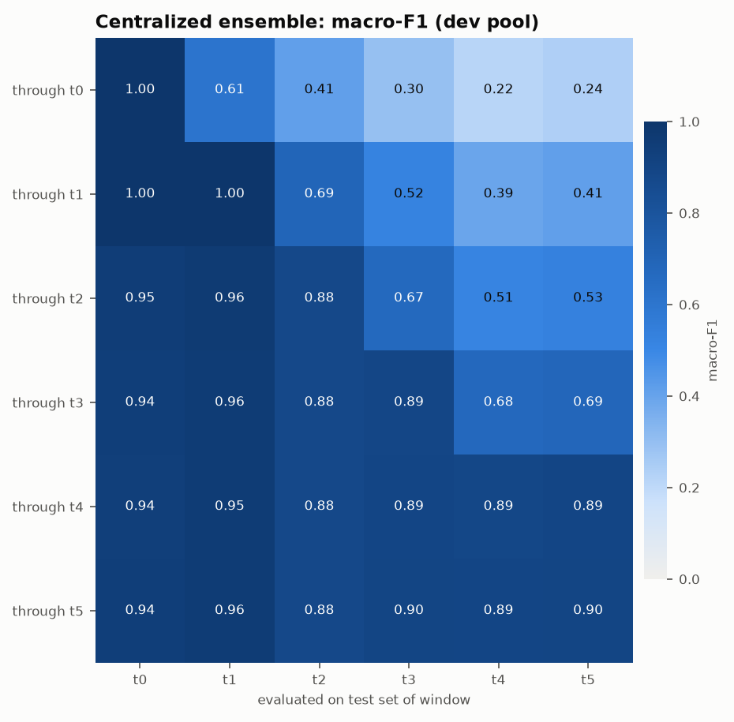
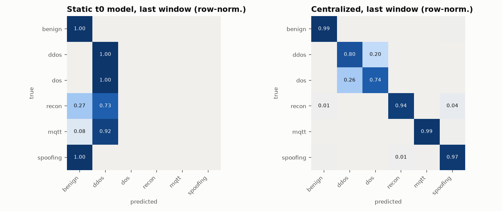

# M3 results — edge ensemble baselines (`dev` pool)

Run `20261116-122419_m3_baselines_dev`; target `y_category` (6 classes); timeline `alt_order`; 43 features (D6: IAT excluded).
Model: XGBoost + LightGBM with balanced class weights (capped at 50), early stopping on a 10% stratified validation split, fusion weight chosen by validation log-loss, temperature-calibrated.

## E1 centralized vs static, on each window's own test set

| window | new classes | E1 centralized macro-F1 | E1 accuracy | static macro-F1 | static accuracy | E1 n_train | w_xgb | T |
|---|---|---:|---:|---:|---:|---:|---:|---:|
| t0 | Benign, DDoS-* | 1.0000 | 1.0000 | 1.0000 | 1.0000 | 44,156 | 0.0 | 0.32 |
| t1 | MQTT-* | 0.9965 | 0.9980 | 0.6050 | 0.7891 | 100,111 | 0.9 | 1.01 |
| t2 | DoS-* | 0.8776 | 0.8368 | 0.4109 | 0.5827 | 175,864 | 0.7 | 0.76 |
| t3 | ARP-Spoofing | 0.8906 | 0.8450 | 0.2953 | 0.5519 | 255,838 | 0.5 | 0.84 |
| t4 | Recon-* | 0.8853 | 0.8563 | 0.2155 | 0.4636 | 351,038 | 0.5 | 0.84 |
| t5 | — | 0.8953 | 0.8724 | 0.2363 | 0.5072 | 454,635 | 0.6 | 0.88 |

- *E1 centralized* = retrained at every window on all clients' train data for windows 0..t (the upper bound).
- *Static* = trained on t0 only and never updated, which quantifies drift degradation.
- Window-averaged macro-F1: **E1 0.9242**, **static 0.4605**.
- E1 macro-F1 on the cumulative test set (windows 0..t, row-weighted) per t: t0 1.0000, t1 0.9975, t2 0.9215, t3 0.9087, t4 0.9024, t5 0.9031.

Each matrix row is one model (trained through window t) and each column is a window's test set. Cells right of the diagonal are future windows the model hasn't seen.

## Ensemble components (averaged over the diagonal)

| variant | mean macro-F1 | mean accuracy | mean ECE |
|---|---:|---:|---:|
| xgb | 0.9240 | 0.9011 | 0.0082 |
| lgb | 0.9243 | 0.9016 | 0.0076 |
| fused | 0.9242 | 0.9014 | 0.0091 |
| calibrated | 0.9242 | 0.9014 | 0.0079 |

## Per-class F1 of E1 on each window (— = class not yet present)

| window | benign | ddos | dos | recon | mqtt | spoofing |
|---|---:|---:|---:|---:|---:|---:|
| t0 | 1.000 | 1.000 | — | — | — | — |
| t1 | 0.994 | 1.000 | — | — | 0.995 | — |
| t2 | 0.996 | 0.821 | 0.698 | — | 0.996 | — |
| t3 | 0.982 | 0.823 | 0.717 | — | 0.989 | 0.940 |
| t4 | 0.976 | 0.821 | 0.711 | 0.959 | 0.988 | 0.857 |
| t5 | 0.987 | 0.825 | 0.713 | 0.966 | 0.991 | 0.890 |

## Edge cost

| model | single-flow P50 (ms) | P95 (ms) | batched (µs/flow) | XGB size (KB) | LGBM size (KB) |
|---|---:|---:|---:|---:|---:|
| trained through t0 | 5.49 | 6.78 | 3.42 | 189 | 802 |
| trained through t5 | 7.27 | 8.34 | 26.19 | 19,631 | 6,031 |

Measured on a machine with 12 logical CPUs, using all of them, with the full fused + calibrated ensemble. Single-flow latency includes Python call overhead.

## BLE edge model (binary, separate feature space: packet_length, inter_packet_gap, hci_type, hci_event_code, l2cap_length)

| trained through | eval window | macro-F1 | accuracy | AUROC | ECE |
|---|---|---:|---:|---:|---:|
| t4 | t4 | 0.9934 | 0.9947 | 0.9990 | 0.0054 |
| t4 | t5 | 0.9953 | 0.9961 | 0.9992 | 0.0062 |
| t5 | t4 | 0.9918 | 0.9933 | 0.9996 | 0.0054 |
| t5 | t5 | 0.9928 | 0.9941 | 0.9995 | 0.0054 |
