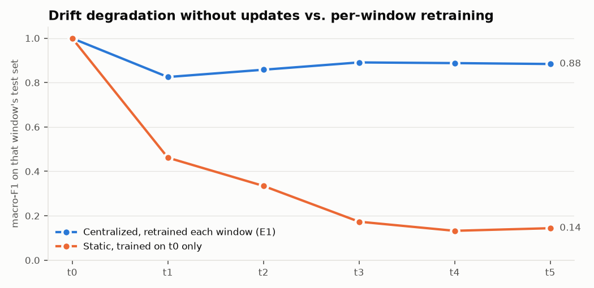
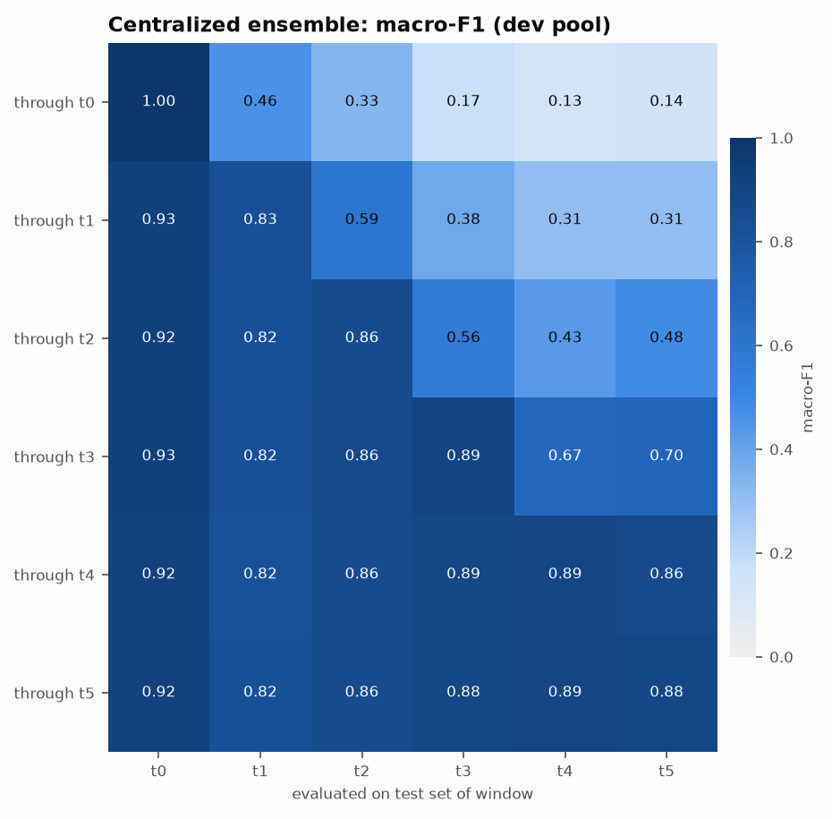
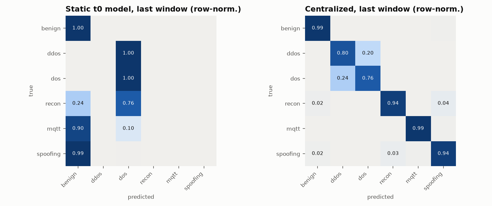

# M3 results — edge ensemble baselines (`dev` pool)

Run `20261116-115017_m3_baselines_dev`; target `y_category` (6 classes); timeline `category_intro`; 41 features (D6: IAT excluded).
Model: XGBoost + LightGBM with balanced class weights (capped at 50), early stopping on a 10% stratified validation split, fusion weight chosen by validation log-loss, temperature-calibrated.

## E1 centralized vs static, on each window's own test set

| window | new classes | E1 centralized macro-F1 | E1 accuracy | static macro-F1 | static accuracy | E1 n_train | w_xgb | T |
|---|---|---:|---:|---:|---:|---:|---:|---:|
| t0 | Benign, DoS-* | 0.9993 | 0.9994 | 0.9993 | 0.9994 | 22,628 | 0.8 | 0.95 |
| t1 | DDoS-* | 0.8250 | 0.8160 | 0.4618 | 0.3513 | 86,930 | 0.4 | 0.98 |
| t2 | Recon-Port-Scan, Recon-Ping-Sweep | 0.8578 | 0.8152 | 0.3345 | 0.3325 | 154,897 | 1.0 | 0.84 |
| t3 | MQTT-* | 0.8907 | 0.8651 | 0.1734 | 0.2579 | 242,526 | 0.4 | 0.85 |
| t4 | ARP-Spoofing | 0.8876 | 0.8622 | 0.1323 | 0.2405 | 336,493 | 0.4 | 0.87 |
| t5 | Recon-OS-Scan, Recon-VulScan | 0.8836 | 0.8852 | 0.1441 | 0.2623 | 454,648 | 0.3 | 0.89 |

- *E1 centralized* = retrained at every window on all clients' train data for windows 0..t (the upper bound).
- *Static* = trained on t0 only and never updated, which quantifies drift degradation.
- Window-averaged macro-F1: **E1 0.8907**, **static 0.3743**.
- E1 macro-F1 on the cumulative test set (windows 0..t, row-weighted) per t: t0 0.9993, t1 0.8516, t2 0.8520, t3 0.8683, t4 0.8705, t5 0.8742.

Each matrix row is one model (trained through window t) and each column is a window's test set. Cells right of the diagonal are future windows the model hasn't seen.

## Ensemble components (averaged over the diagonal)

| variant | mean macro-F1 | mean accuracy | mean ECE |
|---|---:|---:|---:|
| xgb | 0.8897 | 0.8731 | 0.0173 |
| lgb | 0.8895 | 0.8724 | 0.0171 |
| fused | 0.8907 | 0.8738 | 0.0177 |
| calibrated | 0.8907 | 0.8738 | 0.0123 |

## Per-class F1 of E1 on each window (— = class not yet present)

| window | benign | ddos | dos | recon | mqtt | spoofing |
|---|---:|---:|---:|---:|---:|---:|
| t0 | 0.999 | — | 0.999 | — | — | — |
| t1 | 0.999 | 0.848 | 0.628 | — | — | — |
| t2 | 0.993 | 0.840 | 0.614 | 0.985 | — | — |
| t3 | 0.988 | 0.852 | 0.631 | 0.988 | 0.995 | — |
| t4 | 0.983 | 0.846 | 0.627 | 0.953 | 0.990 | 0.926 |
| t5 | 0.981 | 0.854 | 0.636 | 0.959 | 0.990 | 0.882 |

## Edge cost

| model | single-flow P50 (ms) | P95 (ms) | batched (µs/flow) | XGB size (KB) | LGBM size (KB) |
|---|---:|---:|---:|---:|---:|
| trained through t0 | 5.92 | 7.48 | 2.73 | 219 | 477 |
| trained through t5 | 7.92 | 8.80 | 38.39 | 20,316 | 8,866 |

Measured on a machine with 12 logical CPUs, using all of them, with the full fused + calibrated ensemble. Single-flow latency includes Python call overhead.

## BLE edge model (binary, separate feature space: packet_length, inter_packet_gap, hci_type, hci_event_code, l2cap_length)

| trained through | eval window | macro-F1 | accuracy | AUROC | ECE |
|---|---|---:|---:|---:|---:|
| t4 | t4 | 0.9934 | 0.9947 | 0.9990 | 0.0054 |
| t4 | t5 | 0.9953 | 0.9961 | 0.9992 | 0.0062 |
| t5 | t4 | 0.9918 | 0.9933 | 0.9996 | 0.0054 |
| t5 | t5 | 0.9928 | 0.9941 | 0.9995 | 0.0054 |
