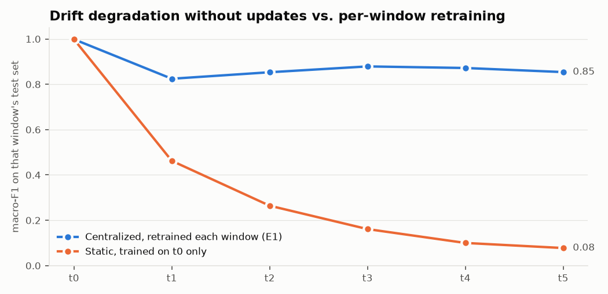
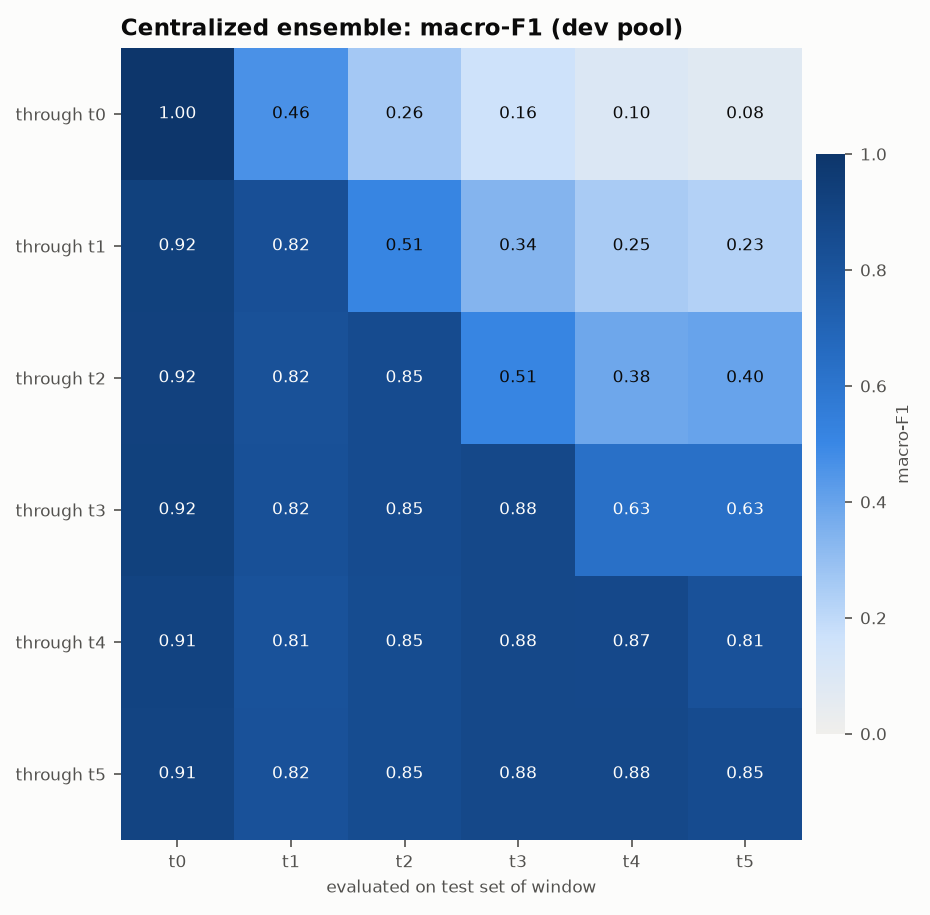
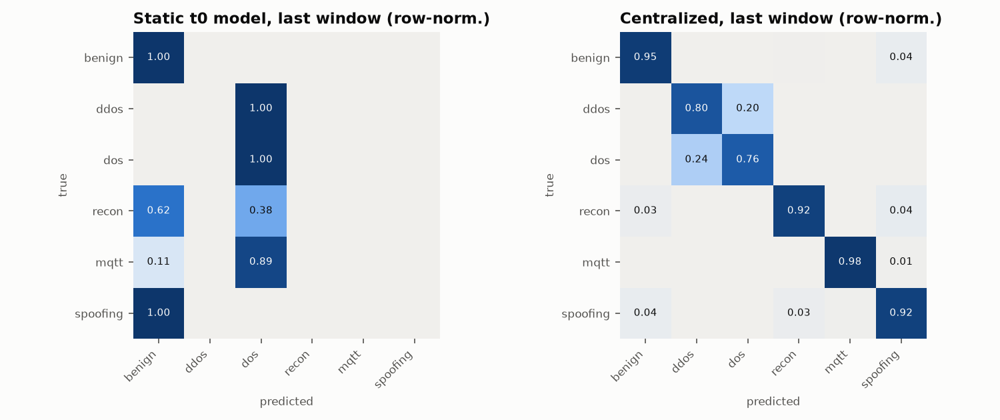

# M3 results — edge ensemble baselines (`dev` pool)

Run `20261116-172442_m3_baselines_dev`; target `y_category` (6 classes); timeline `category_intro`; 43 features (D6: IAT excluded).
Model: XGBoost + LightGBM with balanced class weights (capped at 50), early stopping on a 10% stratified validation split, fusion weight chosen by validation log-loss, temperature-calibrated.

## E1 centralized vs static, on each window's own test set

| window | new classes | E1 centralized macro-F1 | E1 accuracy | static macro-F1 | static accuracy | E1 n_train | w_xgb | T |
|---|---|---:|---:|---:|---:|---:|---:|---:|
| t0 | Benign, DoS-* | 0.9986 | 0.9993 | 0.9986 | 0.9993 | 15,483 | 0.0 | 0.06 |
| t1 | DDoS-* | 0.8244 | 0.7930 | 0.4623 | 0.2707 | 72,640 | 0.5 | 0.96 |
| t2 | Recon-Port-Scan, Recon-Ping-Sweep | 0.8531 | 0.7961 | 0.2643 | 0.2544 | 133,466 | 0.6 | 0.82 |
| t3 | MQTT-* | 0.8789 | 0.8501 | 0.1611 | 0.1922 | 213,956 | 0.2 | 0.85 |
| t4 | ARP-Spoofing | 0.8719 | 0.8478 | 0.1000 | 0.1782 | 300,787 | 0.2 | 0.86 |
| t5 | Recon-OS-Scan, Recon-VulScan | 0.8538 | 0.8634 | 0.0775 | 0.1508 | 403,404 | 0.3 | 0.88 |

- *E1 centralized* = retrained at every window on all clients' train data for windows 0..t (the upper bound).
- *Static* = trained on t0 only and never updated, which quantifies drift degradation.
- Window-averaged macro-F1: **E1 0.8801**, **static 0.3440**.
- E1 macro-F1 on the cumulative test set (windows 0..t, row-weighted) per t: t0 0.9986, t1 0.8458, t2 0.8465, t3 0.8598, t4 0.8590, t5 0.8597.

Each matrix row is one model (trained through window t) and each column is a window's test set. Cells right of the diagonal are future windows the model hasn't seen.

## Ensemble components (averaged over the diagonal)

| variant | mean macro-F1 | mean accuracy | mean ECE |
|---|---:|---:|---:|
| xgb | 0.8798 | 0.8585 | 0.0205 |
| lgb | 0.8798 | 0.8582 | 0.0200 |
| fused | 0.8801 | 0.8583 | 0.0191 |
| calibrated | 0.8801 | 0.8583 | 0.0149 |

## Per-class F1 of E1 on each window (— = class not yet present)

| window | benign | ddos | dos | recon | mqtt | spoofing |
|---|---:|---:|---:|---:|---:|---:|
| t0 | 0.998 | — | 1.000 | — | — | — |
| t1 | 0.999 | 0.849 | 0.625 | — | — | — |
| t2 | 0.972 | 0.842 | 0.614 | 0.984 | — | — |
| t3 | 0.937 | 0.849 | 0.628 | 0.985 | 0.995 | — |
| t4 | 0.898 | 0.844 | 0.624 | 0.953 | 0.989 | 0.923 |
| t5 | 0.819 | 0.851 | 0.632 | 0.954 | 0.989 | 0.878 |

## Edge cost

| model | single-flow P50 (ms) | P95 (ms) | batched (µs/flow) | XGB size (KB) | LGBM size (KB) |
|---|---:|---:|---:|---:|---:|
| trained through t0 | 5.60 | 6.45 | 3.06 | 120 | 719 |
| trained through t5 | 7.55 | 8.77 | 32.85 | 20,350 | 8,077 |

Measured on a machine with 12 logical CPUs, using all of them, with the full fused + calibrated ensemble. Single-flow latency includes Python call overhead.

## BLE edge model (binary, separate feature space: packet_length, inter_packet_gap, hci_type, hci_event_code, l2cap_length)

| trained through | eval window | macro-F1 | accuracy | AUROC | ECE |
|---|---|---:|---:|---:|---:|
| t4 | t4 | 0.9934 | 0.9947 | 0.9990 | 0.0054 |
| t4 | t5 | 0.9953 | 0.9961 | 0.9992 | 0.0062 |
| t5 | t4 | 0.9918 | 0.9933 | 0.9996 | 0.0054 |
| t5 | t5 | 0.9928 | 0.9941 | 0.9995 | 0.0054 |
