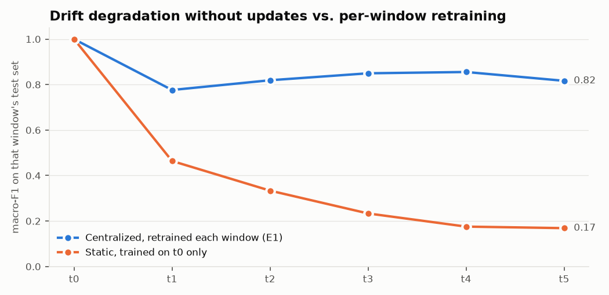
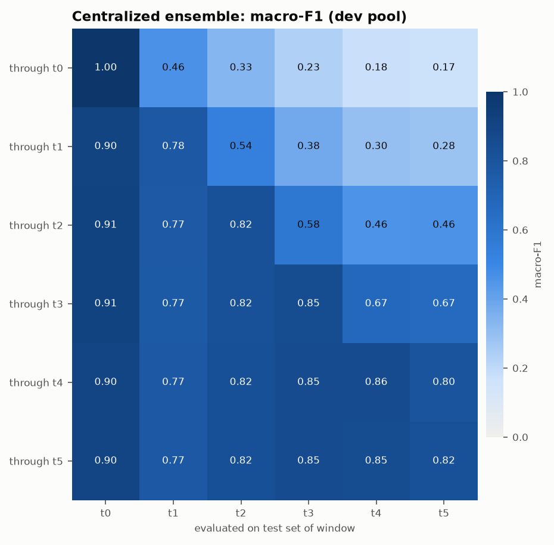
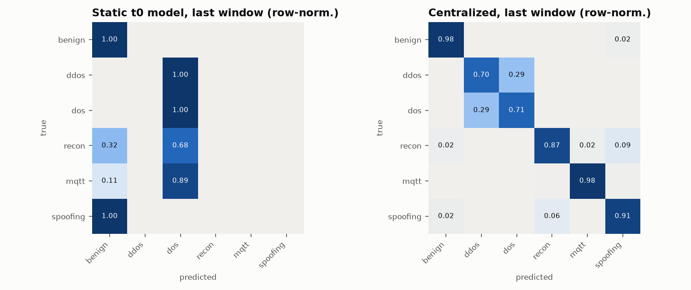

# M3 results — edge ensemble baselines (`dev` pool)

Run `20261116-165203_m3_baselines_dev`; target `y_category` (6 classes); timeline `category_intro`; 43 features (D6: IAT excluded).
Model: XGBoost + LightGBM with balanced class weights (capped at 50), early stopping on a 10% stratified validation split, fusion weight chosen by validation log-loss, temperature-calibrated.

## E1 centralized vs static, on each window's own test set

| window | new classes | E1 centralized macro-F1 | E1 accuracy | static macro-F1 | static accuracy | E1 n_train | w_xgb | T |
|---|---|---:|---:|---:|---:|---:|---:|---:|
| t0 | Benign, DoS-* | 0.9998 | 0.9998 | 0.9998 | 0.9998 | 22,855 | 1.0 | 0.91 |
| t1 | DDoS-* | 0.7761 | 0.7547 | 0.4640 | 0.3610 | 88,441 | 0.5 | 0.90 |
| t2 | Recon-Port-Scan, Recon-Ping-Sweep | 0.8190 | 0.7531 | 0.3336 | 0.3360 | 157,583 | 0.4 | 0.86 |
| t3 | MQTT-* | 0.8496 | 0.8079 | 0.2333 | 0.2620 | 246,252 | 0.5 | 0.85 |
| t4 | ARP-Spoofing | 0.8553 | 0.8168 | 0.1755 | 0.2484 | 342,059 | 0.5 | 0.89 |
| t5 | Recon-OS-Scan, Recon-VulScan | 0.8165 | 0.8340 | 0.1687 | 0.2698 | 462,376 | 0.3 | 0.90 |

- *E1 centralized* = retrained at every window on all clients' train data for windows 0..t (the upper bound).
- *Static* = trained on t0 only and never updated, which quantifies drift degradation.
- Window-averaged macro-F1: **E1 0.8527**, **static 0.3958**.
- E1 macro-F1 on the cumulative test set (windows 0..t, row-weighted) per t: t0 0.9998, t1 0.8105, t2 0.8117, t3 0.8244, t4 0.8357, t5 0.8288.

Each matrix row is one model (trained through window t) and each column is a window's test set. Cells right of the diagonal are future windows the model hasn't seen.

## Ensemble components (averaged over the diagonal)

| variant | mean macro-F1 | mean accuracy | mean ECE |
|---|---:|---:|---:|
| xgb | 0.8520 | 0.8274 | 0.0318 |
| lgb | 0.8532 | 0.8282 | 0.0294 |
| fused | 0.8527 | 0.8277 | 0.0294 |
| calibrated | 0.8527 | 0.8277 | 0.0391 |

## Per-class F1 of E1 on each window (— = class not yet present)

| window | benign | ddos | dos | recon | mqtt | spoofing |
|---|---:|---:|---:|---:|---:|---:|
| t0 | 1.000 | — | 1.000 | — | — | — |
| t1 | 1.000 | 0.788 | 0.540 | — | — | — |
| t2 | 0.994 | 0.772 | 0.526 | 0.984 | — | — |
| t3 | 0.977 | 0.769 | 0.543 | 0.965 | 0.994 | — |
| t4 | 0.975 | 0.785 | 0.545 | 0.969 | 0.989 | 0.868 |
| t5 | 0.973 | 0.784 | 0.540 | 0.921 | 0.983 | 0.699 |

## Edge cost

| model | single-flow P50 (ms) | P95 (ms) | batched (µs/flow) | XGB size (KB) | LGBM size (KB) |
|---|---:|---:|---:|---:|---:|
| trained through t0 | 5.85 | 7.27 | 2.77 | 110 | 477 |
| trained through t5 | 8.23 | 9.96 | 43.70 | 19,794 | 9,237 |

Measured on a machine with 12 logical CPUs, using all of them, with the full fused + calibrated ensemble. Single-flow latency includes Python call overhead.

## BLE edge model (binary, separate feature space: packet_length, inter_packet_gap, hci_type, hci_event_code, l2cap_length)

| trained through | eval window | macro-F1 | accuracy | AUROC | ECE |
|---|---|---:|---:|---:|---:|
| t4 | t4 | 0.9934 | 0.9947 | 0.9990 | 0.0054 |
| t4 | t5 | 0.9953 | 0.9961 | 0.9992 | 0.0062 |
| t5 | t4 | 0.9918 | 0.9933 | 0.9996 | 0.0054 |
| t5 | t5 | 0.9928 | 0.9941 | 0.9995 | 0.0054 |
