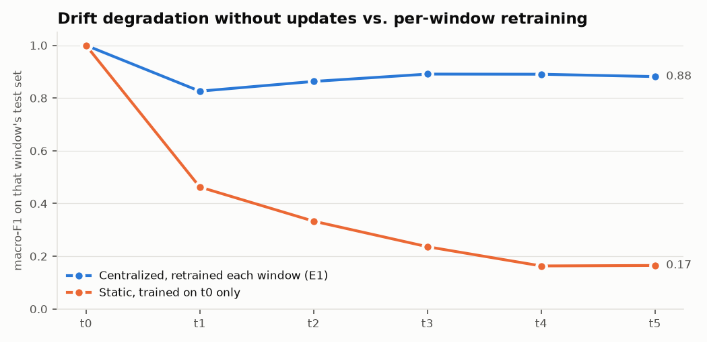
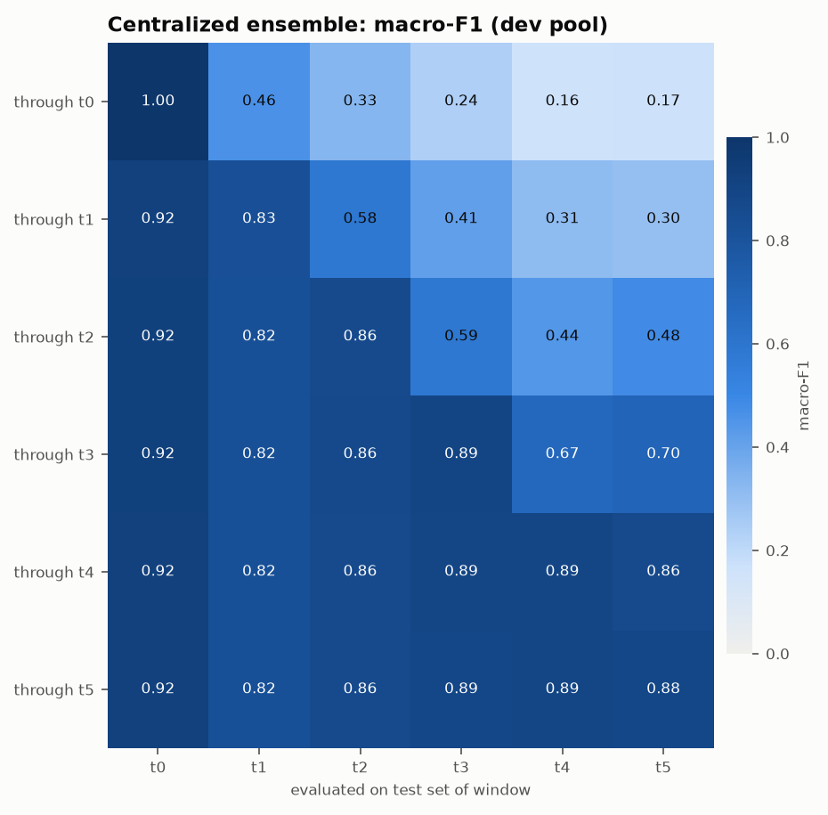
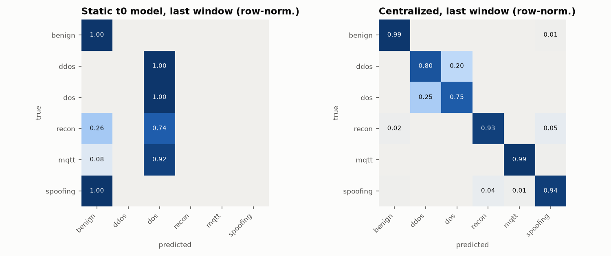

# M3 results — edge ensemble baselines (`dev` pool)

Run `20261116-161730_m3_baselines_dev`; target `y_category` (6 classes); timeline `category_intro`; 43 features (D6: IAT excluded).
Model: XGBoost + LightGBM with balanced class weights (capped at 50), early stopping on a 10% stratified validation split, fusion weight chosen by validation log-loss, temperature-calibrated.

## E1 centralized vs static, on each window's own test set

| window | new classes | E1 centralized macro-F1 | E1 accuracy | static macro-F1 | static accuracy | E1 n_train | w_xgb | T |
|---|---|---:|---:|---:|---:|---:|---:|---:|
| t0 | Benign, DoS-* | 1.0000 | 1.0000 | 1.0000 | 1.0000 | 22,711 | 1.0 | 0.05 |
| t1 | DDoS-* | 0.8260 | 0.8202 | 0.4626 | 0.3526 | 87,095 | 0.4 | 0.93 |
| t2 | Recon-Port-Scan, Recon-Ping-Sweep | 0.8630 | 0.8237 | 0.3331 | 0.3336 | 155,146 | 1.0 | 0.84 |
| t3 | MQTT-* | 0.8909 | 0.8651 | 0.2362 | 0.2588 | 242,858 | 0.3 | 0.83 |
| t4 | ARP-Spoofing | 0.8903 | 0.8655 | 0.1633 | 0.2413 | 336,908 | 0.3 | 0.88 |
| t5 | Recon-OS-Scan, Recon-VulScan | 0.8814 | 0.8829 | 0.1650 | 0.2597 | 454,607 | 0.3 | 0.89 |

- *E1 centralized* = retrained at every window on all clients' train data for windows 0..t (the upper bound).
- *Static* = trained on t0 only and never updated, which quantifies drift degradation.
- Window-averaged macro-F1: **E1 0.8919**, **static 0.3934**.
- E1 macro-F1 on the cumulative test set (windows 0..t, row-weighted) per t: t0 1.0000, t1 0.8504, t2 0.8545, t3 0.8680, t4 0.8726, t5 0.8744.

Each matrix row is one model (trained through window t) and each column is a window's test set. Cells right of the diagonal are future windows the model hasn't seen.

## Ensemble components (averaged over the diagonal)

| variant | mean macro-F1 | mean accuracy | mean ECE |
|---|---:|---:|---:|
| xgb | 0.8914 | 0.8756 | 0.0177 |
| lgb | 0.8919 | 0.8763 | 0.0183 |
| fused | 0.8919 | 0.8762 | 0.0184 |
| calibrated | 0.8919 | 0.8762 | 0.0139 |

## Per-class F1 of E1 on each window (— = class not yet present)

| window | benign | ddos | dos | recon | mqtt | spoofing |
|---|---:|---:|---:|---:|---:|---:|
| t0 | 1.000 | — | 1.000 | — | — | — |
| t1 | 1.000 | 0.853 | 0.625 | — | — | — |
| t2 | 0.995 | 0.848 | 0.620 | 0.988 | — | — |
| t3 | 0.988 | 0.852 | 0.631 | 0.987 | 0.996 | — |
| t4 | 0.980 | 0.850 | 0.629 | 0.957 | 0.991 | 0.934 |
| t5 | 0.982 | 0.851 | 0.631 | 0.957 | 0.991 | 0.877 |

## Edge cost

| model | single-flow P50 (ms) | P95 (ms) | batched (µs/flow) | XGB size (KB) | LGBM size (KB) |
|---|---:|---:|---:|---:|---:|
| trained through t0 | 5.68 | 7.11 | 2.39 | 131 | 444 |
| trained through t5 | 7.73 | 8.84 | 33.61 | 19,802 | 8,042 |

Measured on a machine with 12 logical CPUs, using all of them, with the full fused + calibrated ensemble. Single-flow latency includes Python call overhead.

## BLE edge model (binary, separate feature space: packet_length, inter_packet_gap, hci_type, hci_event_code, l2cap_length)

| trained through | eval window | macro-F1 | accuracy | AUROC | ECE |
|---|---|---:|---:|---:|---:|
| t4 | t4 | 0.9933 | 0.9945 | 0.9995 | 0.0044 |
| t4 | t5 | 0.9946 | 0.9956 | 0.9996 | 0.0037 |
| t5 | t4 | 0.9947 | 0.9957 | 0.9996 | 0.0036 |
| t5 | t5 | 0.9953 | 0.9961 | 0.9997 | 0.0034 |
