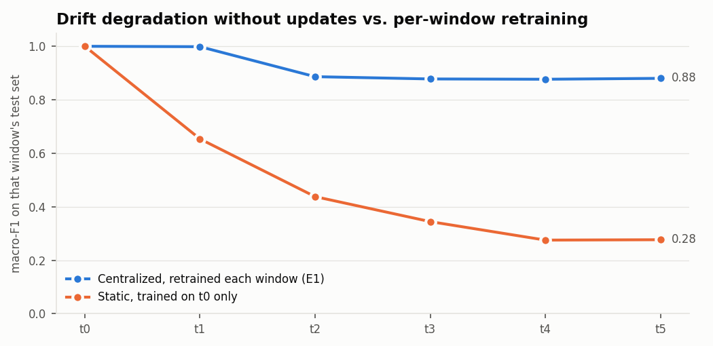
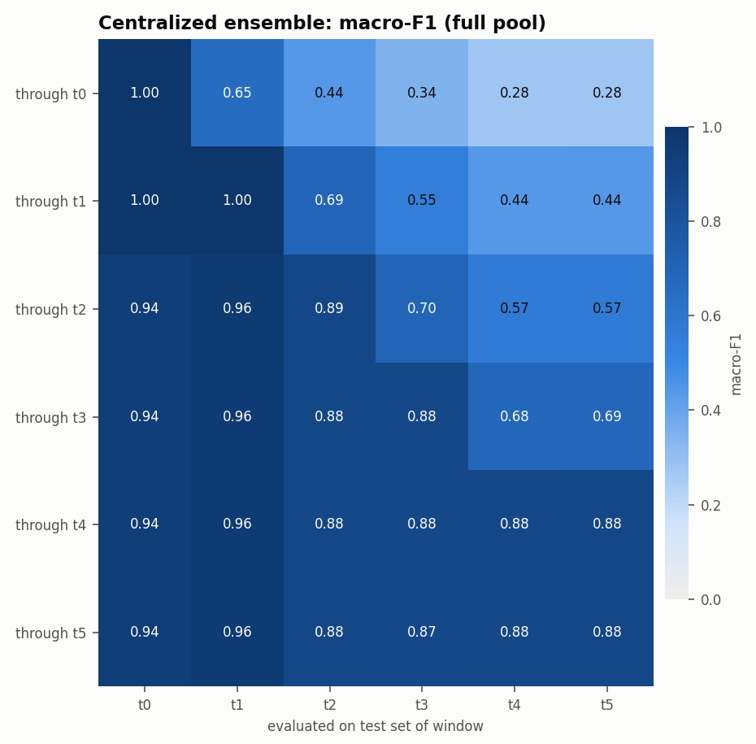
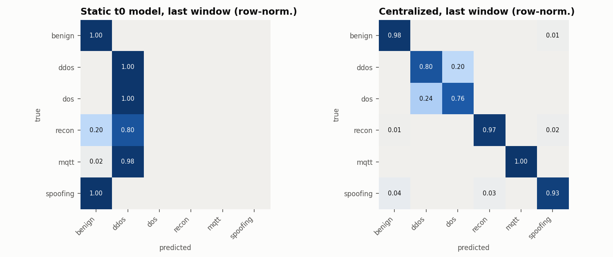

# M3 results — edge ensemble baselines (`full` pool)

Run `20261116-144337_m3_baselines_full`; target `y_category` (6 classes); timeline `alt_order`; 43 features (D6: IAT excluded).
Model: XGBoost + LightGBM with balanced class weights (capped at 50), early stopping on a 10% stratified validation split, fusion weight chosen by validation log-loss, temperature-calibrated.

## E1 centralized vs static, on each window's own test set

| window | new classes | E1 centralized macro-F1 | E1 accuracy | static macro-F1 | static accuracy | E1 n_train | w_xgb | T |
|---|---|---:|---:|---:|---:|---:|---:|---:|
| t0 | Benign, DDoS-* | 1.0000 | 1.0000 | 1.0000 | 1.0000 | 763,457 | 0.0 | 0.87 |
| t1 | MQTT-* | 0.9985 | 0.9997 | 0.6536 | 0.9425 | 1,573,482 | 0.1 | 0.87 |
| t2 | DoS-* | 0.8864 | 0.8069 | 0.4378 | 0.6330 | 2,779,502 | 0.3 | 0.79 |
| t3 | ARP-Spoofing | 0.8778 | 0.8035 | 0.3444 | 0.6308 | 3,989,742 | 0.8 | 0.79 |
| t4 | Recon-* | 0.8767 | 0.8101 | 0.2753 | 0.6085 | 5,244,400 | 0.5 | 0.81 |
| t5 | — | 0.8801 | 0.8108 | 0.2767 | 0.6111 | 6,507,456 | 0.3 | 0.82 |

- *E1 centralized* = retrained at every window on all clients' train data for windows 0..t (the upper bound).
- *Static* = trained on t0 only and never updated, which quantifies drift degradation.
- Window-averaged macro-F1: **E1 0.9199**, **static 0.4980**.
- E1 macro-F1 on the cumulative test set (windows 0..t, row-weighted) per t: t0 1.0000, t1 0.9991, t2 0.9243, t3 0.9083, t4 0.8995, t5 0.8956.

Each matrix row is one model (trained through window t) and each column is a window's test set. Cells right of the diagonal are future windows the model hasn't seen.

## Ensemble components (averaged over the diagonal)

| variant | mean macro-F1 | mean accuracy | mean ECE |
|---|---:|---:|---:|
| xgb | 0.9197 | 0.8712 | 0.0125 |
| lgb | 0.9195 | 0.8713 | 0.0124 |
| fused | 0.9199 | 0.8718 | 0.0129 |
| calibrated | 0.9199 | 0.8718 | 0.0078 |

## Per-class F1 of E1 on each window (— = class not yet present)

| window | benign | ddos | dos | recon | mqtt | spoofing |
|---|---:|---:|---:|---:|---:|---:|
| t0 | 1.000 | 1.000 | — | — | — | — |
| t1 | 0.998 | 1.000 | — | — | 0.997 | — |
| t2 | 0.999 | 0.827 | 0.722 | — | 0.998 | — |
| t3 | 0.991 | 0.824 | 0.718 | — | 0.997 | 0.860 |
| t4 | 0.985 | 0.825 | 0.720 | 0.977 | 0.996 | 0.757 |
| t5 | 0.987 | 0.825 | 0.718 | 0.979 | 0.997 | 0.775 |

## Edge cost

| model | single-flow P50 (ms) | P95 (ms) | batched (µs/flow) | XGB size (KB) | LGBM size (KB) |
|---|---:|---:|---:|---:|---:|
| trained through t0 | 6.04 | 12.15 | 6.42 | 225 | 658 |
| trained through t5 | 6.01 | 17.99 | 113.78 | 27,110 | 8,259 |

Measured on a machine with 4 logical CPUs, using all of them, with the full fused + calibrated ensemble. Single-flow latency includes Python call overhead.

## BLE edge model (binary, separate feature space: packet_length, inter_packet_gap, hci_type, hci_event_code, l2cap_length)

| trained through | eval window | macro-F1 | accuracy | AUROC | ECE |
|---|---|---:|---:|---:|---:|
| t4 | t4 | 0.9931 | 0.9955 | 0.9998 | 0.0048 |
| t4 | t5 | 0.9925 | 0.9951 | 0.9998 | 0.0046 |
| t5 | t4 | 0.9944 | 0.9963 | 0.9998 | 0.0049 |
| t5 | t5 | 0.9936 | 0.9958 | 0.9998 | 0.0050 |
