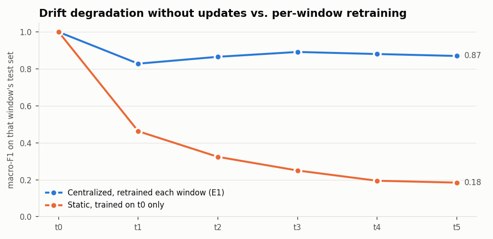
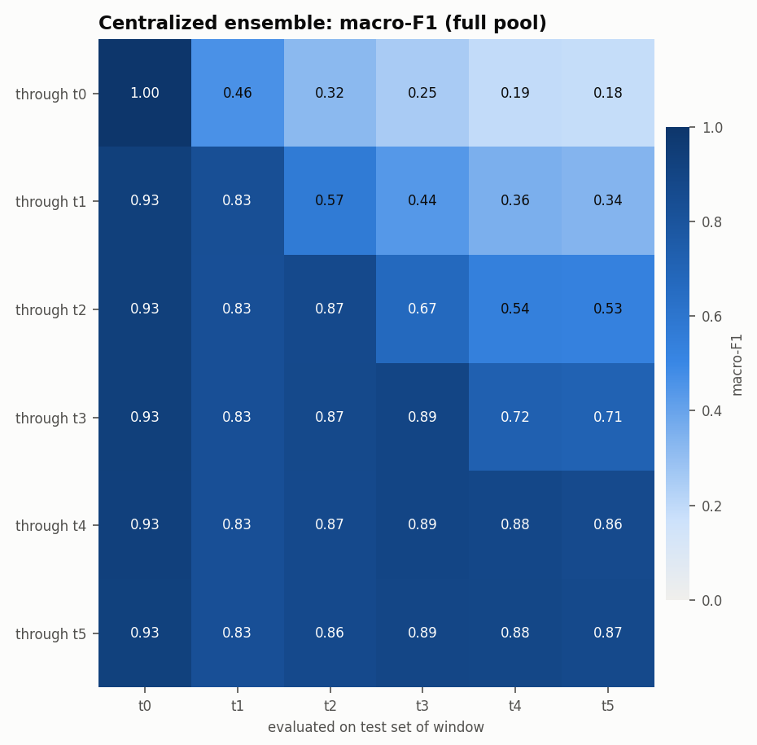
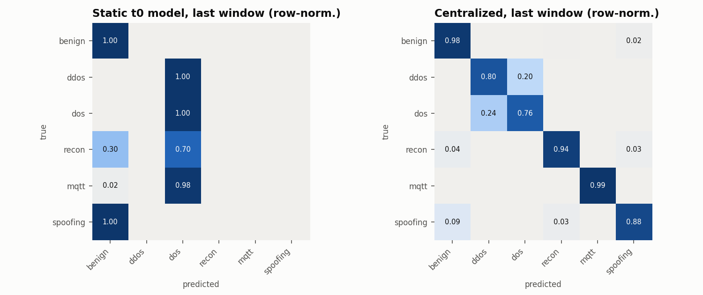

# M3 results — edge ensemble baselines (`full` pool)

Run `20261117-024807_m3_baselines_full`; target `y_category` (6 classes); timeline `category_intro`; 43 features (D6: IAT excluded).
Model: XGBoost + LightGBM with balanced class weights (capped at 50), early stopping on a 10% stratified validation split, fusion weight chosen by validation log-loss, temperature-calibrated.

## E1 centralized vs static, on each window's own test set

| window | new classes | E1 centralized macro-F1 | E1 accuracy | static macro-F1 | static accuracy | E1 n_train | w_xgb | T |
|---|---|---:|---:|---:|---:|---:|---:|---:|
| t0 | Benign, DoS-* | 0.9999 | 1.0000 | 0.9999 | 1.0000 | 291,040 | 1.0 | 0.09 |
| t1 | DDoS-* | 0.8284 | 0.7931 | 0.4626 | 0.2588 | 1,415,480 | 0.4 | 0.87 |
| t2 | Recon-Port-Scan, Recon-Ping-Sweep | 0.8656 | 0.7933 | 0.3240 | 0.2547 | 2,558,069 | 0.4 | 0.83 |
| t3 | MQTT-* | 0.8918 | 0.8086 | 0.2501 | 0.2385 | 3,778,270 | 0.2 | 0.84 |
| t4 | ARP-Spoofing | 0.8806 | 0.8092 | 0.1947 | 0.2373 | 5,004,810 | 0.1 | 0.83 |
| t5 | Recon-OS-Scan, Recon-VulScan | 0.8701 | 0.8113 | 0.1845 | 0.2342 | 6,247,584 | 0.2 | 0.83 |

- *E1 centralized* = retrained at every window on all clients' train data for windows 0..t (the upper bound).
- *Static* = trained on t0 only and never updated, which quantifies drift degradation.
- Window-averaged macro-F1: **E1 0.8894**, **static 0.4026**.
- E1 macro-F1 on the cumulative test set (windows 0..t, row-weighted) per t: t0 0.9999, t1 0.8499, t2 0.8558, t3 0.8684, t4 0.8701, t5 0.8701.

Each matrix row is one model (trained through window t) and each column is a window's test set. Cells right of the diagonal are future windows the model hasn't seen.

## Ensemble components (averaged over the diagonal)

| variant | mean macro-F1 | mean accuracy | mean ECE |
|---|---:|---:|---:|
| xgb | 0.8886 | 0.8340 | 0.0252 |
| lgb | 0.8893 | 0.8360 | 0.0242 |
| fused | 0.8894 | 0.8359 | 0.0251 |
| calibrated | 0.8894 | 0.8359 | 0.0195 |

## Per-class F1 of E1 on each window (— = class not yet present)

| window | benign | ddos | dos | recon | mqtt | spoofing |
|---|---:|---:|---:|---:|---:|---:|
| t0 | 1.000 | — | 1.000 | — | — | — |
| t1 | 1.000 | 0.851 | 0.634 | — | — | — |
| t2 | 0.993 | 0.848 | 0.631 | 0.990 | — | — |
| t3 | 0.987 | 0.851 | 0.633 | 0.991 | 0.997 | — |
| t4 | 0.970 | 0.852 | 0.633 | 0.980 | 0.997 | 0.851 |
| t5 | 0.951 | 0.853 | 0.634 | 0.962 | 0.997 | 0.823 |

## Edge cost

| model | single-flow P50 (ms) | P95 (ms) | batched (µs/flow) | XGB size (KB) | LGBM size (KB) |
|---|---:|---:|---:|---:|---:|
| trained through t0 | 5.99 | 8.70 | 13.31 | 289 | 1,092 |
| trained through t5 | 6.01 | 10.61 | 140.74 | 28,026 | 10,109 |

Measured on a machine with 4 logical CPUs, using all of them, with the full fused + calibrated ensemble. Single-flow latency includes Python call overhead.

## BLE edge model (binary, separate feature space: packet_length, inter_packet_gap, hci_type, hci_event_code, l2cap_length)

| trained through | eval window | macro-F1 | accuracy | AUROC | ECE |
|---|---|---:|---:|---:|---:|
| t4 | t4 | 0.9931 | 0.9955 | 0.9998 | 0.0048 |
| t4 | t5 | 0.9925 | 0.9951 | 0.9998 | 0.0046 |
| t5 | t4 | 0.9944 | 0.9963 | 0.9998 | 0.0049 |
| t5 | t5 | 0.9936 | 0.9958 | 0.9998 | 0.0050 |
