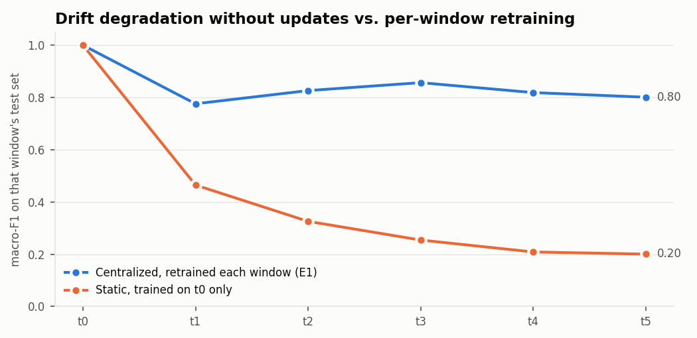
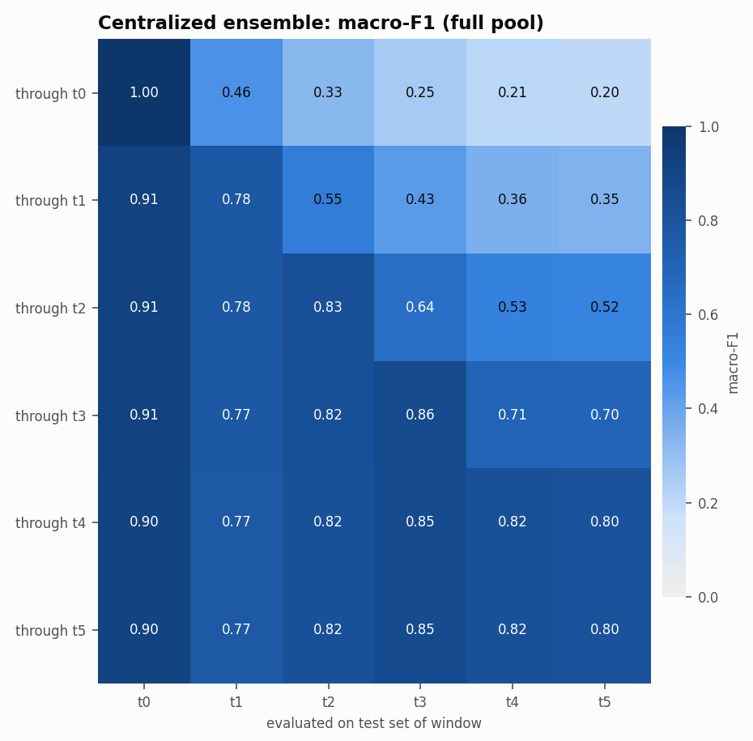
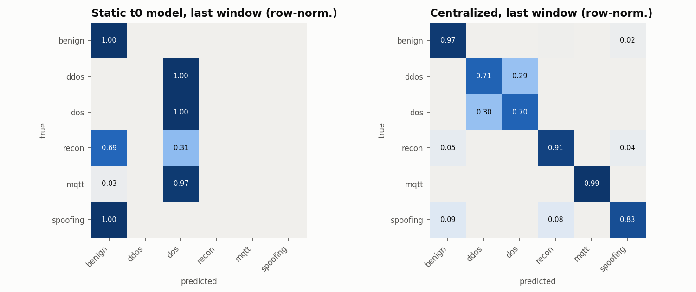

# M3 results — edge ensemble baselines (`full` pool)

Run `20261117-024907_m3_baselines_full`; target `y_category` (6 classes); timeline `category_intro`; 43 features (D6: IAT excluded).
Model: XGBoost + LightGBM with balanced class weights (capped at 50), early stopping on a 10% stratified validation split, fusion weight chosen by validation log-loss, temperature-calibrated.

## E1 centralized vs static, on each window's own test set

| window | new classes | E1 centralized macro-F1 | E1 accuracy | static macro-F1 | static accuracy | E1 n_train | w_xgb | T |
|---|---|---:|---:|---:|---:|---:|---:|---:|
| t0 | Benign, DoS-* | 1.0000 | 1.0000 | 1.0000 | 1.0000 | 338,246 | 0.0 | 0.16 |
| t1 | DDoS-* | 0.7758 | 0.7248 | 0.4648 | 0.2906 | 1,528,454 | 0.3 | 0.89 |
| t2 | Recon-Port-Scan, Recon-Ping-Sweep | 0.8263 | 0.7285 | 0.3258 | 0.2855 | 2,736,223 | 0.9 | 0.86 |
| t3 | MQTT-* | 0.8567 | 0.7417 | 0.2543 | 0.2675 | 4,022,507 | 0.1 | 0.86 |
| t4 | ARP-Spoofing | 0.8187 | 0.7447 | 0.2086 | 0.2658 | 5,315,836 | 0.1 | 0.86 |
| t5 | Recon-OS-Scan, Recon-VulScan | 0.8009 | 0.7470 | 0.2004 | 0.2679 | 6,633,571 | 0.2 | 0.86 |

- *E1 centralized* = retrained at every window on all clients' train data for windows 0..t (the upper bound).
- *Static* = trained on t0 only and never updated, which quantifies drift degradation.
- Window-averaged macro-F1: **E1 0.8464**, **static 0.4090**.
- E1 macro-F1 on the cumulative test set (windows 0..t, row-weighted) per t: t0 1.0000, t1 0.8070, t2 0.8153, t3 0.8266, t4 0.8221, t5 0.8170.

Each matrix row is one model (trained through window t) and each column is a window's test set. Cells right of the diagonal are future windows the model hasn't seen.

## Ensemble components (averaged over the diagonal)

| variant | mean macro-F1 | mean accuracy | mean ECE |
|---|---:|---:|---:|
| xgb | 0.8470 | 0.7796 | 0.0376 |
| lgb | 0.8452 | 0.7801 | 0.0409 |
| fused | 0.8464 | 0.7811 | 0.0387 |
| calibrated | 0.8464 | 0.7811 | 0.0532 |

## Per-class F1 of E1 on each window (— = class not yet present)

| window | benign | ddos | dos | recon | mqtt | spoofing |
|---|---:|---:|---:|---:|---:|---:|
| t0 | 1.000 | — | 1.000 | — | — | — |
| t1 | 1.000 | 0.785 | 0.543 | — | — | — |
| t2 | 0.997 | 0.784 | 0.543 | 0.982 | — | — |
| t3 | 0.992 | 0.780 | 0.538 | 0.977 | 0.997 | — |
| t4 | 0.977 | 0.785 | 0.541 | 0.974 | 0.996 | 0.638 |
| t5 | 0.968 | 0.785 | 0.542 | 0.935 | 0.996 | 0.580 |

## Edge cost

| model | single-flow P50 (ms) | P95 (ms) | batched (µs/flow) | XGB size (KB) | LGBM size (KB) |
|---|---:|---:|---:|---:|---:|
| trained through t0 | 6.02 | 12.15 | 11.56 | 299 | 1,050 |
| trained through t5 | 6.06 | 18.02 | 131.72 | 27,313 | 10,080 |

Measured on a machine with 4 logical CPUs, using all of them, with the full fused + calibrated ensemble. Single-flow latency includes Python call overhead.

## BLE edge model (binary, separate feature space: packet_length, inter_packet_gap, hci_type, hci_event_code, l2cap_length)

| trained through | eval window | macro-F1 | accuracy | AUROC | ECE |
|---|---|---:|---:|---:|---:|
| t4 | t4 | 0.9931 | 0.9955 | 0.9998 | 0.0048 |
| t4 | t5 | 0.9925 | 0.9951 | 0.9998 | 0.0046 |
| t5 | t4 | 0.9944 | 0.9963 | 0.9998 | 0.0049 |
| t5 | t5 | 0.9936 | 0.9958 | 0.9998 | 0.0050 |
