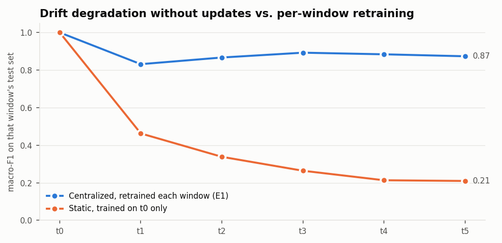
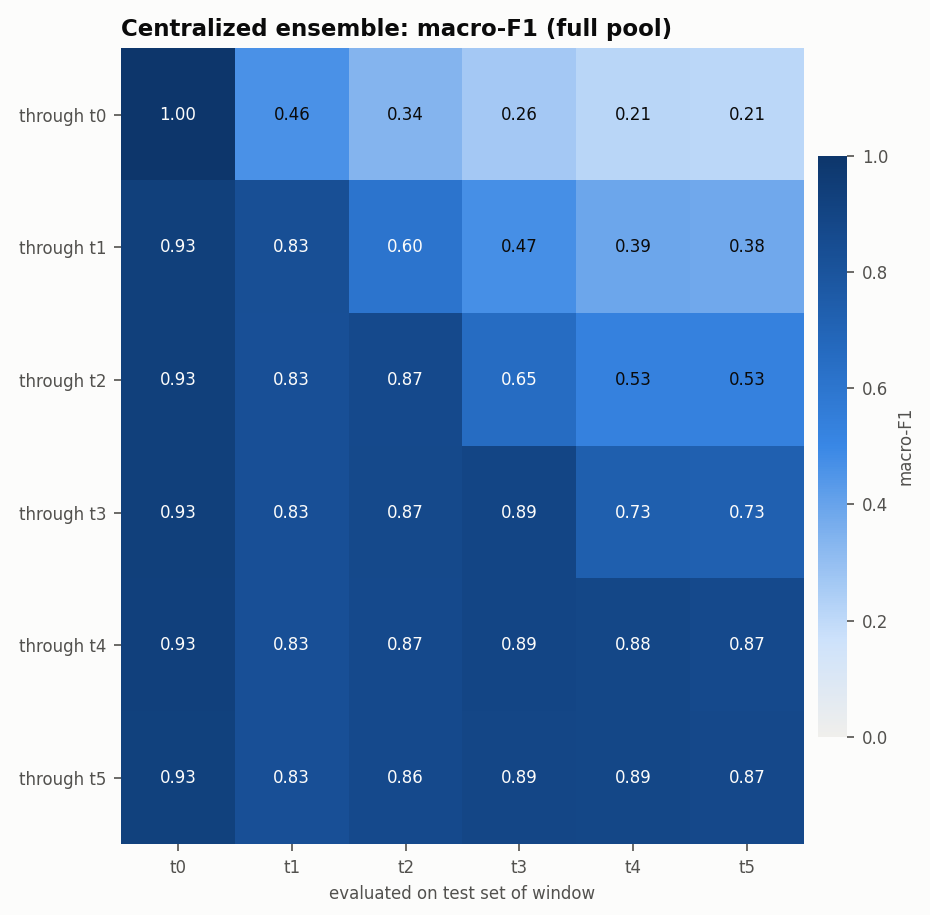
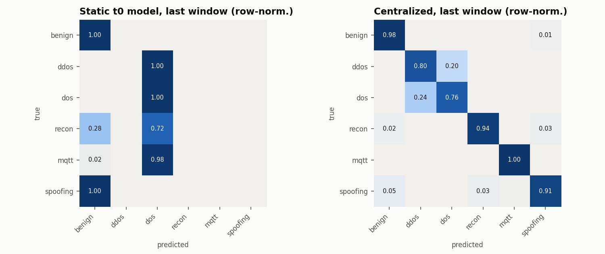

# M3 results — edge ensemble baselines (`full` pool)

Run `20261117-024725_m3_baselines_full`; target `y_category` (6 classes); timeline `category_intro`; 43 features (D6: IAT excluded).
Model: XGBoost + LightGBM with balanced class weights (capped at 50), early stopping on a 10% stratified validation split, fusion weight chosen by validation log-loss, temperature-calibrated.

## E1 centralized vs static, on each window's own test set

| window | new classes | E1 centralized macro-F1 | E1 accuracy | static macro-F1 | static accuracy | E1 n_train | w_xgb | T |
|---|---|---:|---:|---:|---:|---:|---:|---:|
| t0 | Benign, DoS-* | 1.0000 | 1.0000 | 1.0000 | 1.0000 | 333,044 | 0.0 | 0.23 |
| t1 | DDoS-* | 0.8315 | 0.8061 | 0.4626 | 0.2855 | 1,499,487 | 0.4 | 0.88 |
| t2 | Recon-Port-Scan, Recon-Ping-Sweep | 0.8668 | 0.8030 | 0.3382 | 0.2811 | 2,684,076 | 0.9 | 0.82 |
| t3 | MQTT-* | 0.8925 | 0.8146 | 0.2640 | 0.2638 | 3,946,274 | 0.6 | 0.83 |
| t4 | ARP-Spoofing | 0.8839 | 0.8146 | 0.2134 | 0.2625 | 5,214,810 | 0.7 | 0.81 |
| t5 | Recon-OS-Scan, Recon-VulScan | 0.8735 | 0.8202 | 0.2096 | 0.2637 | 6,507,442 | 0.2 | 0.83 |

- *E1 centralized* = retrained at every window on all clients' train data for windows 0..t (the upper bound).
- *Static* = trained on t0 only and never updated, which quantifies drift degradation.
- Window-averaged macro-F1: **E1 0.8914**, **static 0.4146**.
- E1 macro-F1 on the cumulative test set (windows 0..t, row-weighted) per t: t0 1.0000, t1 0.8534, t2 0.8578, t3 0.8691, t4 0.8710, t5 0.8718.

Each matrix row is one model (trained through window t) and each column is a window's test set. Cells right of the diagonal are future windows the model hasn't seen.

## Ensemble components (averaged over the diagonal)

| variant | mean macro-F1 | mean accuracy | mean ECE |
|---|---:|---:|---:|
| xgb | 0.8910 | 0.8425 | 0.0229 |
| lgb | 0.8910 | 0.8423 | 0.0235 |
| fused | 0.8914 | 0.8431 | 0.0237 |
| calibrated | 0.8914 | 0.8431 | 0.0157 |

## Per-class F1 of E1 on each window (— = class not yet present)

| window | benign | ddos | dos | recon | mqtt | spoofing |
|---|---:|---:|---:|---:|---:|---:|
| t0 | 1.000 | — | 1.000 | — | — | — |
| t1 | 1.000 | 0.856 | 0.639 | — | — | — |
| t2 | 0.997 | 0.851 | 0.632 | 0.987 | — | — |
| t3 | 0.994 | 0.851 | 0.631 | 0.989 | 0.998 | — |
| t4 | 0.988 | 0.851 | 0.634 | 0.981 | 0.997 | 0.852 |
| t5 | 0.984 | 0.854 | 0.636 | 0.964 | 0.997 | 0.806 |

## Edge cost

| model | single-flow P50 (ms) | P95 (ms) | batched (µs/flow) | XGB size (KB) | LGBM size (KB) |
|---|---:|---:|---:|---:|---:|
| trained through t0 | 6.03 | 12.17 | 12.17 | 322 | 1,081 |
| trained through t5 | 6.16 | 18.04 | 119.94 | 27,307 | 8,838 |

Measured on a machine with 4 logical CPUs, using all of them, with the full fused + calibrated ensemble. Single-flow latency includes Python call overhead.

## BLE edge model (binary, separate feature space: packet_length, inter_packet_gap, hci_type, hci_event_code, l2cap_length)

| trained through | eval window | macro-F1 | accuracy | AUROC | ECE |
|---|---|---:|---:|---:|---:|
| t4 | t4 | 0.9927 | 0.9952 | 0.9998 | 0.0040 |
| t4 | t5 | 0.9935 | 0.9957 | 0.9998 | 0.0039 |
| t5 | t4 | 0.9946 | 0.9964 | 0.9998 | 0.0045 |
| t5 | t5 | 0.9952 | 0.9968 | 0.9998 | 0.0044 |
