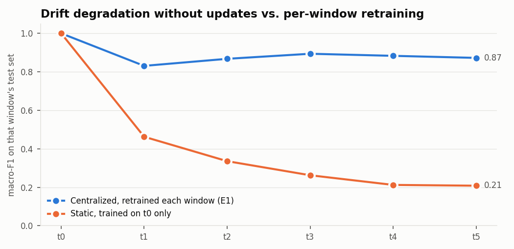
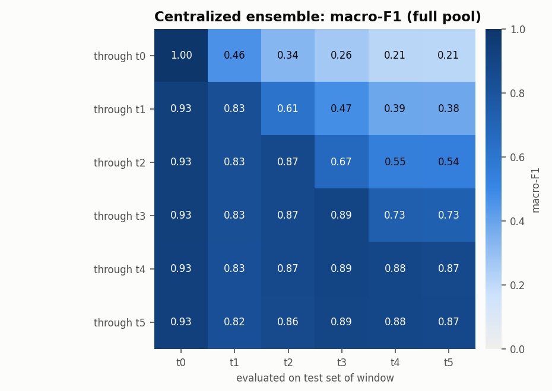
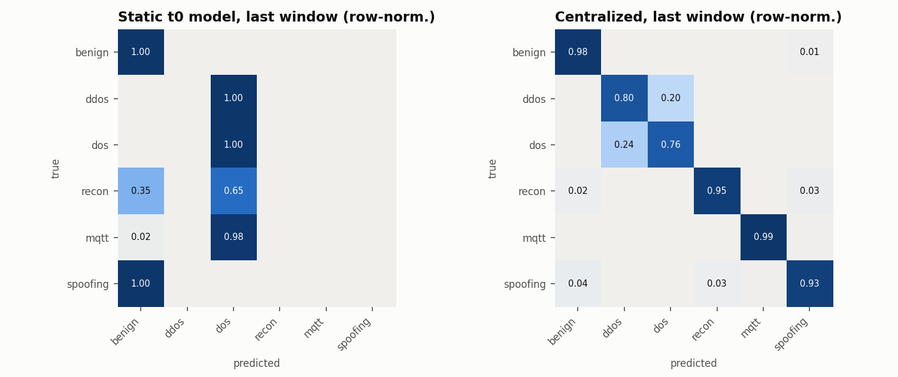

# M3 results — edge ensemble baselines (`full` pool)

> **Provisional.** Full-pool run at commit `a27f725`, on the partition from before D_pub moved to the proposal's definition (D_pub 17,913 rows, now 90,429). Kept for reference until the rerun writes `reports/m3/full/`.

Run `20261103-200414_m3_baselines_full`; target `y_category` (6 classes); timeline `category_intro`; 43 features (D6: IAT excluded).
Model: XGBoost + LightGBM with balanced class weights (capped at 50), early stopping on a 10% stratified validation split, fusion weight chosen by validation log-loss, temperature-calibrated.

## E1 centralized vs static, on each window's own test set

| window | new classes | E1 centralized macro-F1 | E1 accuracy | static macro-F1 | static accuracy | E1 n_train | w_xgb | T |
|---|---|---:|---:|---:|---:|---:|---:|---:|
| t0 | Benign, DoS-* | 0.9999 | 1.0000 | 0.9999 | 1.0000 | 335,262 | 1.0 | 0.97 |
| t1 | DDoS-* | 0.8308 | 0.8048 | 0.4625 | 0.2849 | 1,511,910 | 0.4 | 0.87 |
| t2 | Recon-Port-Scan, Recon-Ping-Sweep | 0.8674 | 0.8027 | 0.3357 | 0.2806 | 2,706,450 | 0.6 | 0.82 |
| t3 | MQTT-* | 0.8937 | 0.8152 | 0.2625 | 0.2635 | 3,978,662 | 0.3 | 0.84 |
| t4 | ARP-Spoofing | 0.8829 | 0.8140 | 0.2123 | 0.2623 | 5,256,954 | 0.7 | 0.81 |
| t5 | Recon-OS-Scan, Recon-VulScan | 0.8723 | 0.8167 | 0.2082 | 0.2638 | 6,559,668 | 0.7 | 0.82 |

- *E1 centralized* = retrained at every window on all clients' train data for windows 0..t (the upper bound).
- *Static* = trained on t0 only and never updated, which quantifies drift degradation.
- Window-averaged macro-F1: **E1 0.8912**, **static 0.4135**.
- E1 macro-F1 on the cumulative test set (windows 0..t, row-weighted) per t: t0 0.9999, t1 0.8531, t2 0.8582, t3 0.8704, t4 0.8712, t5 0.8697.

Each matrix row is one model (trained through window t) and each column is a window's test set. Cells right of the diagonal are future windows the model hasn't seen.

## Ensemble components (averaged over the diagonal)

| variant | mean macro-F1 | mean accuracy | mean ECE |
|---|---:|---:|---:|
| xgb | 0.8912 | 0.8424 | 0.0236 |
| lgb | 0.8900 | 0.8406 | 0.0234 |
| fused | 0.8912 | 0.8422 | 0.0241 |
| calibrated | 0.8912 | 0.8422 | 0.0181 |

## Per-class F1 of E1 on each window (— = class not yet present)

| window | benign | ddos | dos | recon | mqtt | spoofing |
|---|---:|---:|---:|---:|---:|---:|
| t0 | 1.000 | — | 1.000 | — | — | — |
| t1 | 1.000 | 0.855 | 0.638 | — | — | — |
| t2 | 0.997 | 0.851 | 0.632 | 0.990 | — | — |
| t3 | 0.995 | 0.851 | 0.633 | 0.991 | 0.998 | — |
| t4 | 0.988 | 0.850 | 0.632 | 0.981 | 0.997 | 0.849 |
| t5 | 0.984 | 0.851 | 0.633 | 0.965 | 0.996 | 0.805 |

## Edge cost

| model | single-flow P50 (ms) | P95 (ms) | batched (µs/flow) | XGB size (KB) | LGBM size (KB) |
|---|---:|---:|---:|---:|---:|
| trained through t0 | 6.02 | 12.11 | 6.85 | 250 | 638 |
| trained through t5 | 6.24 | 18.03 | 93.72 | 26,986 | 6,064 |

Measured on Kaggle with 4 logical CPUs, using all of them, with the full fused + calibrated ensemble. Single-flow latency includes Python call overhead.

## BLE edge model (binary, separate feature space: packet_length, inter_packet_gap, hci_type, hci_event_code, l2cap_length)

| trained through | eval window | macro-F1 | accuracy | AUROC | ECE |
|---|---|---:|---:|---:|---:|
| t4 | t4 | 0.9931 | 0.9955 | 0.9998 | 0.0048 |
| t4 | t5 | 0.9925 | 0.9951 | 0.9998 | 0.0046 |
| t5 | t4 | 0.9944 | 0.9963 | 0.9998 | 0.0049 |
| t5 | t5 | 0.9936 | 0.9958 | 0.9998 | 0.0050 |
