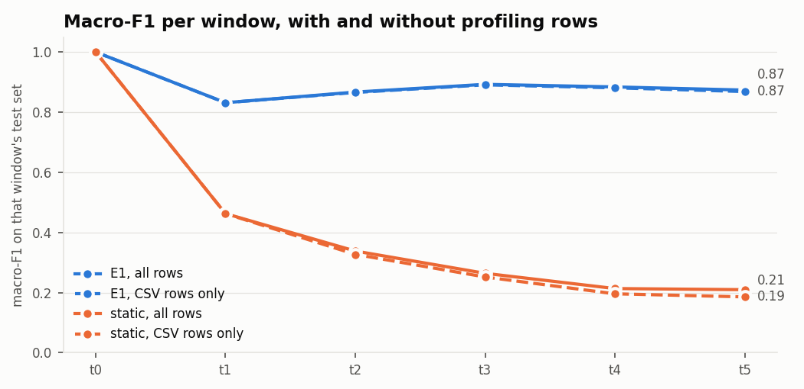
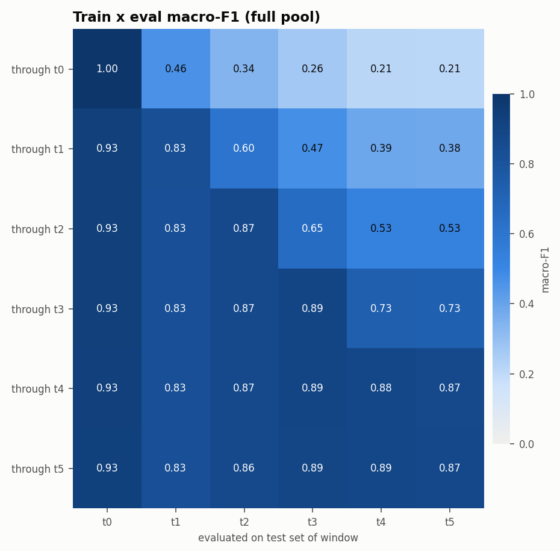
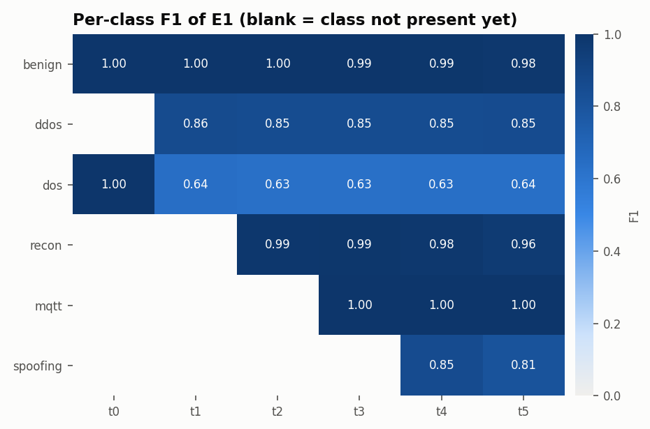
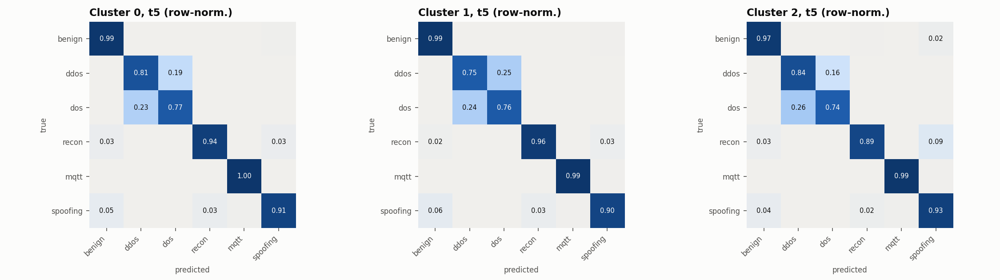

# M4 evaluation: E1 and static through the shared harness (`full` pool)

Run `20261117-040204_m4_evaluate_full`, models from `20261117-024725_m3_baselines_full`. Generated by `scripts/m4_evaluate.py`.

**Regression check against the logged M3 numbers: passed.** 160 rows compared; largest macro-F1 difference 5.0e-11, largest ECE difference 5.0e-11 (tolerance 1e-09).

Slices: `all` is every test row. `csv_only` drops the Zenodo benign profiling rows, which can be told apart from the CSV's benign rows and are always classified correctly, so it is the fairer view of benign false positives and the headline (decision D7).

## Summary

| method | slice | window avg | avg excl. t0 | final (t5) | drop from peak | class forgetting | drops | recovered | never |
|---|---|---:|---:|---:|---:|---:|---:|---:|---:|
| E1 | all | 0.8914 | 0.8697 | 0.8735 | 0.1265 | 0.0251 | 4 | 3 | 1 |
| E1 | csv_only | 0.8895 | 0.8674 | 0.8685 | 0.1315 | 0.0275 | 5 | 4 | 1 |
| static | all | 0.4146 | 0.2976 | 0.2096 | 0.7904 | n/a | 4 | 0 | 4 |
| static | csv_only | 0.4038 | 0.2846 | 0.1857 | 0.8143 | n/a | 4 | 0 | 4 |

Class forgetting is F_max − F_final per class on the test set of the window that introduced it, averaged over classes. A static model has one trained state, so it has no forgetting history. A *drop* is a window where the model before its update falls more than ε = 0.02 below its pre-drift score.

## Macro-F1 per window

| method | slice | t0 | t1 | t2 | t3 | t4 | t5 |
|---|---|---:|---:|---:|---:|---:|---:|
| E1 | all | 1.0000 | 0.8315 | 0.8668 | 0.8925 | 0.8839 | 0.8735 |
| E1 | csv_only | 1.0000 | 0.8314 | 0.8656 | 0.8908 | 0.8809 | 0.8685 |
| static | all | 1.0000 | 0.4626 | 0.3382 | 0.2640 | 0.2134 | 0.2096 |
| static | csv_only | 1.0000 | 0.4625 | 0.3270 | 0.2518 | 0.1958 | 0.1857 |

## Time to recover

| method | slice | window | pre-drift | model before update | windows to recover |
|---|---|---|---:|---:|---:|
| E1 | all | t1 | 1.0000 | 0.4626 | never |
| E1 | all | t2 | 0.8315 | 0.6032 | 1 |
| E1 | all | t3 | 0.8668 | 0.6504 | 1 |
| E1 | all | t4 | 0.8925 | 0.7306 | 1 |
| E1 | all | t5 | 0.8839 | 0.8672 | 0 |
| E1 | csv_only | t1 | 1.0000 | 0.4625 | never |
| E1 | csv_only | t2 | 0.8314 | 0.5785 | 1 |
| E1 | csv_only | t3 | 0.8656 | 0.6149 | 1 |
| E1 | csv_only | t4 | 0.8908 | 0.7247 | 1 |
| E1 | csv_only | t5 | 0.8809 | 0.8606 | 1 |
| static | all | t1 | 1.0000 | 0.4626 | never |
| static | all | t2 | 0.4626 | 0.3382 | never |
| static | all | t3 | 0.3382 | 0.2640 | never |
| static | all | t4 | 0.2640 | 0.2134 | never |
| static | all | t5 | 0.2134 | 0.2096 | 0 |
| static | csv_only | t1 | 1.0000 | 0.4625 | never |
| static | csv_only | t2 | 0.4625 | 0.3270 | never |
| static | csv_only | t3 | 0.3270 | 0.2518 | never |
| static | csv_only | t4 | 0.2518 | 0.1958 | never |
| static | csv_only | t5 | 0.1958 | 0.1857 | 0 |

## Detection metrics of E1 per window (all rows)

| window | accuracy | macro-F1 | AUROC (attack vs benign) | macro one-vs-rest AUC | ECE |
|---|---:|---:|---:|---:|---:|
| t0 | 1.0000 | 1.0000 | 1.0000 | 1.0000 | 0.0000 |
| t1 | 0.8061 | 0.8315 | 1.0000 | 0.9254 | 0.0209 |
| t2 | 0.8030 | 0.8668 | 1.0000 | 0.9445 | 0.0207 |
| t3 | 0.8146 | 0.8925 | 1.0000 | 0.9610 | 0.0164 |
| t4 | 0.8146 | 0.8839 | 1.0000 | 0.9681 | 0.0184 |
| t5 | 0.8202 | 0.8735 | 1.0000 | 0.9696 | 0.0181 |

## Client clusters

Clients are grouped by training label mix (Ward linkage on 19-class shares across all windows). Macro-F1 of E1 at each window, by cluster:

| cluster | clients | t0 | t1 | t2 | t3 | t4 | t5 |
|---|---|---:|---:|---:|---:|---:|---:|
| 0 | c00, c01, c02, c05, c06, c07, c10, c13, c14 | 1.0000 | 0.7999 | 0.8430 | 0.8737 | 0.8708 | 0.8644 |
| 1 | c03, c08, c11 | 1.0000 | 0.8163 | 0.8571 | 0.8842 | 0.8852 | 0.8767 |
| 2 | c04, c09, c12 | 1.0000 | 0.8678 | 0.8801 | 0.9040 | 0.8704 | 0.8635 |

Confusion matrices for every (model, window, slice) are in `confusions.csv`.

## System cost

Latency on one thread, on this machine, with Python call overhead included in the single-flow figures:

| model | component | single-flow P50 (ms) | P95 (ms) | batched (µs/flow) |
|---|---|---:|---:|---:|
| through t0 | xgb | 0.41 | 0.47 | 3.54 |
| through t0 | lgb | 0.08 | 0.11 | 14.02 |
| through t0 | ensemble | 0.67 | 0.81 | 17.55 |
| through t5 | xgb | 0.88 | 1.25 | 57.36 |
| through t5 | lgb | 0.25 | 0.32 | 158.13 |
| through t5 | ensemble | 1.54 | 2.01 | 223.33 |

| model | XGB trees | LGBM trees | max comparisons per flow | size (MB) | training time (s) |
|---|---:|---:|---:|---:|---:|
| through t0 | 300 | 290 | 5,300 | 1.4 | 13.3 |
| through t5 | 1,770 | 1,278 | 26,940 | 36.1 | 1427.5 |

Projected federated cost: sharing float32 soft labels on the whole D_pub (90,429 rows, 6 classes) costs **2.17 MB per client** and **32.6 MB per round** over 15 clients, before any compression. M7 will measure the real figure. LLM cost and payload size are recorded from M11 onward.
