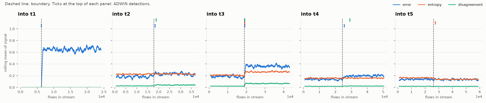
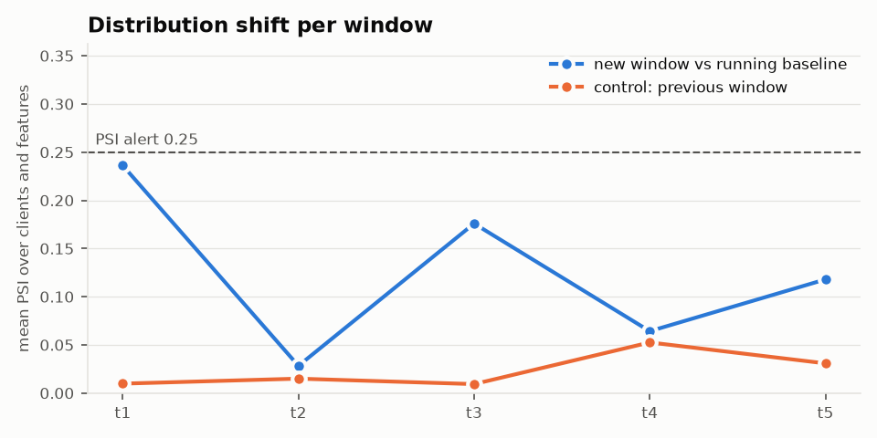
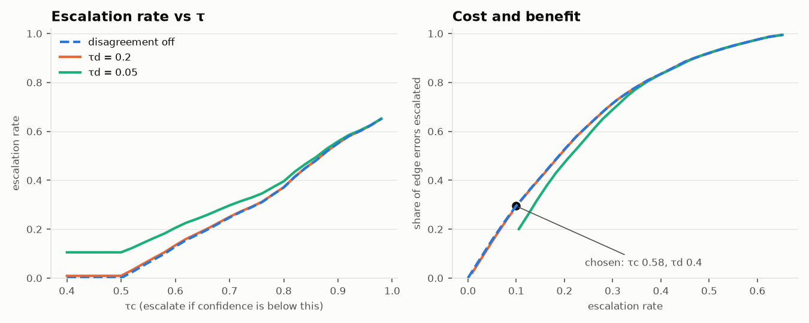

# M5: drift signals and the uncertainty gate (`dev` pool)

Run `20261104-180417_m5_drift_dev`, models from `20261104-142623_m3_baselines_dev`. Generated by `scripts/m5_drift.py`.

**Experiment.** At each boundary, the model trained through the earlier window scores a client's test rows from that window, then its rows from the new window. Rows are shuffled inside each window. A detection before the boundary is a false alarm. A *detection* is the first rise in the signal after the boundary. The data has no timestamps, so real bursts are absent and the false-alarm counts apply only to shuffled traffic. An *affected* client is one whose error rate rises by at least 0.02. Only `entropy` and `disagreement` are available at deployment, because `error` needs labels. ADWIN δ = 0.002.

## ADWIN summary

| signal | clients detected | affected clients detected | boundaries caught, pooled | client false alarms | per 100k rows | pooled false alarms |
|---|---:|---:|---:|---:|---:|---:|
| error | 38/75 | 38/49 | 4/5 | 0 | 0.0 | 0 |
| entropy | 11/75 | 11/49 | 1/5 | 0 | 0.0 | 0 |
| disagreement | 14/75 | 14/49 | 3/5 | 0 | 0.0 | 0 |

## ADWIN per boundary

| boundary | signal | clients detected | affected clients detected | median delay (rows) | client false alarms | pre-boundary rows | pooled delay (rows) | pooled false alarms |
|---|---|---:|---:|---:|---:|---:|---:|---:|
| t1 | error | 15/15 | 15/15 | 37 | 0 | 6,281 | 22 | 0 |
| t1 | entropy | 0/15 | 0/15 | n/a | 0 | 6,281 | missed | 0 |
| t1 | disagreement | 0/15 | 0/15 | n/a | 0 | 6,281 | missed | 0 |
| t2 | error | 2/15 | 2/7 | 162 | 0 | 17,856 | 511 | 0 |
| t2 | entropy | 0/15 | 0/7 | n/a | 0 | 17,856 | missed | 0 |
| t2 | disagreement | 2/15 | 2/7 | 178 | 0 | 17,856 | 991 | 0 |
| t3 | error | 14/15 | 14/15 | 262 | 0 | 18,874 | 229 | 0 |
| t3 | entropy | 11/15 | 11/15 | 297 | 0 | 18,874 | 293 | 0 |
| t3 | disagreement | 12/15 | 12/15 | 220 | 0 | 18,874 | 229 | 0 |
| t4 | error | 6/15 | 6/10 | 294 | 0 | 24,338 | 1,261 | 0 |
| t4 | entropy | 0/15 | 0/10 | n/a | 0 | 24,338 | missed | 0 |
| t4 | disagreement | 0/15 | 0/10 | n/a | 0 | 24,338 | 4,749 | 0 |
| t5 | error | 1/15 | 1/2 | 1,501 | 0 | 26,099 | missed | 0 |
| t5 | entropy | 0/15 | 0/2 | n/a | 0 | 26,099 | missed | 0 |
| t5 | disagreement | 0/15 | 0/2 | n/a | 0 | 26,099 | missed | 0 |

## Distribution shift per client, against its running baseline

Baseline: the client's training rows from earlier windows. Control: the same baseline against test rows of the previous window, which it covers, though diluted by the older windows. PSI alert = 0.25. As in the proposal, these are reported and don't trigger anything.

| window | mean PSI | control | features over PSI alert | control | clients with at least 10% of features over it | control | mean KL | mean Wasserstein (std units) | top features by PSI |
|---|---:|---:|---:|---:|---:|---:|---:|---:|---|
| t1 | 0.236 | 0.010 | 26.7% | 0.0% | 13/15 | 0/15 | 0.126 | 0.196 | Header_Length (0.88), Tot_size (0.85), AVG (0.85) |
| t2 | 0.028 | 0.015 | 1.1% | 0.0% | 0/15 | 0/15 | 0.016 | 0.109 | Weight (0.09), Tot_sum (0.08), Number (0.08) |
| t3 | 0.176 | 0.009 | 19.4% | 0.0% | 7/15 | 0/15 | 0.105 | 0.382 | fin_flag_number (0.61), fin_count (0.49), rst_count (0.46) |
| t4 | 0.064 | 0.053 | 5.7% | 4.0% | 4/15 | 2/15 | 0.034 | 0.168 | Magnitue (0.22), rst_count (0.17), Radius (0.16) |
| t5 | 0.118 | 0.031 | 14.1% | 0.0% | 7/15 | 0/15 | 0.063 | 0.334 | AVG (0.32), Tot_size (0.32), Min (0.32) |

## Gate

Thresholds were tuned on the validation rows M3 held out, averaged over the models for t1 to t5, for the most errors captured within an escalation budget. The proposal sets no budget, so 10% is an assumption. **Used below: τc = 0.58, τd = 0.4.** Those rows set early stopping and calibration, so compare with the test rows below.

| escalation budget | τc | τd | escalation rate | errors captured |
|---:|---:|---:|---:|---:|
| 5% | 0.52 | 0.15 | 0.039 | 0.107 |
| 10% | 0.58 | 0.4 | 0.100 | 0.295 |
| 20% | 0.66 | 0.3 | 0.200 | 0.526 |
| 30% | 0.74 | 0.15 | 0.294 | 0.702 |

On the test sets. LLM calls count every flow; the other columns use CSV-only rows (D7). *Before update* is the old model on the new window; *settled* is the model after its update. The drift flag uses `disagreement` and holds for 200 flows after each rise.

| window | model | drift flag | LLM calls per 1k flows | errors sent to cloud | error rate among escalated | accuracy on the rest | unseen-class rows escalated |
|---|---|---|---:|---:|---:|---:|---:|
| t1 | settled | no | 116 | 0.298 | 0.470 | 0.834 | n/a |
| t1 | before update | no | 0 | 0.000 | 0.000 | 0.271 | 0.000 |
| t1 | before update | yes | 0 | 0.000 | 0.000 | 0.271 | 0.000 |
| t2 | settled | no | 113 | 0.310 | 0.504 | 0.837 | n/a |
| t2 | before update | no | 141 | 0.355 | 0.577 | 0.804 | 0.527 |
| t2 | before update | yes | 158 | 0.373 | 0.545 | 0.805 | 0.558 |
| t3 | settled | no | 84 | 0.313 | 0.509 | 0.888 | n/a |
| t3 | before update | no | 208 | 0.460 | 0.800 | 0.726 | 0.553 |
| t3 | before update | yes | 280 | 0.516 | 0.692 | 0.731 | 0.605 |
| t4 | settled | no | 88 | 0.302 | 0.467 | 0.886 | n/a |
| t4 | before update | no | 83 | 0.224 | 0.532 | 0.819 | 0.071 |
| t4 | before update | yes | 83 | 0.224 | 0.532 | 0.819 | 0.071 |
| t5 | settled | no | 68 | 0.289 | 0.495 | 0.897 | n/a |
| t5 | before update | no | 75 | 0.296 | 0.526 | 0.881 | n/a |
| t5 | before update | yes | 75 | 0.296 | 0.526 | 0.881 | n/a |

Every ADWIN and distribution event is in the run's `drift_registry.jsonl`; `adwin_streams.csv` and `distribution_shift.csv` hold the per-stream and per-feature numbers.
