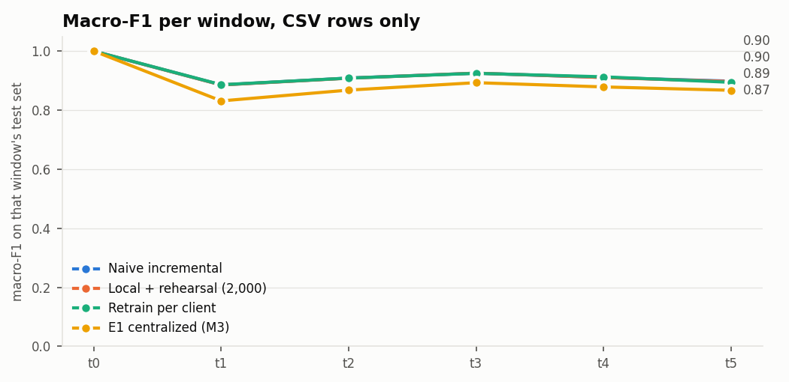

# M6: incremental local learning and rehearsal (`full` pool)

Run `20261114-204526_m6_incremental_full`. Generated by `scripts/m6_incremental.py`. One seed. Scores use CSV-only rows (D7), and each row is scored by its own client's model.

Every client trains alone. Old classes recur with fresh rows in each later window of this timeline, so even a client without a buffer keeps seeing them. That limits how much forgetting this timeline can show.

Settings: 50 rounds at most for the first fit, 50 per update, leaf output capped at `max_delta_step` = 10.0, buffer 2,000 rows per client, class-balanced. M3's centralized results, where available, come from `reports/m4/full/`.

## Results

| method | window avg | avg excl. t0 | final (t5) | class forgetting |
|---|---:|---:|---:|---:|
| Naive incremental | 0.9213 | 0.9057 | 0.8982 | 0.0254 |
| Local + rehearsal (2,000) | 0.9210 | 0.9053 | 0.8970 | 0.0216 |
| Local + rehearsal (500) | 0.9205 | 0.9047 | 0.8968 | 0.0244 |
| Local + rehearsal (8,000) | 0.9210 | 0.9053 | 0.8975 | 0.0199 |
| Retrain per client | 0.9210 | 0.9053 | 0.8942 | 0.0158 |
| E1 centralized (M3) | 0.8897 | 0.8676 | 0.8673 | 0.0255 |
| Static centralized (M3) | 0.3924 | 0.2709 | 0.1691 | n/a |

## Macro-F1 per window

| method | t0 | t1 | t2 | t3 | t4 | t5 |
|---|---:|---:|---:|---:|---:|---:|
| Naive incremental | 1.000 | 0.885 | 0.909 | 0.925 | 0.911 | 0.898 |
| Local + rehearsal (2,000) | 1.000 | 0.885 | 0.908 | 0.925 | 0.911 | 0.897 |
| Local + rehearsal (500) | 1.000 | 0.885 | 0.908 | 0.925 | 0.909 | 0.897 |
| Local + rehearsal (8,000) | 1.000 | 0.884 | 0.909 | 0.925 | 0.910 | 0.898 |
| Retrain per client | 1.000 | 0.886 | 0.909 | 0.925 | 0.913 | 0.894 |
| E1 centralized (M3) | 1.000 | 0.831 | 0.868 | 0.893 | 0.879 | 0.867 |
| Static centralized (M3) | 1.000 | 0.463 | 0.304 | 0.235 | 0.184 | 0.169 |

## Forgetting per class

F_max minus F_final on the test set of the window that introduced the class.

| method | benign | ddos | dos | mqtt | recon | spoofing |
|---|---:|---:|---:|---:|---:|---:|
| Naive incremental | 0.022 | 0.013 | 0.079 | 0.001 | 0.009 | 0.028 |
| Local + rehearsal (2,000) | 0.021 | 0.011 | 0.076 | 0.001 | 0.006 | 0.013 |
| Local + rehearsal (500) | 0.023 | 0.013 | 0.079 | 0.001 | 0.010 | 0.020 |
| Local + rehearsal (8,000) | 0.020 | 0.010 | 0.074 | 0.001 | 0.006 | 0.009 |
| Retrain per client | 0.016 | 0.003 | 0.067 | 0.001 | 0.005 | 0.004 |

## Cost

| method | total fit time (s) | mean trees XGB/LGBM at t5 | mean model size at t5 (MB) | largest buffer (rows) | largest buffer (kB) |
|---|---:|---:|---:|---:|---:|
| Naive incremental | 838 | 1695 / 1265 | 17.05 | 0 | 0 |
| Local + rehearsal (2,000) | 869 | 1653 / 1315 | 17.48 | 2,000 | 360 |
| Local + rehearsal (500) | 854 | 1694 / 1301 | 17.46 | 500 | 90 |
| Local + rehearsal (8,000) | 905 | 1672 / 1248 | 17.46 | 8,000 | 1440 |
| Retrain per client | 2541 | 531 / 264 | 6.68 | 0 | 0 |

Per-class and confusion tables are in `per_class.csv` and `confusions.csv`.
