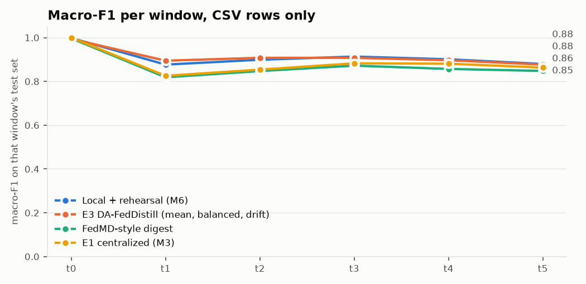

# M7: DA-FedDistill (`dev` pool)

Run `20261106-011832_m7_distill_dev`. Generated by `scripts/m7_distill.py`. Seed 42. Scores use CSV-only rows (D7), and each row is scored by its own client's model. Check against M6: the local models here score 0.9114 on window average and 0.9114 in M6's report (difference +0.00000).

All E3 variants and local + rehearsal share the same local models, so differences between them come from g_t alone. FedMD trains its own models, adding 10 rounds per client per window on the consensus. The headline `e3` was fixed before any result: mean aggregation, class-balanced on pseudo-labels, with drift features.

Two additions the proposal doesn't name. Each client fits a temperature on its own validation rows after g_t, which can't change a predicted class. And `e3_guard`, a variant and not the headline: a client keeps g_t only if it beats the client's own model on those rows, which are also used for its early stopping, so that choice is mildly optimistic.

## Results

| method | window avg | avg excl. t0 | final (t5) | class forgetting | mean ECE |
|---|---:|---:|---:|---:|---:|
| Local + rehearsal (M6) | 0.9114 | 0.8940 | 0.8796 | 0.0270 | 0.0097 |
| E3 DA-FedDistill (mean, balanced, drift) | 0.9130 | 0.8968 | 0.8768 | 0.0323 | 0.0141 |
| E3, reliability-weighted | 0.9131 | 0.8970 | 0.8780 | 0.0335 | 0.0135 |
| E3, no class balance | 0.9049 | 0.8870 | 0.8640 | 0.0458 | 0.0117 |
| E3, no drift features | 0.9126 | 0.8963 | 0.8775 | 0.0328 | 0.0131 |
| E3, 8-bit uplink | 0.9050 | 0.8873 | 0.8781 | 0.0310 | 0.0180 |
| E3 + client guard (addition) | 0.9158 | 0.8995 | 0.8822 | 0.0286 | 0.0065 |
| FedMD-style digest | 0.8733 | 0.8486 | 0.8479 | 0.0431 | 0.0397 |
| Naive incremental (M6) | 0.9122 | 0.8950 | 0.8812 | 0.0332 |  |
| E1 centralized (M3) | 0.8844 | 0.8612 | 0.8632 | 0.0370 |  |
| Static centralized (M3) | 0.3460 | 0.2152 | 0.0779 | n/a |  |

| E3 minus | window avg | final (t5) |
|---|---:|---:|
| Local + rehearsal (M6) | +0.0016 | -0.0028 |
| Naive incremental (M6) | +0.0007 | -0.0043 |
| E1 centralized (M3) | +0.0286 | +0.0136 |
| Static centralized (M3) | +0.5670 | +0.7989 |
| FedMD-style digest | +0.0397 | +0.0290 |

## Macro-F1 per window

| method | t0 | t1 | t2 | t3 | t4 | t5 |
|---|---:|---:|---:|---:|---:|---:|
| Local + rehearsal (M6) | 0.998 | 0.877 | 0.899 | 0.914 | 0.901 | 0.880 |
| E3 DA-FedDistill (mean, balanced, drift) | 0.994 | 0.895 | 0.908 | 0.908 | 0.897 | 0.877 |
| E3, reliability-weighted | 0.994 | 0.894 | 0.907 | 0.907 | 0.899 | 0.878 |
| E3, no class balance | 0.994 | 0.890 | 0.898 | 0.906 | 0.877 | 0.864 |
| E3, no drift features | 0.994 | 0.884 | 0.903 | 0.914 | 0.902 | 0.877 |
| E3, 8-bit uplink | 0.994 | 0.883 | 0.880 | 0.900 | 0.895 | 0.878 |
| E3 + client guard (addition) | 0.998 | 0.895 | 0.908 | 0.913 | 0.899 | 0.882 |
| FedMD-style digest | 0.997 | 0.819 | 0.847 | 0.872 | 0.857 | 0.848 |
| Naive incremental (M6) | 0.999 | 0.876 | 0.900 | 0.914 | 0.904 | 0.881 |
| E1 centralized (M3) | 1.000 | 0.826 | 0.854 | 0.883 | 0.881 | 0.863 |
| Static centralized (M3) | 1.000 | 0.463 | 0.265 | 0.169 | 0.102 | 0.078 |

## F1 per class at t5

| method | benign | ddos | dos | recon | mqtt | spoofing |
|---|---:|---:|---:|---:|---:|---:|
| Local + rehearsal (M6) | 0.826 | 0.901 | 0.739 | 0.960 | 0.979 | 0.873 |
| E3 DA-FedDistill (mean, balanced, drift) | 0.783 | 0.923 | 0.761 | 0.953 | 0.980 | 0.860 |
| E3 + client guard (addition) | 0.816 | 0.913 | 0.756 | 0.958 | 0.980 | 0.870 |
| FedMD-style digest | 0.819 | 0.863 | 0.636 | 0.946 | 0.979 | 0.844 |

## Clients: g_t against the client's own model

Macro-F1 on each client's rows of the current window, over the classes present in them.

| window | clients better with g_t | worse | mean change | worst | best | mean client temperature | guard accepted g_t |
|---|---:|---:|---:|---:|---:|---:|---:|
| t0 | 0/15 | 7 | -0.0116 | -0.1068 | +0.0000 | 0.180 | 1/15 |
| t1 | 10/15 | 5 | +0.0016 | -0.0899 | +0.0449 | 0.160 | 6/15 |
| t2 | 9/15 | 6 | +0.0251 | -0.0523 | +0.3391 | 0.174 | 3/15 |
| t3 | 5/15 | 10 | -0.0039 | -0.1013 | +0.1022 | 0.217 | 3/15 |
| t4 | 8/15 | 7 | +0.0152 | -0.0269 | +0.1350 | 0.243 | 6/15 |
| t5 | 6/15 | 9 | -0.0099 | -0.0519 | +0.0189 | 0.269 | 3/15 |

## Pseudo-label quality on D_pub

Macro-F1 against D_pub's true labels. These are read for this table only and never reach a fit.

| through | public rows | pseudo-labels (mean) | pseudo-labels (reliability) | mean client, local | mean client, g_t |
|---|---:|---:|---:|---:|---:|
| t0 | 2,110 | 0.998 | 0.998 | 0.959 | 0.988 |
| t1 | 5,034 | 0.817 | 0.817 | 0.715 | 0.735 |
| t2 | 5,277 | 0.852 | 0.853 | 0.716 | 0.756 |
| t3 | 6,105 | 0.874 | 0.873 | 0.764 | 0.798 |
| t4 | 6,283 | 0.835 | 0.826 | 0.718 | 0.749 |
| t5 | 6,523 | 0.824 | 0.819 | 0.732 | 0.748 |

## Communication per client per round

15 clients, 6 rounds. Whole run: E3 sends 22.6 MB up as float32 and 1.6 MB as 8-bit + zlib, and 35.3 kB down. FedMD sends 0.8 MB up and 1.0 MB down (8-bit + zlib). The 8-bit uplink's accuracy is the `E3, 8-bit uplink` row above. g_t adds about 0.4 µs per flow at inference, batched.

| through | public rows | E3 up, float32 (MB) | E3 up, 8-bit (MB) | E3 up, 8-bit + zlib (MB) | E3 down (bytes) | FedMD up, 8-bit + zlib (MB) | FedMD down, 8-bit + zlib (MB) |
|---|---:|---:|---:|---:|---:|---:|---:|
| t0 | 2,110 | 0.101 | 0.025 | 0.002 | 392 | 0.000 | 0.001 |
| t1 | 5,034 | 0.242 | 0.060 | 0.016 | 392 | 0.008 | 0.009 |
| t2 | 5,277 | 0.253 | 0.063 | 0.019 | 392 | 0.009 | 0.013 |
| t3 | 6,105 | 0.293 | 0.073 | 0.023 | 392 | 0.011 | 0.015 |
| t4 | 6,283 | 0.302 | 0.075 | 0.023 | 392 | 0.012 | 0.015 |
| t5 | 6,523 | 0.313 | 0.078 | 0.025 | 392 | 0.013 | 0.016 |

## Gate with the cloud's thresholds

The cloud picks τc and τd on D_pub for the most disagreement with the consensus caught, within the 10% budget (an assumption, see M5). D_pub's class mix is not a client's, so test rates can leave the budget. Local + rehearsal is shown with the same thresholds, for reference. Next-window rows show the old model facing new traffic.

| model through | eval window | τc | τd | method | error rate | escalated | errors caught | accuracy on the rest |
|---|---|---:|---:|---|---:|---:|---:|---:|
| t0 | t0 | 0.96 | 0.05 | E3 DA-FedDistill (mean, balanced, drift) | 0.003 | 0.008 | 0.846 | 1.000 |
| t0 | t0 | 0.96 | 0.05 | Local + rehearsal (M6) | 0.001 | 0.008 | 0.500 | 1.000 |
| t0 | t1 | 0.96 | 0.05 | E3 DA-FedDistill (mean, balanced, drift) | 0.730 | 0.016 | 0.019 | 0.272 |
| t0 | t1 | 0.96 | 0.05 | Local + rehearsal (M6) | 0.730 | 0.016 | 0.018 | 0.272 |
| t1 | t1 | 0.62 | 0.4 | E3 DA-FedDistill (mean, balanced, drift) | 0.110 | 0.074 | 0.292 | 0.916 |
| t1 | t1 | 0.62 | 0.4 | Local + rehearsal (M6) | 0.141 | 0.091 | 0.282 | 0.888 |
| t1 | t2 | 0.62 | 0.4 | E3 DA-FedDistill (mean, balanced, drift) | 0.165 | 0.098 | 0.357 | 0.882 |
| t1 | t2 | 0.62 | 0.4 | Local + rehearsal (M6) | 0.190 | 0.116 | 0.350 | 0.860 |
| t2 | t2 | 0.66 | 1.01 | E3 DA-FedDistill (mean, balanced, drift) | 0.109 | 0.083 | 0.326 | 0.920 |
| t2 | t2 | 0.66 | 1.01 | Local + rehearsal (M6) | 0.131 | 0.112 | 0.356 | 0.905 |
| t2 | t3 | 0.66 | 1.01 | E3 DA-FedDistill (mean, balanced, drift) | 0.323 | 0.086 | 0.149 | 0.699 |
| t2 | t3 | 0.66 | 1.01 | Local + rehearsal (M6) | 0.338 | 0.182 | 0.397 | 0.751 |
| t3 | t3 | 0.60 | 1.01 | E3 DA-FedDistill (mean, balanced, drift) | 0.095 | 0.061 | 0.274 | 0.927 |
| t3 | t3 | 0.60 | 1.01 | Local + rehearsal (M6) | 0.097 | 0.049 | 0.237 | 0.922 |
| t3 | t4 | 0.60 | 1.01 | E3 DA-FedDistill (mean, balanced, drift) | 0.167 | 0.063 | 0.185 | 0.854 |
| t3 | t4 | 0.60 | 1.01 | Local + rehearsal (M6) | 0.168 | 0.054 | 0.180 | 0.854 |
| t4 | t4 | 0.60 | 1.01 | E3 DA-FedDistill (mean, balanced, drift) | 0.093 | 0.071 | 0.334 | 0.933 |
| t4 | t4 | 0.60 | 1.01 | Local + rehearsal (M6) | 0.105 | 0.057 | 0.265 | 0.918 |
| t4 | t5 | 0.60 | 1.01 | E3 DA-FedDistill (mean, balanced, drift) | 0.140 | 0.068 | 0.233 | 0.885 |
| t4 | t5 | 0.60 | 1.01 | Local + rehearsal (M6) | 0.185 | 0.076 | 0.269 | 0.854 |
| t5 | t5 | 0.60 | 1.01 | E3 DA-FedDistill (mean, balanced, drift) | 0.089 | 0.065 | 0.319 | 0.935 |
| t5 | t5 | 0.60 | 1.01 | Local + rehearsal (M6) | 0.101 | 0.060 | 0.299 | 0.925 |

Parameters of every g_t are in `calibrators.json`; per-client and per-class tables are in `per_client.csv` and `per_class.csv`.
