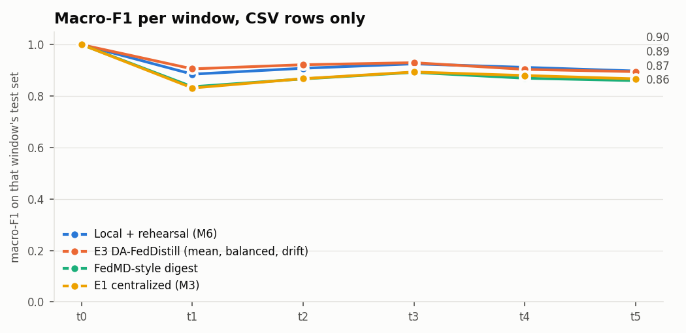

# M7: DA-FedDistill (`full` pool)

Run `20261106-082447_m7_distill_full`. Generated by `scripts/m7_distill.py`. Seed 42. Scores use CSV-only rows (D7), and each row is scored by its own client's model. Check against M6: the local models here score 0.9210 on window average and 0.9208 in M6's report (difference +0.00013).

All E3 variants and local + rehearsal share the same local models, so differences between them come from g_t alone. FedMD trains its own models, adding 10 rounds per client per window on the consensus. The headline `e3` was fixed before any result: mean aggregation, class-balanced on pseudo-labels, with drift features.

Two additions the proposal doesn't name. Each client fits a temperature on its own validation rows after g_t, which can't change a predicted class. And `e3_guard`, a variant and not the headline: a client keeps g_t only if it beats the client's own model on those rows, which are also used for its early stopping, so that choice is mildly optimistic.

## Results

| method | window avg | avg excl. t0 | final (t5) | class forgetting | mean ECE |
|---|---:|---:|---:|---:|---:|
| Local + rehearsal (M6) | 0.9210 | 0.9053 | 0.8972 | 0.0218 | 0.0081 |
| E3 DA-FedDistill (mean, balanced, drift) | 0.9257 | 0.9109 | 0.8947 | 0.0245 | 0.0054 |
| E3, reliability-weighted | 0.9248 | 0.9099 | 0.8939 | 0.0236 | 0.0054 |
| E3, no class balance | 0.9208 | 0.9050 | 0.9004 | -0.0003 | 0.0079 |
| E3, no drift features | 0.9237 | 0.9086 | 0.8968 | 0.0172 | 0.0057 |
| E3, 8-bit uplink | 0.9255 | 0.9107 | 0.8956 | 0.0220 | 0.0062 |
| E3 + client guard (addition) | 0.9288 | 0.9146 | 0.8986 | 0.0249 | 0.0044 |
| FedMD-style digest | 0.8872 | 0.8647 | 0.8598 | 0.0324 | 0.0568 |
| Naive incremental (M6) | 0.9211 | 0.9054 | 0.8979 | 0.0240 |  |
| E1 centralized (M3) | 0.8897 | 0.8677 | 0.8668 | 0.0277 |  |
| Static centralized (M3) | 0.4024 | 0.2829 | 0.1840 | n/a |  |

| E3 minus | window avg | final (t5) |
|---|---:|---:|
| Local + rehearsal (M6) | +0.0047 | -0.0025 |
| Naive incremental (M6) | +0.0046 | -0.0033 |
| E1 centralized (M3) | +0.0360 | +0.0279 |
| Static centralized (M3) | +0.5233 | +0.7107 |
| FedMD-style digest | +0.0385 | +0.0349 |

## Macro-F1 per window

| method | t0 | t1 | t2 | t3 | t4 | t5 |
|---|---:|---:|---:|---:|---:|---:|
| Local + rehearsal (M6) | 1.000 | 0.885 | 0.908 | 0.925 | 0.911 | 0.897 |
| E3 DA-FedDistill (mean, balanced, drift) | 0.999 | 0.905 | 0.922 | 0.929 | 0.904 | 0.895 |
| E3, reliability-weighted | 0.999 | 0.905 | 0.920 | 0.929 | 0.900 | 0.894 |
| E3, no class balance | 0.999 | 0.901 | 0.919 | 0.932 | 0.873 | 0.900 |
| E3, no drift features | 0.999 | 0.898 | 0.915 | 0.930 | 0.903 | 0.897 |
| E3, 8-bit uplink | 0.999 | 0.905 | 0.920 | 0.930 | 0.902 | 0.896 |
| E3 + client guard (addition) | 1.000 | 0.907 | 0.924 | 0.933 | 0.910 | 0.899 |
| FedMD-style digest | 1.000 | 0.836 | 0.866 | 0.892 | 0.869 | 0.860 |
| Naive incremental (M6) | 1.000 | 0.885 | 0.909 | 0.925 | 0.910 | 0.898 |
| E1 centralized (M3) | 1.000 | 0.831 | 0.867 | 0.893 | 0.880 | 0.867 |
| Static centralized (M3) | 1.000 | 0.463 | 0.324 | 0.250 | 0.194 | 0.184 |

## F1 per class at t5

| method | benign | ddos | dos | recon | mqtt | spoofing |
|---|---:|---:|---:|---:|---:|---:|
| Local + rehearsal (M6) | 0.952 | 0.906 | 0.755 | 0.970 | 0.994 | 0.806 |
| E3 DA-FedDistill (mean, balanced, drift) | 0.940 | 0.925 | 0.776 | 0.963 | 0.995 | 0.769 |
| E3 + client guard (addition) | 0.949 | 0.915 | 0.766 | 0.970 | 0.995 | 0.797 |
| FedMD-style digest | 0.927 | 0.873 | 0.662 | 0.949 | 0.994 | 0.754 |

## Clients: g_t against the client's own model

Macro-F1 on each client's rows of the current window, over the classes present in them.

| window | clients better with g_t | worse | mean change | worst | best | mean client temperature | guard accepted g_t |
|---|---:|---:|---:|---:|---:|---:|---:|
| t0 | 2/15 | 3 | +0.0045 | -0.0027 | +0.0715 | 0.170 | 1/15 |
| t1 | 9/15 | 6 | +0.0092 | -0.0111 | +0.0484 | 0.176 | 9/15 |
| t2 | 8/15 | 7 | +0.0044 | -0.0805 | +0.1097 | 0.189 | 11/15 |
| t3 | 6/15 | 9 | -0.0135 | -0.1145 | +0.0193 | 0.209 | 8/15 |
| t4 | 1/15 | 14 | -0.0222 | -0.1095 | +0.0118 | 0.210 | 3/15 |
| t5 | 6/15 | 9 | -0.0077 | -0.0452 | +0.0184 | 0.213 | 6/15 |

## Pseudo-label quality on D_pub

Macro-F1 against D_pub's true labels. These are read for this table only and never reach a fit.

| through | public rows | pseudo-labels (mean) | pseudo-labels (reliability) | mean client, local | mean client, g_t |
|---|---:|---:|---:|---:|---:|
| t0 | 27,222 | 1.000 | 1.000 | 0.998 | 0.999 |
| t1 | 85,681 | 0.826 | 0.827 | 0.745 | 0.764 |
| t2 | 86,737 | 0.862 | 0.863 | 0.763 | 0.786 |
| t3 | 90,004 | 0.885 | 0.886 | 0.809 | 0.827 |
| t4 | 90,182 | 0.819 | 0.805 | 0.734 | 0.741 |
| t5 | 90,429 | 0.816 | 0.811 | 0.724 | 0.737 |

## Communication per client per round

15 clients, 6 rounds. Whole run: E3 sends 338.6 MB up as float32 and 16.6 MB as 8-bit + zlib, and 35.3 kB down. FedMD sends 8.2 MB up and 10.1 MB down (8-bit + zlib). The 8-bit uplink's accuracy is the `E3, 8-bit uplink` row above. g_t adds about 0.7 µs per flow at inference, batched.

| through | public rows | E3 up, float32 (MB) | E3 up, 8-bit (MB) | E3 up, 8-bit + zlib (MB) | E3 down (bytes) | FedMD up, 8-bit + zlib (MB) | FedMD down, 8-bit + zlib (MB) |
|---|---:|---:|---:|---:|---:|---:|---:|
| t0 | 27,222 | 1.307 | 0.327 | 0.007 | 392 | 0.000 | 0.001 |
| t1 | 85,681 | 4.113 | 1.028 | 0.206 | 392 | 0.099 | 0.120 |
| t2 | 86,737 | 4.163 | 1.041 | 0.214 | 392 | 0.108 | 0.133 |
| t3 | 90,004 | 4.320 | 1.080 | 0.222 | 392 | 0.112 | 0.139 |
| t4 | 90,182 | 4.329 | 1.082 | 0.223 | 392 | 0.112 | 0.139 |
| t5 | 90,429 | 4.341 | 1.085 | 0.234 | 392 | 0.117 | 0.141 |

## Gate with the cloud's thresholds

The cloud picks τc and τd on D_pub for the most disagreement with the consensus caught, within the 10% budget (an assumption, see M5). D_pub's class mix is not a client's, so test rates can leave the budget. Local + rehearsal is shown with the same thresholds, for reference. Next-window rows show the old model facing new traffic.

| model through | eval window | τc | τd | method | error rate | escalated | errors caught | accuracy on the rest |
|---|---|---:|---:|---|---:|---:|---:|---:|
| t0 | t0 | 0.98 | 0.02 | E3 DA-FedDistill (mean, balanced, drift) | 0.000 | 0.002 | 0.778 | 1.000 |
| t0 | t0 | 0.98 | 0.02 | Local + rehearsal (M6) | 0.000 | 0.002 | 0.667 | 1.000 |
| t0 | t1 | 0.98 | 0.02 | E3 DA-FedDistill (mean, balanced, drift) | 0.741 | 0.002 | 0.002 | 0.259 |
| t0 | t1 | 0.98 | 0.02 | Local + rehearsal (M6) | 0.741 | 0.002 | 0.002 | 0.259 |
| t1 | t1 | 0.62 | 0.15 | E3 DA-FedDistill (mean, balanced, drift) | 0.102 | 0.071 | 0.296 | 0.923 |
| t1 | t1 | 0.62 | 0.15 | Local + rehearsal (M6) | 0.136 | 0.103 | 0.333 | 0.899 |
| t1 | t2 | 0.62 | 0.15 | E3 DA-FedDistill (mean, balanced, drift) | 0.115 | 0.080 | 0.350 | 0.919 |
| t1 | t2 | 0.62 | 0.15 | Local + rehearsal (M6) | 0.150 | 0.112 | 0.374 | 0.894 |
| t2 | t2 | 0.64 | 0.4 | E3 DA-FedDistill (mean, balanced, drift) | 0.100 | 0.073 | 0.315 | 0.926 |
| t2 | t2 | 0.64 | 0.4 | Local + rehearsal (M6) | 0.134 | 0.109 | 0.363 | 0.904 |
| t2 | t3 | 0.64 | 0.4 | E3 DA-FedDistill (mean, balanced, drift) | 0.157 | 0.097 | 0.369 | 0.891 |
| t2 | t3 | 0.64 | 0.4 | Local + rehearsal (M6) | 0.189 | 0.135 | 0.412 | 0.871 |
| t3 | t3 | 0.62 | 0.3 | E3 DA-FedDistill (mean, balanced, drift) | 0.106 | 0.066 | 0.275 | 0.917 |
| t3 | t3 | 0.62 | 0.3 | Local + rehearsal (M6) | 0.125 | 0.088 | 0.315 | 0.906 |
| t3 | t4 | 0.62 | 0.3 | E3 DA-FedDistill (mean, balanced, drift) | 0.111 | 0.068 | 0.275 | 0.914 |
| t3 | t4 | 0.62 | 0.3 | Local + rehearsal (M6) | 0.131 | 0.089 | 0.319 | 0.902 |
| t4 | t4 | 0.62 | 0.5 | E3 DA-FedDistill (mean, balanced, drift) | 0.107 | 0.070 | 0.292 | 0.919 |
| t4 | t4 | 0.62 | 0.5 | Local + rehearsal (M6) | 0.125 | 0.084 | 0.308 | 0.905 |
| t4 | t5 | 0.62 | 0.5 | E3 DA-FedDistill (mean, balanced, drift) | 0.139 | 0.069 | 0.215 | 0.883 |
| t4 | t5 | 0.62 | 0.5 | Local + rehearsal (M6) | 0.158 | 0.076 | 0.228 | 0.868 |
| t5 | t5 | 0.60 | 0.4 | E3 DA-FedDistill (mean, balanced, drift) | 0.103 | 0.063 | 0.278 | 0.921 |
| t5 | t5 | 0.60 | 0.4 | Local + rehearsal (M6) | 0.123 | 0.078 | 0.293 | 0.906 |

Parameters of every g_t are in `calibrators.json`; per-client and per-class tables are in `per_client.csv` and `per_class.csv`.
