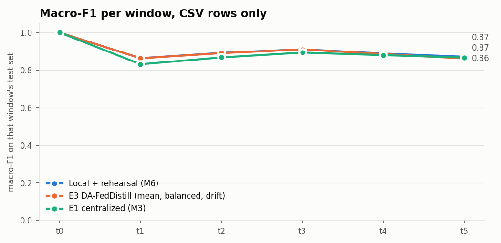

# M7: DA-FedDistill (`full` pool)

Run `20261116-171546_m7_distill_full`. Generated by `scripts/m7_distill.py`. Seed 42. Scores use CSV-only rows (D7), and each row is scored by its own client's model. M6's report for this seed was not found, so the models were not checked against it.

All E3 variants and local + rehearsal share the same local models, so differences between them come from g_t alone. FedMD trains its own models, adding 10 rounds per client per window on the consensus. The headline `e3` was fixed before any result: mean aggregation, class-balanced on pseudo-labels, with drift features.

Two additions the proposal doesn't name. Each client fits a temperature on its own validation rows after g_t, which can't change a predicted class. And `e3_guard`, a variant and not the headline: a client keeps g_t only if it beats the client's own model on those rows, which are also used for its early stopping, so that choice is mildly optimistic.

**The FedMD pass is missing from this report: it did not finish.** The communication table still gives its computed sizes.

## Results

| method | window avg | avg excl. t0 | final (t5) | class forgetting | mean ECE |
|---|---:|---:|---:|---:|---:|
| Local + rehearsal (M6) | 0.9041 | 0.8850 | 0.8712 | 0.0455 | 0.0064 |
| E3 DA-FedDistill (mean, balanced, drift) | 0.9017 | 0.8821 | 0.8618 | 0.0464 | 0.0048 |
| E3, reliability-weighted | 0.9018 | 0.8823 | 0.8627 | 0.0460 | 0.0048 |
| E3, no class balance | 0.9085 | 0.8903 | 0.8732 | 0.0467 | 0.0058 |
| E3, no drift features | 0.9037 | 0.8846 | 0.8654 | 0.0484 | 0.0078 |
| E3, 8-bit uplink | 0.9022 | 0.8829 | 0.8623 | 0.0463 | 0.0046 |
| E3 + client guard (addition) | 0.9048 | 0.8859 | 0.8708 | 0.0469 | 0.0059 |
| E1 centralized (M3) | 0.8897 | 0.8677 | 0.8668 | 0.0277 |  |
| Static centralized (M3) | 0.4024 | 0.2829 | 0.1840 | n/a |  |

| E3 minus | window avg | final (t5) |
|---|---:|---:|
| Local + rehearsal (M6) | -0.0024 | -0.0094 |
| E1 centralized (M3) | +0.0120 | -0.0050 |
| Static centralized (M3) | +0.4992 | +0.6778 |

## Macro-F1 per window

| method | t0 | t1 | t2 | t3 | t4 | t5 |
|---|---:|---:|---:|---:|---:|---:|
| Local + rehearsal (M6) | 0.999 | 0.863 | 0.892 | 0.910 | 0.888 | 0.871 |
| E3 DA-FedDistill (mean, balanced, drift) | 0.999 | 0.863 | 0.891 | 0.910 | 0.885 | 0.862 |
| E3, reliability-weighted | 0.999 | 0.863 | 0.891 | 0.910 | 0.885 | 0.863 |
| E3, no class balance | 0.999 | 0.873 | 0.897 | 0.916 | 0.892 | 0.873 |
| E3, no drift features | 0.999 | 0.865 | 0.893 | 0.912 | 0.887 | 0.865 |
| E3, 8-bit uplink | 0.999 | 0.865 | 0.891 | 0.910 | 0.886 | 0.862 |
| E3 + client guard (addition) | 0.999 | 0.866 | 0.892 | 0.911 | 0.890 | 0.871 |
| E1 centralized (M3) | 1.000 | 0.831 | 0.867 | 0.893 | 0.880 | 0.867 |
| Static centralized (M3) | 1.000 | 0.463 | 0.324 | 0.250 | 0.194 | 0.184 |

## F1 per class at t5

| method | benign | ddos | dos | recon | mqtt | spoofing |
|---|---:|---:|---:|---:|---:|---:|
| Local + rehearsal (M6) | 0.943 | 0.884 | 0.692 | 0.959 | 0.994 | 0.755 |
| E3 DA-FedDistill (mean, balanced, drift) | 0.936 | 0.883 | 0.691 | 0.953 | 0.994 | 0.713 |
| E3 + client guard (addition) | 0.943 | 0.884 | 0.693 | 0.958 | 0.994 | 0.753 |

## Clients: g_t against the client's own model

Macro-F1 on each client's rows of the current window, over the classes present in them.

| window | clients better with g_t | worse | mean change | worst | best | mean client temperature | guard accepted g_t |
|---|---:|---:|---:|---:|---:|---:|---:|
| t0 | 1/15 | 3 | -0.0001 | -0.0005 | +0.0002 | 0.420 | 0/15 |
| t1 | 4/15 | 11 | -0.0024 | -0.0284 | +0.0271 | 0.364 | 2/15 |
| t2 | 6/15 | 9 | +0.0023 | -0.0097 | +0.0527 | 0.370 | 5/15 |
| t3 | 4/15 | 11 | -0.0041 | -0.0367 | +0.0046 | 0.383 | 6/15 |
| t4 | 6/15 | 9 | -0.0010 | -0.0152 | +0.0100 | 0.389 | 6/15 |
| t5 | 0/15 | 15 | -0.0099 | -0.0271 | -0.0005 | 0.430 | 2/15 |

## Pseudo-label quality on D_pub

Macro-F1 against D_pub's true labels. These are read for this table only and never reach a fit.

| through | public rows | pseudo-labels (mean) | pseudo-labels (reliability) | mean client, local | mean client, g_t |
|---|---:|---:|---:|---:|---:|
| t0 | 27,222 | 1.000 | 1.000 | 0.999 | 0.999 |
| t1 | 85,681 | 0.829 | 0.828 | 0.777 | 0.779 |
| t2 | 86,737 | 0.864 | 0.863 | 0.805 | 0.811 |
| t3 | 90,004 | 0.890 | 0.889 | 0.843 | 0.848 |
| t4 | 90,182 | 0.822 | 0.816 | 0.775 | 0.770 |
| t5 | 90,429 | 0.801 | 0.801 | 0.763 | 0.760 |

## Communication per client per round

15 clients, 6 rounds. Whole run: E3 sends 338.6 MB up as float32 and 17.5 MB as 8-bit + zlib, and 35.3 kB down. FedMD sends 8.5 MB up and 9.4 MB down (8-bit + zlib). The 8-bit uplink's accuracy is the `E3, 8-bit uplink` row above. g_t adds about 0.8 µs per flow at inference, batched.

| through | public rows | E3 up, float32 (MB) | E3 up, 8-bit (MB) | E3 up, 8-bit + zlib (MB) | E3 down (bytes) | FedMD up, 8-bit + zlib (MB) | FedMD down, 8-bit + zlib (MB) |
|---|---:|---:|---:|---:|---:|---:|---:|
| t0 | 27,222 | 1.307 | 0.327 | 0.006 | 392 | 0.000 | 0.001 |
| t1 | 85,681 | 4.113 | 1.028 | 0.220 | 392 | 0.106 | 0.118 |
| t2 | 86,737 | 4.163 | 1.041 | 0.228 | 392 | 0.112 | 0.125 |
| t3 | 90,004 | 4.320 | 1.080 | 0.233 | 392 | 0.114 | 0.126 |
| t4 | 90,182 | 4.329 | 1.082 | 0.237 | 392 | 0.116 | 0.129 |
| t5 | 90,429 | 4.341 | 1.085 | 0.243 | 392 | 0.118 | 0.129 |

## Gate with the cloud's thresholds

The cloud picks τc and τd on D_pub for the most disagreement with the consensus caught, within the 10% budget (an assumption, see M5). D_pub's class mix is not a client's, so test rates can leave the budget. Local + rehearsal is shown with the same thresholds, for reference. Next-window rows show the old model facing new traffic.

| model through | eval window | τc | τd | method | error rate | escalated | errors caught | accuracy on the rest |
|---|---|---:|---:|---|---:|---:|---:|---:|
| t0 | t0 | 0.40 | 0.02 | E3 DA-FedDistill (mean, balanced, drift) | 0.000 | 0.002 | 0.765 | 1.000 |
| t0 | t0 | 0.40 | 0.02 | Local + rehearsal (M6) | 0.000 | 0.002 | 0.714 | 1.000 |
| t0 | t1 | 0.40 | 0.02 | E3 DA-FedDistill (mean, balanced, drift) | 0.741 | 0.001 | 0.001 | 0.259 |
| t0 | t1 | 0.40 | 0.02 | Local + rehearsal (M6) | 0.741 | 0.001 | 0.001 | 0.259 |
| t1 | t1 | 0.56 | 0.15 | E3 DA-FedDistill (mean, balanced, drift) | 0.159 | 0.083 | 0.226 | 0.866 |
| t1 | t1 | 0.56 | 0.15 | Local + rehearsal (M6) | 0.158 | 0.076 | 0.201 | 0.863 |
| t1 | t2 | 0.56 | 0.15 | E3 DA-FedDistill (mean, balanced, drift) | 0.171 | 0.091 | 0.255 | 0.860 |
| t1 | t2 | 0.56 | 0.15 | Local + rehearsal (M6) | 0.172 | 0.084 | 0.235 | 0.857 |
| t2 | t2 | 0.58 | 0.3 | E3 DA-FedDistill (mean, balanced, drift) | 0.157 | 0.081 | 0.240 | 0.870 |
| t2 | t2 | 0.58 | 0.3 | Local + rehearsal (M6) | 0.156 | 0.079 | 0.223 | 0.868 |
| t2 | t3 | 0.58 | 0.3 | E3 DA-FedDistill (mean, balanced, drift) | 0.211 | 0.111 | 0.327 | 0.840 |
| t2 | t3 | 0.58 | 0.3 | Local + rehearsal (M6) | 0.211 | 0.108 | 0.317 | 0.839 |
| t3 | t3 | 0.58 | 0.3 | E3 DA-FedDistill (mean, balanced, drift) | 0.146 | 0.080 | 0.250 | 0.881 |
| t3 | t3 | 0.58 | 0.3 | Local + rehearsal (M6) | 0.147 | 0.077 | 0.240 | 0.879 |
| t3 | t4 | 0.58 | 0.3 | E3 DA-FedDistill (mean, balanced, drift) | 0.149 | 0.080 | 0.247 | 0.878 |
| t3 | t4 | 0.58 | 0.3 | Local + rehearsal (M6) | 0.150 | 0.078 | 0.237 | 0.876 |
| t4 | t4 | 0.58 | 0.3 | E3 DA-FedDistill (mean, balanced, drift) | 0.144 | 0.080 | 0.253 | 0.883 |
| t4 | t4 | 0.58 | 0.3 | Local + rehearsal (M6) | 0.147 | 0.079 | 0.240 | 0.879 |
| t4 | t5 | 0.58 | 0.3 | E3 DA-FedDistill (mean, balanced, drift) | 0.201 | 0.091 | 0.218 | 0.827 |
| t4 | t5 | 0.58 | 0.3 | Local + rehearsal (M6) | 0.204 | 0.090 | 0.208 | 0.822 |
| t5 | t5 | 0.58 | 0.4 | E3 DA-FedDistill (mean, balanced, drift) | 0.155 | 0.088 | 0.256 | 0.874 |
| t5 | t5 | 0.58 | 0.4 | Local + rehearsal (M6) | 0.153 | 0.084 | 0.243 | 0.874 |

Parameters of every g_t are in `calibrators.json`; per-client and per-class tables are in `per_client.csv` and `per_class.csv`.
