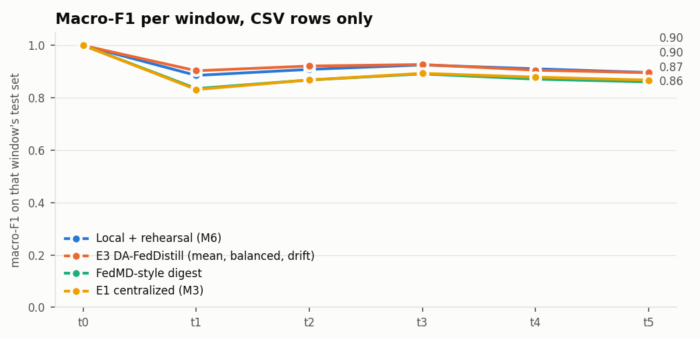

# M7: DA-FedDistill (`full` pool)

Run `20261115-014546_m7_distill_full`. Generated by `scripts/m7_distill.py`. Seed 43. Scores use CSV-only rows (D7), and each row is scored by its own client's model. Check against M6: the local models here score 0.9208 on window average and 0.9210 in M6's report (difference -0.00015).

All E3 variants and local + rehearsal share the same local models, so differences between them come from g_t alone. FedMD trains its own models, adding 10 rounds per client per window on the consensus. The headline `e3` was fixed before any result: mean aggregation, class-balanced on pseudo-labels, with drift features.

Two additions the proposal doesn't name. Each client fits a temperature on its own validation rows after g_t, which can't change a predicted class. And `e3_guard`, a variant and not the headline: a client keeps g_t only if it beats the client's own model on those rows, which are also used for its early stopping, so that choice is mildly optimistic.

## Results

| method | window avg | avg excl. t0 | final (t5) | class forgetting | mean ECE |
|---|---:|---:|---:|---:|---:|
| Local + rehearsal (M6) | 0.9208 | 0.9051 | 0.8963 | 0.0210 | 0.0079 |
| E3 DA-FedDistill (mean, balanced, drift) | 0.9252 | 0.9103 | 0.8955 | 0.0292 | 0.0052 |
| E3, reliability-weighted | 0.9245 | 0.9095 | 0.8955 | 0.0283 | 0.0053 |
| E3, no class balance | 0.9222 | 0.9067 | 0.8997 | 0.0099 | 0.0080 |
| E3, no drift features | 0.9220 | 0.9066 | 0.8948 | 0.0211 | 0.0063 |
| E3, 8-bit uplink | 0.9258 | 0.9112 | 0.8959 | 0.0284 | 0.0065 |
| E3 + client guard (addition) | 0.9284 | 0.9142 | 0.9012 | 0.0236 | 0.0045 |
| FedMD-style digest | 0.8875 | 0.8651 | 0.8605 | 0.0327 | 0.0566 |
| Naive incremental (M6) | 0.9213 | 0.9057 | 0.8982 | 0.0254 |  |
| E1 centralized (M3) | 0.8897 | 0.8676 | 0.8673 | 0.0255 |  |
| Static centralized (M3) | 0.3924 | 0.2709 | 0.1691 | n/a |  |

| E3 minus | window avg | final (t5) |
|---|---:|---:|
| Local + rehearsal (M6) | +0.0043 | -0.0008 |
| Naive incremental (M6) | +0.0038 | -0.0027 |
| E1 centralized (M3) | +0.0355 | +0.0282 |
| Static centralized (M3) | +0.5328 | +0.7265 |
| FedMD-style digest | +0.0377 | +0.0350 |

## Macro-F1 per window

| method | t0 | t1 | t2 | t3 | t4 | t5 |
|---|---:|---:|---:|---:|---:|---:|
| Local + rehearsal (M6) | 1.000 | 0.885 | 0.908 | 0.925 | 0.910 | 0.896 |
| E3 DA-FedDistill (mean, balanced, drift) | 0.999 | 0.903 | 0.921 | 0.927 | 0.905 | 0.896 |
| E3, reliability-weighted | 0.999 | 0.902 | 0.920 | 0.927 | 0.903 | 0.896 |
| E3, no class balance | 1.000 | 0.901 | 0.919 | 0.932 | 0.882 | 0.900 |
| E3, no drift features | 0.999 | 0.895 | 0.911 | 0.928 | 0.904 | 0.895 |
| E3, 8-bit uplink | 0.999 | 0.905 | 0.921 | 0.928 | 0.906 | 0.896 |
| E3 + client guard (addition) | 1.000 | 0.906 | 0.923 | 0.929 | 0.912 | 0.901 |
| FedMD-style digest | 1.000 | 0.835 | 0.868 | 0.891 | 0.871 | 0.860 |
| Naive incremental (M6) | 1.000 | 0.885 | 0.909 | 0.925 | 0.911 | 0.898 |
| E1 centralized (M3) | 1.000 | 0.831 | 0.868 | 0.893 | 0.879 | 0.867 |
| Static centralized (M3) | 1.000 | 0.463 | 0.304 | 0.235 | 0.184 | 0.169 |

## F1 per class at t5

| method | benign | ddos | dos | recon | mqtt | spoofing |
|---|---:|---:|---:|---:|---:|---:|
| Local + rehearsal (M6) | 0.950 | 0.906 | 0.755 | 0.969 | 0.994 | 0.802 |
| E3 DA-FedDistill (mean, balanced, drift) | 0.940 | 0.925 | 0.776 | 0.966 | 0.995 | 0.771 |
| E3 + client guard (addition) | 0.948 | 0.921 | 0.777 | 0.969 | 0.995 | 0.798 |
| FedMD-style digest | 0.930 | 0.871 | 0.661 | 0.951 | 0.994 | 0.756 |

## Clients: g_t against the client's own model

Macro-F1 on each client's rows of the current window, over the classes present in them.

| window | clients better with g_t | worse | mean change | worst | best | mean client temperature | guard accepted g_t |
|---|---:|---:|---:|---:|---:|---:|---:|
| t0 | 1/15 | 6 | -0.0007 | -0.0092 | +0.0013 | 0.330 | 1/15 |
| t1 | 8/15 | 7 | +0.0081 | -0.0161 | +0.0430 | 0.179 | 8/15 |
| t2 | 7/15 | 8 | +0.0059 | -0.0506 | +0.1071 | 0.187 | 6/15 |
| t3 | 3/15 | 12 | -0.0233 | -0.1574 | +0.0172 | 0.219 | 7/15 |
| t4 | 2/15 | 13 | -0.0184 | -0.0930 | +0.0115 | 0.216 | 4/15 |
| t5 | 5/15 | 10 | -0.0024 | -0.0456 | +0.0245 | 0.214 | 7/15 |

## Pseudo-label quality on D_pub

Macro-F1 against D_pub's true labels. These are read for this table only and never reach a fit.

| through | public rows | pseudo-labels (mean) | pseudo-labels (reliability) | mean client, local | mean client, g_t |
|---|---:|---:|---:|---:|---:|
| t0 | 27,222 | 1.000 | 1.000 | 0.999 | 0.999 |
| t1 | 85,681 | 0.827 | 0.827 | 0.746 | 0.763 |
| t2 | 86,737 | 0.863 | 0.863 | 0.766 | 0.790 |
| t3 | 90,004 | 0.887 | 0.887 | 0.808 | 0.828 |
| t4 | 90,182 | 0.821 | 0.806 | 0.734 | 0.746 |
| t5 | 90,429 | 0.818 | 0.817 | 0.727 | 0.739 |

## Communication per client per round

15 clients, 6 rounds. Whole run: E3 sends 338.6 MB up as float32 and 16.5 MB as 8-bit + zlib, and 35.3 kB down. FedMD sends 8.2 MB up and 10.1 MB down (8-bit + zlib). The 8-bit uplink's accuracy is the `E3, 8-bit uplink` row above. g_t adds about 0.8 µs per flow at inference, batched.

| through | public rows | E3 up, float32 (MB) | E3 up, 8-bit (MB) | E3 up, 8-bit + zlib (MB) | E3 down (bytes) | FedMD up, 8-bit + zlib (MB) | FedMD down, 8-bit + zlib (MB) |
|---|---:|---:|---:|---:|---:|---:|---:|
| t0 | 27,222 | 1.307 | 0.327 | 0.008 | 392 | 0.000 | 0.001 |
| t1 | 85,681 | 4.113 | 1.028 | 0.206 | 392 | 0.099 | 0.120 |
| t2 | 86,737 | 4.163 | 1.041 | 0.213 | 392 | 0.107 | 0.133 |
| t3 | 90,004 | 4.320 | 1.080 | 0.221 | 392 | 0.112 | 0.139 |
| t4 | 90,182 | 4.329 | 1.082 | 0.222 | 392 | 0.114 | 0.140 |
| t5 | 90,429 | 4.341 | 1.085 | 0.232 | 392 | 0.117 | 0.140 |

## Gate with the cloud's thresholds

The cloud picks τc and τd on D_pub for the most disagreement with the consensus caught, within the 10% budget (an assumption, see M5). D_pub's class mix is not a client's, so test rates can leave the budget. Local + rehearsal is shown with the same thresholds, for reference. Next-window rows show the old model facing new traffic.

| model through | eval window | τc | τd | method | error rate | escalated | errors caught | accuracy on the rest |
|---|---|---:|---:|---|---:|---:|---:|---:|
| t0 | t0 | 0.40 | 0.02 | E3 DA-FedDistill (mean, balanced, drift) | 0.000 | 0.002 | 0.789 | 1.000 |
| t0 | t0 | 0.40 | 0.02 | Local + rehearsal (M6) | 0.000 | 0.002 | 0.556 | 1.000 |
| t0 | t1 | 0.40 | 0.02 | E3 DA-FedDistill (mean, balanced, drift) | 0.741 | 0.002 | 0.002 | 0.259 |
| t0 | t1 | 0.40 | 0.02 | Local + rehearsal (M6) | 0.741 | 0.002 | 0.002 | 0.259 |
| t1 | t1 | 0.64 | 0.2 | E3 DA-FedDistill (mean, balanced, drift) | 0.105 | 0.072 | 0.303 | 0.921 |
| t1 | t1 | 0.64 | 0.2 | Local + rehearsal (M6) | 0.135 | 0.110 | 0.359 | 0.903 |
| t1 | t2 | 0.64 | 0.2 | E3 DA-FedDistill (mean, balanced, drift) | 0.119 | 0.081 | 0.352 | 0.916 |
| t1 | t2 | 0.64 | 0.2 | Local + rehearsal (M6) | 0.149 | 0.118 | 0.397 | 0.898 |
| t2 | t2 | 0.62 | 0.3 | E3 DA-FedDistill (mean, balanced, drift) | 0.103 | 0.071 | 0.293 | 0.921 |
| t2 | t2 | 0.62 | 0.3 | Local + rehearsal (M6) | 0.134 | 0.094 | 0.318 | 0.899 |
| t2 | t3 | 0.62 | 0.3 | E3 DA-FedDistill (mean, balanced, drift) | 0.161 | 0.106 | 0.428 | 0.897 |
| t2 | t3 | 0.62 | 0.3 | Local + rehearsal (M6) | 0.189 | 0.132 | 0.439 | 0.878 |
| t3 | t3 | 0.62 | 1.01 | E3 DA-FedDistill (mean, balanced, drift) | 0.112 | 0.073 | 0.279 | 0.913 |
| t3 | t3 | 0.62 | 1.01 | Local + rehearsal (M6) | 0.125 | 0.088 | 0.323 | 0.907 |
| t3 | t4 | 0.62 | 1.01 | E3 DA-FedDistill (mean, balanced, drift) | 0.116 | 0.072 | 0.268 | 0.908 |
| t3 | t4 | 0.62 | 1.01 | Local + rehearsal (M6) | 0.130 | 0.087 | 0.315 | 0.902 |
| t4 | t4 | 0.62 | 1.01 | E3 DA-FedDistill (mean, balanced, drift) | 0.109 | 0.072 | 0.286 | 0.916 |
| t4 | t4 | 0.62 | 1.01 | Local + rehearsal (M6) | 0.125 | 0.086 | 0.316 | 0.906 |
| t4 | t5 | 0.62 | 1.01 | E3 DA-FedDistill (mean, balanced, drift) | 0.141 | 0.065 | 0.198 | 0.879 |
| t4 | t5 | 0.62 | 1.01 | Local + rehearsal (M6) | 0.158 | 0.076 | 0.231 | 0.869 |
| t5 | t5 | 0.60 | 0.4 | E3 DA-FedDistill (mean, balanced, drift) | 0.103 | 0.066 | 0.293 | 0.922 |
| t5 | t5 | 0.60 | 0.4 | Local + rehearsal (M6) | 0.123 | 0.077 | 0.289 | 0.905 |

Parameters of every g_t are in `calibrators.json`; per-client and per-class tables are in `per_client.csv` and `per_class.csv`.
