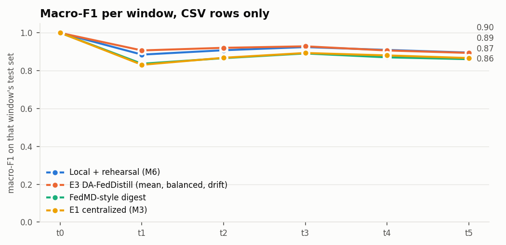

# M7: DA-FedDistill (`full` pool)

Run `20261115-021407_m7_distill_full`. Generated by `scripts/m7_distill.py`. Seed 44. Scores use CSV-only rows (D7), and each row is scored by its own client's model. Check against M6: the local models here score 0.9202 on window average and 0.9204 in M6's report (difference -0.00018).

All E3 variants and local + rehearsal share the same local models, so differences between them come from g_t alone. FedMD trains its own models, adding 10 rounds per client per window on the consensus. The headline `e3` was fixed before any result: mean aggregation, class-balanced on pseudo-labels, with drift features.

Two additions the proposal doesn't name. Each client fits a temperature on its own validation rows after g_t, which can't change a predicted class. And `e3_guard`, a variant and not the headline: a client keeps g_t only if it beats the client's own model on those rows, which are also used for its early stopping, so that choice is mildly optimistic.

## Results

| method | window avg | avg excl. t0 | final (t5) | class forgetting | mean ECE |
|---|---:|---:|---:|---:|---:|
| Local + rehearsal (M6) | 0.9202 | 0.9043 | 0.8954 | 0.0225 | 0.0081 |
| E3 DA-FedDistill (mean, balanced, drift) | 0.9259 | 0.9112 | 0.8937 | 0.0326 | 0.0060 |
| E3, reliability-weighted | 0.9251 | 0.9102 | 0.8944 | 0.0291 | 0.0058 |
| E3, no class balance | 0.9222 | 0.9067 | 0.9007 | 0.0053 | 0.0075 |
| E3, no drift features | 0.9235 | 0.9083 | 0.8948 | 0.0235 | 0.0063 |
| E3, 8-bit uplink | 0.9256 | 0.9109 | 0.8962 | 0.0286 | 0.0065 |
| E3 + client guard (addition) | 0.9280 | 0.9137 | 0.8999 | 0.0249 | 0.0051 |
| FedMD-style digest | 0.8873 | 0.8648 | 0.8605 | 0.0311 | 0.0563 |
| Naive incremental (M6) | 0.9212 | 0.9055 | 0.8975 | 0.0257 |  |
| E1 centralized (M3) | 0.8898 | 0.8678 | 0.8665 | 0.0294 |  |
| Static centralized (M3) | 0.3923 | 0.2708 | 0.1689 | n/a |  |

| E3 minus | window avg | final (t5) |
|---|---:|---:|
| Local + rehearsal (M6) | +0.0057 | -0.0017 |
| Naive incremental (M6) | +0.0047 | -0.0039 |
| E1 centralized (M3) | +0.0360 | +0.0272 |
| Static centralized (M3) | +0.5335 | +0.7247 |
| FedMD-style digest | +0.0386 | +0.0331 |

## Macro-F1 per window

| method | t0 | t1 | t2 | t3 | t4 | t5 |
|---|---:|---:|---:|---:|---:|---:|
| Local + rehearsal (M6) | 1.000 | 0.885 | 0.908 | 0.925 | 0.909 | 0.895 |
| E3 DA-FedDistill (mean, balanced, drift) | 0.999 | 0.907 | 0.921 | 0.929 | 0.907 | 0.894 |
| E3, reliability-weighted | 0.999 | 0.906 | 0.920 | 0.928 | 0.902 | 0.894 |
| E3, no class balance | 0.999 | 0.904 | 0.919 | 0.933 | 0.877 | 0.901 |
| E3, no drift features | 0.999 | 0.897 | 0.915 | 0.930 | 0.905 | 0.895 |
| E3, 8-bit uplink | 0.999 | 0.904 | 0.920 | 0.930 | 0.905 | 0.896 |
| E3 + client guard (addition) | 1.000 | 0.909 | 0.917 | 0.932 | 0.911 | 0.900 |
| FedMD-style digest | 1.000 | 0.836 | 0.866 | 0.891 | 0.870 | 0.861 |
| Naive incremental (M6) | 1.000 | 0.886 | 0.908 | 0.926 | 0.910 | 0.898 |
| E1 centralized (M3) | 1.000 | 0.831 | 0.868 | 0.893 | 0.880 | 0.866 |
| Static centralized (M3) | 1.000 | 0.463 | 0.304 | 0.235 | 0.184 | 0.169 |

## F1 per class at t5

| method | benign | ddos | dos | recon | mqtt | spoofing |
|---|---:|---:|---:|---:|---:|---:|
| Local + rehearsal (M6) | 0.951 | 0.906 | 0.755 | 0.969 | 0.994 | 0.796 |
| E3 DA-FedDistill (mean, balanced, drift) | 0.941 | 0.924 | 0.771 | 0.965 | 0.994 | 0.766 |
| E3 + client guard (addition) | 0.949 | 0.921 | 0.777 | 0.968 | 0.994 | 0.790 |
| FedMD-style digest | 0.929 | 0.872 | 0.661 | 0.953 | 0.994 | 0.755 |

## Clients: g_t against the client's own model

Macro-F1 on each client's rows of the current window, over the classes present in them.

| window | clients better with g_t | worse | mean change | worst | best | mean client temperature | guard accepted g_t |
|---|---:|---:|---:|---:|---:|---:|---:|
| t0 | 2/15 | 6 | +0.0079 | -0.0031 | +0.0715 | 0.346 | 2/15 |
| t1 | 8/15 | 7 | +0.0087 | -0.0254 | +0.0491 | 0.178 | 10/15 |
| t2 | 7/15 | 8 | -0.0033 | -0.0630 | +0.0402 | 0.186 | 7/15 |
| t3 | 5/15 | 10 | -0.0125 | -0.0576 | +0.0234 | 0.212 | 8/15 |
| t4 | 5/15 | 10 | -0.0190 | -0.1491 | +0.0223 | 0.213 | 7/15 |
| t5 | 8/15 | 7 | -0.0013 | -0.0628 | +0.0156 | 0.218 | 8/15 |

## Pseudo-label quality on D_pub

Macro-F1 against D_pub's true labels. These are read for this table only and never reach a fit.

| through | public rows | pseudo-labels (mean) | pseudo-labels (reliability) | mean client, local | mean client, g_t |
|---|---:|---:|---:|---:|---:|
| t0 | 27,222 | 1.000 | 1.000 | 0.998 | 0.999 |
| t1 | 85,681 | 0.826 | 0.827 | 0.745 | 0.762 |
| t2 | 86,737 | 0.863 | 0.863 | 0.762 | 0.784 |
| t3 | 90,004 | 0.886 | 0.887 | 0.809 | 0.827 |
| t4 | 90,182 | 0.822 | 0.802 | 0.735 | 0.746 |
| t5 | 90,429 | 0.814 | 0.811 | 0.732 | 0.741 |

## Communication per client per round

15 clients, 6 rounds. Whole run: E3 sends 338.6 MB up as float32 and 16.5 MB as 8-bit + zlib, and 35.3 kB down. FedMD sends 8.2 MB up and 10.0 MB down (8-bit + zlib). The 8-bit uplink's accuracy is the `E3, 8-bit uplink` row above. g_t adds about 0.8 µs per flow at inference, batched.

| through | public rows | E3 up, float32 (MB) | E3 up, 8-bit (MB) | E3 up, 8-bit + zlib (MB) | E3 down (bytes) | FedMD up, 8-bit + zlib (MB) | FedMD down, 8-bit + zlib (MB) |
|---|---:|---:|---:|---:|---:|---:|---:|
| t0 | 27,222 | 1.307 | 0.327 | 0.008 | 392 | 0.001 | 0.002 |
| t1 | 85,681 | 4.113 | 1.028 | 0.205 | 392 | 0.099 | 0.121 |
| t2 | 86,737 | 4.163 | 1.041 | 0.214 | 392 | 0.107 | 0.133 |
| t3 | 90,004 | 4.320 | 1.080 | 0.221 | 392 | 0.110 | 0.137 |
| t4 | 90,182 | 4.329 | 1.082 | 0.223 | 392 | 0.111 | 0.138 |
| t5 | 90,429 | 4.341 | 1.085 | 0.232 | 392 | 0.117 | 0.139 |

## Gate with the cloud's thresholds

The cloud picks τc and τd on D_pub for the most disagreement with the consensus caught, within the 10% budget (an assumption, see M5). D_pub's class mix is not a client's, so test rates can leave the budget. Local + rehearsal is shown with the same thresholds, for reference. Next-window rows show the old model facing new traffic.

| model through | eval window | τc | τd | method | error rate | escalated | errors caught | accuracy on the rest |
|---|---|---:|---:|---|---:|---:|---:|---:|
| t0 | t0 | 0.90 | 0.02 | E3 DA-FedDistill (mean, balanced, drift) | 0.000 | 0.003 | 0.909 | 1.000 |
| t0 | t0 | 0.90 | 0.02 | Local + rehearsal (M6) | 0.000 | 0.003 | 0.818 | 1.000 |
| t0 | t1 | 0.90 | 0.02 | E3 DA-FedDistill (mean, balanced, drift) | 0.741 | 0.002 | 0.002 | 0.259 |
| t0 | t1 | 0.90 | 0.02 | Local + rehearsal (M6) | 0.741 | 0.002 | 0.002 | 0.259 |
| t1 | t1 | 0.62 | 0.15 | E3 DA-FedDistill (mean, balanced, drift) | 0.100 | 0.072 | 0.300 | 0.924 |
| t1 | t1 | 0.62 | 0.15 | Local + rehearsal (M6) | 0.136 | 0.103 | 0.329 | 0.898 |
| t1 | t2 | 0.62 | 0.15 | E3 DA-FedDistill (mean, balanced, drift) | 0.114 | 0.081 | 0.350 | 0.919 |
| t1 | t2 | 0.62 | 0.15 | Local + rehearsal (M6) | 0.150 | 0.111 | 0.365 | 0.893 |
| t2 | t2 | 0.60 | 0.15 | E3 DA-FedDistill (mean, balanced, drift) | 0.102 | 0.067 | 0.255 | 0.919 |
| t2 | t2 | 0.60 | 0.15 | Local + rehearsal (M6) | 0.134 | 0.093 | 0.295 | 0.896 |
| t2 | t3 | 0.60 | 0.15 | E3 DA-FedDistill (mean, balanced, drift) | 0.159 | 0.111 | 0.456 | 0.903 |
| t2 | t3 | 0.60 | 0.15 | Local + rehearsal (M6) | 0.189 | 0.136 | 0.453 | 0.880 |
| t3 | t3 | 0.60 | 0.2 | E3 DA-FedDistill (mean, balanced, drift) | 0.109 | 0.064 | 0.256 | 0.914 |
| t3 | t3 | 0.60 | 0.2 | Local + rehearsal (M6) | 0.126 | 0.081 | 0.285 | 0.902 |
| t3 | t4 | 0.60 | 0.2 | E3 DA-FedDistill (mean, balanced, drift) | 0.113 | 0.065 | 0.253 | 0.910 |
| t3 | t4 | 0.60 | 0.2 | Local + rehearsal (M6) | 0.131 | 0.082 | 0.286 | 0.898 |
| t4 | t4 | 0.62 | 0.5 | E3 DA-FedDistill (mean, balanced, drift) | 0.108 | 0.070 | 0.284 | 0.917 |
| t4 | t4 | 0.62 | 0.5 | Local + rehearsal (M6) | 0.126 | 0.086 | 0.310 | 0.905 |
| t4 | t5 | 0.62 | 0.5 | E3 DA-FedDistill (mean, balanced, drift) | 0.139 | 0.068 | 0.209 | 0.882 |
| t4 | t5 | 0.62 | 0.5 | Local + rehearsal (M6) | 0.159 | 0.078 | 0.230 | 0.867 |
| t5 | t5 | 0.60 | 0.4 | E3 DA-FedDistill (mean, balanced, drift) | 0.105 | 0.064 | 0.279 | 0.919 |
| t5 | t5 | 0.60 | 0.4 | Local + rehearsal (M6) | 0.123 | 0.079 | 0.292 | 0.905 |

Parameters of every g_t are in `calibrators.json`; per-client and per-class tables are in `per_client.csv` and `per_class.csv`.
