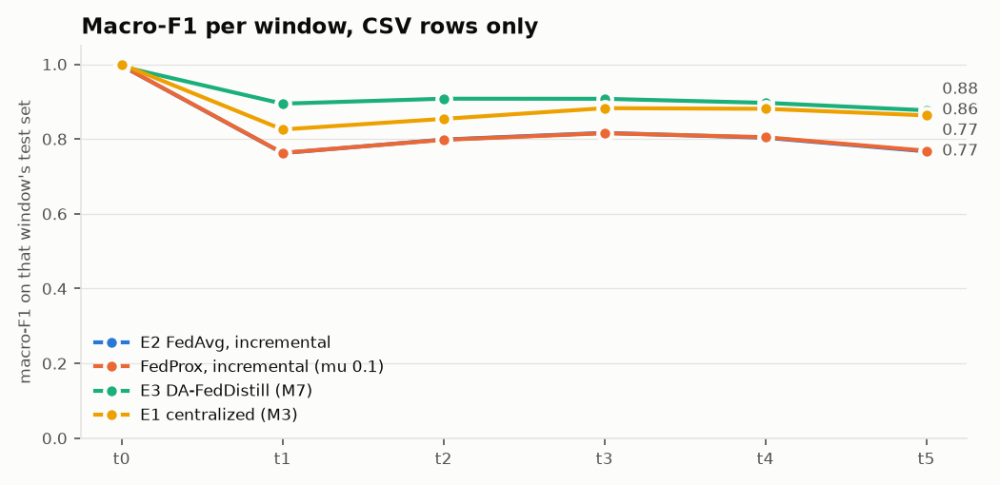

# M8: FedAvg and FedProx on an MLP (`dev` pool)

Run `20261106-230556_m8_fedavg_dev`. Generated by `scripts/m8_fedavg.py`. Seed 42. Scores use CSV-only rows (D7), and one global model scores every row. Same partitions, test rows, rehearsal buffers and validation rows as E3.

MLP: hidden layers [128, 64], 14,278 parameters (57 kB as float32). At most 50 rounds per window with patience 5, 1 local epoch(s), SGD at lr 0.1 with momentum 0.9, batch 512, class-balanced loss per client, a temperature fitted on validation rows. All of these are assumptions: the proposal names FedAvg and FedProx with an MLP and sets none of them.

`fedprox` is the mu with the best validation score, chosen without test rows. `fedavg_no_rehearsal` is an addition.

## Results

| method | window avg | avg excl. t0 | final (t5) | class forgetting | mean ECE |
|---|---:|---:|---:|---:|---:|
| E2 FedAvg, incremental | 0.8241 | 0.7896 | 0.7671 | 0.1111 | 0.0617 |
| E2 FedAvg, none (t0 only) | 0.3371 | 0.2053 | 0.0745 | n/a |  |
| FedAvg, no rehearsal (addition) | 0.8229 | 0.7882 | 0.7744 | 0.1096 | 0.0699 |
| FedProx, incremental (mu 0.1) | 0.8244 | 0.7900 | 0.7687 | 0.1144 | 0.0655 |
| FedProx, none (t0 only) | 0.3372 | 0.2054 | 0.0746 | n/a |  |
| FedProx, mu 0.001 | 0.8230 | 0.7883 | 0.7615 | 0.1083 | 0.0674 |
| FedProx, mu 0.01 | 0.8232 | 0.7886 | 0.7647 | 0.1101 | 0.0667 |
| FedProx, mu 0.1 | 0.8244 | 0.7900 | 0.7687 | 0.1144 | 0.0655 |
| FedProx, mu 1 | 0.7948 | 0.7545 | 0.7224 | 0.1226 | 0.0630 |
| Local + rehearsal (M6) | 0.9114 | 0.8940 | 0.8796 | 0.0270 | 0.0097 |
| E3 DA-FedDistill (M7) | 0.9130 | 0.8968 | 0.8768 | 0.0323 | 0.0141 |
| E3 + client guard (M7) | 0.9158 | 0.8995 | 0.8822 | 0.0286 | 0.0065 |
| FedMD-style digest (M7) | 0.8733 | 0.8486 | 0.8479 | 0.0431 | 0.0397 |
| Naive incremental (M6) | 0.9122 | 0.8950 | 0.8812 | 0.0332 |  |
| E1 centralized (M3) | 0.8844 | 0.8612 | 0.8632 | 0.0370 |  |
| Static centralized (M3) | 0.3460 | 0.2152 | 0.0779 | n/a |  |

| FedAvg minus | window avg | final (t5) |
|---|---:|---:|
| E3 DA-FedDistill (M7) | -0.0889 | -0.1098 |
| Local + rehearsal (M6) | -0.0873 | -0.1126 |
| FedMD-style digest (M7) | -0.0492 | -0.0808 |
| E1 centralized (M3) | -0.0603 | -0.0962 |
| FedProx, incremental (mu 0.1) | -0.0003 | -0.0017 |

## Macro-F1 per window

| method | t0 | t1 | t2 | t3 | t4 | t5 |
|---|---:|---:|---:|---:|---:|---:|
| E2 FedAvg, incremental | 0.996 | 0.762 | 0.799 | 0.816 | 0.804 | 0.767 |
| E2 FedAvg, none (t0 only) | 0.996 | 0.458 | 0.296 | 0.113 | 0.086 | 0.074 |
| FedAvg, no rehearsal (addition) | 0.996 | 0.762 | 0.797 | 0.815 | 0.793 | 0.774 |
| FedProx, incremental (mu 0.1) | 0.996 | 0.763 | 0.798 | 0.816 | 0.805 | 0.769 |
| FedProx, none (t0 only) | 0.996 | 0.458 | 0.295 | 0.113 | 0.086 | 0.075 |
| FedProx, mu 0.001 | 0.996 | 0.765 | 0.796 | 0.817 | 0.802 | 0.761 |
| FedProx, mu 0.01 | 0.996 | 0.765 | 0.796 | 0.816 | 0.802 | 0.765 |
| FedProx, mu 0.1 | 0.996 | 0.763 | 0.798 | 0.816 | 0.805 | 0.769 |
| FedProx, mu 1 | 0.996 | 0.739 | 0.762 | 0.794 | 0.755 | 0.722 |
| Local + rehearsal (M6) | 0.998 | 0.877 | 0.899 | 0.914 | 0.901 | 0.880 |
| E3 DA-FedDistill (M7) | 0.994 | 0.895 | 0.908 | 0.908 | 0.897 | 0.877 |
| E3 + client guard (M7) | 0.998 | 0.895 | 0.908 | 0.913 | 0.899 | 0.882 |
| FedMD-style digest (M7) | 0.997 | 0.819 | 0.847 | 0.872 | 0.857 | 0.848 |
| Naive incremental (M6) | 0.999 | 0.876 | 0.900 | 0.914 | 0.904 | 0.881 |
| E1 centralized (M3) | 1.000 | 0.826 | 0.854 | 0.883 | 0.881 | 0.863 |
| Static centralized (M3) | 1.000 | 0.463 | 0.265 | 0.169 | 0.102 | 0.078 |

## F1 per class at t5

| method | benign | ddos | dos | recon | mqtt | spoofing |
|---|---:|---:|---:|---:|---:|---:|
| E2 FedAvg, incremental | 0.746 | 0.826 | 0.448 | 0.910 | 0.963 | 0.709 |
| FedAvg, no rehearsal (addition) | 0.744 | 0.834 | 0.453 | 0.918 | 0.966 | 0.731 |
| FedProx, incremental (mu 0.1) | 0.741 | 0.831 | 0.448 | 0.912 | 0.966 | 0.714 |
| E3 DA-FedDistill (M7) | 0.783 | 0.923 | 0.761 | 0.953 | 0.980 | 0.860 |

## FedProx mu sweep

| FedProx mu | mean best validation macro-F1 | window avg (test) | final t5 (test) | picked |
|---:|---:|---:|---:|---|
| 0.001 | 0.8377 | 0.8230 | 0.7615 |  |
| 0.01 | 0.8377 | 0.8232 | 0.7647 |  |
| 0.1 | 0.8384 | 0.8244 | 0.7687 | yes |
| 1 | 0.8210 | 0.7948 | 0.7224 |  |

## Rounds and communication

FedAvg, whole run: 173.0 MB up and down over 15 clients and 101 rounds (57 kB each way per client per round), plus 696 bytes per client once for the scaling statistics. Inference: 0.5 µs per flow, batched, at 4 threads.

| method | through | rounds run | best round | best validation | seconds | MB up + down, per client |
|---|---|---:|---:|---:|---:|---:|
| E2 FedAvg, incremental | t0 | 27 | 21 | 0.9988 | 3 | 3.08 |
| E2 FedAvg, incremental | t1 | 24 | 18 | 0.7745 | 7 | 2.74 |
| E2 FedAvg, incremental | t2 | 16 | 10 | 0.7966 | 4 | 1.83 |
| E2 FedAvg, incremental | t3 | 13 | 7 | 0.8337 | 4 | 1.48 |
| E2 FedAvg, incremental | t4 | 14 | 8 | 0.8196 | 5 | 1.60 |
| E2 FedAvg, incremental | t5 | 7 | 1 | 0.8099 | 3 | 0.80 |
| FedProx, mu 0.1 | t0 | 33 | 27 | 0.9992 | 3 | 3.77 |
| FedProx, mu 0.1 | t1 | 24 | 18 | 0.7679 | 8 | 2.74 |
| FedProx, mu 0.1 | t2 | 13 | 7 | 0.7981 | 5 | 1.48 |
| FedProx, mu 0.1 | t3 | 13 | 7 | 0.8338 | 5 | 1.48 |
| FedProx, mu 0.1 | t4 | 20 | 14 | 0.8212 | 9 | 2.28 |
| FedProx, mu 0.1 | t5 | 7 | 1 | 0.8103 | 4 | 0.80 |
