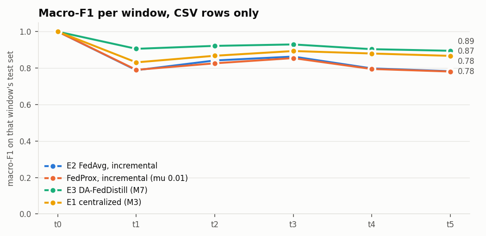

# M8: FedAvg and FedProx on an MLP (`full` pool)

Run `20261106-222708_m8_fedavg_full`. Generated by `scripts/m8_fedavg.py`. Seed 42. Scores use CSV-only rows (D7), and one global model scores every row. Same partitions, test rows, rehearsal buffers and validation rows as E3.

MLP: hidden layers [128, 64], 14,278 parameters (57 kB as float32). At most 50 rounds per window with patience 5, 1 local epoch(s), SGD at lr 0.03 with momentum 0.9, batch 512, class-balanced loss per client, a temperature fitted on validation rows. All of these are assumptions: the proposal names FedAvg and FedProx with an MLP and sets none of them.

`fedprox` is the mu with the best validation score, chosen without test rows. `fedavg_no_rehearsal` is an addition.

## Results

| method | window avg | avg excl. t0 | final (t5) | class forgetting | mean ECE |
|---|---:|---:|---:|---:|---:|
| E2 FedAvg, incremental | 0.8455 | 0.8147 | 0.7826 | 0.0678 | 0.0203 |
| E2 FedAvg, none (t0 only) | 0.3688 | 0.2426 | 0.1310 | n/a |  |
| FedAvg, no rehearsal (addition) | 0.8486 | 0.8183 | 0.7969 | 0.0607 | 0.0212 |
| FedProx, incremental (mu 0.01) | 0.8410 | 0.8093 | 0.7809 | 0.0670 | 0.0225 |
| FedProx, none (t0 only) | 0.3681 | 0.2418 | 0.1305 | n/a |  |
| FedProx, mu 0.001 | 0.8370 | 0.8044 | 0.7771 | 0.0771 | 0.0329 |
| FedProx, mu 0.01 | 0.8410 | 0.8093 | 0.7809 | 0.0670 | 0.0225 |
| FedProx, mu 0.1 | 0.8253 | 0.7905 | 0.7687 | 0.0841 | 0.0751 |
| FedProx, mu 1 | 0.8099 | 0.7724 | 0.7503 | 0.0745 | 0.0877 |
| Local + rehearsal (M6) | 0.9210 | 0.9053 | 0.8972 | 0.0218 | 0.0081 |
| E3 DA-FedDistill (M7) | 0.9257 | 0.9109 | 0.8947 | 0.0245 | 0.0054 |
| E3 + client guard (M7) | 0.9288 | 0.9146 | 0.8986 | 0.0249 | 0.0044 |
| FedMD-style digest (M7) | 0.8872 | 0.8647 | 0.8598 | 0.0324 | 0.0568 |
| Naive incremental (M6) | 0.9211 | 0.9054 | 0.8979 | 0.0240 |  |
| E1 centralized (M3) | 0.8897 | 0.8677 | 0.8668 | 0.0277 |  |
| Static centralized (M3) | 0.4024 | 0.2829 | 0.1840 | n/a |  |

| FedAvg minus | window avg | final (t5) |
|---|---:|---:|
| E3 DA-FedDistill (M7) | -0.0802 | -0.1120 |
| Local + rehearsal (M6) | -0.0755 | -0.1146 |
| FedMD-style digest (M7) | -0.0417 | -0.0772 |
| E1 centralized (M3) | -0.0442 | -0.0842 |
| FedProx, incremental (mu 0.01) | +0.0045 | +0.0018 |

## Macro-F1 per window

| method | t0 | t1 | t2 | t3 | t4 | t5 |
|---|---:|---:|---:|---:|---:|---:|
| E2 FedAvg, incremental | 1.000 | 0.788 | 0.842 | 0.863 | 0.798 | 0.783 |
| E2 FedAvg, none (t0 only) | 1.000 | 0.461 | 0.317 | 0.168 | 0.136 | 0.131 |
| FedAvg, no rehearsal (addition) | 1.000 | 0.788 | 0.834 | 0.866 | 0.807 | 0.797 |
| FedProx, incremental (mu 0.01) | 1.000 | 0.790 | 0.826 | 0.855 | 0.795 | 0.781 |
| FedProx, none (t0 only) | 1.000 | 0.461 | 0.315 | 0.167 | 0.135 | 0.130 |
| FedProx, mu 0.001 | 1.000 | 0.785 | 0.822 | 0.848 | 0.789 | 0.777 |
| FedProx, mu 0.01 | 1.000 | 0.790 | 0.826 | 0.855 | 0.795 | 0.781 |
| FedProx, mu 0.1 | 0.999 | 0.759 | 0.810 | 0.838 | 0.776 | 0.769 |
| FedProx, mu 1 | 0.997 | 0.746 | 0.797 | 0.815 | 0.754 | 0.750 |
| Local + rehearsal (M6) | 1.000 | 0.885 | 0.908 | 0.925 | 0.911 | 0.897 |
| E3 DA-FedDistill (M7) | 0.999 | 0.905 | 0.922 | 0.929 | 0.904 | 0.895 |
| E3 + client guard (M7) | 1.000 | 0.907 | 0.924 | 0.933 | 0.910 | 0.899 |
| FedMD-style digest (M7) | 1.000 | 0.836 | 0.866 | 0.892 | 0.869 | 0.860 |
| Naive incremental (M6) | 1.000 | 0.885 | 0.909 | 0.925 | 0.910 | 0.898 |
| E1 centralized (M3) | 1.000 | 0.831 | 0.867 | 0.893 | 0.880 | 0.867 |
| Static centralized (M3) | 1.000 | 0.463 | 0.324 | 0.250 | 0.194 | 0.184 |

## F1 per class at t5

| method | benign | ddos | dos | recon | mqtt | spoofing |
|---|---:|---:|---:|---:|---:|---:|
| E2 FedAvg, incremental | 0.839 | 0.836 | 0.570 | 0.938 | 0.990 | 0.523 |
| FedAvg, no rehearsal (addition) | 0.869 | 0.840 | 0.576 | 0.917 | 0.991 | 0.588 |
| FedProx, incremental (mu 0.01) | 0.848 | 0.820 | 0.551 | 0.938 | 0.990 | 0.537 |
| E3 DA-FedDistill (M7) | 0.940 | 0.925 | 0.776 | 0.963 | 0.995 | 0.769 |

## FedProx mu sweep

| FedProx mu | mean best validation macro-F1 | window avg (test) | final t5 (test) | picked |
|---:|---:|---:|---:|---|
| 0.001 | 0.8459 | 0.8370 | 0.7771 |  |
| 0.01 | 0.8492 | 0.8410 | 0.7809 | yes |
| 0.1 | 0.8349 | 0.8253 | 0.7687 |  |
| 1 | 0.8208 | 0.8099 | 0.7503 |  |

## Rounds and communication

FedAvg, whole run: 227.9 MB up and down over 15 clients and 133 rounds (57 kB each way per client per round), plus 696 bytes per client once for the scaling statistics. Inference: 0.5 µs per flow, batched, at 4 threads.

| method | through | rounds run | best round | best validation | seconds | MB up + down, per client |
|---|---|---:|---:|---:|---:|---:|
| E2 FedAvg, incremental | t0 | 26 | 20 | 0.9997 | 38 | 2.97 |
| E2 FedAvg, incremental | t1 | 31 | 25 | 0.7890 | 151 | 3.54 |
| E2 FedAvg, incremental | t2 | 42 | 36 | 0.8459 | 201 | 4.80 |
| E2 FedAvg, incremental | t3 | 8 | 2 | 0.8706 | 48 | 0.91 |
| E2 FedAvg, incremental | t4 | 6 | 0 | 0.8056 | 36 | 0.69 |
| E2 FedAvg, incremental | t5 | 20 | 14 | 0.8107 | 113 | 2.28 |
| FedProx, mu 0.01 | t0 | 28 | 22 | 0.9997 | 42 | 3.20 |
| FedProx, mu 0.01 | t1 | 39 | 33 | 0.7903 | 209 | 4.45 |
| FedProx, mu 0.01 | t2 | 14 | 8 | 0.8316 | 76 | 1.60 |
| FedProx, mu 0.01 | t3 | 13 | 7 | 0.8621 | 77 | 1.48 |
| FedProx, mu 0.01 | t4 | 14 | 8 | 0.8043 | 82 | 1.60 |
| FedProx, mu 0.01 | t5 | 20 | 14 | 0.8072 | 116 | 2.28 |
