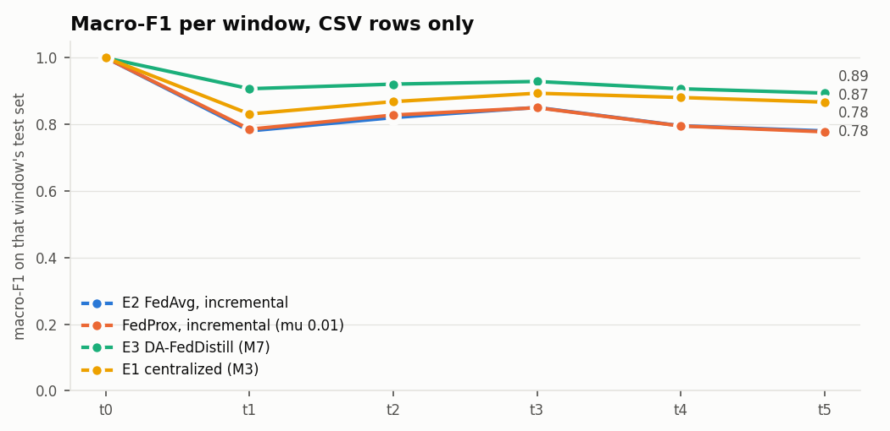

# M8: FedAvg and FedProx on an MLP (`full` pool)

Run `20261115-031506_m8_fedavg_full`. Generated by `scripts/m8_fedavg.py`. Seed 44. Scores use CSV-only rows (D7), and one global model scores every row. Same partitions, test rows, rehearsal buffers and validation rows as E3.

MLP: hidden layers [128, 64], 14,278 parameters (57 kB as float32). At most 50 rounds per window with patience 5, 1 local epoch(s), SGD at lr 0.03 with momentum 0.9, batch 512, class-balanced loss per client, a temperature fitted on validation rows. All of these are assumptions: the proposal names FedAvg and FedProx with an MLP and sets none of them.

`fedprox` is the mu with the best validation score, chosen without test rows. `fedavg_no_rehearsal` is an addition.

## Results

| method | window avg | avg excl. t0 | final (t5) | class forgetting | mean ECE |
|---|---:|---:|---:|---:|---:|
| E2 FedAvg, incremental | 0.8376 | 0.8053 | 0.7800 | 0.0699 | 0.0363 |
| E2 FedAvg, none (t0 only) | 0.3798 | 0.2558 | 0.1465 | n/a |  |
| FedAvg, no rehearsal (addition) | 0.8445 | 0.8135 | 0.7872 | 0.0577 | 0.0177 |
| FedProx, incremental (mu 0.01) | 0.8391 | 0.8070 | 0.7774 | 0.0698 | 0.0265 |
| FedProx, none (t0 only) | 0.3795 | 0.2555 | 0.1459 | n/a |  |
| FedProx, mu 0.001 | 0.8362 | 0.8036 | 0.7749 | 0.0741 | 0.0363 |
| FedProx, mu 0.01 | 0.8391 | 0.8070 | 0.7774 | 0.0698 | 0.0265 |
| FedProx, mu 0.1 | 0.8233 | 0.7884 | 0.7644 | 0.0847 | 0.0770 |
| FedProx, mu 1 | 0.8122 | 0.7751 | 0.7472 | 0.0865 | 0.0666 |
| Local + rehearsal (M6) | 0.9202 | 0.9043 | 0.8954 | 0.0225 | 0.0081 |
| E3 DA-FedDistill (M7) | 0.9259 | 0.9112 | 0.8937 | 0.0326 | 0.0060 |
| E3 + client guard (M7) | 0.9280 | 0.9137 | 0.8999 | 0.0249 | 0.0051 |
| FedMD-style digest (M7) | 0.8873 | 0.8648 | 0.8605 | 0.0311 | 0.0563 |
| Naive incremental (M6) | 0.9212 | 0.9055 | 0.8975 | 0.0257 |  |
| E1 centralized (M3) | 0.8898 | 0.8678 | 0.8665 | 0.0294 |  |
| Static centralized (M3) | 0.3923 | 0.2708 | 0.1689 | n/a |  |

| FedAvg minus | window avg | final (t5) |
|---|---:|---:|
| E3 DA-FedDistill (M7) | -0.0882 | -0.1136 |
| Local + rehearsal (M6) | -0.0826 | -0.1153 |
| FedMD-style digest (M7) | -0.0496 | -0.0805 |
| E1 centralized (M3) | -0.0522 | -0.0864 |
| FedProx, incremental (mu 0.01) | -0.0014 | +0.0027 |

## Macro-F1 per window

| method | t0 | t1 | t2 | t3 | t4 | t5 |
|---|---:|---:|---:|---:|---:|---:|
| E2 FedAvg, incremental | 1.000 | 0.780 | 0.820 | 0.851 | 0.796 | 0.780 |
| E2 FedAvg, none (t0 only) | 1.000 | 0.461 | 0.335 | 0.187 | 0.150 | 0.146 |
| FedAvg, no rehearsal (addition) | 1.000 | 0.791 | 0.828 | 0.861 | 0.801 | 0.787 |
| FedProx, incremental (mu 0.01) | 1.000 | 0.785 | 0.828 | 0.850 | 0.795 | 0.777 |
| FedProx, none (t0 only) | 1.000 | 0.461 | 0.335 | 0.186 | 0.149 | 0.146 |
| FedProx, mu 0.001 | 1.000 | 0.782 | 0.821 | 0.845 | 0.795 | 0.775 |
| FedProx, mu 0.01 | 1.000 | 0.785 | 0.828 | 0.850 | 0.795 | 0.777 |
| FedProx, mu 0.1 | 0.998 | 0.757 | 0.805 | 0.834 | 0.782 | 0.764 |
| FedProx, mu 1 | 0.997 | 0.751 | 0.797 | 0.827 | 0.754 | 0.747 |
| Local + rehearsal (M6) | 1.000 | 0.885 | 0.908 | 0.925 | 0.909 | 0.895 |
| E3 DA-FedDistill (M7) | 0.999 | 0.907 | 0.921 | 0.929 | 0.907 | 0.894 |
| E3 + client guard (M7) | 1.000 | 0.909 | 0.917 | 0.932 | 0.911 | 0.900 |
| FedMD-style digest (M7) | 1.000 | 0.836 | 0.866 | 0.891 | 0.870 | 0.861 |
| Naive incremental (M6) | 1.000 | 0.886 | 0.908 | 0.926 | 0.910 | 0.898 |
| E1 centralized (M3) | 1.000 | 0.831 | 0.868 | 0.893 | 0.880 | 0.866 |
| Static centralized (M3) | 1.000 | 0.463 | 0.304 | 0.235 | 0.184 | 0.169 |

## F1 per class at t5

| method | benign | ddos | dos | recon | mqtt | spoofing |
|---|---:|---:|---:|---:|---:|---:|
| E2 FedAvg, incremental | 0.852 | 0.834 | 0.537 | 0.939 | 0.990 | 0.529 |
| FedAvg, no rehearsal (addition) | 0.855 | 0.816 | 0.569 | 0.924 | 0.991 | 0.568 |
| FedProx, incremental (mu 0.01) | 0.849 | 0.827 | 0.531 | 0.932 | 0.989 | 0.536 |
| E3 DA-FedDistill (M7) | 0.941 | 0.924 | 0.771 | 0.965 | 0.994 | 0.766 |

## FedProx mu sweep

| FedProx mu | mean best validation macro-F1 | window avg (test) | final t5 (test) | picked |
|---:|---:|---:|---:|---|
| 0.001 | 0.8453 | 0.8362 | 0.7749 |  |
| 0.01 | 0.8481 | 0.8391 | 0.7774 | yes |
| 0.1 | 0.8329 | 0.8233 | 0.7644 |  |
| 1 | 0.8233 | 0.8122 | 0.7472 |  |

## Rounds and communication

FedAvg, whole run: 166.2 MB up and down over 15 clients and 97 rounds (57 kB each way per client per round), plus 696 bytes per client once for the scaling statistics. Inference: 0.4 µs per flow, batched, at 4 threads.

| method | through | rounds run | best round | best validation | seconds | MB up + down, per client |
|---|---|---:|---:|---:|---:|---:|
| E2 FedAvg, incremental | t0 | 23 | 17 | 0.9995 | 40 | 2.63 |
| E2 FedAvg, incremental | t1 | 22 | 16 | 0.7820 | 115 | 2.51 |
| E2 FedAvg, incremental | t2 | 14 | 8 | 0.8260 | 73 | 1.60 |
| E2 FedAvg, incremental | t3 | 17 | 11 | 0.8572 | 92 | 1.94 |
| E2 FedAvg, incremental | t4 | 14 | 8 | 0.8043 | 71 | 1.60 |
| E2 FedAvg, incremental | t5 | 7 | 1 | 0.8089 | 38 | 0.80 |
| FedProx, mu 0.01 | t0 | 24 | 18 | 0.9995 | 36 | 2.74 |
| FedProx, mu 0.01 | t1 | 37 | 31 | 0.7861 | 195 | 4.23 |
| FedProx, mu 0.01 | t2 | 21 | 15 | 0.8332 | 113 | 2.40 |
| FedProx, mu 0.01 | t3 | 11 | 5 | 0.8587 | 62 | 1.26 |
| FedProx, mu 0.01 | t4 | 10 | 4 | 0.8041 | 57 | 1.14 |
| FedProx, mu 0.01 | t5 | 7 | 1 | 0.8072 | 40 | 0.80 |
